# 材料物性レビュー ① 木質ボード（合板・OSB・繊維板）

作成: 2026-10-21（Claude Code による調査）
対象: 旧 Excel（`whamcavity`）3 材料、新しい Excel（`mews_ashrae`）17 材料、合わせて 20 材料
比べた文献: 建築学会『建築材料の熱・空気・湿気物性値』p51〜59（合板・木繊維板・ウエハーボード・パーティクルボード）、エース建築環境工学Ⅱ 表 7.2（p40）、新しい Excel の出典 RR-110（MEWS）・Kumaran 2006（ASHRAE RP-1018）。文献の目録は `sources.md`、書き写した数値は `ref_data/wood_boards.csv`
図・指標: `make_figures_wood_boards.py`、`make_indicators.py`（`indicators.csv`）

---

## 1. まとめ

判定の基準は 2 章。

| 材料 | 熱 | 平衡含水率 | 湿気伝導率 | 液水拡散係数 | 主な点 | 節 |
|---|---|---|---|---|---|---|
| 構造用合板1（旧） | 要注意 | 妥当 | 妥当 | 要注意 | 熱伝導率 0.16 は文献（0.09〜0.12）より大きい | 3.1 |
| 構造用合板2（旧） | 要注意 | 妥当 | 要注意 | 要注意 | 湿気伝導率が一定。比熱 1300 は小さい。液水が動かない | 3.2 |
| MEWS Plywood | 妥当 | 妥当 | 妥当 | **誤りの疑い** | 液水拡散係数に OSB の測定値が入っている（表の取り違え） | 3.3 |
| ASHRAE Plywood -1 | 妥当 | 妥当 | 妥当 | 要注意 | 液水拡散係数が厚さ方向の目安の約 1/40 | 3.4 |
| ASHRAE Plywood -2 | 妥当 | 妥当 | 妥当 | 妥当 | 液水拡散係数は目安の約 1/8（下限に近い） | 3.5 |
| ASHRAE Plywood -3 | 妥当 | 妥当 | 妥当 | 要注意 | 液水拡散係数が目安の約 1/20 | 3.6 |
| MEWS Oriented Strand Board | 妥当 | **誤りの疑い** | 妥当 | 要注意 | RH 50% の含水率が文献・出典の約 1/4。液水拡散係数は目安の約 30 倍 | 4.1 |
| ASHRAE OSB -1 | 妥当 | 妥当 | 妥当 | 要注意 | 液水拡散係数が目安の約 1/70 | 4.2 |
| ASHRAE OSB -2 | 妥当 | 妥当 | 妥当 | 要注意 | 同上（約 1/55） | 4.3 |
| ASHRAE OSB -3 | 妥当 | 妥当 | 妥当 | 要注意 | 同上（約 1/60）。密度 600 は論文の 650 と違う | 4.4 |
| 軟質繊維版（旧） | 妥当 | 妥当 | 妥当 | 要注意 | 液水が動かない設定 | 5.1 |
| MEWS Fibreboard I - Paper Facer | 妥当 | 妥当 | 要注意 | 要注意 | μ 60〜90 は繊維板の範囲の外（表面の紙）。液水拡散係数は目安の約 50 倍 | 5.2 |
| MEWS Fibreboard II - Plain | 妥当 | 要注意 | 妥当 | 要注意 | RH 50% の含水率が文献より 2〜5 割低い。RH 100% で 3.25。液水拡散係数は目安の 16〜110 倍 | 5.3 |
| MEWS Fibreboard III - Foil Facer | 妥当 | **根拠なし** | 要注意 | 根拠なし | 水分物性がすべて 0 | 5.4 |
| MEWS Fibreboard IV - Plain | 妥当 | 妥当 | 妥当 | 妥当 | 液水拡散係数は目安の 5〜36 倍（上限に近い） | 5.5 |
| MEWS Fibreboard V - Black Coat | 妥当 | 妥当 | 妥当 | 要注意 | 液水拡散係数は目安の 33〜81 倍 | 5.6 |
| MEWS Fibreboard VI - Black Coat | 妥当 | 妥当 | 妥当 | 要注意 | 同上（190〜460 倍） | 5.7 |
| MEWS Fibreboard VII - Black Coat | 妥当 | 妥当 | 妥当 | 根拠なし | 液水は測っていない | 5.8 |
| MEWS Fibreboard VIII - Black Coat | 妥当 | 妥当 | 妥当 | 要注意 | 液水拡散係数は目安の 130〜330 倍 | 5.9 |
| ASHRAE Fibreboard | 妥当 | 要注意 | 妥当 | 要注意 | RH 50% の含水率が文献より 2〜5 割低い。RH 100% で 2.71。液水拡散係数は目安の 100 倍以上 | 5.10 |

**主な結論**
- **熱物性**は、ほとんどの材料が文献の範囲に入る。旧 Excel の構造用合板1・2 の熱伝導率 0.16 だけが、文献の合板（0.09〜0.12）より 3〜6 割大きい。構造用合板1 は今の壁の計算で使っている。
- **平衡含水率**は、ASHRAE の合板・OSB と旧 Excel の材料が文献とよく合う。MEWS OSB はふだんの湿度で含水量を約 1/4 に見積もる（誤りの疑い）。繊維板には、文献より 2〜5 割低いものがある（出典 RR-110 とは合う）。
- **湿気伝導率**は、値のある 19 材料すべてで μ > 1（ありえない値はない）。合板・OSB は湿度とともに湿気を通しやすくなる形で、文献の傾向と合う。
- **液水拡散係数**は、出典の測り方に大きく左右される。
  - MEWS Plywood の値は、出典 RR-110 の OSB の表を合板の密度で直したもので、表の取り違えと見られる（3.3 節）。
  - 厚さ方向の吸水係数から Künzel の式で求めた目安と比べると、**MEWS（RR-110）の値は目安より 1〜2 桁以上大きく、ASHRAE（RP-1018）の合板・OSB の値は 1〜2 桁小さい**。RR-110 は小口（端面）から吸水させて測った値で、方向の違いが理由の一つと考えられるが、同じ研究所の RP-1018 の合板が逆に小さい理由は、手元の資料では分からない。
  - 合板では、Künzel の式の目安と建築学会の本の式（Annex 14）がほぼ一致する（図 3-13）。厚さ方向の値としては、この 2 つが最も確からしい。

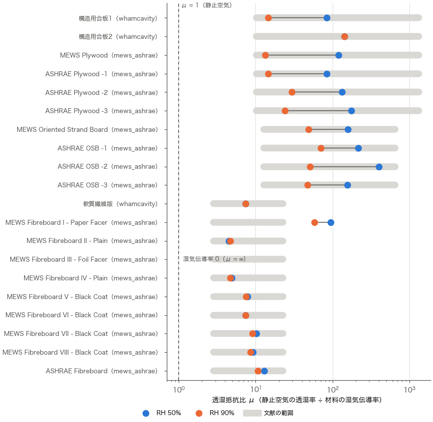
図 1-1　木質ボード 20 材料の透湿抵抗比 μ。青は RH 50%、橙は RH 90% の値。灰色の帯は、同じ種類の文献の測定値から求めた μ の最小〜最大で、**湿度による違いは表していない**（例：構造用合板2 は RH 90% で文献より 4〜10 倍通しにくいが、この帯の中に見える。3.2 節）。合板・OSB（μ 15〜400）と繊維板（μ 4〜13）の 2 つの群に分かれる。帯から外れるのは MEWS Fibreboard I（表面に紙）だけ。

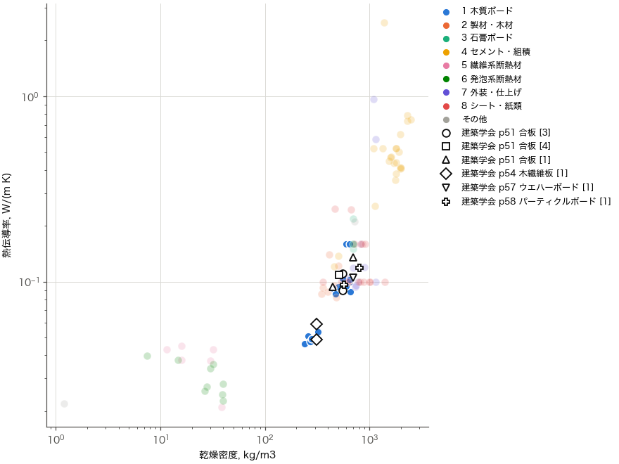
図 1-2　全 100 材料の熱伝導率と乾燥密度（両対数）。濃い青が木質ボード、黒い白抜きの印が文献の値。木質ボードは密度 240〜700 kg/m³ で、密度とともに熱伝導率が大きくなる。密度 600〜650 で 0.16 の 2 点が、旧 Excel の構造用合板1・2。

---

## 2. 見方

#### 判定の基準

| 判定 | 意味 |
|---|---|
| **妥当** | 文献の値の範囲に入る |
| **要注意** | 文献から外れるが理由が説明できる、または計算への影響が小さい |
| **誤りの疑い** | ありえない値、または写し間違い・当てはめの失敗と見られる |
| **根拠なし** | 比べられる値がない、または値が入っていない |

**液水拡散係数の判定**は、次の目安と比べて行った。

- 液水拡散係数は、測り方・解析のしかたで 1〜2 桁変わる（建築学会の本の付録 I・II：同じ試料で国ごとに 1〜2 桁違った）。また、木質ボードは方向によって値が違う。NRC（RR-110、RP-1018）の値は、**小口（端面）から吸水させて含水率の分布を測った**もの（RR-110 の合板・OSB・繊維板の節に「across / along the edges」とある）。壁の計算で水分が動くのは厚さ方向なので、方向がはっきりしている**厚さ方向の吸水係数**から目安を求めた。
- **厚さ方向の目安**：Künzel (1995) の経験式 Dws(w) = 3.8 · (A ÷ wf)² · 1000^(w ÷ wf − 1)。A は厚さ方向の吸水係数 kg/(m²·s^½)、w は含水量 kg/m³、wf は自由水飽和の含水量 kg/m³。wf は、その材料の平衡含水率の RH 99.8%（吸引圧 約 3×10⁵ Pa）の値で代用した。A は材料ごとに次の値を使った（材料そのものの値がないものは、同じ種類の値）。

| 材料 | 吸水係数 A, kg/(m²·s^½) | 出典 |
|---|---|---|
| 構造用合板1・2、ASHRAE Plywood -1〜3 | 0.003 | 建築学会 p53 合板 |
| MEWS Plywood | 0.0026 | RR-110 表 3.5 |
| MEWS OSB、ASHRAE OSB -1〜3 | 0.0022 | RR-110 表 3.5 OSB |
| MEWS Fibreboard I（Paper Facer） | 0.0019 | RR-110 表 8.4 |
| 軟質繊維版、MEWS Fibreboard II・IV（Plain）、ASHRAE Fibreboard | 0.0021〜0.0054 | RR-110 表 8.4 Plain（2 製品） |
| MEWS Fibreboard V・VI・VIII（Black Coat） | 0.00096〜0.0015 | RR-110 表 8.4 Black Coat（4 製品） |

- 比べるのは、**RH 99% の平衡含水率**での値とした。それより乾いた含水率では水蒸気の移動が主で、液水の目安（Künzel の式）は意味を持ちにくい。
- 目安との比が **0.1〜10 倍**なら妥当、それより外れれば要注意とした。目安の式は経験式で、wf の取り方でも数倍は変わるので、1 桁以内の違いは問わない。
- 液水が動かない設定（拡散係数 0）の材料は、文献では液水が動くので要注意とした。

#### 指標

- **透湿抵抗比 μ**：静止空気の透湿率（20 ℃ で 1.94×10⁻¹⁰ (kg/s)/(m·Pa)、Schirmer の式）÷ 材料の湿気伝導率。1 より小さいとありえない。
- **容積含水率 ψ(100%)**：RH 100% の含水率 × 密度 ÷ 1000。空隙率（木材なら およそ 1 − 密度 ÷ 1500、1500 kg/m³ は細胞壁の密度）を超えると、空隙を水で満たした以上の水を含むことになる。

#### 図の見方

- **青い線（熱物性の図では大きな青い点）**：検証する材料。**灰色の線**：同じグループのほかの材料（この材料が仲間の中でどこにいるかを見るため）。**黒い白抜きの印**：文献の値（凡例に文献・ページ・出典の番号 [n]・吸湿／放湿の別）。
- **熱物性の図**：両対数。薄い青は木質ボードのほかの材料、灰色はほかのカテゴリの材料。
- **平衡含水率の図**：縦軸は RH 98% までの値と文献の値が入る範囲にした（RH 100% 近くで急に大きくなる材料があるため）。
- **湿気伝導率の図**：対数目盛り。破線は静止空気の透湿率（μ = 1）で、これより上はありえない。文献の透湿率（カップ法）は、カップの両側の相対湿度の平均の位置に描いた（例：0/50% → 25%）。
- **液水拡散係数の図**：対数目盛り。縦の点線は、この材料の RH 80・95・99% の平衡含水率。黒い破線と灰色の帯は、厚さ方向の目安（Künzel の式。吸水係数に幅がある材料は上限と下限）。合板の文献の式 Dw = 3.2×10⁻¹³ exp(0.015 w)（w は kg/m³）は、密度 600 kg/m³ として含水率 u に直して描いた。

#### 文献の値について

- 書き写した数値（`ref_data/wood_boards.csv`）は、原典のページの画像と 2 回見比べて確かめた。原典の画像は、非公開リポジトリ `docs/reference/papers/review_images/` にある（建築学会 p51〜59、エース p39〜40、最新 p21）。
- 建築学会の本の**ウエハーボード**（p57）の平衡含水率は、出典 [2]（Richards 1992）の試料密度が 266 kg/m³ と書かれている。ウエハーボードの密度（約 700）とは大きく違い、同じ Richards 1992 から取った木繊維板（p54 [3]）の試料密度 266 と同じなので、**本の写し間違いの可能性が高い**。図の凡例は本のとおり「266 kg/m3」としている。
- 建築学会の本の**木繊維板の液水拡散係数**（p56 [6]）は「NRC Canada data」で、RR-110 と同じ研究所の値。測り方は書かれていないが、RR-110 と同じ小口からの測定の可能性がある。そのため、MEWS の繊維板と同じ値になるのは、確かめたことにならない。

---
## 3. 合板

**文献の値**（建築学会 p51〜53）：乾燥密度 445〜799 kg/m³、比熱 1880 J/(kg·K)、熱伝導率 0.09〜0.111（ASTM C518）、式 λ = 0.0201 + 1.66×10⁻⁴ρ（ρ = 445〜692 で 0.094〜0.135）。平衡含水率は 2 系列（600 kg/m³、509 kg/m³）で、RH 50% 付近で吸湿 0.06〜0.11、放湿 0.09〜0.13。透湿率は RH 25% の約 2〜5×10⁻¹³ から RH 95% の約 2×10⁻¹¹ まで、湿度とともに 2 桁近く大きくなる（μ ≒ 10〜1300）。液水拡散係数は式 Dw = 3.2×10⁻¹³ exp(0.015 w)、吸水係数 0.003 kg/(m²·s^½)。

### 3.1 構造用合板1（旧 Excel）

| 熱 | 平衡含水率 | 湿気伝導率 | 液水拡散係数 |
|---|---|---|---|
| 要注意 | 妥当 | 妥当 | 要注意 |

**根拠**：水分物性は ASHRAE RP-1018 の Plywood-1 と同じ係数（平衡含水率、湿気伝導率、液水拡散係数の区間 2）。熱物性は別の出典で、密度 600・熱伝導率 0.16・比熱 1860。今の壁の計算で使っている材料。

**熱物性**：密度 600 は文献の範囲（445〜799）に入るが、**熱伝導率 0.16 は、文献の式で密度 600 のときの 0.12、測定値 0.09〜0.111 より 3〜6 割大きい**。図では、木質ボードの並び（密度とともに大きくなる線）から上に外れている。比熱 1860 は文献 1880 とほぼ同じ。熱伝導率を文献の値にすると、合板層の熱抵抗は 3〜8 割大きくなる。

図 3-1　構造用合板1：熱伝導率と乾燥密度

**平衡含水率**：RH 50% で 0.071、RH 80% で 0.145。509 kg/m³ の吸湿の点と 600 kg/m³ の吸湿の点の間を通り、妥当。

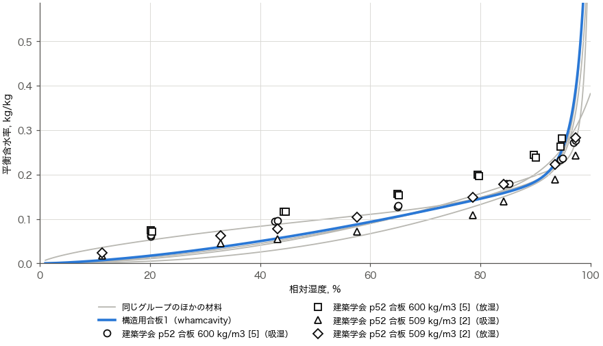
図 3-2　構造用合板1：平衡含水率と相対湿度

**湿気伝導率**：RH 50% で μ 84、RH 90% で μ 15。湿度とともに 1 桁ほど湿気を通しやすくなる形で、文献の点（5 つの出典）の中を通る。妥当。RH 10% 以下では 10⁻¹⁴ より小さくなるが、文献の点はそこにはない。

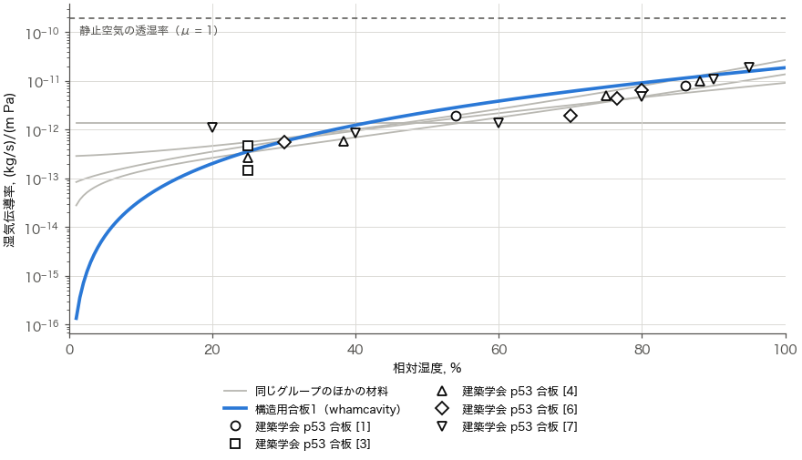
図 3-3　構造用合板1：湿気伝導率と相対湿度

**液水拡散係数**：含水率 0.45 以下（RH 約 98% 以下）は液水が動かない設定（Fortran の DIFF と同じ）。RH 99% の含水率（0.67）で 5.9×10⁻¹³ と、厚さ方向の目安（1.3×10⁻¹¹）の約 1/20、建築学会の本の式の約 1/200。目安より 1 桁以上小さい（要注意）。

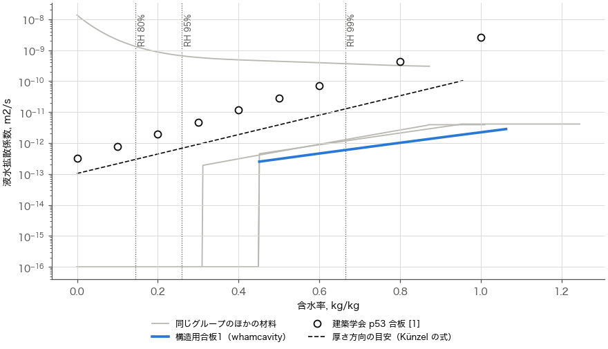
図 3-4　構造用合板1：液水拡散係数と含水率

**直す・確かめること（優先：高）**：熱伝導率 0.16 を、文献の 0.09〜0.12 に近い値にするか検討する。今の壁の計算で使っている材料で、熱抵抗が 3〜8 割変わる。あわせて、密度 600 と水分物性の出典（Plywood-1 の 445）が合わない点（HANDOFF の未決事項）も決める。液水拡散係数は ASHRAE Plywood -1 と同じ課題がある（3.4 節）。

### 3.2 構造用合板2（旧 Excel）

| 熱 | 平衡含水率 | 湿気伝導率 | 液水拡散係数 |
|---|---|---|---|
| 要注意 | 妥当 | 要注意 | 要注意 |

**根拠**：Fortran の材料 19 と同じ値。平衡含水率の式 0.382·r^0.670·exp(−0.907(1−r^9.412)) の出典は不明（Fortran のコメントに「OM」の文字があるが、文字化けで読めない）。湿気伝導率は一定値 1.36×10⁻¹²。

**熱物性**：熱伝導率 0.1596 は、構造用合板1 と同じく文献（密度 644 で式 0.127、測定値 0.09〜0.111）より大きい。**比熱 1300 は、文献 1880 や木材の一般的な値（1600〜1900）より小さい**。

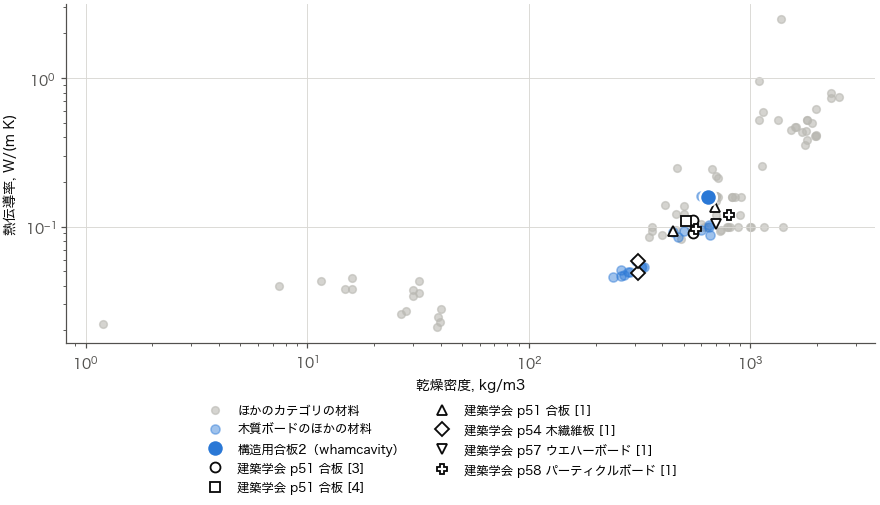
図 3-5　構造用合板2：熱伝導率と乾燥密度

**平衡含水率**：RH 50% で 0.097、RH 80% で 0.148。低湿では 600 kg/m³ の放湿の点に近く、ほかの合板より大きい。文献の吸湿と放湿の幅の中で、妥当。

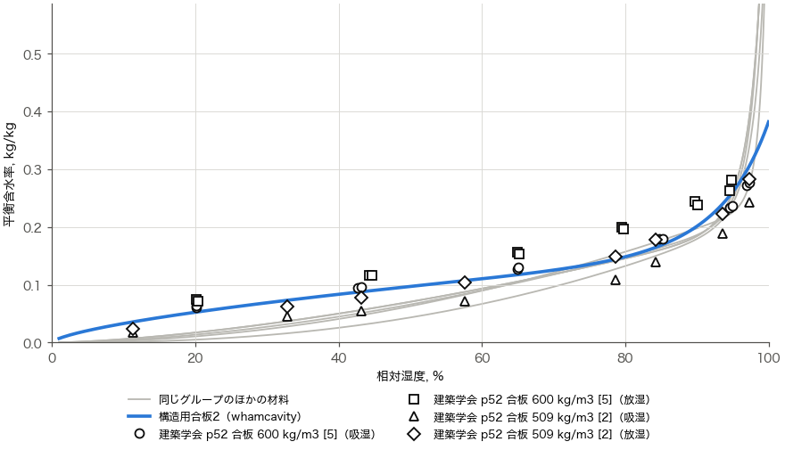
図 3-6　構造用合板2：平衡含水率と相対湿度

**湿気伝導率**：**一定値 1.36×10⁻¹²（μ 142）**。RH 25〜50% では文献の点と同じ大きさだが、RH 80% より上では文献（10⁻¹¹ 前後、μ 10〜40）より 4〜10 倍湿気を通しにくい。

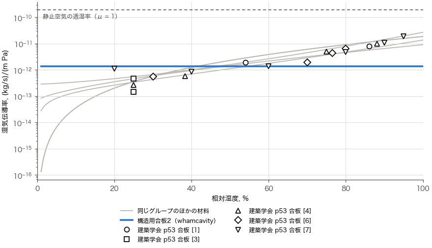
図 3-7　構造用合板2：湿気伝導率と相対湿度

**液水拡散係数**：液水が動かない設定。文献の式では含水率 0.3〜1.0 で 5×10⁻¹²〜3×10⁻⁹、厚さ方向の目安でも RH 99% の含水率（0.35）で 4×10⁻¹⁰ と、液水は動く。結露など高湿の計算では、液水の移動を見落とす（要注意）。

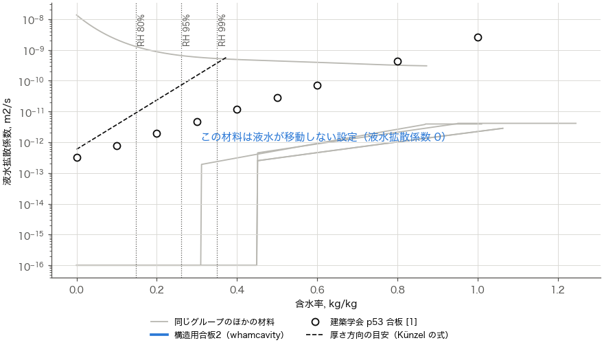
図 3-8　構造用合板2：液水拡散係数と含水率

**直す・確かめること（優先：中）**：湿気伝導率を湿度で変わる式にする（例：ASHRAE Plywood の式）。比熱 1300 の根拠を確かめる。結露など高湿の計算をするなら、液水拡散係数を入れることも検討する（優先：低）。

### 3.3 MEWS Plywood（MEWS）

| 熱 | 平衡含水率 | 湿気伝導率 | 液水拡散係数 |
|---|---|---|---|
| 妥当 | 妥当 | 妥当 | **誤りの疑い** |

**根拠**：RR-110 の Plywood（No.3）。熱・平衡含水率・湿気伝導率は RR-110 の表とよく合う（`mews_excel_derivation.md` 4 章）。

**熱物性**：密度 500、熱伝導率 0.094、比熱 1880。文献の測定値（0.09〜0.111）と式（0.103）に合い、妥当。

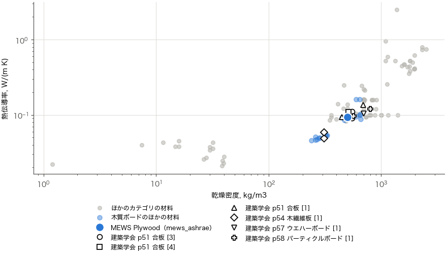
図 3-9　MEWS Plywood：熱伝導率と乾燥密度

**平衡含水率**：RH 50% で 0.043、RH 80% で 0.132。建築学会の本の点（RH 50% 付近で吸湿 0.06〜0.11）より**約 3 割以上低く、どの系列よりも下**にある。一方、出典 RR-110 の表とは ±16% で合う（`mews_excel_derivation.md`）。製品の違いの範囲として妥当とした。

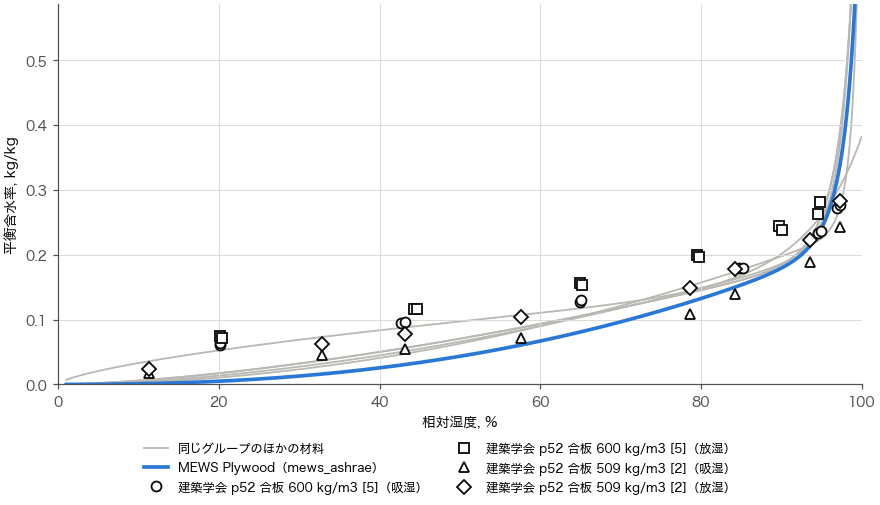
図 3-10　MEWS Plywood：平衡含水率と相対湿度

**湿気伝導率**：RH 50% で μ 120、RH 90% で μ 13。文献の点の中を通り、妥当。低湿でほかの合板より大きい（RR-110 の当てはめ）。

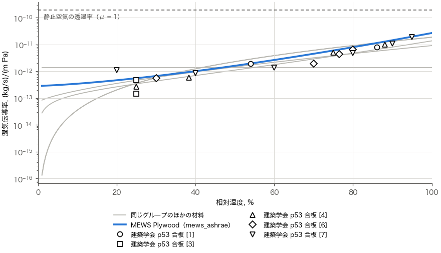
図 3-11　MEWS Plywood：湿気伝導率と相対湿度

**液水拡散係数**：RH 99% の含水率（0.55）で 4.1×10⁻¹⁰ と、厚さ方向の目安（2.1×10⁻¹¹）の約 20 倍、ASHRAE の合板の 300〜700 倍。理由を調べるため、出典 RR-110 の表と、含水量（kg/m³）をそろえて比べた（図 3-13）。

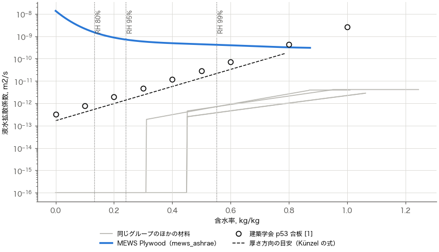
図 3-12　MEWS Plywood：液水拡散係数と含水率

**単位の間違いではなく、OSB の表を使っている**：Excel の MEWS Plywood の値を含水量に直す（含水率 × 合板の密度 500）と、出典 RR-110 の**合板**の表（表 3.3）の 0.09〜0.36 倍で合わないが、**OSB** の表（表 3.4）とは 0.95〜1.17 倍でぴったり合う（図 3-13 で、青い線が四角の印の上を通り、Excel の MEWS OSB の線と重なる）。

| 含水量, kg/m³ | Excel の MEWS Plywood | RR-110 表 3.3（合板） | RR-110 表 3.4（OSB） | Excel ÷ OSB の表 |
|---|---|---|---|---|
| 30 | 3.9×10⁻⁹ | 1.6×10⁻⁸ | 3.4×10⁻⁹ | 1.17 |
| 100 | 8.7×10⁻¹⁰ | 3.6×10⁻⁹ | 8.8×10⁻¹⁰ | 0.99 |
| 200 | 4.9×10⁻¹⁰ | 5.6×10⁻⁹ | 4.9×10⁻¹⁰ | 1.00 |
| 300 | 3.9×10⁻¹⁰ | 2.2×10⁻⁹ | 3.8×10⁻¹⁰ | 1.05 |
| 400 | 3.2×10⁻¹⁰ | 9.4×10⁻¹⁰ | 3.3×10⁻¹⁰ | 0.97 |

区間の境目も、これを裏づける。MEWS Plywood の区間 1 の上限 1.2 kg/kg は、OSB の表の最後の含水量 600 kg/m³ を合板の密度 500 で割った値（合板の表は 400 kg/m³ まで）。OSB の区間 1 の上限 0.92 も 600 ÷ 650。区間 2 の定数（2.8×10⁻¹⁰）は OSB と全桁一致する。Excel を作るときに、合板の行に OSB の表を使い、合板の密度で kg/kg に直して当てはめたと見られる（**誤りの疑い**）。

**正しい表（合板）も、厚さ方向の値とは大きく違う**：RR-110 の合板の表そのものも、建築学会の本の式より 2〜4 桁大きい（含水量 50 で約 13000 倍、100 で約 2600 倍、300 で約 76 倍）。比が一定でないので、単位の換算（例：m²/h と m²/s なら 3600 倍で一定）の違いでもない。図 3-13 では、厚さ方向の目安（Künzel の式、A = 0.0026）と建築学会の本の式がほぼ重なり、RR-110 の表だけが離れている。

考えられる理由と、残る疑問：
- RR-110 は「moisture uptake process **across the edges**」、つまり合板の**小口（端面）から**水を吸わせて測っている。単板の面内の移動を見ていることになり、厚さ方向とは違う。一般に木材は、繊維方向の水分移動がほかの方向より大きいとされる（このレポートでは、その大きさの出典は確かめていない）。
- 一方、**同じ研究所（NRC）の RP-1018 の合板（ASHRAE Plywood -1〜3）は、目安より 1 桁以上小さい**（3.4〜3.6 節）。RP-1018 も同じ方法（ガンマ線で含水率の分布を測る）で、Kumaran (2006) の例（Aerated Concrete）は小口からの吸水。合板をどの面から測ったかは、手元の資料（Kumaran 2006）には書かれていない。方向の違いだけでは、RR-110 と RP-1018 の 3 桁の違いを説明できない。
- したがって、方向の違いは**理由の一つの候補**にとどまる。RP-1018 の最終報告書（手元にない）で確かめたい。

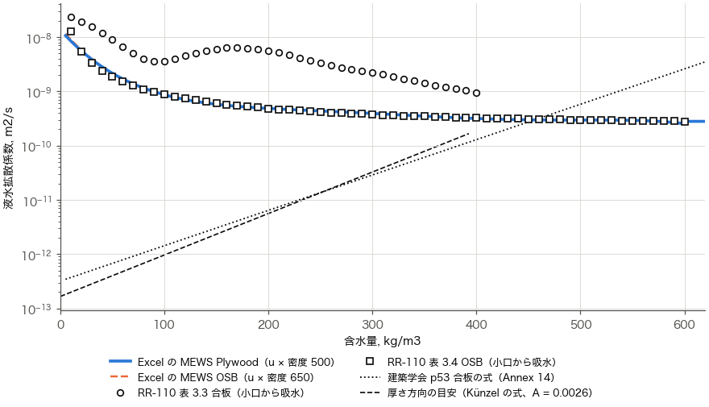
図 3-13　MEWS Plywood の液水拡散係数と出典 RR-110 の表の比べ（横軸は含水量 kg/m³）。青い線が Excel の MEWS Plywood（含水率 × 密度 500）、橙の破線が Excel の MEWS OSB（含水率 × 密度 650。青い線と重なる）。丸は RR-110 の合板の表、四角は OSB の表（どちらも下限と上限の幾何平均）。点線は建築学会の本の合板の式、破線は厚さ方向の目安（Künzel の式）

**直す・確かめること（優先：高）**：液水拡散係数に OSB の表が入っているので直す。直し方は 2 通りあり、どちらにするかを決める。(1) RR-110 の合板の表（表 3.3）で当てはめ直す（ただし小口から測った値で、厚さ方向の目安より 1〜2 桁大きい）。(2) 厚さ方向の値（建築学会の本の式、または Künzel の式の目安）にする。

### 3.4 ASHRAE Plywood -1（ASHRAE）

| 熱 | 平衡含水率 | 湿気伝導率 | 液水拡散係数 |
|---|---|---|---|
| 妥当 | 妥当 | 妥当 | 要注意 |

**根拠**：ASHRAE RP-1018（Kumaran 2006）。測った範囲より下の液水拡散係数は 10⁻¹⁶（実質 0）。構造用合板1 と水分物性が同じ。

**熱物性**：密度 445（論文と一致）、熱伝導率 0.092、比熱 1880。文献の測定値（0.09〜0.111）・式に合い、妥当。

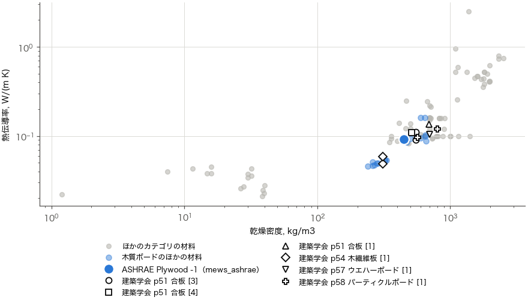
図 3-13　ASHRAE Plywood -1：熱伝導率と乾燥密度

**平衡含水率**：RH 50% で 0.071、RH 80% で 0.145。文献の吸湿と放湿の点の間を通り、妥当。

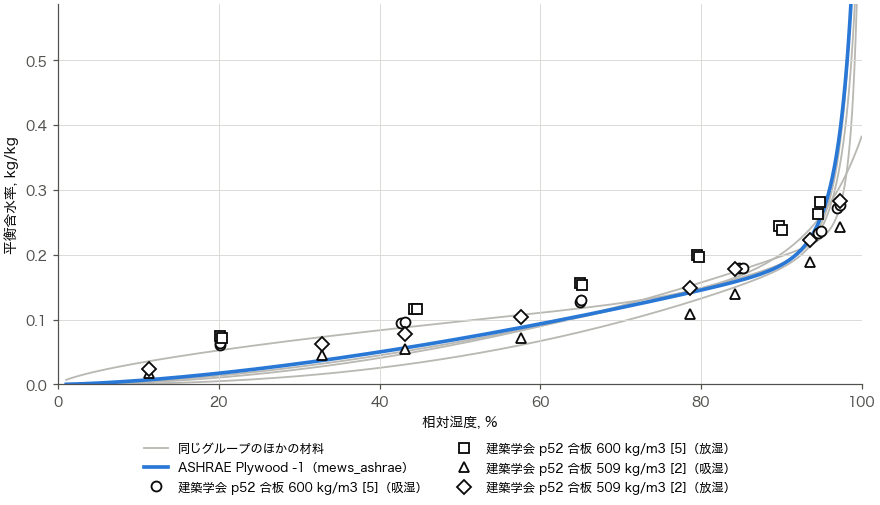
図 3-14　ASHRAE Plywood -1：平衡含水率と相対湿度

**湿気伝導率**：RH 50% で μ 84、RH 90% で μ 15。文献の点の中を通り、妥当。

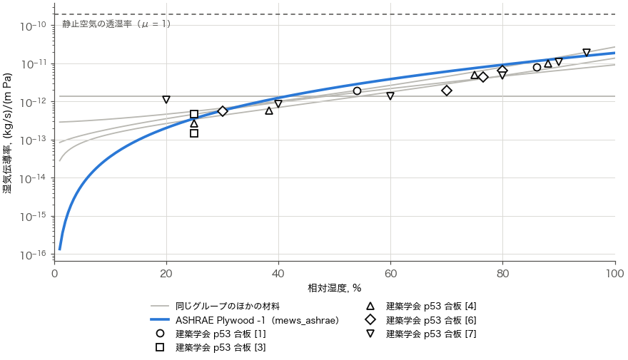
図 3-15　ASHRAE Plywood -1：湿気伝導率と相対湿度

**液水拡散係数**：含水率 0.45 以下（RH 約 98% 以下）は 10⁻¹⁶（実質 0）。RH 99% の含水率（0.67）で 5.9×10⁻¹³ と、厚さ方向の目安（2.3×10⁻¹¹）の約 1/40。目安より 1 桁以上小さい（要注意）。

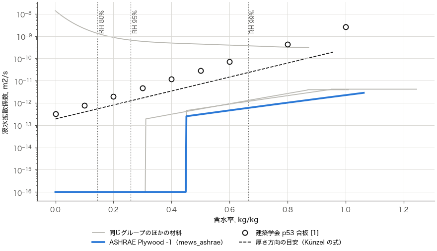
図 3-16　ASHRAE Plywood -1：液水拡散係数と含水率

**確かめること（優先：低）**：同じ研究所の RR-110 の合板（小口から測定）より 3 桁小さく、厚さ方向の目安より小さい。RP-1018 の最終報告書（手元にない）で、測り方と値を確かめたい。

### 3.5 ASHRAE Plywood -2（ASHRAE）

| 熱 | 平衡含水率 | 湿気伝導率 | 液水拡散係数 |
|---|---|---|---|
| 妥当 | 妥当 | 妥当 | 妥当 |

**根拠**：ASHRAE RP-1018（Kumaran 2006）。測った範囲より下の液水拡散係数は 10⁻¹⁶（実質 0）。

**熱物性**：密度 470（論文と一致）、熱伝導率 0.0858、比熱 1880。文献の測定値（0.09〜0.111）・式に合い、妥当。

図 3-17　ASHRAE Plywood -2：熱伝導率と乾燥密度

**平衡含水率**：RH 50% で 0.066、RH 80% で 0.148。文献の吸湿と放湿の点の間を通り、妥当。

図 3-18　ASHRAE Plywood -2：平衡含水率と相対湿度

**湿気伝導率**：RH 50% で μ 133、RH 90% で μ 30。文献の点の中を通り、妥当。

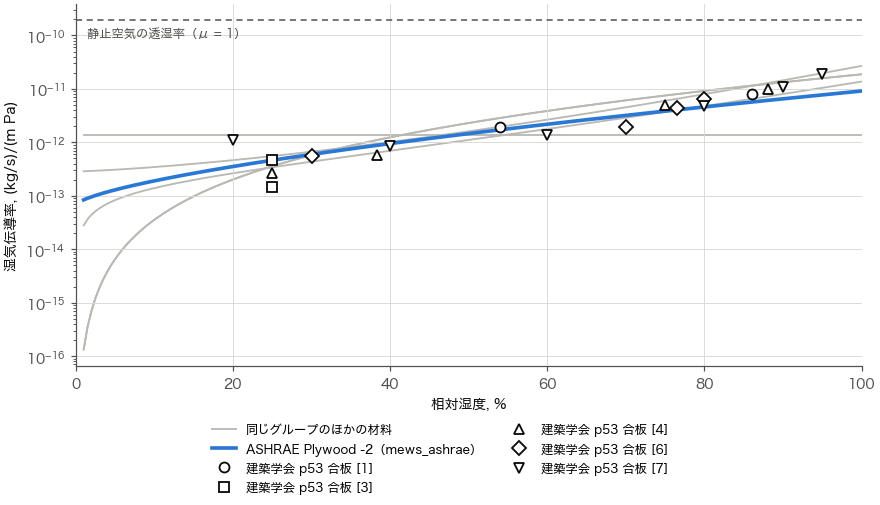
図 3-19　ASHRAE Plywood -2：湿気伝導率と相対湿度

**液水拡散係数**：含水率 0.45 以下は 10⁻¹⁶。RH 99% の含水率（0.68）で 1.3×10⁻¹² と、厚さ方向の目安（1.0×10⁻¹¹）の約 1/8。目安の 1 桁以内なので妥当としたが、下限に近く、含水率 1.0 では約 1/20 になる。

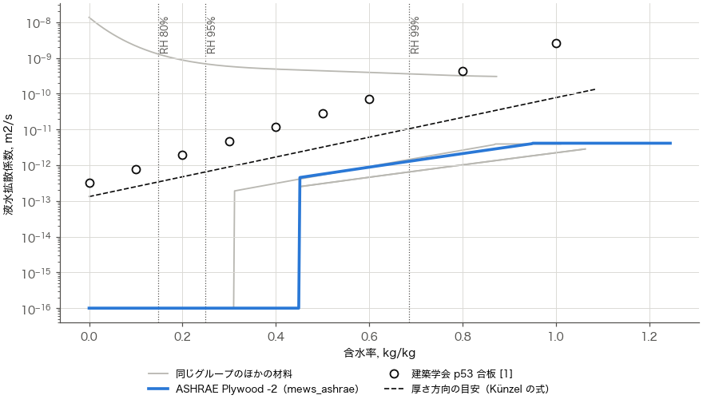
図 3-20　ASHRAE Plywood -2：液水拡散係数と含水率

**確かめること（優先：低）**：3.4 節と同じく、RP-1018 の最終報告書で測り方を確かめたい。

### 3.6 ASHRAE Plywood -3（ASHRAE）

| 熱 | 平衡含水率 | 湿気伝導率 | 液水拡散係数 |
|---|---|---|---|
| 妥当 | 妥当 | 妥当 | 要注意 |

**根拠**：ASHRAE RP-1018（Kumaran 2006）。測った範囲より下の液水拡散係数は 10⁻¹⁶（実質 0）。液水の区間が含水率 0.31 からで、ほかの 2 材料（0.45）より低い。

**熱物性**：密度 550（論文と一致）、熱伝導率 0.104、比熱 1880。文献の測定値（0.09〜0.111）・式に合い、妥当。

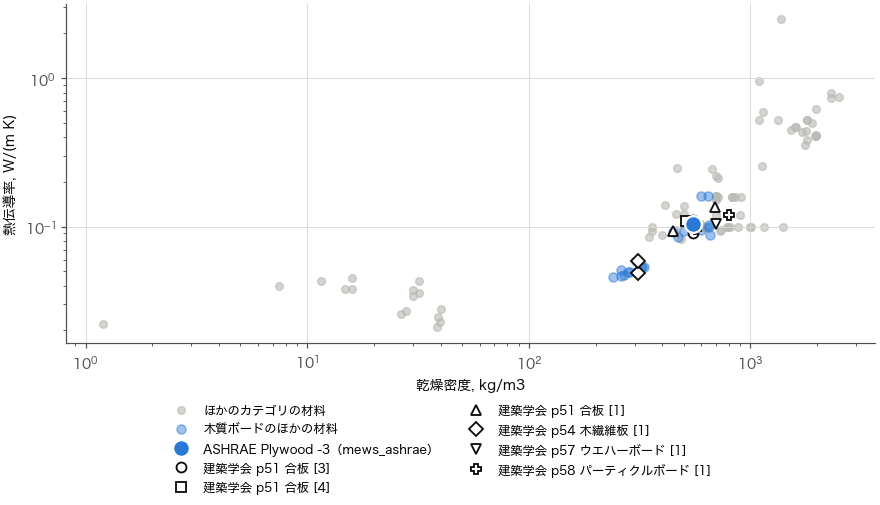
図 3-21　ASHRAE Plywood -3：熱伝導率と乾燥密度

**平衡含水率**：RH 50% で 0.063、RH 80% で 0.157。文献の吸湿と放湿の点の間を通り、妥当。

図 3-22　ASHRAE Plywood -3：平衡含水率と相対湿度

**湿気伝導率**：RH 50% で μ 175、RH 90% で μ 24。文献の点の中を通り、妥当。

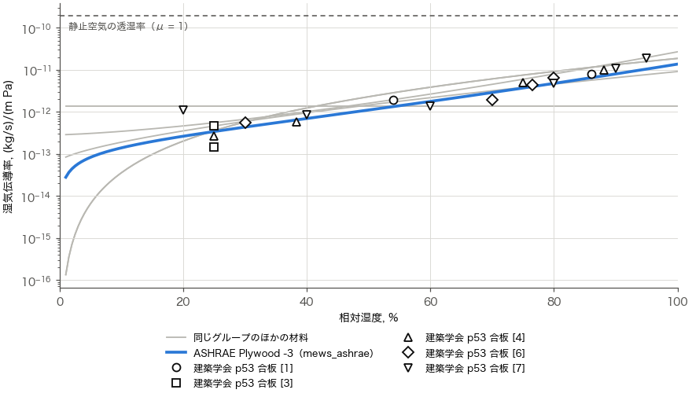
図 3-23　ASHRAE Plywood -3：湿気伝導率と相対湿度

**液水拡散係数**：含水率 0.31 以下は 10⁻¹⁶。RH 99% の含水率（0.46）で 4.3×10⁻¹³ と、厚さ方向の目安（8.0×10⁻¹²）の約 1/20。目安より 1 桁以上小さい（要注意）。

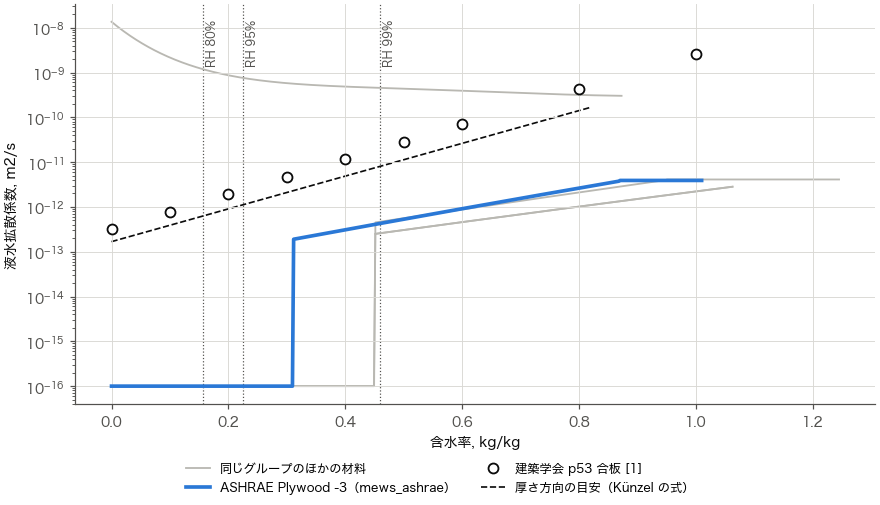
図 3-24　ASHRAE Plywood -3：液水拡散係数と含水率

**確かめること（優先：低）**：同じ研究所の RR-110 の合板（小口から測定）より 3 桁小さく、厚さ方向の目安より小さい。RP-1018 の最終報告書（手元にない）で、測り方と値を確かめたい。

## 4. OSB

OSB そのものの値は建築学会の本にない。**作り方が近いウエハーボード**（p57、密度 約 700）と**パーティクルボード**（p58〜59、密度 570〜800）と比べた。ウエハーボード：熱伝導率 0.105、平衡含水率（試料密度 266 kg/m³ と書かれているが、写し間違いの可能性が高い。2 章）、透湿率 3〜5×10⁻¹³（RH 0/50%）。パーティクルボード：熱伝導率の式 λ = 0.098 + 0.0001(ρ − 590)、平衡含水率 2 系列、透湿率 4.4〜15.2×10⁻¹²、液水拡散係数 1.4〜5.0×10⁻⁹（測り方は書かれていない）。厚さ方向の吸水係数は、RR-110 表 3.5 の OSB 0.0022 kg/(m²·s^½)。

### 4.1 MEWS Oriented Strand Board（MEWS）

| 熱 | 平衡含水率 | 湿気伝導率 | 液水拡散係数 |
|---|---|---|---|
| 妥当 | **誤りの疑い** | 妥当 | 要注意 |

**根拠**：RR-110 の OSB（No.2）。湿気伝導率・液水拡散係数は RR-110 の表とよく合う（`mews_excel_derivation.md`）。

**熱物性**：密度 650、熱伝導率 0.099、比熱 1880。ウエハーボード 0.105、パーティクルボードの式（密度 650 で 0.104）に近く、妥当。

図 4-1　MEWS Oriented Strand Board：熱伝導率と乾燥密度

**平衡含水率**：**RH 50% で 0.012 は、ウエハーボード（RH 43% 吸湿 0.037、57% で 0.052）、ASHRAE OSB（0.038〜0.046）の約 1/3〜1/4**。出典 RR-110 の表でも RH 50% は 0.050 で、Excel は表の 1/4（`mews_excel_derivation.md` 5.5 節）。図でも、RH 20〜80% で文献の点とほかの OSB の線より大きく下にある。式の当てはめが高湿域に引っ張られた結果と見られ、ふだんの湿度での含水量を大きく少なく見積もる（誤りの疑い）。

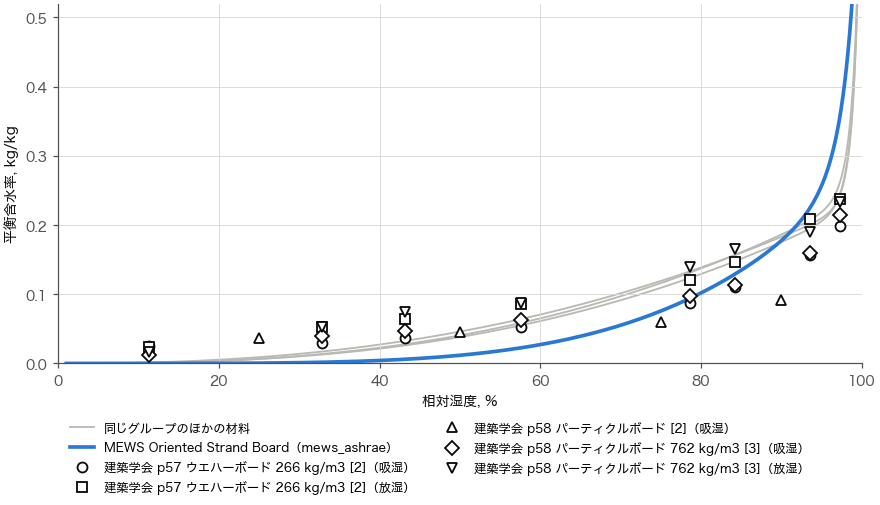
図 4-2　MEWS Oriented Strand Board：平衡含水率と相対湿度

**湿気伝導率**：RH 50% で μ 159、RH 90% で μ 49。文献の点（ウエハーボード 3〜5×10⁻¹³、パーティクルボード 4〜15×10⁻¹²）の間にあり、妥当。

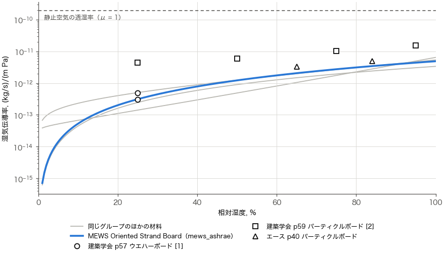
図 4-3　MEWS Oriented Strand Board：湿気伝導率と相対湿度

**液水拡散係数**：RH 99% の含水率（0.56）で 3.4×10⁻¹⁰。出典 RR-110 の表 3.4 とよく合うが、RR-110 は合板と同じく小口から吸水させて測った値（3.3 節）。厚さ方向の目安（1.2×10⁻¹¹）の約 30 倍で、目安より 1 桁以上大きい（要注意）。パーティクルボードの文献値（1.4〜5×10⁻⁹、測り方は書かれていない）とは同じ桁。

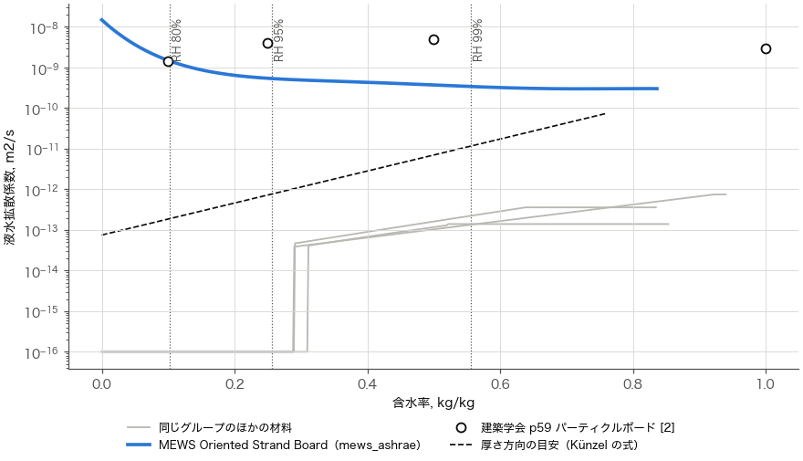
図 4-4　MEWS Oriented Strand Board：液水拡散係数と含水率

**直す・確かめること**：平衡含水率の係数を、RR-110 の表の低湿域にも合うように当てはめ直す（優先：高）。液水拡散係数は小口から測った値なので、厚さ方向の計算に使うなら、目安との違い（約 30 倍）を考える（優先：中）。

### 4.2 ASHRAE OSB -1（ASHRAE）

| 熱 | 平衡含水率 | 湿気伝導率 | 液水拡散係数 |
|---|---|---|---|
| 妥当 | 妥当 | 妥当 | 要注意 |

**根拠**：ASHRAE RP-1018（Kumaran 2006）。

**熱物性**：密度 650、熱伝導率 0.102、比熱 1880。ウエハーボード 0.105、パーティクルボードの式（0.099〜0.105）に近く、妥当。

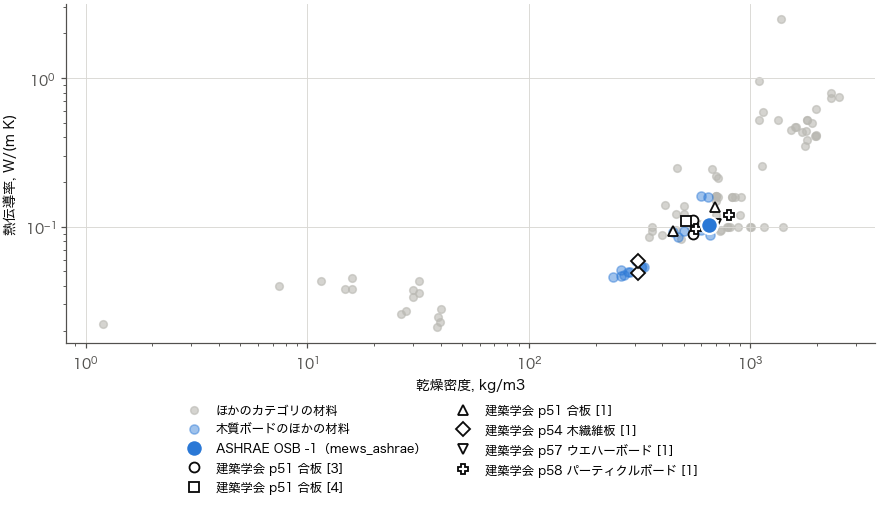
図 4-5　ASHRAE OSB -1：熱伝導率と乾燥密度

**平衡含水率**：RH 50% で 0.04 前後、RH 80% で 0.13〜0.14。文献の吸湿と放湿の点の間を通り、妥当。

図 4-6　ASHRAE OSB -1：平衡含水率と相対湿度

**湿気伝導率**：RH 50% で μ 216、RH 90% で μ 70。文献の範囲（μ 13〜650）に入り、妥当。

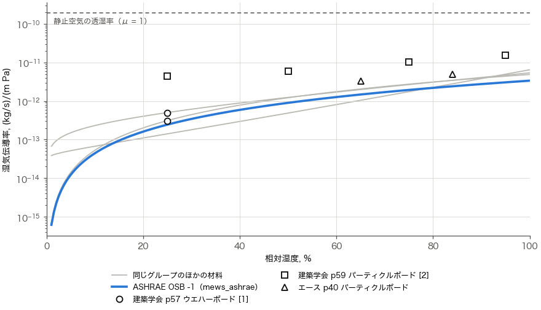
図 4-7　ASHRAE OSB -1：湿気伝導率と相対湿度

**液水拡散係数**：含水率 0.3 以下は 10⁻¹⁶（実質 0）。RH 99% の含水率で 7.5×10⁻¹⁴ と、厚さ方向の目安（5.2×10⁻¹²）の約 1/70。目安より 1 桁以上小さい（要注意）。MEWS OSB（RR-110）より約 4 桁小さい。

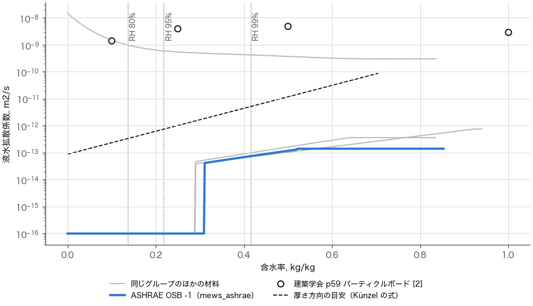
図 4-8　ASHRAE OSB -1：液水拡散係数と含水率

**確かめること（優先：低）**：RP-1018 の最終報告書で、液水拡散係数の測り方を確かめたい（3.3 節の残る疑問と同じ）。

### 4.3 ASHRAE OSB -2（ASHRAE）

| 熱 | 平衡含水率 | 湿気伝導率 | 液水拡散係数 |
|---|---|---|---|
| 妥当 | 妥当 | 妥当 | 要注意 |

**根拠**：ASHRAE RP-1018（Kumaran 2006）。

**熱物性**：密度 660、熱伝導率 0.0878、比熱 1880。ウエハーボード 0.105、パーティクルボードの式（0.099〜0.105）に近く、妥当。

図 4-9　ASHRAE OSB -2：熱伝導率と乾燥密度

**平衡含水率**：RH 50% で 0.04 前後、RH 80% で 0.13〜0.14。文献の吸湿と放湿の点の間を通り、妥当。

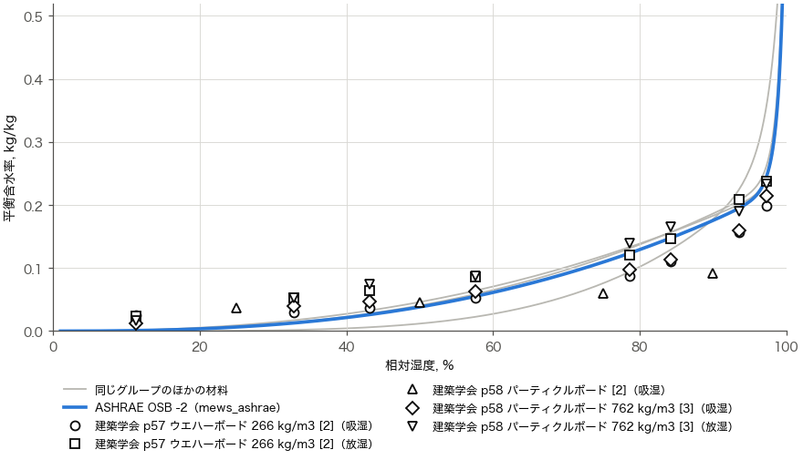
図 4-10　ASHRAE OSB -2：平衡含水率と相対湿度

**湿気伝導率**：RH 50% で μ 397、RH 90% で μ 51。文献の範囲（μ 13〜650）に入り、妥当。

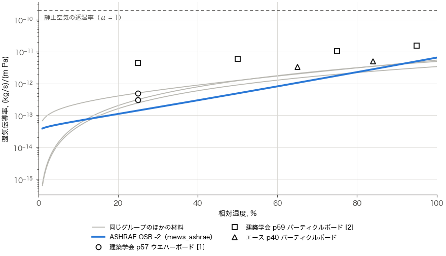
図 4-11　ASHRAE OSB -2：湿気伝導率と相対湿度

**液水拡散係数**：含水率 0.3 以下は 10⁻¹⁶（実質 0）。RH 99% の含水率で 8.5×10⁻¹⁴ と、厚さ方向の目安（4.8×10⁻¹²）の約 1/55。目安より 1 桁以上小さい（要注意）。MEWS OSB（RR-110）より約 4 桁小さい。

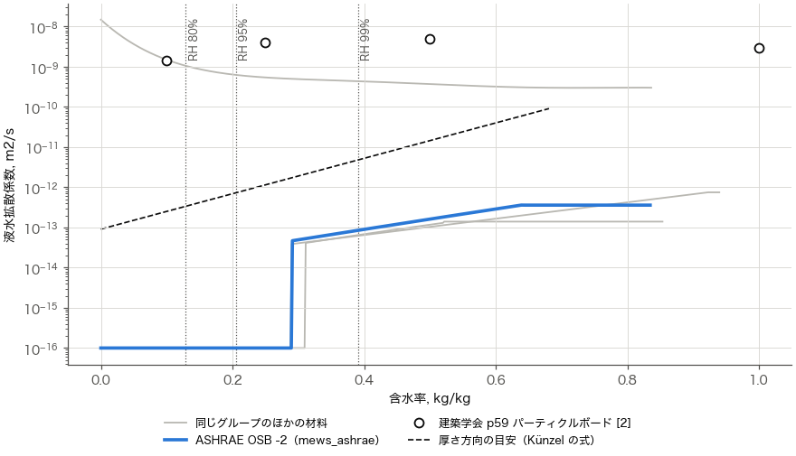
図 4-12　ASHRAE OSB -2：液水拡散係数と含水率

**確かめること（優先：低）**：RP-1018 の最終報告書で、液水拡散係数の測り方を確かめたい（3.3 節の残る疑問と同じ）。

### 4.4 ASHRAE OSB -3（ASHRAE）

| 熱 | 平衡含水率 | 湿気伝導率 | 液水拡散係数 |
|---|---|---|---|
| 妥当 | 妥当 | 妥当 | 要注意 |

**根拠**：ASHRAE RP-1018（Kumaran 2006）。密度 600 は論文（Kumaran 2006）の 650 と違う（`ashrae_excel_derivation.md`）。

**熱物性**：密度 600、熱伝導率 0.0943、比熱 1880。ウエハーボード 0.105、パーティクルボードの式（0.099〜0.105）に近く、妥当。

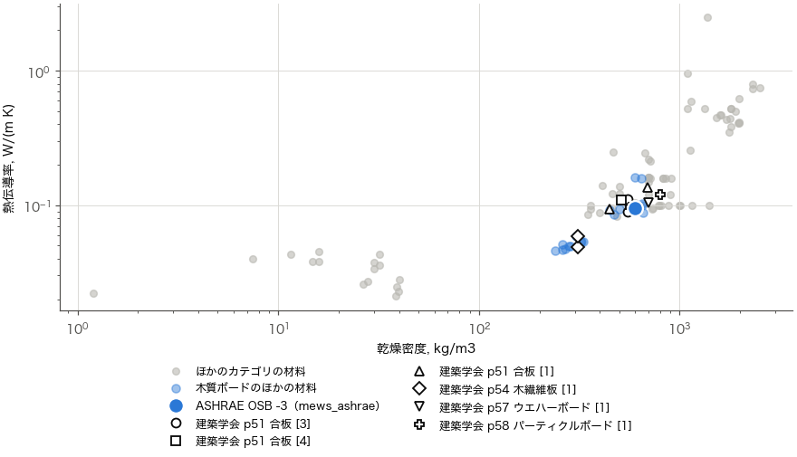
図 4-13　ASHRAE OSB -3：熱伝導率と乾燥密度

**平衡含水率**：RH 50% で 0.04 前後、RH 80% で 0.13〜0.14。文献の吸湿と放湿の点の間を通り、妥当。

図 4-14　ASHRAE OSB -3：平衡含水率と相対湿度

**湿気伝導率**：RH 50% で μ 156、RH 90% で μ 47。文献の範囲（μ 13〜650）に入り、妥当。

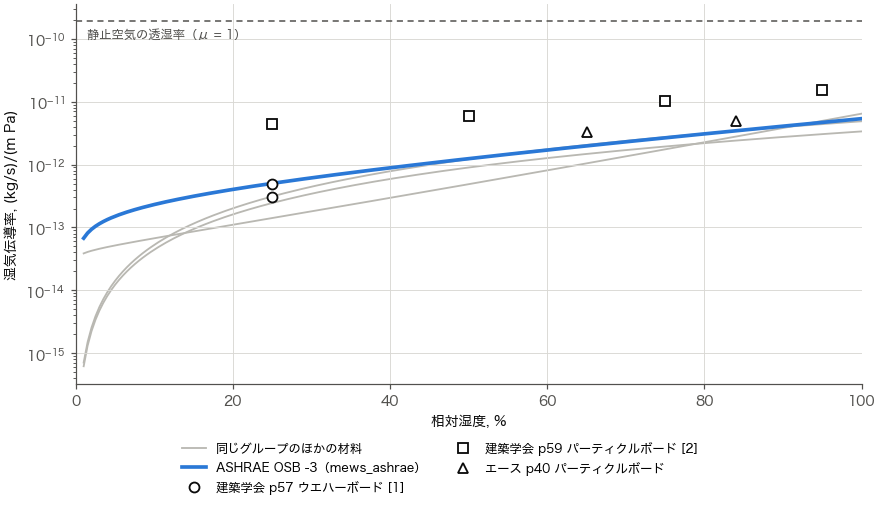
図 4-15　ASHRAE OSB -3：湿気伝導率と相対湿度

**液水拡散係数**：含水率 0.3 以下は 10⁻¹⁶（実質 0）。RH 99% の含水率で 6.2×10⁻¹⁴ と、厚さ方向の目安（3.7×10⁻¹²）の約 1/60。目安より 1 桁以上小さい（要注意）。MEWS OSB（RR-110）より約 4 桁小さい。

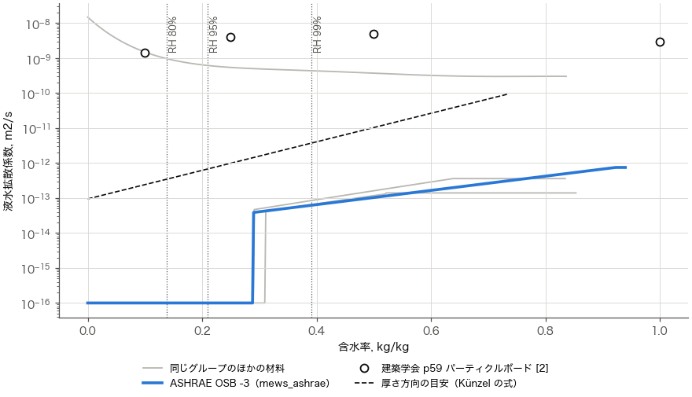
図 4-16　ASHRAE OSB -3：液水拡散係数と含水率

**確かめること（優先：低）**：RP-1018 の最終報告書で、液水拡散係数の測り方を確かめたい（3.3 節の残る疑問と同じ）。密度 600 と論文の 650 の違いも確かめる。

## 5. 繊維板

**文献の値**（建築学会 p54〜56、エース 表 7.2）：乾燥密度 240〜380 kg/m³、熱伝導率 0.0485〜0.0588。平衡含水率 3 系列（300・266・340 kg/m³）で、RH 50% 付近で吸湿 0.056〜0.09。透湿率 0.85〜6.8×10⁻¹¹（μ 2.9〜23）。液水拡散係数は含水率 0.02〜1.6 で 2.9×10⁻¹⁰〜9.4×10⁻⁹（243 kg/m³ の試料、NRC の値。2 章）。エースの表では軟質木繊維板（密度 270、RH 84%）が 4.0×10⁻¹¹。厚さ方向の吸水係数は RR-110 表 8.4 で、Plain 0.0021〜0.0054、Paper Faced 0.0019、Black Coat 0.00096〜0.0015、Aluminum Foil Faced 0.00042 kg/(m²·s^½)。

**繊維板の液水拡散係数の全体の傾向**：MEWS の繊維板（RR-110 の小口からの測定）は、RH 99% の含水率で 10⁻¹⁰〜4×10⁻⁹ m²/s。厚さ方向の目安は 5×10⁻¹²〜3×10⁻¹⁰ で、**ほとんどの製品で目安より 1〜2 桁以上大きい**。とくに表面に塗装・紙のある製品（Black Coat、Paper Facer）は厚さ方向の吸水係数が小さく、目安との開きが大きい。小口からの吸水は表面の塗装の影響を受けないので、この差は方向の違いと表面の仕上げの両方で説明できる。

### 5.1 軟質繊維版（旧 Excel）

| 熱 | 平衡含水率 | 湿気伝導率 | 液水拡散係数 |
|---|---|---|---|
| 妥当 | 妥当 | 妥当 | 要注意 |

**根拠**：Fortran の材料 8 と同じ値。平衡含水率の式は Fortran の「NANSHITSUSENIBAN」。湿気伝導率は一定値 2.61×10⁻¹¹。

**熱物性**：密度 306、熱伝導率 0.0586（文献の上限 0.0588 とほぼ同じ）で妥当。比熱 1500 は MEWS・ASHRAE の 1880 より小さいが、繊維板の比熱は文献にないので判定しない。

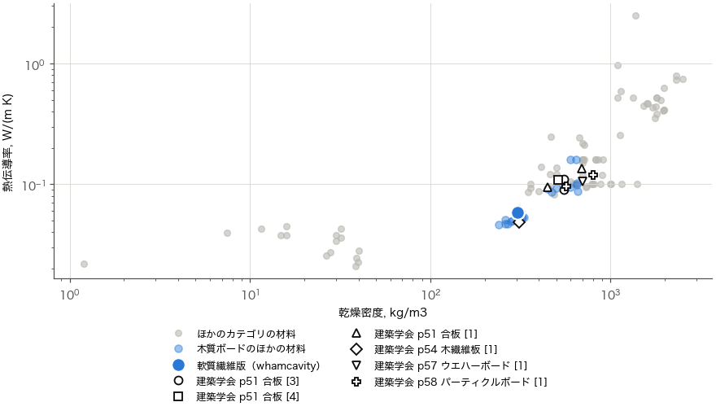
図 5-1　軟質繊維版：熱伝導率と乾燥密度

**平衡含水率**：RH 50% で 0.103、RH 80% で 0.173。文献の放湿の点に近く、繊維板の中では大きめ。妥当。

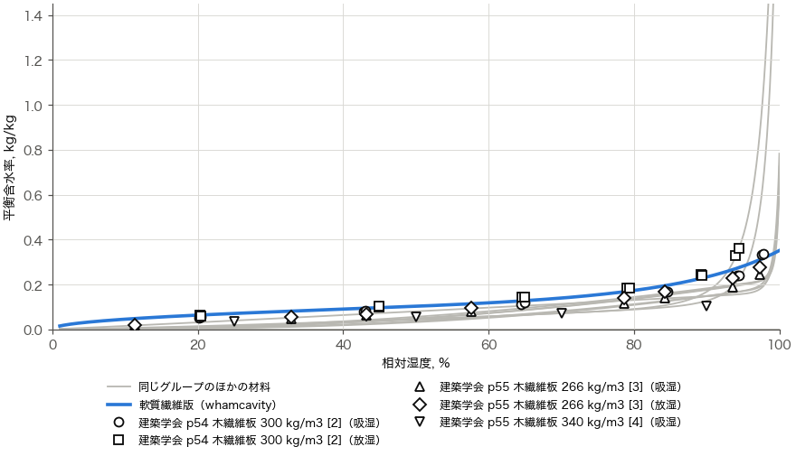
図 5-2　軟質繊維版：平衡含水率と相対湿度

**湿気伝導率**：一定値 2.61×10⁻¹¹（μ 7.4）。文献の範囲（μ 2.9〜23）の中ほどで、妥当。繊維板の文献値は湿度であまり変わらないので、一定値でも大きな問題はない。

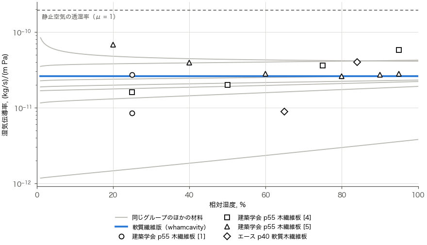
図 5-3　軟質繊維版：湿気伝導率と相対湿度

**液水拡散係数**：液水が動かない設定。厚さ方向の目安でも、RH 99% の含水率（0.34）で 10⁻⁹ 程度（この材料は wf が 106 kg/m³ と小さいため目安が大きい）で、液水は動く。結露など高湿の計算では、液水の移動を見落とす（要注意）。

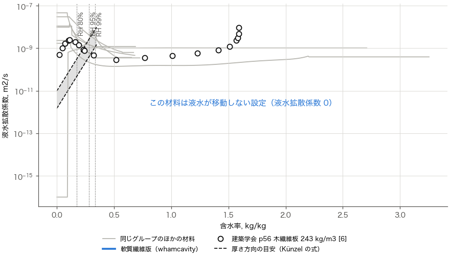
図 5-4　軟質繊維版：液水拡散係数と含水率

**確かめること（優先：低）**：結露など高湿の計算をするなら、液水拡散係数を入れることを検討する。

### 5.2 MEWS Fibreboard I - Paper Facer（MEWS）

| 熱 | 平衡含水率 | 湿気伝導率 | 液水拡散係数 |
|---|---|---|---|
| 妥当 | 妥当 | 要注意 | 要注意 |

**根拠**：RR-110 の Fibreboard（No.27、表面に紙を貼った製品）。液水拡散係数は範囲分け数 4 を 3 として読んでいる（`material_loaders.py`）。

**熱物性**：密度 285、熱伝導率 0.050。文献の範囲に入り、妥当。

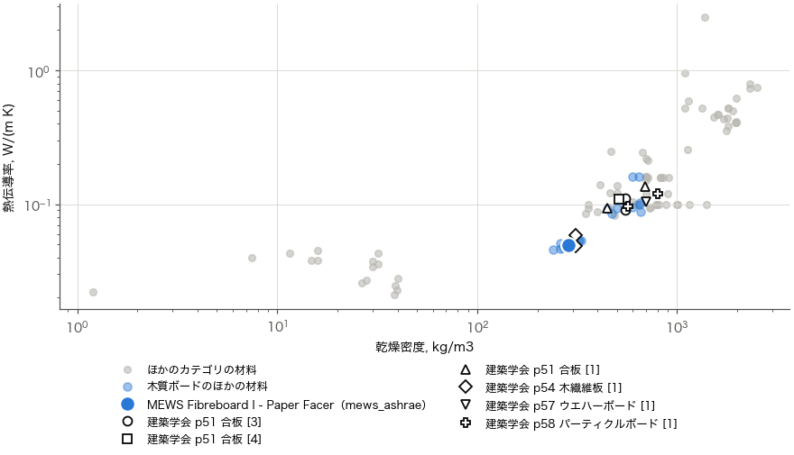
図 5-5　MEWS Fibreboard I - Paper Facer：熱伝導率と乾燥密度

**平衡含水率**：RH 50% で 0.056、RH 80% で 0.144。文献の吸湿の点とよく合い、妥当。

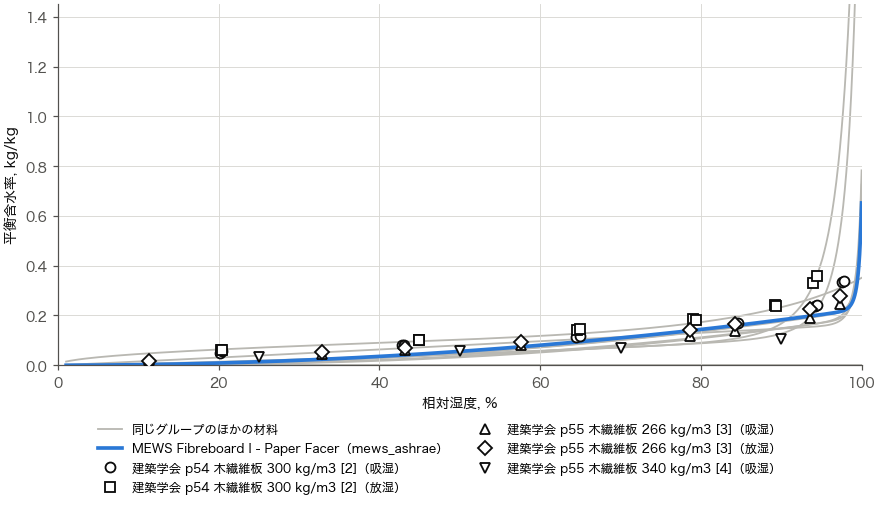
図 5-6　MEWS Fibreboard I - Paper Facer：平衡含水率と相対湿度

**湿気伝導率**：**RH 50% で μ 94、RH 90% で μ 58** で、繊維板の文献の範囲（μ 2.9〜23）の外。図では、ほかの繊維板より 1 桁低い。表面の紙の分だけ湿気を通しにくいと説明できる（要注意）。

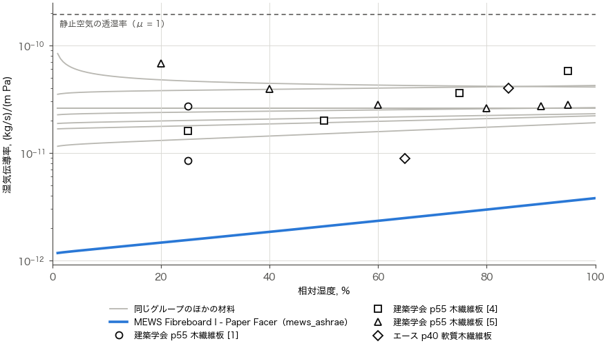
図 5-7　MEWS Fibreboard I - Paper Facer：湿気伝導率と相対湿度

**液水拡散係数**：RH 99% の含水率（0.27）で 1.9×10⁻⁹。厚さ方向の目安（A = 0.0019 で 3.6×10⁻¹¹）の約 50 倍（要注意）。RR-110 の小口からの測定で、表面の紙の影響を受けていない値。

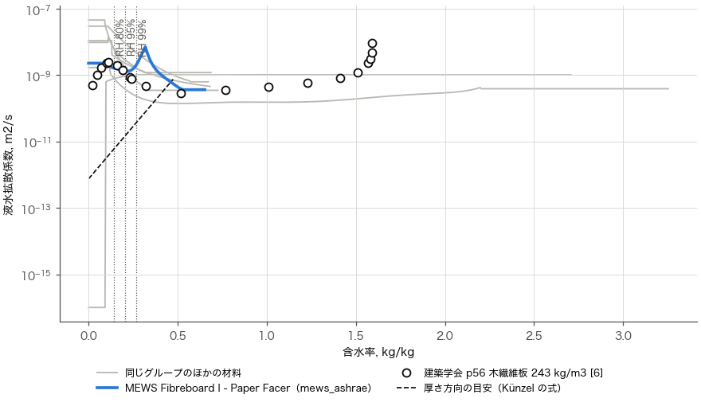
図 5-8　MEWS Fibreboard I - Paper Facer：液水拡散係数と含水率

**確かめること（優先：中）**：液水拡散係数は小口から測った値で、厚さ方向の計算には大きすぎる可能性が高い。表面の紙は、境界の湿気・液水の抵抗として別に扱うことも考える。

### 5.3 MEWS Fibreboard II - Plain（MEWS）

| 熱 | 平衡含水率 | 湿気伝導率 | 液水拡散係数 |
|---|---|---|---|
| 妥当 | 要注意 | 妥当 | 要注意 |

**根拠**：RR-110 の Fibreboard（No.28）。湿気伝導率の係数 c と d が同じ値（−0.27904）で、RH 0% では計算できない（`mews_excel_derivation.md` 5.4 節）。

**熱物性**：密度 260、熱伝導率 0.051。文献の範囲に入り、妥当。

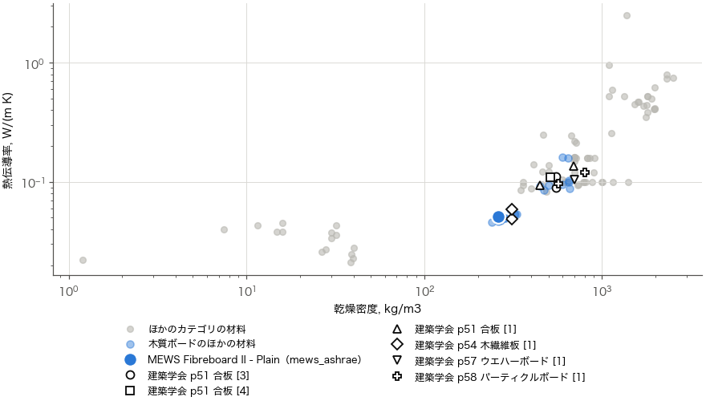
図 5-9　MEWS Fibreboard II - Plain：熱伝導率と乾燥密度

**平衡含水率**：RH 50% で 0.046、RH 80% で 0.090。**文献（RH 50% 付近で吸湿 0.056〜0.09）より 2〜5 割低い**。また、**RH 100% で 3.25**（容積含水率 0.85）と、空隙（空隙率の目安 0.83）をほぼすべて水で満たす量。真空飽和の値に合わせた形（RR-110）で、RH 99% を超えたところだけの話（要注意）。

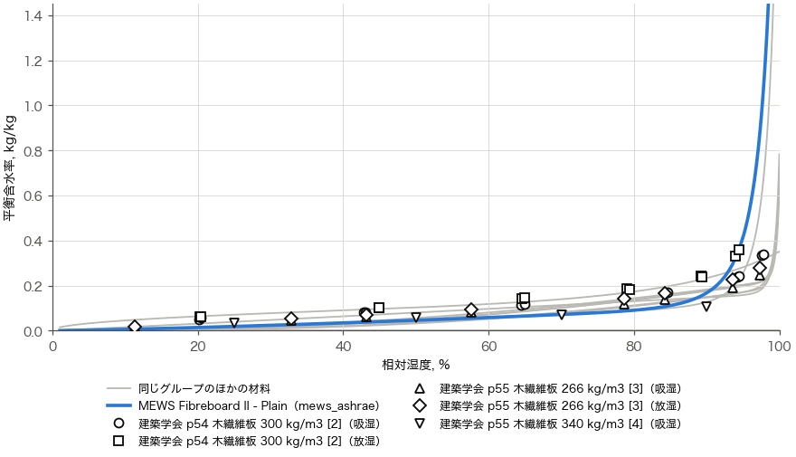
図 5-10　MEWS Fibreboard II - Plain：平衡含水率と相対湿度

**湿気伝導率**：RH 50% で μ 4.5、RH 90% で μ 4.7。文献の範囲に入り、妥当。

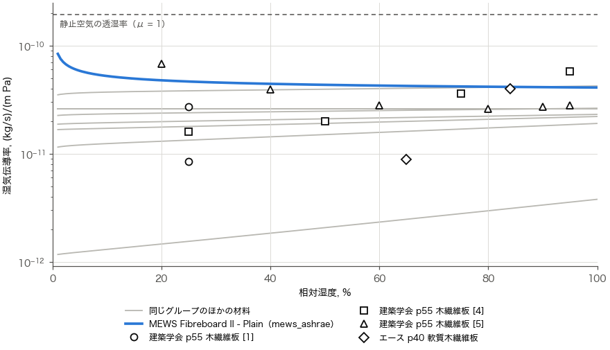
図 5-11　MEWS Fibreboard II - Plain：湿気伝導率と相対湿度

**液水拡散係数**：RH 99% の含水率（1.87）で 2.7×10⁻¹⁰。厚さ方向の目安（A = 0.0021〜0.0054 で 2.6×10⁻¹²〜1.7×10⁻¹¹）の 16〜110 倍（要注意）。この材料は平衡含水率が真空飽和に合わせた形なので、wf（RH 99.8% の値で 751 kg/m³）が大きく、目安が小さめに出ている。

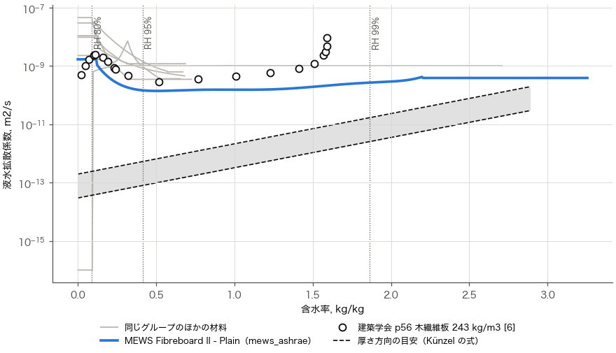
図 5-12　MEWS Fibreboard II - Plain：液水拡散係数と含水率

**確かめること（優先：中）**：平衡含水率を RR-110 の加圧板の値（真空飽和ではなく）に合わせた形に当てはめ直すか検討する。液水拡散係数は小口から測った値（5.2 節と同じ）。

### 5.4 MEWS Fibreboard III - Foil Facer（MEWS）

| 熱 | 平衡含水率 | 湿気伝導率 | 液水拡散係数 |
|---|---|---|---|
| 妥当 | **根拠なし** | 要注意 | 根拠なし |

**根拠**：RR-110 の Fibreboard（No.29、表面にアルミ箔）。**Excel の水分物性はすべて 0**（平衡含水率・湿気伝導率・液水拡散係数）。RR-110 でも水分物性は解析できていない。厚さ方向の吸水係数は 0.00042 と、ほかの繊維板の 1/3〜1/10。

**熱物性**：密度 260、熱伝導率 0.047。文献の範囲に入り、妥当。

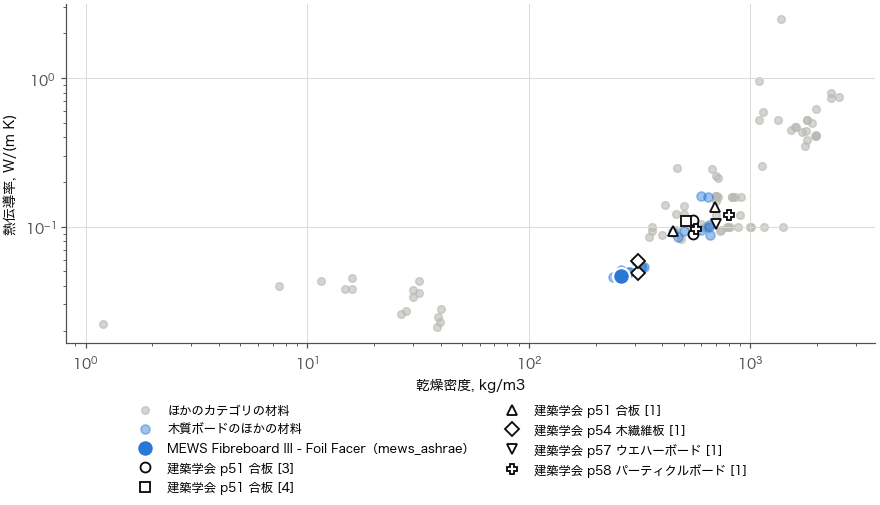
図 5-13　MEWS Fibreboard III - Foil Facer：熱伝導率と乾燥密度

**平衡含水率**：**どの湿度でも 0**（図の青い線が横軸に重なっている）。芯の繊維板は、ほかの繊維板と同じように吸湿するはずで、物理的でない（根拠なし）。

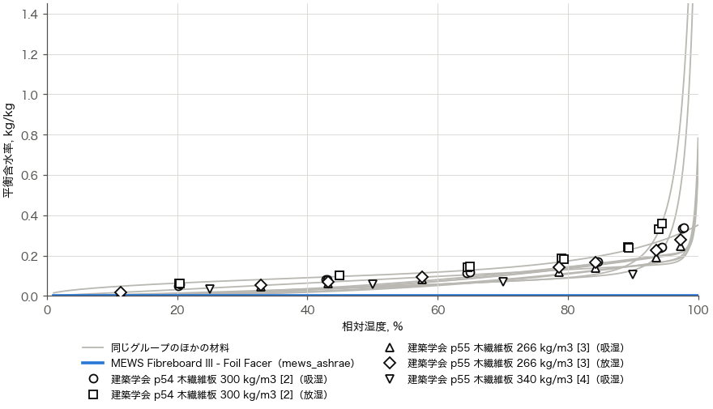
図 5-14　MEWS Fibreboard III - Foil Facer：平衡含水率と相対湿度

**湿気伝導率**：0（湿気を通さない、μ = ∞）。図には線が描かれない。箔の面材として湿気を通さないのは説明できるが、芯材を含めた材料全体の値としては極端（要注意）。

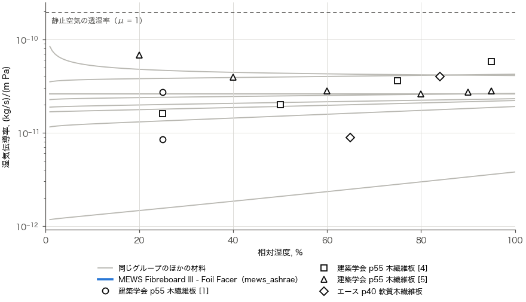
図 5-15　MEWS Fibreboard III - Foil Facer：湿気伝導率と相対湿度

**液水拡散係数**：0（液水が動かない）。根拠なし。

図 5-16　MEWS Fibreboard III - Foil Facer：液水拡散係数と含水率

**直す・確かめること（優先：中）**：水分物性が入っていないので、使わないか、扱い方を決める。壁の計算に使う場合は、芯材を別の繊維板（例：MEWS Fibreboard IV）の値にし、箔の面を境界の湿気コンダクタンスで表すなどの工夫が必要。

### 5.5 MEWS Fibreboard IV - Plain（MEWS）

| 熱 | 平衡含水率 | 湿気伝導率 | 液水拡散係数 |
|---|---|---|---|
| 妥当 | 妥当 | 妥当 | 妥当 |

**根拠**：RR-110 の Fibreboard（No.30）。

**熱物性**：密度 240、熱伝導率 0.046。文献の範囲の下端で、妥当。

図 5-17　MEWS Fibreboard IV - Plain：熱伝導率と乾燥密度

**平衡含水率**：RH 50% で 0.080、RH 80% で 0.130。文献の吸湿の点とよく合い、妥当。

図 5-18　MEWS Fibreboard IV - Plain：平衡含水率と相対湿度

**湿気伝導率**：RH 50% で μ 4.9、RH 90% で μ 4.7。文献の範囲に入り、妥当。

図 5-19　MEWS Fibreboard IV - Plain：湿気伝導率と相対湿度

**液水拡散係数**：RH 99% の含水率（0.28）で 1.4×10⁻⁹。厚さ方向の目安（A = 0.0021〜0.0054 で 4×10⁻¹¹〜2.7×10⁻¹⁰）の 5〜36 倍。吸水係数が大きい側（0.0054）なら目安の 1 桁以内なので妥当としたが、上限に近い。

図 5-20　MEWS Fibreboard IV - Plain：液水拡散係数と含水率

**確かめること（優先：低）**：RR-110 表 8.4 の Plain 2 製品のどちらがこの材料か（吸水係数 0.0021 か 0.0054 か）で判定が変わる。RR-110 の製品の対応を確かめたい。

### 5.6 MEWS Fibreboard V - Black Coat（MEWS）

| 熱 | 平衡含水率 | 湿気伝導率 | 液水拡散係数 |
|---|---|---|---|
| 妥当 | 妥当 | 妥当 | 要注意 |

**根拠**：RR-110 の Fibreboard（No.31、表面に黒い塗装）。厚さ方向の吸水係数は、Black Coat の 4 製品で 0.00096〜0.0015（どれがこの材料かは分からない）。

**熱物性**：密度 270、熱伝導率 0.047。文献の範囲に入り、妥当。

図 5-21　MEWS Fibreboard V - Black Coat：熱伝導率と乾燥密度

**平衡含水率**：RH 50% で 0.048、RH 80% で 0.135。文献（Annex 24 の木繊維板、RH 50% 付近で吸湿 0.056〜0.09）の 0.4〜0.9 倍と小さいが、出典 RR-110 の表とは 0.64〜1.4 倍で合う。表面の塗装を含む製品の違いとして妥当とした。

図 5-22　MEWS Fibreboard V - Black Coat：平衡含水率と相対湿度

**湿気伝導率**：RH 50% で μ 7.8、RH 90% で μ 7.5。文献の範囲（μ 2.9〜23）に入り、妥当。

図 5-23　MEWS Fibreboard V - Black Coat：湿気伝導率と相対湿度

**液水拡散係数**：RH 99% の含水率（0.29）で 5.4×10⁻¹⁰。厚さ方向の目安（A = 0.00096〜0.0015 で 6.7×10⁻¹²〜1.6×10⁻¹¹）の 33〜81 倍（要注意）。

図 5-24　MEWS Fibreboard V - Black Coat：液水拡散係数と含水率

**確かめること（優先：中）**：液水拡散係数は小口から測った値で、表面の黒い塗装の影響を受けていない。厚さ方向の計算には、目安に近い値にするか、塗装を境界の抵抗として扱うことを考える。

### 5.7 MEWS Fibreboard VI - Black Coat（MEWS）

| 熱 | 平衡含水率 | 湿気伝導率 | 液水拡散係数 |
|---|---|---|---|
| 妥当 | 妥当 | 妥当 | 要注意 |

**根拠**：RR-110 の Fibreboard（No.32、表面に黒い塗装）。厚さ方向の吸水係数は、Black Coat の 4 製品で 0.00096〜0.0015（どれがこの材料かは分からない）。

**熱物性**：密度 280、熱伝導率 0.049。文献の範囲に入り、妥当。

図 5-25　MEWS Fibreboard VI - Black Coat：熱伝導率と乾燥密度

**平衡含水率**：RH 50% で 0.049、RH 80% で 0.137。文献（Annex 24 の木繊維板、RH 50% 付近で吸湿 0.056〜0.09）の 0.4〜0.9 倍と小さいが、出典 RR-110 の表とは 0.64〜1.4 倍で合う。表面の塗装を含む製品の違いとして妥当とした。

図 5-26　MEWS Fibreboard VI - Black Coat：平衡含水率と相対湿度

**湿気伝導率**：RH 50% で μ 7.5、RH 90% で μ 7.5。文献の範囲（μ 2.9〜23）に入り、妥当。

図 5-27　MEWS Fibreboard VI - Black Coat：湿気伝導率と相対湿度

**液水拡散係数**：RH 99% の含水率（0.29）で 3.9×10⁻⁹。厚さ方向の目安（8.3×10⁻¹²〜2.0×10⁻¹¹）の 190〜460 倍で、繊維板の中でも大きい（要注意）。

図 5-28　MEWS Fibreboard VI - Black Coat：液水拡散係数と含水率

**確かめること（優先：中）**：液水拡散係数は小口から測った値で、表面の黒い塗装の影響を受けていない。厚さ方向の計算には、目安に近い値にするか、塗装を境界の抵抗として扱うことを考える。

### 5.8 MEWS Fibreboard VII - Black Coat（MEWS）

| 熱 | 平衡含水率 | 湿気伝導率 | 液水拡散係数 |
|---|---|---|---|
| 妥当 | 妥当 | 妥当 | 根拠なし |

**根拠**：RR-110 の Fibreboard（No.33、表面に黒い塗装）。厚さ方向の吸水係数は、Black Coat の 4 製品で 0.00096〜0.0015（どれがこの材料かは分からない）。

**熱物性**：密度 330、熱伝導率 0.053。文献の範囲に入り、妥当。

図 5-29　MEWS Fibreboard VII - Black Coat：熱伝導率と乾燥密度

**平衡含水率**：RH 50% で 0.032、RH 80% で 0.108。文献（Annex 24 の木繊維板、RH 50% 付近で吸湿 0.056〜0.09）の 0.4〜0.9 倍と小さいが、出典 RR-110 の表とは 0.64〜1.4 倍で合う。表面の塗装を含む製品の違いとして妥当とした。

図 5-30　MEWS Fibreboard VII - Black Coat：平衡含水率と相対湿度

**湿気伝導率**：RH 50% で μ 10、RH 90% で μ 9.1。文献の範囲（μ 2.9〜23）に入り、妥当。

図 5-31　MEWS Fibreboard VII - Black Coat：湿気伝導率と相対湿度

**液水拡散係数**：液水が動かない設定（範囲分け数 0、Excel の a は「測っていない」の印 ln(99999)）。RR-110 でも解析できなかった製品。根拠なし。

図 5-32　MEWS Fibreboard VII - Black Coat：液水拡散係数と含水率

### 5.9 MEWS Fibreboard VIII - Black Coat（MEWS）

| 熱 | 平衡含水率 | 湿気伝導率 | 液水拡散係数 |
|---|---|---|---|
| 妥当 | 妥当 | 妥当 | 要注意 |

**根拠**：RR-110 の Fibreboard（No.34、表面に黒い塗装）。厚さ方向の吸水係数は、Black Coat の 4 製品で 0.00096〜0.0015（どれがこの材料かは分からない）。

**熱物性**：密度 325、熱伝導率 0.054。文献の範囲に入り、妥当。

図 5-33　MEWS Fibreboard VIII - Black Coat：熱伝導率と乾燥密度

**平衡含水率**：RH 50% で 0.036、RH 80% で 0.112。文献（Annex 24 の木繊維板、RH 50% 付近で吸湿 0.056〜0.09）の 0.4〜0.9 倍と小さいが、出典 RR-110 の表とは 0.64〜1.4 倍で合う。表面の塗装を含む製品の違いとして妥当とした。

図 5-34　MEWS Fibreboard VIII - Black Coat：平衡含水率と相対湿度

**湿気伝導率**：RH 50% で μ 9.2、RH 90% で μ 8.6。文献の範囲（μ 2.9〜23）に入り、妥当。

図 5-35　MEWS Fibreboard VIII - Black Coat：湿気伝導率と相対湿度

**液水拡散係数**：RH 99% の含水率（0.28）で 1.5×10⁻⁹。厚さ方向の目安（4.7×10⁻¹²〜1.1×10⁻¹¹）の 130〜330 倍（要注意）。

図 5-36　MEWS Fibreboard VIII - Black Coat：液水拡散係数と含水率

**確かめること（優先：中）**：液水拡散係数は小口から測った値で、表面の黒い塗装の影響を受けていない。厚さ方向の計算には、目安に近い値にするか、塗装を境界の抵抗として扱うことを考える。

### 5.10 ASHRAE Fibreboard（ASHRAE）

| 熱 | 平衡含水率 | 湿気伝導率 | 液水拡散係数 |
|---|---|---|---|
| 妥当 | 要注意 | 妥当 | 要注意 |

**根拠**：ASHRAE RP-1018（Kumaran 2006、Woodfibre Board、密度 320）。液水拡散係数の区間 1 と 2 の間のすき間（0.058〜0.094）は、前の区間を延ばして埋めている（`material_loaders.py`）。吸水係数は RP-1018 の値が手元にないので、RR-110 の Plain の値を使った。

**熱物性**：密度 320（論文と一致）、熱伝導率 0.053。文献の範囲に入り、妥当。

図 5-37　ASHRAE Fibreboard：熱伝導率と乾燥密度

**平衡含水率**：RH 50% で 0.043、RH 80% で 0.088。**文献（RH 50% 付近で吸湿 0.056〜0.09）より 2〜5 割低い**。また、**RH 100% で 2.71**（容積含水率 0.87）と、空隙率の目安（0.79）を超える。RH 99% を超えたところだけの話（要注意）。

図 5-38　ASHRAE Fibreboard：平衡含水率と相対湿度

**湿気伝導率**：RH 50% で μ 13、RH 90% で μ 11。文献の範囲に入り、妥当。

図 5-39　ASHRAE Fibreboard：湿気伝導率と相対湿度

**液水拡散係数**：含水率 0.094 以上で 10⁻⁹ 前後。RH 99% の含水率（1.31）で厚さ方向の目安（1.5×10⁻¹²〜10⁻¹¹）の 100〜670 倍（要注意）。この材料も平衡含水率が真空飽和に近い形で wf（738 kg/m³）が大きく、目安が小さめに出ている。ASHRAE の合板・OSB が目安より小さいのと逆向き。

図 5-40　ASHRAE Fibreboard：液水拡散係数と含水率

**確かめること（優先：低）**：RP-1018 の最終報告書で、液水拡散係数の測り方と吸水係数を確かめたい。
