# 材料物性レビュー ② 製材・木材

作成: 2026-10-21（Claude Code による調査）
対象: 旧 Excel（`whamcavity`）2 材料（木材、集成材）、新しい Excel（`mews_ashrae`）の ASHRAE 5 材料、合わせて 7 材料
比べた文献: 建築学会『建築材料の熱・空気・湿気物性値』p45〜50（パイン、トウヒ）・p90（木製スラブ）、エース建築環境工学Ⅱ 表 7.2（p39：あかまつ、すぎ、べいひ、ラワン）、新しい Excel の出典 Kumaran 2006（ASHRAE RP-1018）。文献の目録は `sources.md`、書き写した数値は `ref_data/lumber.csv`
図: `make_figures_lumber.py`

---

## 1. まとめ

判定の基準と図の見方は 2 章（共通のことは `01_wood_boards.md` 2 章）。

| 材料 | 熱 | 平衡含水率 | 湿気伝導率 | 液水拡散係数 | 主な点 | 節 |
|---|---|---|---|---|---|---|
| 木材（旧） | 妥当 | 妥当 | 要注意 | 要注意 | 湿気伝導率が一定（高湿で小さすぎる）。液水が動かない | 3.1 |
| 集成材（旧） | 要注意 | 妥当 | 要注意 | 要注意 | 熱伝導率 0.14 は繊維直交方向の文献（0.09〜0.1）より 4 割大きい。比熱 1260 は小さい。湿気伝導率が一定（低湿で大きすぎる） | 3.2 |
| ASHRAE Eastern White Cedar | 妥当 | **誤りの疑い** | 妥当 | 要注意 | RH 80% で 0.58 kg/kg と、木材ではありえない（当てはめの失敗） | 3.3 |
| ASHRAE Western Red Cedar | 妥当 | 要注意 | 要注意 | 要注意 | RH 50% の含水率が文献の約半分。高湿で湿気を通しにくすぎる | 3.4 |
| ASHRAE Spruce | 妥当 | 要注意 | 妥当 | 要注意 | RH 50% の含水率が文献（トウヒ）の約 0.4 倍 | 3.5 |
| ASHRAE Eastern White Pine | 妥当 | 要注意 | 妥当 | 要注意 | RH 50% の含水率が文献の 0.35〜0.5 倍 | 3.6 |
| ASHRAE Southern Yellow Pine | 妥当 | 要注意 | 妥当 | 要注意 | RH 50% の含水率が文献（サザンパイン）の約 1/3 | 3.7 |

**主な結論**
- **熱物性**：木材の熱伝導率は繊維方向（0.23〜0.25）と繊維直交方向（0.09〜0.1）で 2 倍以上違う。壁の木材は繊維直交方向に熱が流れるので、直交方向の値と比べた。旧 Excel の集成材（0.14）だけが大きい。旧 Excel の比熱（木材 1620、集成材 1260）は、文献の 1880 より小さい。
- **平衡含水率**：**ASHRAE の 5 材料は、RH 50% の含水率がそろって文献の 1/3〜1/2 しかない**（RH 80% では文献と同じくらい）。Kumaran (2006) は、RP-1018 の平衡含水率は「反応が遅く平衡に時間がかかり、ほかの物性ほど詳しく測れなかった」と書いており、低湿の測定が平衡に達していなかった可能性がある。なかでも **Eastern White Cedar は、RH 80% で 0.58 kg/kg と、木材ではありえない値**（係数 c ≒ 0、d = 0.71 で、ほかの樹種と形が違う。当てはめの失敗）。旧 Excel の木材・集成材は文献とよく合う。
- **湿気伝導率**：ASHRAE の材料は、湿度とともに 1〜2 桁大きくなる形で、繊維直交方向の文献とおおむね合う（Western Red Cedar だけ高湿で小さい）。旧 Excel の 2 材料は一定値で、木材は高湿で、集成材は低湿で文献から外れる。
- **液水拡散係数**：建築学会の本には、NRC が**繊維直交方向**の吸水実験から見積もった値（パイン、約 2.3×10⁻¹¹ m²/s）と、**繊維方向**の測定値（パイン・トウヒ、10⁻¹⁰〜10⁻⁹）が両方ある。繊維方向は直交方向より 1〜2 桁大きく、木質ボード（①）で考えた「方向の違い」の具体的な根拠になる。ASHRAE の 5 材料は、繊維直交方向の値（約 2.3×10⁻¹¹）や Künzel の式の目安よりも、さらに 1〜3 桁小さい。旧 Excel の 2 材料は液水が動かない設定。

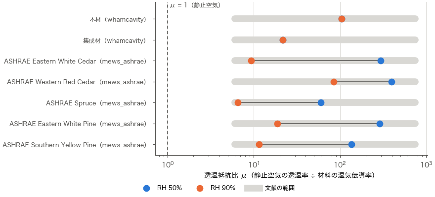
図 1-1　製材・木材 7 材料の透湿抵抗比 μ。青は RH 50%、橙は RH 90%。灰色の帯は、文献の繊維直交方向（と方向の書かれていない値）の μ の最小〜最大（6〜745）で、湿度による違いは表していない。旧 Excel の 2 材料は一定値なので 2 点が重なる。

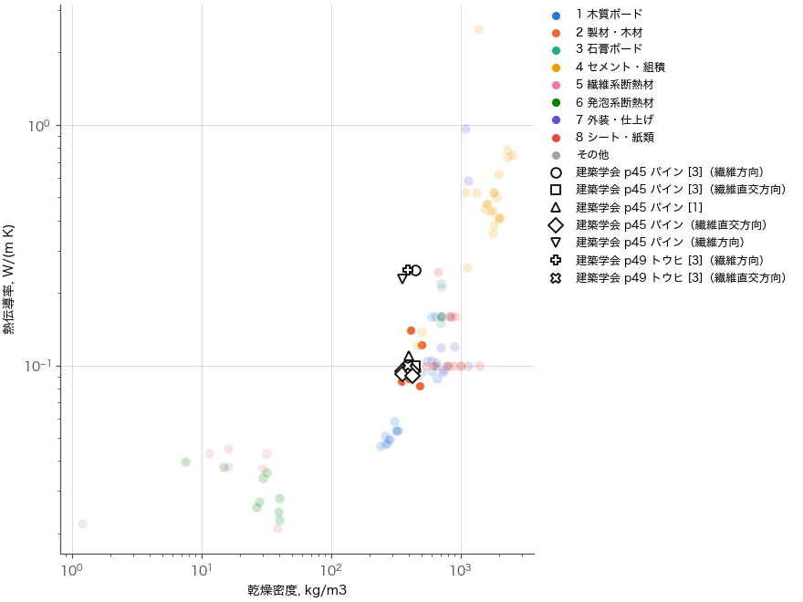
図 1-2　全 100 材料の熱伝導率と乾燥密度。濃い橙が製材・木材、黒い白抜きの印が文献の値（上の 3 点は繊維方向、下は繊維直交方向）。

---

## 2. 見方

判定の 4 段階、指標（μ、ψ）、図の線・印の意味は `01_wood_boards.md` 2 章と同じ。この章では、製材・木材に特有のことだけを書く。

- **方向**：木材は、繊維方向と繊維直交方向で、熱伝導率は 2 倍以上、湿気伝導率は 1〜2 桁、液水拡散係数も 1〜2 桁違う。壁の部材（柱・間柱・下地材）では、熱・水分は主に**繊維直交方向**に流れるので、判定は直交方向の文献値と比べた。文献の凡例には（繊維方向）（繊維直交方向）を書いた。方向の書かれていない値は、直交方向の目安として扱った。
- **平衡含水率の文献**：パイン（510 kg/m³）、サザンパイン（565）、シュガーパイン（365）、トウヒ（420）、木製スラブ。RH 50% 付近で吸湿 0.07〜0.10、放湿 0.09〜0.12 kg/kg、RH 80% 付近で吸湿 0.13〜0.17。
- **トウヒの放湿の 2 点**（RH 65.1・65.4%）は、本では 0.0148・0.0151 だが、前後の値（0.112、0.200）から桁の誤記と見て 0.148・0.151 とした（`ref_data/lumber.csv` の注記）。
- **エースの表のすぎ**は、RH 40% の値（1.5×10⁻¹²）が RH 20% の値（5.2×10⁻¹²）より小さく、誤記の可能性がある。表のまま描いた。
- **液水拡散係数の判定**：`01_wood_boards.md` 2 章の暫定の方式（Künzel の式の目安と RH 99% の含水率で比べ、0.1〜10 倍なら妥当）を使った。吸水係数 A は、パインの**繊維直交方向**の 0.0040 kg/(m²·s^½)（建築学会 p48）を、7 材料すべてに使った。あわせて、NRC の吸水実験による繊維直交方向の見積もり 2.3×10⁻¹¹ m²/s（建築学会 p48）を横の点線で描いた。この判定方式は暫定で、疑問点は `01_wood_boards.md` 2 章にまとめてある。
- 原典のページの画像は、非公開リポジトリ `docs/reference/papers/review_images/`（建築学会 p45〜50・p90、エース p39）。書き写した数値は、画像と見比べて確かめた。

---

## 3. 材料ごとの検討

**文献の値**（建築学会 p45〜50）：パインの乾燥密度 365〜565 kg/m³、比熱 1880。熱伝導率は繊維方向 0.229〜0.25、繊維直交方向 0.0906〜0.1（パイン・トウヒ）。透湿率は、繊維直交方向で RH 20〜40% の 5×10⁻¹³〜1×10⁻¹² から RH 95% の 1.7×10⁻¹¹（トウヒ）まで湿度とともに大きくなり、繊維方向は 5×10⁻¹¹〜1.2×10⁻¹⁰ と 1〜2 桁大きい。液水拡散係数は、繊維方向でパイン 1.7×10⁻¹⁰〜1.5×10⁻⁹、トウヒ 8.5×10⁻¹¹〜5.7×10⁻¹⁰、繊維直交方向の見積もりは 2.3×10⁻¹¹（パイン）。吸水係数はパインで繊維直交方向 0.0040、繊維方向 0.0163、トウヒの繊維方向 0.0096 kg/(m²·s^½)。
### 3.1 木材（旧 Excel）

| 熱 | 平衡含水率 | 湿気伝導率 | 液水拡散係数 |
|---|---|---|---|
| 妥当 | 妥当 | 要注意 | 要注意 |

**根拠**：Fortran の材料 4 と同じ値。平衡含水率の式 1.58·r^1.3664·exp(−2.1708(1−r^90.988)) の出典は不明。Fortran にはコメントアウトされた別の式が 2 つ残っていて、そのうち 1.2725·r^2.3836·exp(−1.9854(1−r^91.36)) は ASHRAE Eastern White Pine の係数と全桁一致する（3.6 節）。湿気伝導率は一定値 1.86×10⁻¹²。

**熱物性**：密度 484、熱伝導率 0.0824 は、繊維直交方向の文献（0.09〜0.1、密度 355〜450）より 1〜2 割小さいが、近い。比熱 1620 は文献 1880 より小さいが、木材の一般的な範囲（1600〜1900）に入る。妥当。

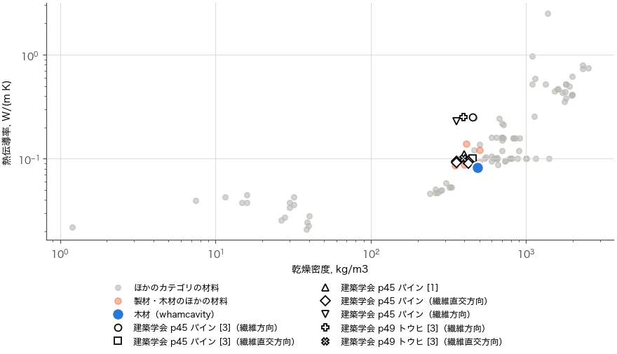
図 3-1　木材：熱伝導率と乾燥密度

**平衡含水率**：RH 50% で 0.070、RH 80% で 0.133。文献の吸湿の点の下側を通るが、幅の中。RH 95% 以上で急に大きくなり、RH 100% で 1.58。妥当。

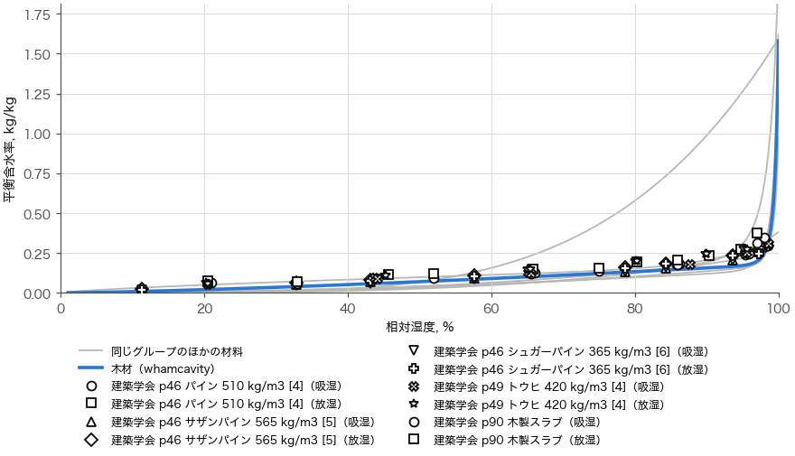
図 3-2　木材：平衡含水率と相対湿度

**湿気伝導率**：**一定値 1.86×10⁻¹²（μ 104）**。RH 50% では繊維直交方向の文献（1〜3×10⁻¹²）と合うが、RH 90% では文献（1〜2.4×10⁻¹¹）より 5〜13 倍湿気を通しにくい（要注意）。

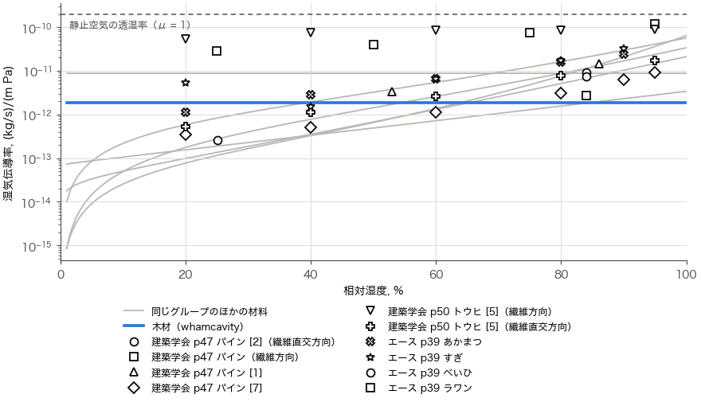
図 3-3　木材：湿気伝導率と相対湿度

**液水拡散係数**：液水が動かない設定。文献では繊維直交方向でも約 2.3×10⁻¹¹ m²/s で動く（要注意）。

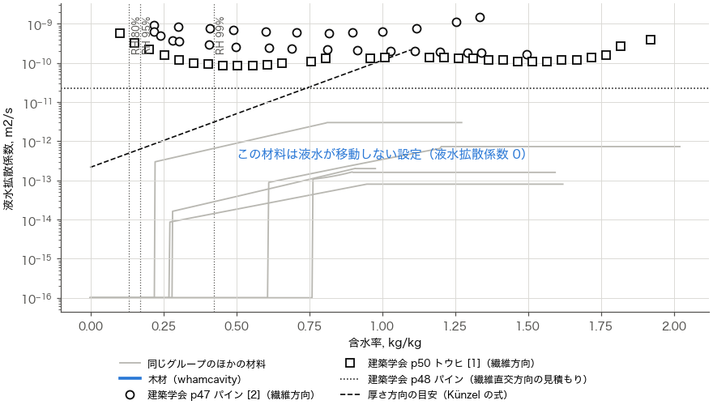
図 3-4　木材：液水拡散係数と含水率

**直す・確かめること（優先：中）**：湿気伝導率を湿度で変わる式にする（例：ASHRAE の製材の式）。結露など高湿の計算をするなら、液水拡散係数を入れることを検討する。

### 3.2 集成材（旧 Excel）

| 熱 | 平衡含水率 | 湿気伝導率 | 液水拡散係数 |
|---|---|---|---|
| 要注意 | 妥当 | 要注意 | 要注意 |

**根拠**：Fortran の材料 18 と同じ値。平衡含水率の式 0.381·r^0.738·exp(−0.849(1−r^9.527)) の出典は不明（Fortran のコメントに「OM」の文字があるが、文字化けで読めない。構造用合板2 と同じ）。湿気伝導率は一定値 8.94×10⁻¹²。

**熱物性**：**熱伝導率 0.1397 は、繊維直交方向の文献（0.09〜0.1）より 4 割大きい**。繊維方向（0.23〜0.25）よりは小さい。**比熱 1260 は、文献 1880 や木材の一般的な値（1600〜1900）より小さい**（要注意）。

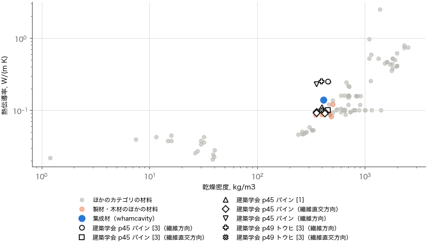
図 3-5　集成材：熱伝導率と乾燥密度

**平衡含水率**：RH 50% で 0.098、RH 80% で 0.153。文献の吸湿と放湿の点の間を通り、妥当。RH 100% で 0.38 と、ほかの木材より小さい。

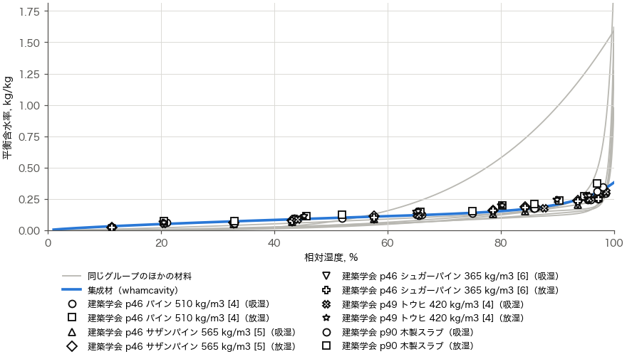
図 3-6　集成材：平衡含水率と相対湿度

**湿気伝導率**：**一定値 8.94×10⁻¹²（μ 22）**。RH 80〜90% では繊維直交方向の文献（0.8〜2.4×10⁻¹¹）に近いが、RH 20〜50% では文献（5×10⁻¹³〜3×10⁻¹²）より 3〜18 倍湿気を通しやすい（要注意）。

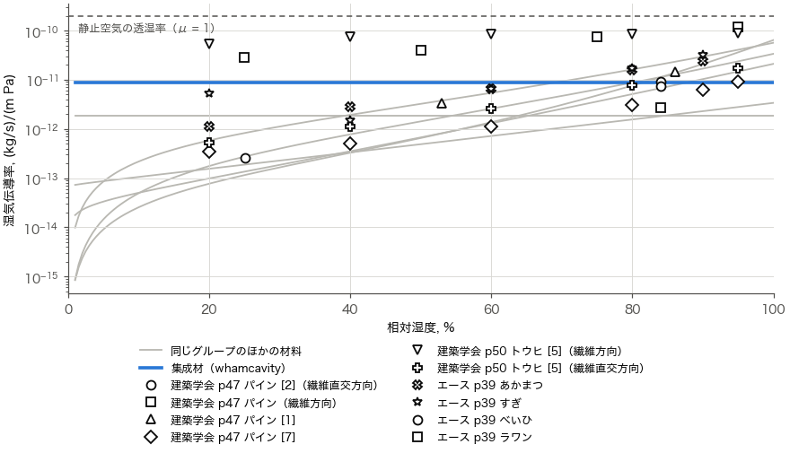
図 3-7　集成材：湿気伝導率と相対湿度

**液水拡散係数**：液水が動かない設定。文献では繊維直交方向でも約 2.3×10⁻¹¹ m²/s で動く（要注意）。

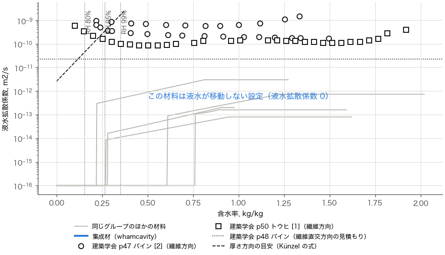
図 3-8　集成材：液水拡散係数と含水率

**直す・確かめること（優先：中）**：熱伝導率 0.14 と比熱 1260 の根拠を確かめる（集成材の接着層の影響か、繊維方向の値が混じったか）。湿気伝導率を湿度で変わる式にする。

### 3.3 ASHRAE Eastern White Cedar（ASHRAE）

| 熱 | 平衡含水率 | 湿気伝導率 | 液水拡散係数 |
|---|---|---|---|
| 妥当 | **誤りの疑い** | 妥当 | 要注意 |

**根拠**：ASHRAE RP-1018（Kumaran 2006、密度 360）。平衡含水率の係数は a = 1.593、b = 4.5488、**c = 0.0036、d = 0.708**。ほかの 4 樹種は c = −1.3〜−2.4、d = 33〜123 で、この材料だけ形が違う。

**熱物性**：密度 360（論文と一致）、熱伝導率 0.093。繊維直交方向の文献（0.09〜0.1）に合い、妥当。

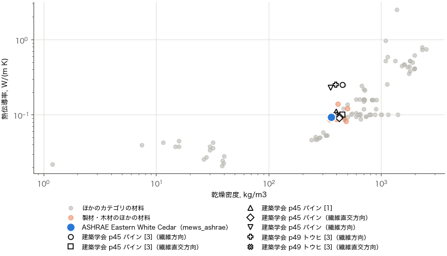
図 3-9　ASHRAE Eastern White Cedar：熱伝導率と乾燥密度

**平衡含水率**：RH 50% で 0.068 は文献（吸湿 0.07〜0.10）に近いが、**RH 80% で 0.58、RH 95% で 1.26 kg/kg** と、文献（RH 80% で 0.13〜0.20）の 3〜4 倍。木材の繊維飽和点（およそ 0.3 kg/kg）を RH 70% で超えてしまい、ありえない。c ≒ 0 のため指数の部分がほぼ 1 になり、a·r^b だけの形になっている。式の当てはめの失敗と見られる（**誤りの疑い**）。ふだんの湿度でも、RH 70% を超えると含水量を大きく見積もる。

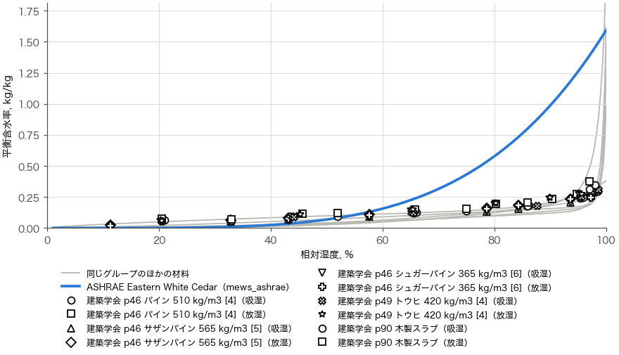
図 3-10　ASHRAE Eastern White Cedar：平衡含水率と相対湿度

**湿気伝導率**：RH 50% で μ 297、RH 90% で μ 9.3。湿度とともに 30 倍大きくなる形で、繊維直交方向の文献の範囲に入る。妥当。

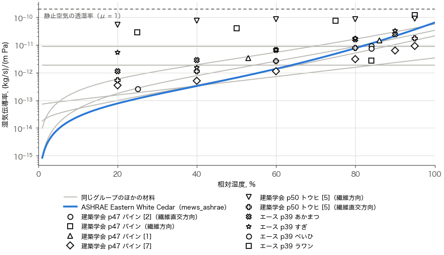
図 3-11　ASHRAE Eastern White Cedar：湿気伝導率と相対湿度

**液水拡散係数**：RH 99% の含水率（1.52、ただし平衡含水率の誤りで大きすぎる）で 1.6×10⁻¹³。厚さ方向の目安の約 1/900、NRC の繊維直交方向の見積もり（2.3×10⁻¹¹）の約 1/140（要注意）。

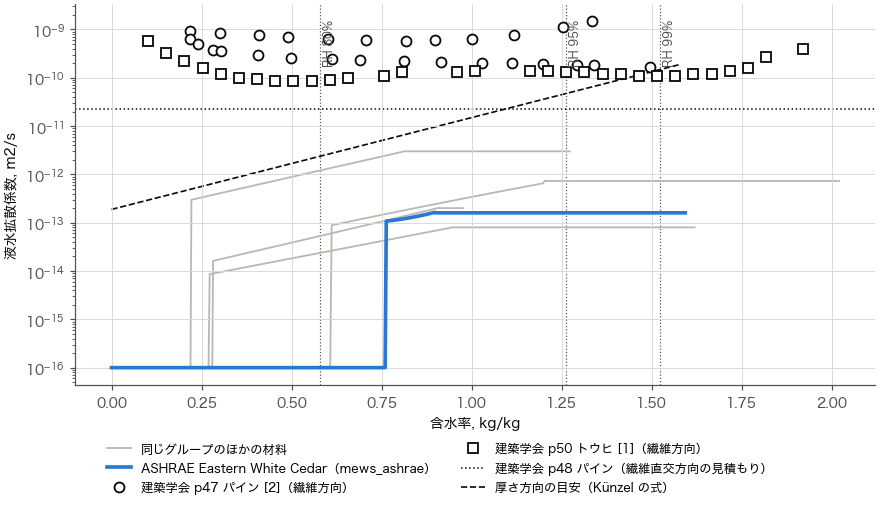
図 3-12　ASHRAE Eastern White Cedar：液水拡散係数と含水率

**直す・確かめること（優先：高）**：平衡含水率の係数を当てはめ直す。RP-1018 の測定値（手元にない）か、ほかのシーダー（Western Red Cedar）や文献の木材の値を使う。

### 3.4 ASHRAE Western Red Cedar（ASHRAE）

| 熱 | 平衡含水率 | 湿気伝導率 | 液水拡散係数 |
|---|---|---|---|
| 妥当 | 要注意 | 要注意 | 要注意 |

**根拠**：ASHRAE RP-1018（Kumaran 2006、密度 350）。液水拡散係数の区間 3 の定数は、No.79 EIFS の区間 2 と全桁一致する（`ashrae_excel_derivation.md`）。

**熱物性**：密度 350（論文と一致）、熱伝導率 0.086。繊維直交方向の文献（0.09〜0.1）に近く、妥当。

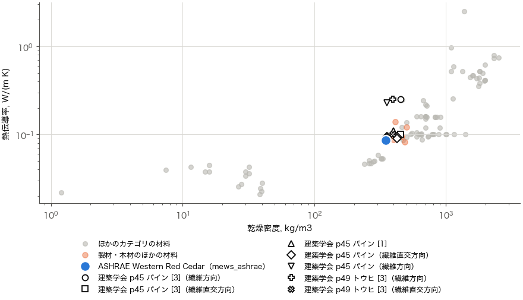
図 3-13　ASHRAE Western Red Cedar：熱伝導率と乾燥密度

**平衡含水率**：RH 50% で 0.041 は、文献の吸湿（0.07〜0.10）の約半分。RH 80% で 0.096 も、文献（0.13〜0.17）の 0.6〜0.7 倍。全体に小さい（要注意）。

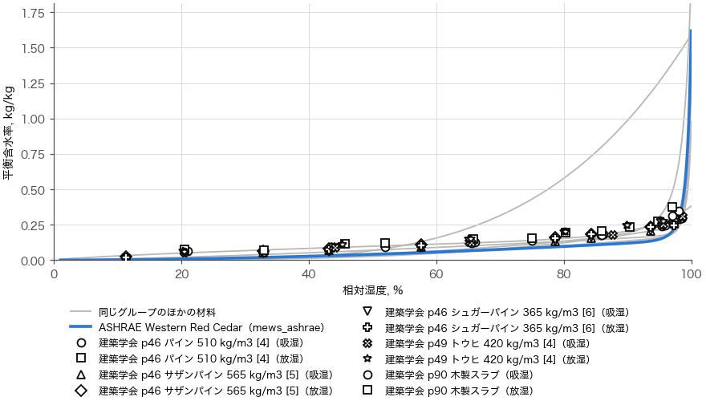
図 3-14　ASHRAE Western Red Cedar：平衡含水率と相対湿度

**湿気伝導率**：RH 50% で μ 397（4.9×10⁻¹³）、RH 90% で μ 84（2.3×10⁻¹²）。低湿では文献の範囲に入るが、RH 90% では繊維直交方向の文献（1〜2.4×10⁻¹¹）より 4〜10 倍湿気を通しにくい（要注意）。

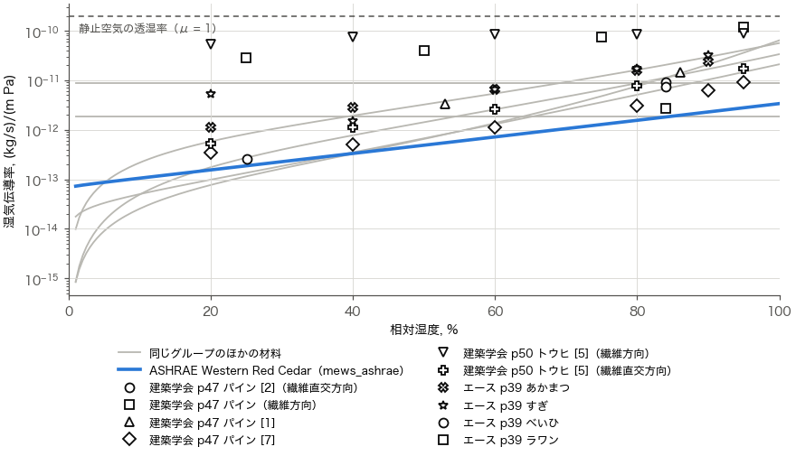
図 3-15　ASHRAE Western Red Cedar：湿気伝導率と相対湿度

**液水拡散係数**：含水率 0.27 以下は 10⁻¹⁶。RH 99% の含水率（0.53）で 2.0×10⁻¹⁴ と、厚さ方向の目安の約 1/300、NRC の繊維直交方向の見積もりの約 1/1000（要注意）。

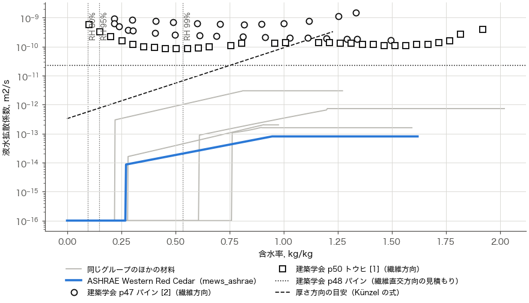
図 3-16　ASHRAE Western Red Cedar：液水拡散係数と含水率

**確かめること（優先：低）**：平衡含水率・湿気伝導率・液水拡散係数を、RP-1018 の最終報告書で確かめたい。

### 3.5 ASHRAE Spruce（ASHRAE）

| 熱 | 平衡含水率 | 湿気伝導率 | 液水拡散係数 |
|---|---|---|---|
| 妥当 | 要注意 | 妥当 | 要注意 |

**根拠**：ASHRAE RP-1018（Kumaran 2006、密度 400）。

**熱物性**：密度 400（論文と一致）、熱伝導率 0.088。トウヒの繊維直交方向の文献（0.1）に近く、妥当。

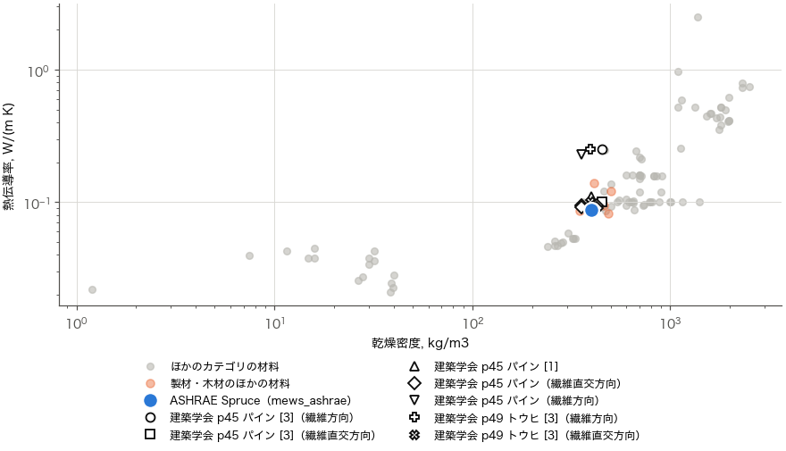
図 3-17　ASHRAE Spruce：熱伝導率と乾燥密度

**平衡含水率**：RH 50% で 0.041 は、トウヒの文献（RH 44% 吸湿 0.085〜0.090）の約 0.4 倍。RH 80% で 0.134 は文献（0.15 前後）とほぼ合う。低湿で小さい（要注意）。RH 100% で 2.02（容積含水率 0.81）と、空隙率の目安（0.73）を少し超える。

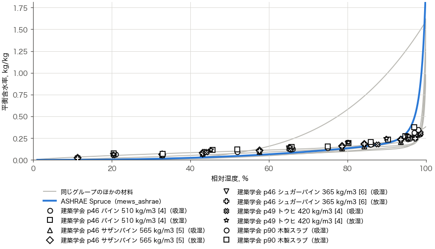
図 3-18　ASHRAE Spruce：平衡含水率と相対湿度

**湿気伝導率**：RH 50% で μ 60（3.2×10⁻¹²）、RH 90% で μ 6.6（3.0×10⁻¹¹）。トウヒの繊維直交方向の文献（RH 40% で 1.1×10⁻¹²、RH 95% で 1.7×10⁻¹¹）の 2〜3 倍で、繊維方向（5〜9×10⁻¹¹）よりは小さい。妥当。

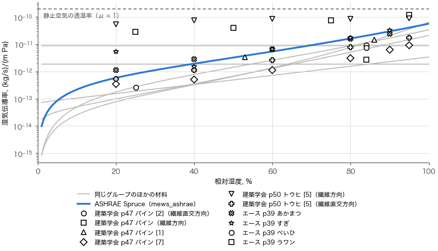
図 3-19　ASHRAE Spruce：湿気伝導率と相対湿度

**液水拡散係数**：含水率 0.61 以下は 10⁻¹⁶。RH 99% の含水率（1.07）で 4.3×10⁻¹³ と、厚さ方向の目安の約 1/20、NRC の繊維直交方向の見積もりの約 1/50。トウヒの繊維方向の文献（10⁻¹⁰ 前後）とは 2〜3 桁違う（要注意）。

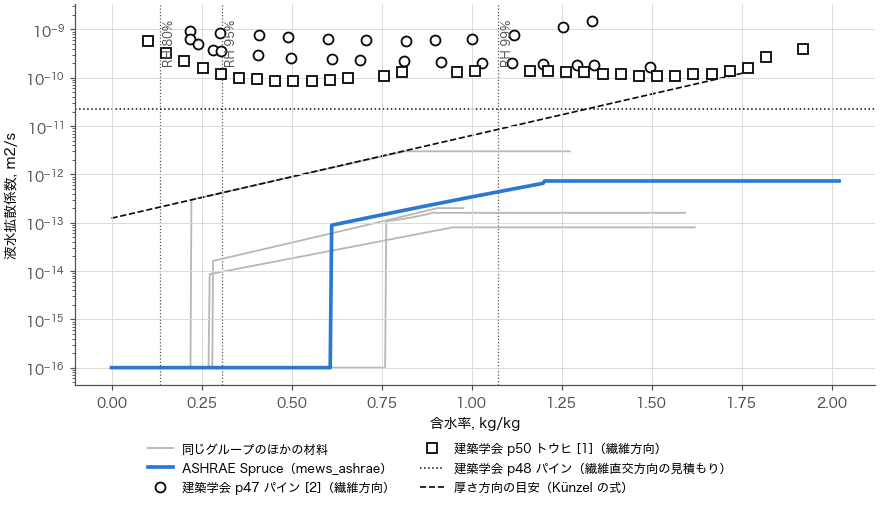
図 3-20　ASHRAE Spruce：液水拡散係数と含水率

**確かめること（優先：低）**：平衡含水率の低湿域と液水拡散係数を、RP-1018 の最終報告書で確かめたい。

### 3.6 ASHRAE Eastern White Pine（ASHRAE）

| 熱 | 平衡含水率 | 湿気伝導率 | 液水拡散係数 |
|---|---|---|---|
| 妥当 | 要注意 | 妥当 | 要注意 |

**根拠**：ASHRAE RP-1018（Kumaran 2006、密度 460）。平衡含水率の係数は、Fortran のコメントアウトされた木材の式と全桁一致する（3.1 節）。

**熱物性**：密度 460（論文と一致）、熱伝導率 0.095。パインの繊維直交方向の文献（0.09〜0.1）に合い、妥当。

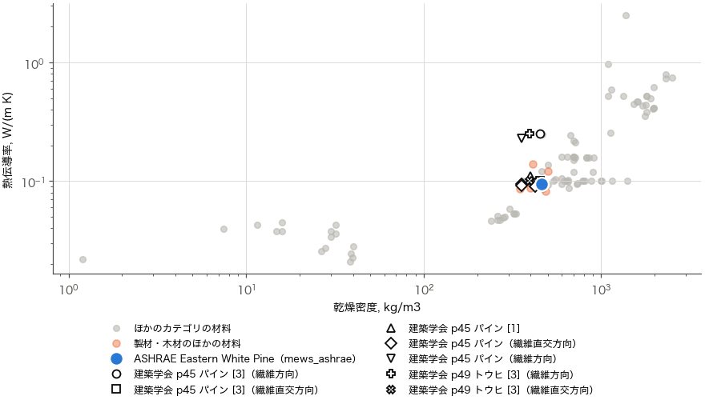
図 3-21　ASHRAE Eastern White Pine：熱伝導率と乾燥密度

**平衡含水率**：RH 50% で 0.033 は、パインの文献（吸湿 0.07〜0.10）の 0.35〜0.5 倍。RH 80% で 0.103 も文献の 0.6〜0.8 倍（要注意）。

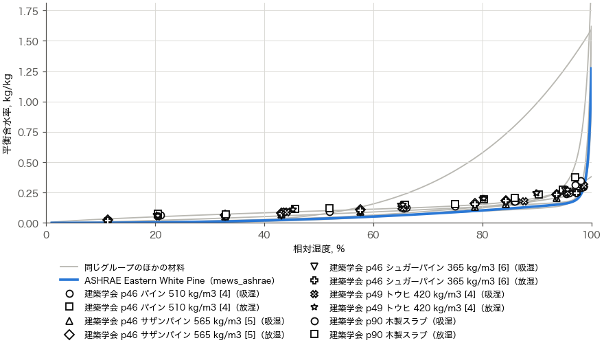
図 3-22　ASHRAE Eastern White Pine：平衡含水率と相対湿度

**湿気伝導率**：RH 50% で μ 288、RH 90% で μ 19。繊維直交方向の文献の範囲に入り、妥当。

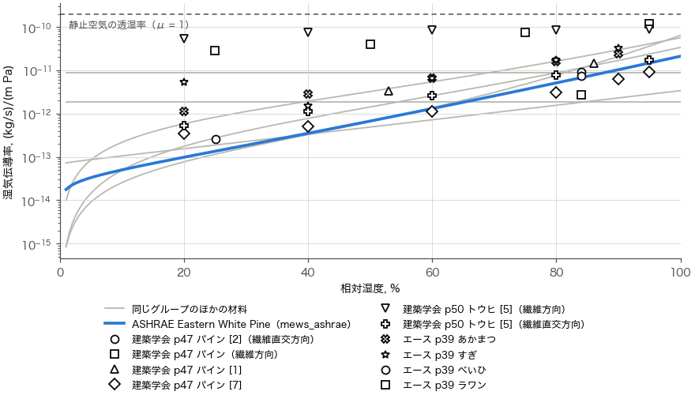
図 3-23　ASHRAE Eastern White Pine：湿気伝導率と相対湿度

**液水拡散係数**：含水率 0.22 以下は 10⁻¹⁶。RH 99% の含水率（0.38）で 5.5×10⁻¹³ と、厚さ方向の目安（6.1×10⁻¹²）の約 1/11、NRC の繊維直交方向の見積もりの約 1/40。目安の 1 桁よりわずかに外れる（要注意）。

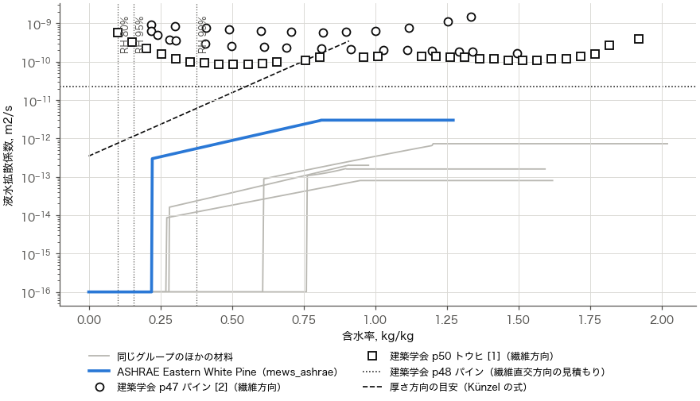
図 3-24　ASHRAE Eastern White Pine：液水拡散係数と含水率

**確かめること（優先：低）**：平衡含水率の低湿域と液水拡散係数を、RP-1018 の最終報告書で確かめたい。

### 3.7 ASHRAE Southern Yellow Pine（ASHRAE）

| 熱 | 平衡含水率 | 湿気伝導率 | 液水拡散係数 |
|---|---|---|---|
| 妥当 | 要注意 | 妥当 | 要注意 |

**根拠**：ASHRAE RP-1018（Kumaran 2006、密度 500）。

**熱物性**：密度 500（論文と一致）、熱伝導率 0.122。文献の繊維直交方向（0.09〜0.1、密度 355〜450）より 2〜3 割大きいが、密度が大きい分として説明できる。妥当。

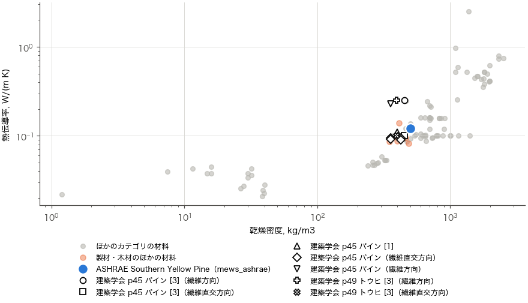
図 3-25　ASHRAE Southern Yellow Pine：熱伝導率と乾燥密度

**平衡含水率**：RH 50% で 0.026 は、サザンパインの文献（565 kg/m³、RH 43〜58% の吸湿 0.067〜0.090）の約 1/3。RH 80% で 0.123 は文献（0.13）とほぼ合う。低湿で小さい（要注意。比が約 1/3 で、MEWS OSB の 1/4 に近い）。

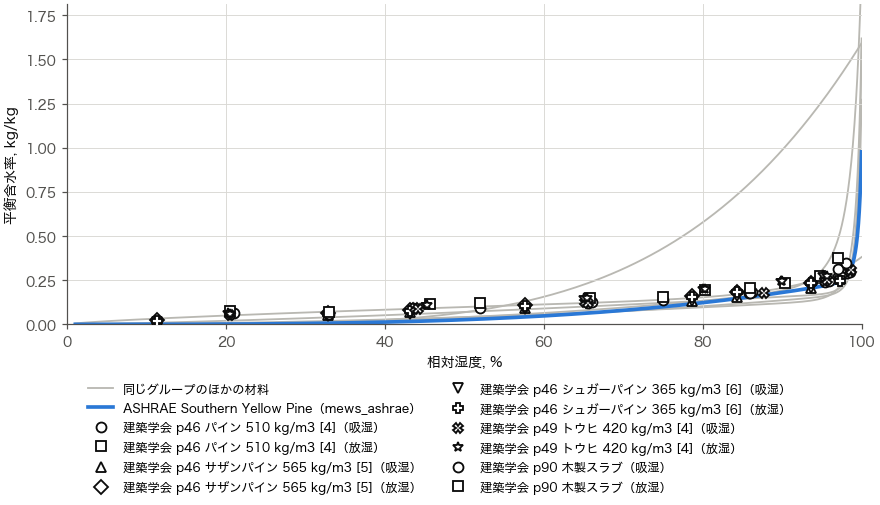
図 3-26　ASHRAE Southern Yellow Pine：平衡含水率と相対湿度

**湿気伝導率**：RH 50% で μ 136、RH 90% で μ 11.5。繊維直交方向の文献の範囲に入り、妥当。

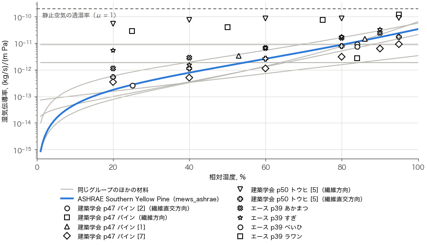
図 3-27　ASHRAE Southern Yellow Pine：湿気伝導率と相対湿度

**液水拡散係数**：含水率 0.28 以下は 10⁻¹⁶。RH 99% の含水率（0.36）で 2.2×10⁻¹⁴ と、厚さ方向の目安（1.5×10⁻¹¹）の約 1/700（要注意）。

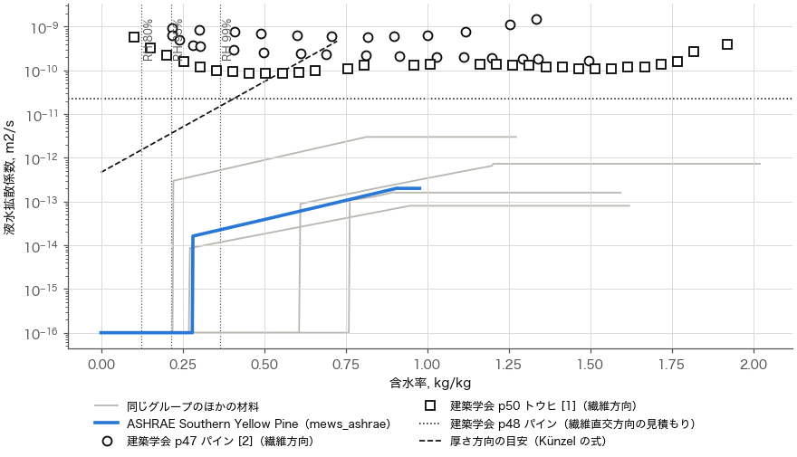
図 3-28　ASHRAE Southern Yellow Pine：液水拡散係数と含水率

**確かめること（優先：中）**：平衡含水率の低湿域が文献の約 1/3 で、ふだんの湿度の含水量を小さく見積もる。RP-1018 の最終報告書で確かめるか、文献の値で当てはめ直すかを検討する。
