# 材料物性レビュー ③ 石膏ボード

作成: 2026-10-21（Claude Code による調査）
対象: 旧 Excel（`whamcavity`）の石膏ボード、新しい Excel（`mews_ashrae`）の MEWS Exterior Grade Gypsum Board、ASHRAE Gypsum・Gypsum + Primer・Gypsum + Primer + Latex、合わせて 5 材料
比べた文献: 建築学会『建築材料の熱・空気・湿気物性値』p41〜44（せっこうボード）・p89（壁用塗料）、エース建築環境工学Ⅱ 表 7.2（p40：プラスターボード）、新しい Excel の出典 RR-110 11 章（Exterior Grade Gypsum Board）・Kumaran 2006。文献の目録は `sources.md`、書き写した数値は `ref_data/gypsum.csv`
図: `make_figures_gypsum.py`

---

## 1. まとめ

判定の基準と図の見方は 2 章（共通のことは `01_wood_boards.md` 2 章）。

| 材料 | 熱 | 平衡含水率 | 湿気伝導率 | 液水拡散係数 | 主な点 | 節 |
|---|---|---|---|---|---|---|
| 石膏ボード（旧） | 妥当 | 要注意 | 妥当 | 要注意 | 平衡含水率は文献どうしで 10 倍以上違い、大きい方（KU-Leuven）に合わせている。液水が動かない | 3.1 |
| MEWS Exterior Grade Gypsum Board | 妥当 | **根拠なし** | 妥当 | 根拠なし | 平衡含水率・液水拡散係数が入っていない（すべて 0） | 3.2 |
| ASHRAE Gypsum | 妥当 | 要注意 | 妥当 | 要注意 | 平衡含水率は 3.1 と同じ。液水拡散係数が NRC の測定値より 4〜5 桁小さい | 3.3 |
| ASHRAE Gypsum + Primer | 妥当 | 要注意 | 妥当 | 要注意 | 同上 | 3.4 |
| ASHRAE Gypsum + Primer + Latex | 妥当 | 要注意 | 妥当 | 要注意 | 同上。湿気伝導率は塗装の分だけ小さく、文献の塗料の幅の中 | 3.5 |

**主な結論**
- **熱物性**：熱伝導率 0.15〜0.22、密度 700、比熱 870 は、すべて文献（0.164〜0.22、700 ± 80、870）の範囲に入る。
- **平衡含水率**：**文献どうしで 10 倍以上違う**。建築学会の本の KU-Leuven のデータ [6]（kg/m³ で与えられ、RH 50% で吸湿 0.043、放湿 0.14 kg/kg と大きく、吸湿と放湿の差も大きい）と、NIST のデータ [7]（RH 50% で 0.004〜0.006 kg/kg）がある。旧 Excel と ASHRAE の 4 材料は同じ式で、**KU-Leuven の吸湿と放湿の平均にほぼ一致する**（RH 10〜98% で 0.87〜1.09 倍）。RH 100% の値 0.57 kg/kg も、NRC の毛細管飽和含水率 400 kg/m³（÷ 700 = 0.57）と一致する。どちらの文献が正しいかは決められないが、NIST に比べるとふだんの湿度での含水量が 10〜20 倍で、**室内の調湿の効果を大きく見積もる側**になる。
- **湿気伝導率**：μ 3〜7 で、文献（μ 3〜9）とよく合う。塗装した 2 材料も、文献の塗料の値から見積もった範囲に入る。
- **液水拡散係数**：NRC の自由水の吸水測定（建築学会 p44 [2a]）は 3×10⁻⁸〜6×10⁻⁷ m²/s と非常に大きい。ASHRAE の 3 材料は 10⁻¹²〜10⁻¹¹ で、**4〜5 桁小さい**。旧 Excel と MEWS は液水が動かない設定。

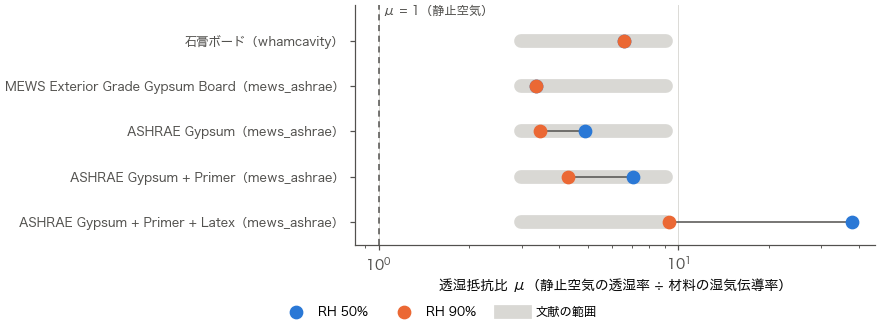
図 1-1　石膏ボード 5 材料の透湿抵抗比 μ。青は RH 50%、橙は RH 90%。灰色の帯は、文献の塗装していないせっこうボードの μ の最小〜最大（3.0〜9.1。エースの表の耐火板を除く）。塗装した ASHRAE Gypsum + Primer + Latex は RH 50% で帯の外（μ 38）だが、塗装の分として説明できる（3.5 節）。

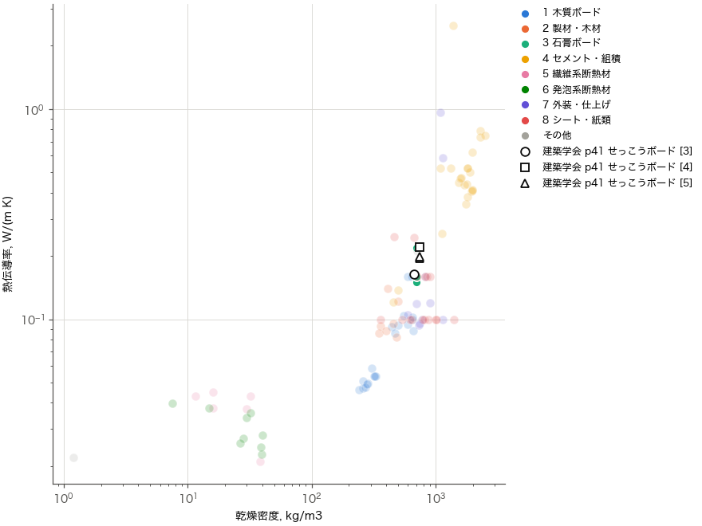
図 1-2　全 100 材料の熱伝導率と乾燥密度。緑が石膏ボード、黒い白抜きの印が文献の値。

---

## 2. 見方

判定の 4 段階、指標（μ、ψ）、図の線・印の意味は `01_wood_boards.md` 2 章と同じ。この章では、石膏ボードに特有のことだけを書く。

- **平衡含水率の文献の単位**：KU-Leuven のデータ [6] は kg/m³ で与えられているので、せっこうボードの乾燥密度 700 で割って kg/kg に直した。NIST のデータ [7] は kg/kg と kg/m³ の両方が書かれていて、kg/kg の値を使った。
- **液水拡散係数の文献**：NRC の自由水の吸水測定 [2a] は含水量 kg/m³ で与えられているので、試料密度 620 で割って kg/kg に直した。測った方向は書かれていない。
- **液水拡散係数の判定**：普通のせっこうボードの厚さ方向の吸水係数は手元の文献にないので、Künzel の式の目安（`01_wood_boards.md` 2 章）は使わず、NRC の測定値 [2a] と比べた。Exterior Grade は RR-110 11 章の吸水係数（面材を通して 約 0.001 kg/(m²·s^½)）と、毛細管飽和含水率 400 kg/m³ で目安を描いた。この判定方式は暫定（`01_wood_boards.md` 2 章）。
- **塗装したせっこうボードの比べ方**：Excel の ASHRAE Gypsum + Primer・+ Primer + Latex は、塗装を含めたボード全体を 1 つの材料として、見かけの湿気伝導率で表している。文献の塗料（建築学会 p89）は湿気拡散厚 μd（m）で与えられているので、厚さ 12.7 mm のボード（McLean の式、建築学会 p43）に直列に足した見かけの湿気伝導率に直して描いた（凡例「塗装したせっこうボード（換算）」）。
- 原典のページの画像は、非公開リポジトリ `docs/reference/papers/review_images/`（建築学会 p41〜44・p89、エース p40）。書き写した数値は、画像と見比べて確かめた。

---

## 3. 材料ごとの検討

**文献の値**（建築学会 p41〜44）：乾燥密度 700 ± 80 kg/m³、比熱 870 J/(kg·K)、空隙率 約 0.7、熱伝導率 0.164（NRC、669 kg/m³）〜0.22（KU-Leuven、747 kg/m³）。平衡含水率は KU-Leuven [6] と NIST [7] で 10 倍以上違う（1 章）。透湿率は 2.0〜6.5×10⁻¹¹（μ 3〜9）で、湿度とともに少し大きくなる。McLean らの式（20 ℃）は厚さ 12 mm で (1.78 + 0.018·RH)×10⁻¹¹。液水拡散係数は NRC の自由水の吸水測定で 3×10⁻⁸〜6×10⁻⁷ m²/s、毛細管飽和含水率 約 400 kg/m³。エースの表のプラスターボード（密度 963、厚さ 9 mm）は 2.7〜4.0×10⁻¹¹。
### 3.1 石膏ボード（旧 Excel）

| 熱 | 平衡含水率 | 湿気伝導率 | 液水拡散係数 |
|---|---|---|---|
| 妥当 | 要注意 | 妥当 | 要注意 |

**根拠**：Fortran の材料 6 と同じ平衡含水率の式（Fortran のコメントに「ASHRAE GYPSUM」）。熱伝導率 0.2192、比熱 870、密度 700、湿気伝導率は一定値 2.93×10⁻¹¹。Fortran の材料データファイル（`mcoff1.prn`）では比熱 2840、密度 318 で、旧 Excel と違う（HANDOFF の要確認）。

**熱物性**：密度 700、熱伝導率 0.219、比熱 870。KU-Leuven の測定（0.195〜0.22、密度 746〜747）とほぼ同じで、NRC（0.164、669）よりは大きい。文献の範囲に入り、妥当。

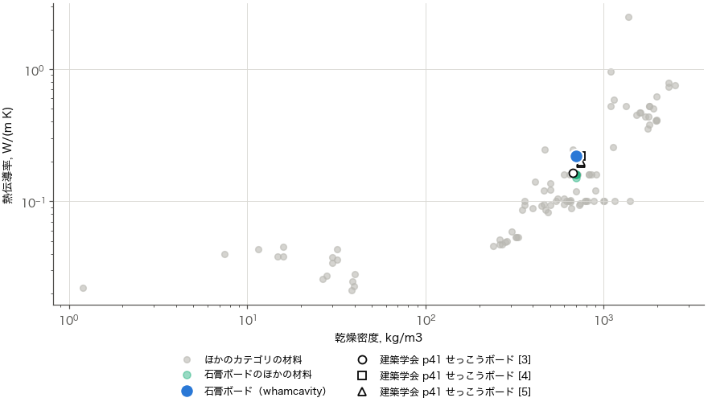
図 3-1　石膏ボード：熱伝導率と乾燥密度

**平衡含水率**：旧 Excel・ASHRAE の 4 材料と同じ式（0.56978·r^0.18552·exp(−1.6445(1−r^75.811))）。RH 50% で 0.097、RH 80% で 0.106、RH 100% で 0.57 kg/kg。KU-Leuven [6] の吸湿（RH 50% で 0.043）と放湿（0.14）のほぼ平均で、平均との比は RH 10〜98% で 0.87〜1.09。RH 100% の 0.57 は、NRC の毛細管飽和含水率 400 kg/m³ を密度 700 で割った値と一致する。一方、NIST [7] は RH 50% で 0.004〜0.006 と、Excel の 1/15〜1/25。**文献どうしで 10 倍以上違い、どちらが正しいかは手元の資料では決められない**（要注意）。KU-Leuven のデータは、吸湿と放湿の差が非常に大きい（RH 10% で 0.033 と 0.12）。Excel はその平均を使っているので、吸湿・放湿のどちらの過程でも文献の点から外れる。

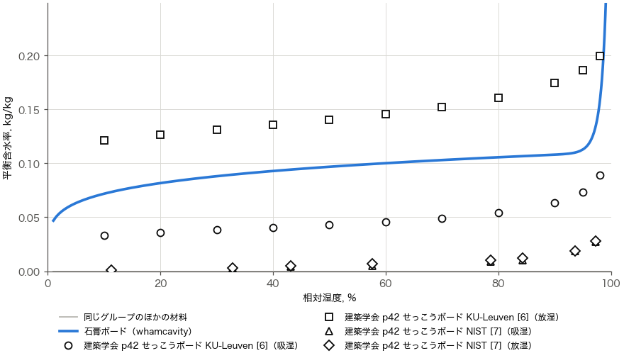
図 3-2　石膏ボード：平衡含水率と相対湿度

**湿気伝導率**：一定値 2.93×10⁻¹¹（μ 6.6）。文献（2.0〜6.5×10⁻¹¹）の中ほどで、妥当。文献の値は湿度で 1.5〜2 倍しか変わらないので、一定値でも大きな問題はない。

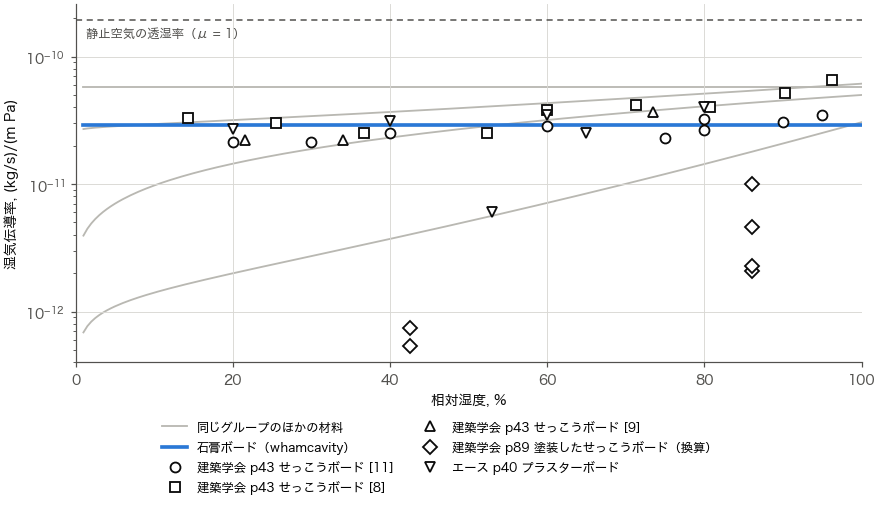
図 3-3　石膏ボード：湿気伝導率と相対湿度

**液水拡散係数**：液水が動かない設定。NRC の測定 [2a] では 3×10⁻⁸〜6×10⁻⁷ m²/s と、非常によく動く（要注意）。

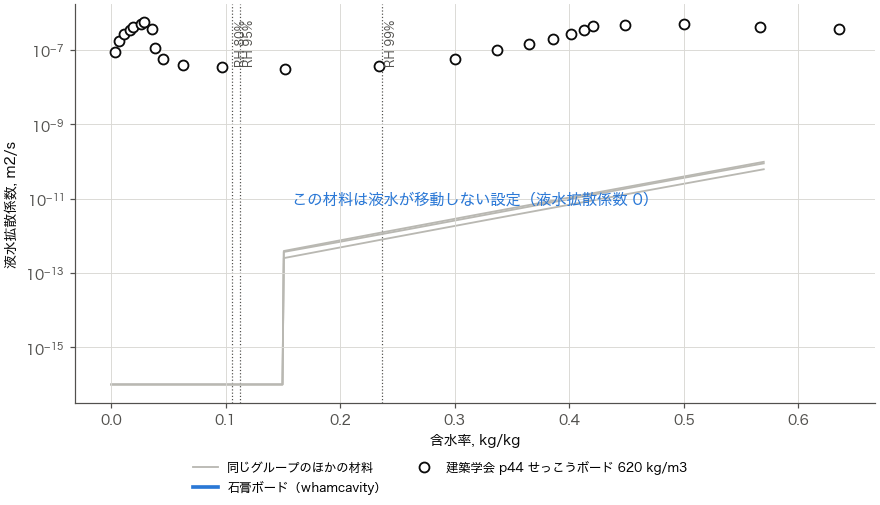
図 3-4　石膏ボード：液水拡散係数と含水率

**確かめること（優先：中）**：平衡含水率の文献の違い（KU-Leuven と NIST）を、ほかの資料（例：RP-1018 の最終報告書、国内の測定値）で確かめたい。結露など高湿の計算をするなら、液水拡散係数を入れることを検討する。

### 3.2 MEWS Exterior Grade Gypsum Board（MEWS）

| 熱 | 平衡含水率 | 湿気伝導率 | 液水拡散係数 |
|---|---|---|---|
| 妥当 | **根拠なし** | 妥当 | 根拠なし |

**根拠**：RR-110 11 章。普通のせっこうボードとの違いを確かめるための spot check だけで、熱伝導率 0.15、パーミアンス 4.43×10⁻⁹ kg/(m²·s·Pa)（RH 80%、厚さ 13 mm）、吸水係数（面材を通して 約 0.001、小口から 約 0.006）が書かれている。平衡含水率は測っていない。Excel の液水拡散係数の欄の a（−22.93）は MEWS Siding V の値と全桁一致するが、範囲分け数 0 なので使われない（`mews_excel_derivation.md` 5.3 節）。

**熱物性**：密度 700、熱伝導率 0.15（RR-110 の測定値）。文献の範囲の下端で、妥当。

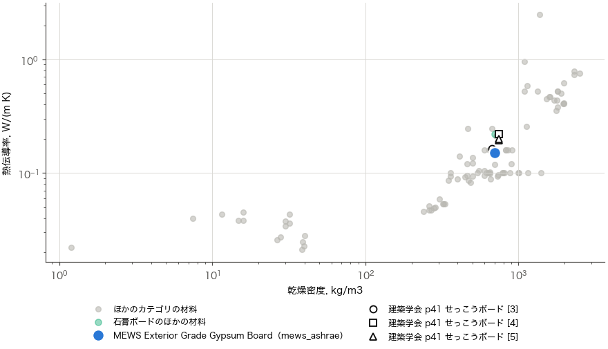
図 3-5　MEWS Exterior Grade Gypsum Board：熱伝導率と乾燥密度

**平衡含水率**：**どの湿度でも 0**（係数がすべて 0）。RR-110 に測定値がない。芯は普通のせっこうボードと同じように吸湿するはずで、物理的でない（根拠なし）。

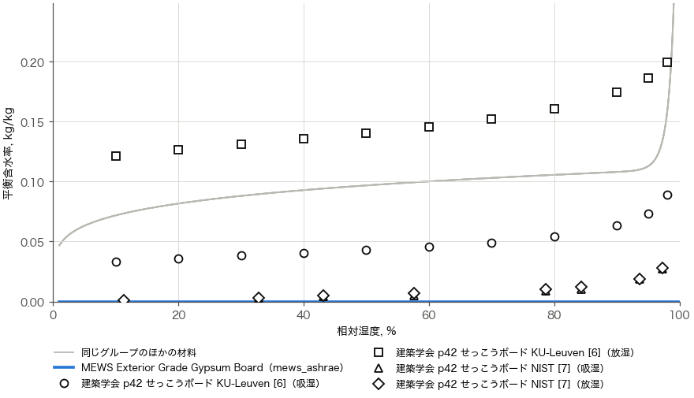
図 3-6　MEWS Exterior Grade Gypsum Board：平衡含水率と相対湿度

**湿気伝導率**：一定値 5.8×10⁻¹¹（μ 3.3）。RR-110 のパーミアンス × 厚さ 13 mm の値で、文献の普通のせっこうボード（2.0〜6.5×10⁻¹¹）の上の方。妥当。

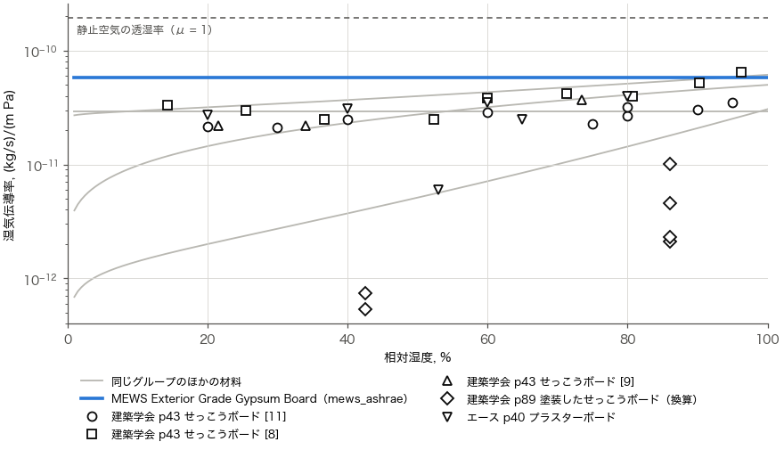
図 3-7　MEWS Exterior Grade Gypsum Board：湿気伝導率と相対湿度

**液水拡散係数**：液水が動かない設定（範囲分け数 0）。RR-110 には「液水の移動は普通のせっこうボードよりずっと遅い」とあり、面材を通した吸水係数 0.001 から求めた厚さ方向の目安（Künzel の式、wf = 400 kg/m³）は、含水率 0.3〜0.57 で 10⁻¹²〜2×10⁻¹¹ 程度。0 ではない（根拠なし）。

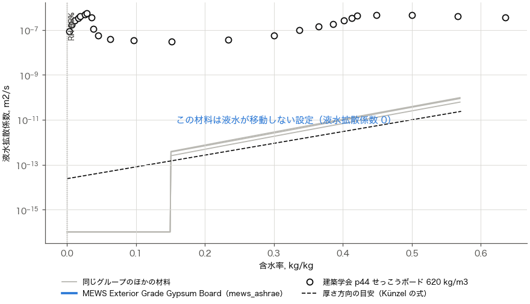
図 3-8　MEWS Exterior Grade Gypsum Board：液水拡散係数と含水率

**直す・確かめること（優先：中）**：平衡含水率が入っていないので、壁の計算に使うなら、普通のせっこうボードの値（3.1 節と同じ式）を使うのが自然。液水拡散係数は、面材を通した吸水係数からの目安を使うか検討する。

### 3.3 ASHRAE Gypsum（ASHRAE）

| 熱 | 平衡含水率 | 湿気伝導率 | 液水拡散係数 |
|---|---|---|---|
| 妥当 | 要注意 | 妥当 | 要注意 |

**根拠**：ASHRAE RP-1018（Kumaran 2006 の Interior Gypsum Board）。Excel の密度 700 は、論文の 625 と違う（`ashrae_excel_derivation.md`）。液水拡散係数の区間 1 と 2 の間のすき間（0.13〜0.15）は、前の区間を延ばして埋めている。

**熱物性**：密度 700（論文は 625）、熱伝導率 0.16。NRC の測定（0.164）とほぼ同じで、妥当。

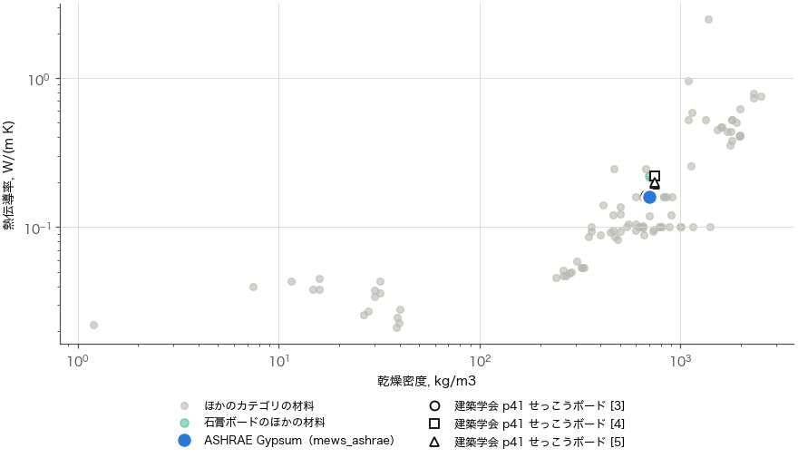
図 3-9　ASHRAE Gypsum：熱伝導率と乾燥密度

**平衡含水率**：旧 Excel・ASHRAE の 4 材料と同じ式（0.56978·r^0.18552·exp(−1.6445(1−r^75.811))）。RH 50% で 0.097、RH 80% で 0.106、RH 100% で 0.57 kg/kg。KU-Leuven [6] の吸湿（RH 50% で 0.043）と放湿（0.14）のほぼ平均で、平均との比は RH 10〜98% で 0.87〜1.09。RH 100% の 0.57 は、NRC の毛細管飽和含水率 400 kg/m³ を密度 700 で割った値と一致する。一方、NIST [7] は RH 50% で 0.004〜0.006 と、Excel の 1/15〜1/25。**文献どうしで 10 倍以上違い、どちらが正しいかは手元の資料では決められない**（要注意）。KU-Leuven のデータは、吸湿と放湿の差が非常に大きい（RH 10% で 0.033 と 0.12）。Excel はその平均を使っているので、吸湿・放湿のどちらの過程でも文献の点から外れる。

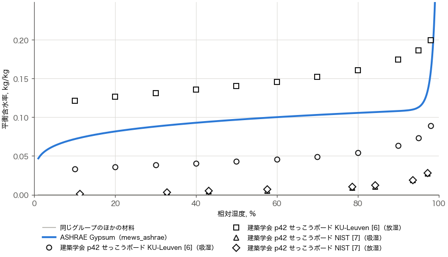
図 3-10　ASHRAE Gypsum：平衡含水率と相対湿度

**湿気伝導率**：RH 50% で 4.0×10⁻¹¹（μ 4.9）、RH 90% で 5.6×10⁻¹¹（μ 3.5）。文献の点とよく合い、妥当。

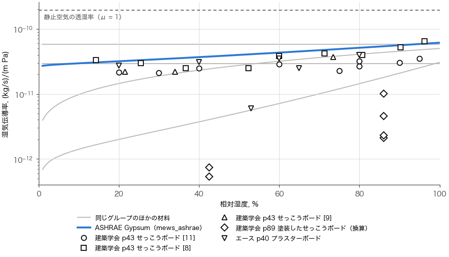
図 3-11　ASHRAE Gypsum：湿気伝導率と相対湿度

**液水拡散係数**：含水率 0.15 以下は 10⁻¹⁶（実質 0）。RH 99% の含水率（0.24）で 1.1×10⁻¹²、含水率 0.4 で 1.0×10⁻¹¹。NRC の測定 [2a]（同じ含水率で 4×10⁻⁸〜3×10⁻⁷）より **4〜5 桁小さい**（要注意）。ほかのカテゴリと同じく、RP-1018 の液水拡散係数は NRC のほかの測定値よりずっと小さい傾向がある。

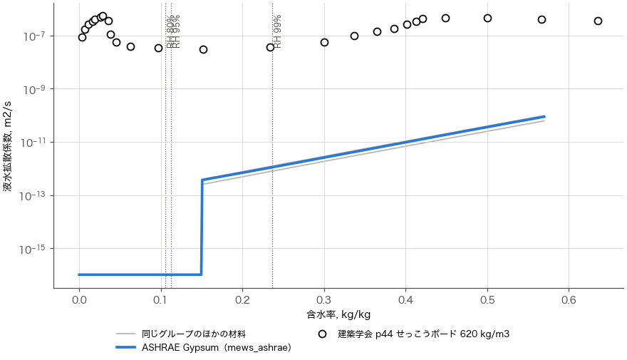
図 3-12　ASHRAE Gypsum：液水拡散係数と含水率

**確かめること（優先：中）**：平衡含水率の文献の違い（3.1 節と同じ）。液水拡散係数が NRC の測定と 4〜5 桁違う理由を、RP-1018 の最終報告書で確かめたい。密度 700 と論文の 625 の違いも確かめる。

### 3.4 ASHRAE Gypsum + Primer（ASHRAE）

| 熱 | 平衡含水率 | 湿気伝導率 | 液水拡散係数 |
|---|---|---|---|
| 妥当 | 要注意 | 妥当 | 要注意 |

**根拠**：ASHRAE RP-1018（Kumaran 2006 の Primer and Two Coats of a Latex Paint on Gypsum Board の、プライマーだけの段階と見られる）。塗装を含めたボード全体を 1 つの材料とし、湿気伝導率だけを ASHRAE Gypsum から変えている。密度 700 は論文の Interior Gypsum Board（625）と違う。

**熱物性**：ASHRAE Gypsum と同じ（密度 700、熱伝導率 0.16）。塗装は薄いので、熱物性は同じでよい。妥当。

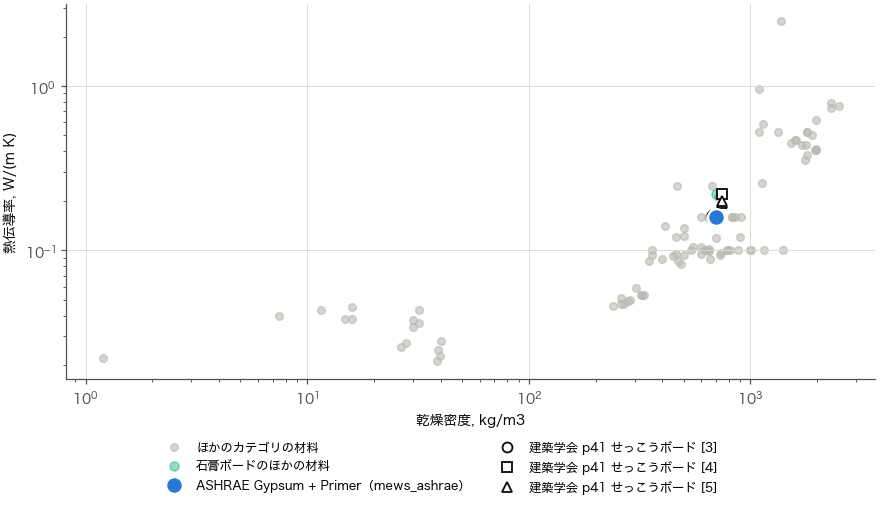
図 3-13　ASHRAE Gypsum + Primer：熱伝導率と乾燥密度

**平衡含水率**：旧 Excel・ASHRAE の 4 材料と同じ式（0.56978·r^0.18552·exp(−1.6445(1−r^75.811))）。RH 50% で 0.097、RH 80% で 0.106、RH 100% で 0.57 kg/kg。KU-Leuven [6] の吸湿（RH 50% で 0.043）と放湿（0.14）のほぼ平均で、平均との比は RH 10〜98% で 0.87〜1.09。RH 100% の 0.57 は、NRC の毛細管飽和含水率 400 kg/m³ を密度 700 で割った値と一致する。一方、NIST [7] は RH 50% で 0.004〜0.006 と、Excel の 1/15〜1/25。**文献どうしで 10 倍以上違い、どちらが正しいかは手元の資料では決められない**（要注意）。KU-Leuven のデータは、吸湿と放湿の差が非常に大きい（RH 10% で 0.033 と 0.12）。Excel はその平均を使っているので、吸湿・放湿のどちらの過程でも文献の点から外れる。 平衡含水率の係数は ASHRAE Gypsum と最後の桁だけ違う（b = 0.18551、d = 75.806）が、値はほぼ同じ。

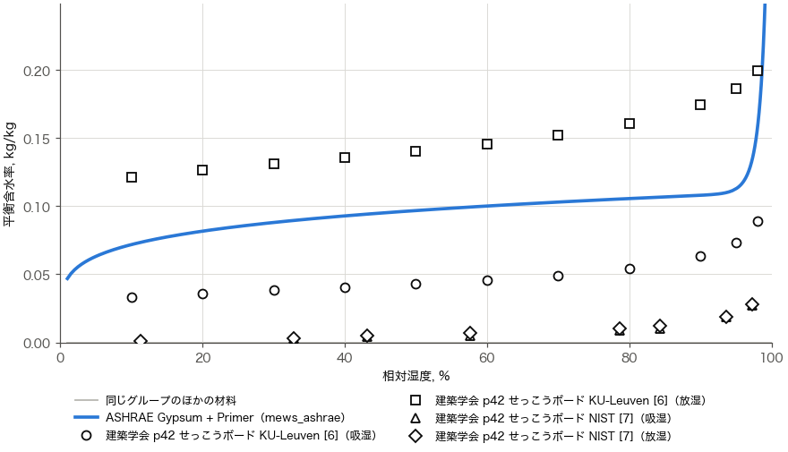
図 3-14　ASHRAE Gypsum + Primer：平衡含水率と相対湿度

**湿気伝導率**：RH 50% で 2.7×10⁻¹¹（μ 7.1）、RH 90% で 4.5×10⁻¹¹（μ 4.3）。塗装していない ASHRAE Gypsum の 0.7〜0.8 倍で、プライマーの分だけ小さい。文献の塗装していないボードの範囲の下側に入り、妥当。

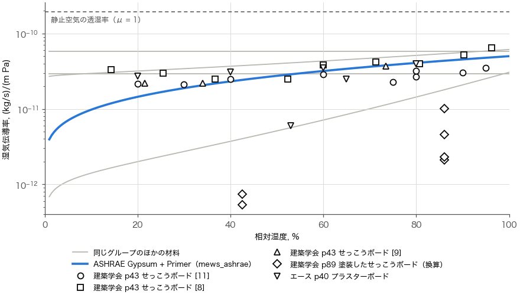
図 3-15　ASHRAE Gypsum + Primer：湿気伝導率と相対湿度

**液水拡散係数**：含水率 0.15 以下は 10⁻¹⁶。RH 99% の含水率で 1.2×10⁻¹²。ASHRAE Gypsum とほぼ同じで、NRC の測定より 4〜5 桁小さい（要注意）。

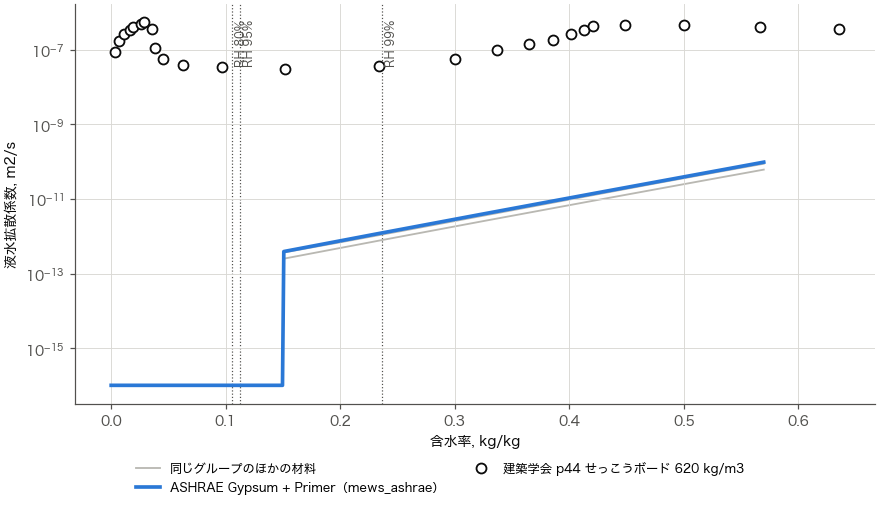
図 3-16　ASHRAE Gypsum + Primer：液水拡散係数と含水率

**確かめること（優先：低）**：3.3 節と同じ。塗装を材料全体の見かけの値で表しているので、Excel を作ったときの厚さ（12.7 mm と見られる）と違う厚さで使うと、塗装の抵抗の大きさが変わる点に注意。

### 3.5 ASHRAE Gypsum + Primer + Latex（ASHRAE）

| 熱 | 平衡含水率 | 湿気伝導率 | 液水拡散係数 |
|---|---|---|---|
| 妥当 | 要注意 | 妥当 | 要注意 |

**根拠**：ASHRAE RP-1018（Kumaran 2006 の Primer and Two Coats of a Latex Paint on Gypsum Board）。3.4 節と同じく、塗装を含めたボード全体を 1 つの材料としている。

**熱物性**：ASHRAE Gypsum と同じ（密度 700、熱伝導率 0.16）。妥当。

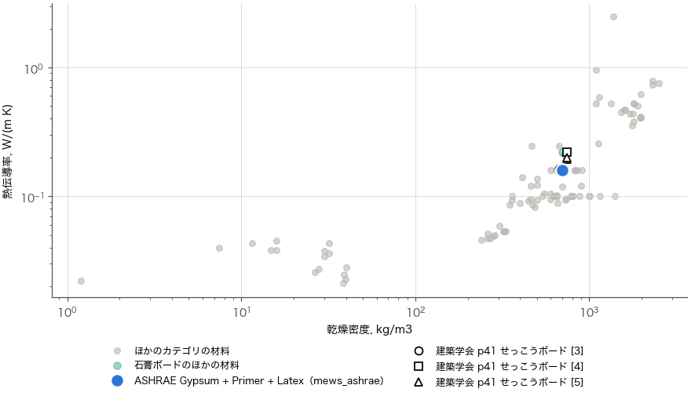
図 3-17　ASHRAE Gypsum + Primer + Latex：熱伝導率と乾燥密度

**平衡含水率**：旧 Excel・ASHRAE の 4 材料と同じ式（0.56978·r^0.18552·exp(−1.6445(1−r^75.811))）。RH 50% で 0.097、RH 80% で 0.106、RH 100% で 0.57 kg/kg。KU-Leuven [6] の吸湿（RH 50% で 0.043）と放湿（0.14）のほぼ平均で、平均との比は RH 10〜98% で 0.87〜1.09。RH 100% の 0.57 は、NRC の毛細管飽和含水率 400 kg/m³ を密度 700 で割った値と一致する。一方、NIST [7] は RH 50% で 0.004〜0.006 と、Excel の 1/15〜1/25。**文献どうしで 10 倍以上違い、どちらが正しいかは手元の資料では決められない**（要注意）。KU-Leuven のデータは、吸湿と放湿の差が非常に大きい（RH 10% で 0.033 と 0.12）。Excel はその平均を使っているので、吸湿・放湿のどちらの過程でも文献の点から外れる。

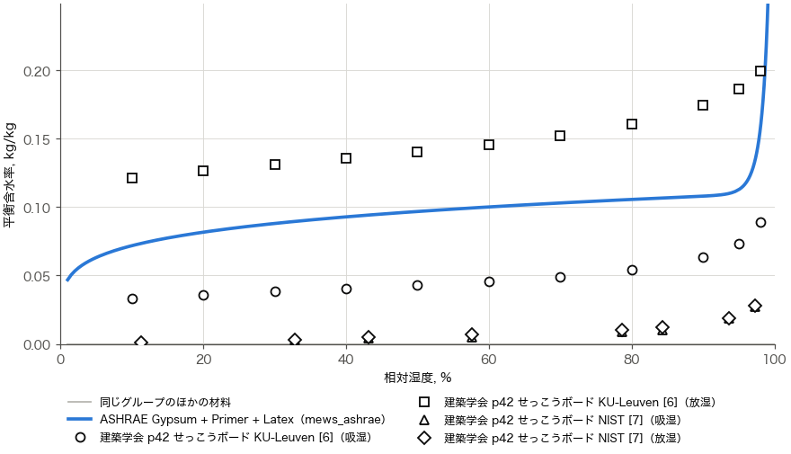
図 3-18　ASHRAE Gypsum + Primer + Latex：平衡含水率と相対湿度

**湿気伝導率**：RH 50% で 5.1×10⁻¹²（μ 38）、RH 90% で 2.1×10⁻¹¹（μ 9.3）。塗装していないボードより低湿で 8 倍、高湿で 2.7 倍小さい。文献の塗料（建築学会 p89）をボードに足した見かけの値は、塗料の種類で 5×10⁻¹³〜1×10⁻¹¹ と大きく違う（ラテックス 1：μd 0.17 m、ラテックス 2：μd 1.10〜4.50 m）。Excel の値は μd の小さいラテックス 1 に近く（RH 86% で 1.8 倍）、塗料の幅の中。妥当。

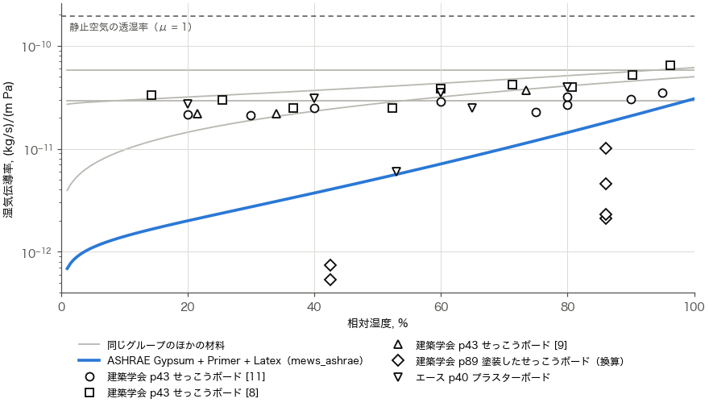
図 3-19　ASHRAE Gypsum + Primer + Latex：湿気伝導率と相対湿度

**液水拡散係数**：含水率 0.15 以下は 10⁻¹⁶。RH 99% の含水率で 7.9×10⁻¹³。NRC の測定より 4〜5 桁小さい（要注意）。

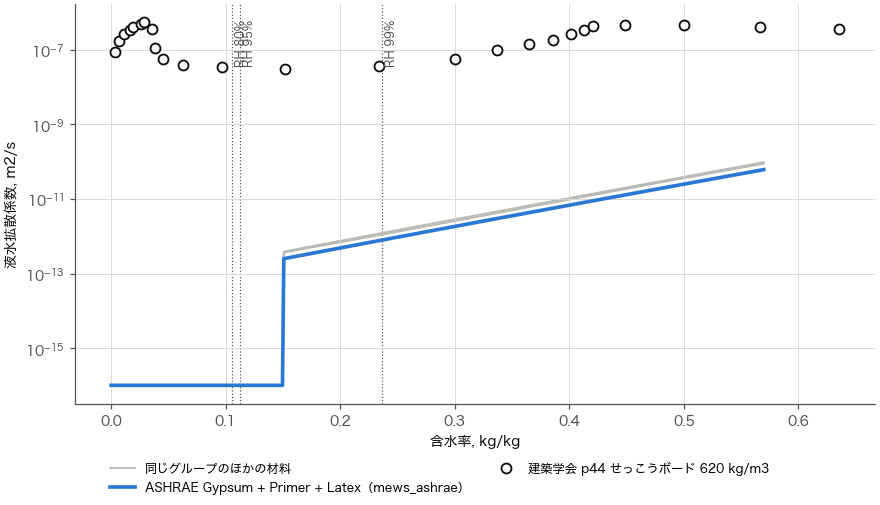
図 3-20　ASHRAE Gypsum + Primer + Latex：液水拡散係数と含水率

**確かめること（優先：低）**：3.4 節と同じ（塗装を見かけの値で表していることと厚さの関係）。
