# 材料物性レビュー ④ セメント・組積

作成: 2026-10-21（Claude Code による調査）
対象: 23 材料。旧 Excel（`whamcavity`）の ALC・軽量モルタル・土壁、新しい Excel（`mews_ashrae`）の MEWS Aerated Concrete・Brick I〜VI・Mortar 4 種・Stucco 3 種、ASHRAE Clay Brick・Mortar・Stucco・Fibre Cement Board・Cement Board・Lime Stone
比べた文献: 建築学会『建築材料の熱・空気・湿気物性値』p27〜40（気泡コンクリート、レンガ、セメントモルタル）・p62（砂-石灰石）・p65〜66（繊維セメント）、エース建築環境工学Ⅱ 表 7.2（p39：モルタル、石灰プラスター、気泡コンクリート板）、新しい Excel の出典 RR-110（MEWS の材料。表の値は `mews_check/rr110_tables.py`）・Kumaran 2006（Aerated Concrete の Table 8）。文献の目録は `sources.md`、書き写した数値は `ref_data/cement_masonry.csv`
図: `make_figures_cement_masonry.py`

---

## 1. まとめ

判定の基準と図の見方は 2 章（共通のことは `01_wood_boards.md` 2 章）。

| 材料 | 熱 | 平衡含水率 | 湿気伝導率 | 液水拡散係数 | 主な点 | 節 |
|---|---|---|---|---|---|---|
| ALC（旧） | 妥当 | 要注意 | 妥当 | 要注意 | RH 95% 以上の含水率が文献の 1/2〜1/6。液水が動かない | 3.1 |
| MEWS Aerated Concrete | 妥当 | **誤りの疑い** | 妥当 | 妥当 | RH 50% の含水率がほぼ 0（文献の 1/1000 以下） | 3.2 |
| MEWS Brick I - White Concrete Brick | 妥当 | 妥当 | 妥当 | 妥当 | | 4.1 |
| MEWS Brick II - Red Matt Clay Brick | 妥当 | 妥当 | 要注意 | 要注意 | 低湿の湿気伝導率が出典の約 1/5。液水拡散係数が目安の約 1/30 | 4.2 |
| MEWS Brick III - Buff Matt Clay Brick | 妥当 | 要注意 | 妥当 | 要注意 | RH 50% の含水率がほぼ 0。液水拡散係数が目安の 1/2000 | 4.3 |
| MEWS Brick IV - Textured Coated Clay Brick | 妥当 | 要注意 | 妥当 | 要注意 | 含水率が出典の 5〜56 倍。液水拡散係数が目安の 1/5000 | 4.4 |
| MEWS Brick V - Concrete Brick | 妥当 | 妥当 | 妥当 | 妥当 | | 4.5 |
| MEWS Brick VI - Calcium Silicate Brick | 妥当 | 妥当 | 妥当 | 要注意 | 液水拡散係数が目安の約 1/35 | 4.6 |
| ASHRAE Clay Brick | 妥当 | 妥当 | 妥当 | 妥当 | 測った範囲より下の液水拡散係数は 10⁻¹⁶ | 4.7 |
| 軽量モルタル（旧） | 要注意 | 根拠なし | 妥当 | 要注意 | 熱伝導率が文献の式の約 1.5 倍。液水が動かない | 5.1 |
| MEWS Mortar 1-S | 要注意 | 妥当 | 妥当 | 妥当 | 熱伝導率が文献の式の 0.5〜0.8 倍（出典の測定値とは合う） | 5.2 |
| MEWS Mortar 1-N | 要注意 | 妥当 | 妥当 | 妥当 | 同上 | 5.3 |
| MEWS Mortar 2-S | 要注意 | 要注意 | 妥当 | 妥当 | 同上。RH 50% の吸湿の含水率が出典の 5 倍 | 5.4 |
| MEWS Mortar 2-N | 要注意 | 要注意 | 妥当 | 妥当 | 同上 | 5.5 |
| ASHRAE Mortar | 要注意 | 妥当 | 妥当 | 要注意 | 熱伝導率が文献の式の約 0.7 倍。液水拡散係数は吸水係数が分からず判定しにくい | 5.6 |
| MEWS Regular Lime Stucco | 妥当 | 妥当 | 妥当 | 要注意 | 液水拡散係数は出典の表と合わないが、出典の吸水係数からの目安とは同じ桁（約 17 倍） | 6.1 |
| MEWS Regular Portland Stucco | 妥当 | 妥当 | 妥当 | 妥当 | 同上（目安の約 8 倍） | 6.2 |
| MEWS Acrylic Stucco | 妥当 | 妥当 | 妥当 | 妥当 | 同上（目安の約 1.6 倍） | 6.3 |
| ASHRAE Stucco | 妥当 | 妥当 | 妥当 | 要注意 | 液水拡散係数は吸水係数が分からず判定しにくい | 6.4 |
| 土壁（旧） | 根拠なし | 根拠なし | 根拠なし | 要注意 | 比べられる文献がない。液水が動かない | 7.1 |
| ASHRAE Fibre Cement Board | **誤りの疑い** | 妥当 | 要注意 | 妥当 | 熱伝導率 2.5 は文献（0.14〜0.42）の 6〜18 倍 | 7.2 |
| ASHRAE Cement Board | 妥当 | 要注意 | 妥当 | 要注意 | 繊維セメントの文献と比べた | 7.3 |
| ASHRAE Lime Stone | 根拠なし | 根拠なし | 根拠なし | 根拠なし | 比べられる文献がない | 7.4 |

**主な結論**
- **熱物性**：ほとんどの材料が文献の範囲か、出典 RR-110 の測定値と合う。**ASHRAE Fibre Cement Board の熱伝導率 2.5 は、繊維セメントの文献（0.14〜0.42）の 6〜18 倍で、誤りの疑い**（ASHRAE のレポートでも指摘。同じ ASHRAE の Cement Board が 0.255 なので、0.25 の写し間違いの可能性がある。推測）。MEWS と ASHRAE のモルタルは、建築学会の本の式（密度の関数）の 0.5〜0.8 倍と小さいが、RR-110 の測定値とは合う。
- **平衡含水率**：**MEWS Aerated Concrete は RH 50% で 3×10⁻⁶ kg/kg とほぼ 0**（文献 0.024〜0.035、RR-110 0.011）。MEWS のレポートで見つけた当てはめの失敗で、木質ボード（MEWS OSB）と同じ型の誤り。レンガ（粘土）の含水率はもともと 0.001〜0.005 と非常に小さく、文献どうしでも数倍違う。
- **湿気伝導率**：23 材料すべてで μ > 1。多くは文献の範囲に入る。
- **液水拡散係数**：この カテゴリの材料は方向によらない（木材のような繊維の向きがない）ので、木質ボードで問題になった「小口から測った値」は問題にならない。RR-110 には材料ごとの吸水係数があるので、**その材料自身の吸水係数から Künzel の式で目安を求めた**。
  - MEWS の **Stucco 3 種は、Excel の値が RR-110 の表（表 7.6）と合わない**（MEWS のレポート 5.2 節で「誤りの疑い」とした点）が、**RR-110 の吸水係数からの目安とは同じ桁**（1.6〜17 倍）。逆に、RR-110 の表の値（10⁻¹⁵〜10⁻⁹）が、同じ報告書の吸水係数と合わない。Excel を作った人が表ではなく別の方法で決めたのか、表の方に問題があるのかは分からない。
  - MEWS の **Brick II・III・IV・VI は、Excel の値が RR-110 の表とは合う**が、RR-110 の吸水係数からの目安より 1〜4 桁小さい。レンガの表の値も、吸水係数と食い違っている。
  - 旧 Excel の 3 材料（ALC、軽量モルタル、土壁）は液水が動かない設定。

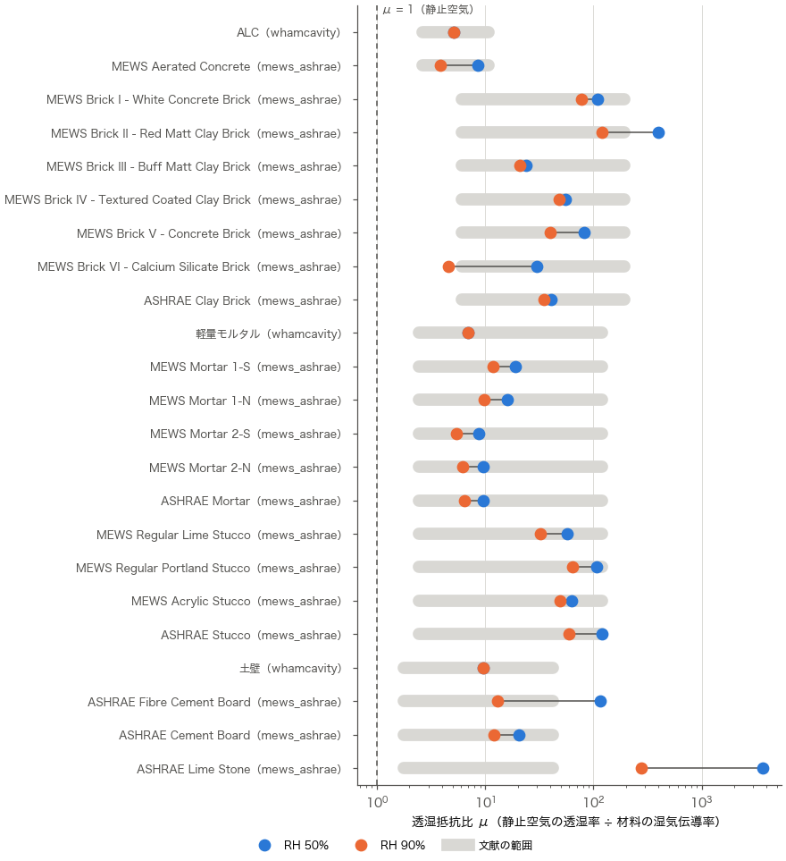
図 1-1　セメント・組積 23 材料の透湿抵抗比 μ。青は RH 50%、橙は RH 90%。灰色の帯は、同じ種類の文献の測定値から求めた μ の最小〜最大（湿度による違いは表していない）。土壁・Fibre Cement Board・Cement Board・Lime Stone の帯は繊維セメントと砂-石灰石の値で、種類が違う。

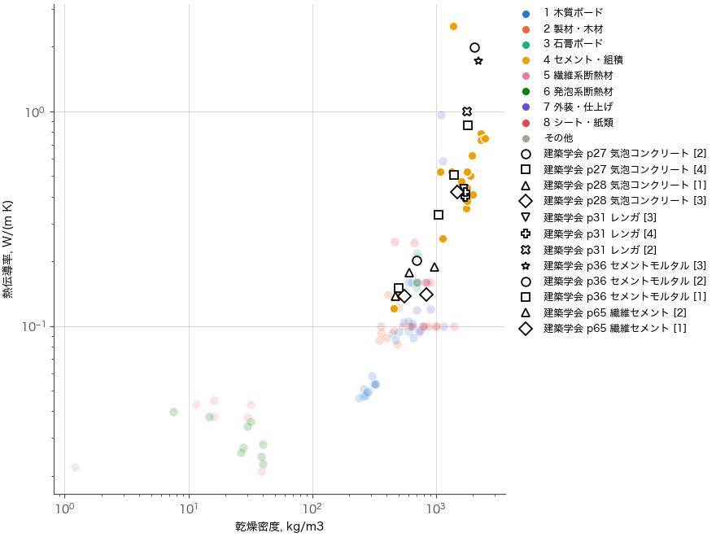
図 1-2　全 100 材料の熱伝導率と乾燥密度。濃い黄がセメント・組積、黒い白抜きの印が文献の値。右上に飛び出している 1 点が ASHRAE Fibre Cement Board（2.5）。

---

## 2. 見方

判定の 4 段階、指標（μ、ψ）、図の線・印の意味は `01_wood_boards.md` 2 章と同じ。この章では、このカテゴリに特有のことだけを書く。

- **MEWS の材料の文献の値**：建築学会の本の値に加えて、出典 RR-110 の表（平衡含水率の吸湿・放湿、液水拡散係数）を図に重ねた（凡例「RR-110 No.n の表」）。RR-110 の液水拡散係数の表は含水量 kg/m³ で与えられているので、その材料の Excel の密度で割って kg/kg に直した。これらの表は MEWS のレポート（`mews_excel_derivation.md`）で照合済みで、その結果も使った。
- **液水拡散係数の判定**：`01_wood_boards.md` 2 章の暫定の方式（Künzel の式の目安と RH 99% の含水率で比べ、0.1〜10 倍なら妥当）を使った。吸水係数 A は、次のものを使った。この判定方式は暫定で、疑問点は `01_wood_boards.md` 2 章にまとめてある。

| 材料 | 吸水係数 A, kg/(m²·s^½) | 出典 |
|---|---|---|
| MEWS Aerated Concrete | 0.036 | RR-110 2 章 |
| MEWS Brick I〜VI | 0.0076、0.0268、0.0012、0.0322、0.0097、0.0181 | RR-110 表 5.3 |
| MEWS Mortar 1-S・1-N・2-S・2-N | 0.063、0.086、0.011、0.016 | RR-110 表 6.4 |
| MEWS Stucco（Lime・Portland・Acrylic） | 0.0050、0.0123、0.0074 | RR-110 表 7.3 |
| ALC（旧） | 0.066〜0.128 | 建築学会 p30 [8] |
| ASHRAE Clay Brick | 0.112〜0.121 | 建築学会 p35 [3][4]（NRC の粘土・砂石灰レンガ） |
| 軽量モルタル（旧）、ASHRAE Mortar・Stucco | 0.042〜0.8 | 建築学会 p40 [1]（モルタルの幅。広すぎて判定に使いにくい） |

- 旧 Excel の ALC は、平衡含水率の RH 99.8% の値（wf）が 35 kg/m³ と小さいため、Künzel の式の目安が 10⁻⁶〜10⁻⁵ と極端に大きく出る。目安として使えないので、ALC の判定は文献の測定値で行った。
- **土壁**は、手元の文献に値がない。**Lime Stone**（石灰岩）も、手元の文献には砂-石灰石（sand-lime stone、別の材料）しかない。
- 原典のページの画像は、非公開リポジトリ `docs/reference/papers/review_images/`（建築学会 p27〜40・p62・p65〜66、エース p39）。書き写した数値は、画像と見比べて確かめた。

---

## 3. 気泡コンクリート（ALC）

**文献の値**（建築学会 p27〜30、Kumaran 2006）：乾燥密度 430〜800 kg/m³、比熱 840〜1050、熱伝導率 0.138（455〜492 kg/m³、20 ℃、式）〜0.202（700 kg/m³）。平衡含水率は RH 55% で 0.024〜0.045、RH 95% で 0.09（吸湿）〜RH 98% で 0.17〜0.39。透湿率 1.8〜6.3×10⁻¹¹（μ 3〜11）。液水拡散係数は 10⁻⁹〜2×10⁻⁷（[2]）、1.2〜2×10⁻⁹（[5a]）、Kumaran 2006 の Table 8 で 3×10⁻⁹〜5×10⁻⁸。吸水係数 0.066〜0.128（[8]）、RR-110 の Aerated Concrete は 0.036。エースの表の気泡コンクリート板（517〜570）は 3.8〜7.3×10⁻¹¹。

### 3.1 ALC（旧 Excel）

| 熱 | 平衡含水率 | 湿気伝導率 | 液水拡散係数 |
|---|---|---|---|
| 妥当 | 要注意 | 妥当 | 要注意 |

**根拠**：Fortran の材料 7 の平衡含水率の式 0.071101·r^1.0146·exp(−0.66866(1−r^17.316))（Fortran の「ALC」）。熱伝導率 0.137、比熱 1050、密度 500、湿気伝導率は一定値 3.79×10⁻¹¹。Fortran の材料データファイル（`mcoff1.prn`）では熱伝導率 1.6、密度 2300 で、旧 Excel と違う（HANDOFF の要確認）。

**熱物性**：密度 500、熱伝導率 0.137。文献の式（455〜492 kg/m³ で 0.138）とほぼ同じで、妥当。比熱 1050 も文献の範囲（840〜1050）。Fortran の値（1.6、2300）はコンクリートの値で、旧 Excel の方が ALC らしい。

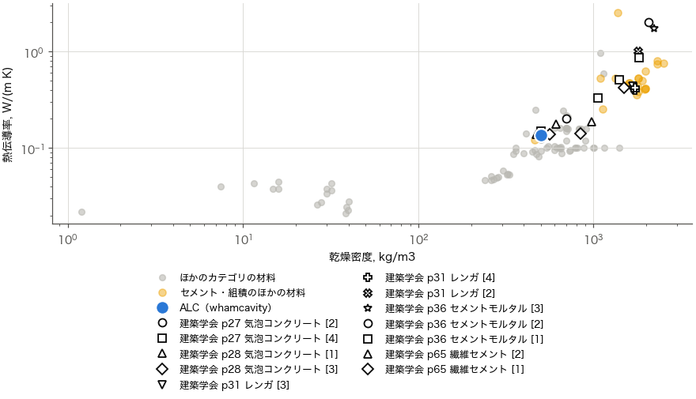
図 3-1　ALC：熱伝導率と乾燥密度

**平衡含水率**：RH 50% で 0.018、RH 80% で 0.029 は、文献の吸湿の点（RH 55% で 0.024、RH 76% で 0.035）に近い。しかし RH 95% で 0.046、RH 99% で 0.063、RH 100% でも 0.071 と、高湿で文献（RH 95% で 0.09、RH 98% で 0.17〜0.39）の 1/2〜1/6 にとどまる。ALC は空隙が多く（空隙率 約 0.7）、毛細管飽和では 0.4 kg/kg 以上になるので、RH 100% の 0.071 は小さすぎる（要注意）。

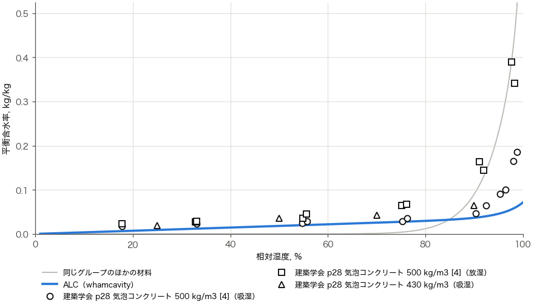
図 3-2　ALC：平衡含水率と相対湿度

**湿気伝導率**：一定値 3.79×10⁻¹¹（μ 5.1）。文献（1.8〜6.3×10⁻¹¹）の中ほどで、妥当。

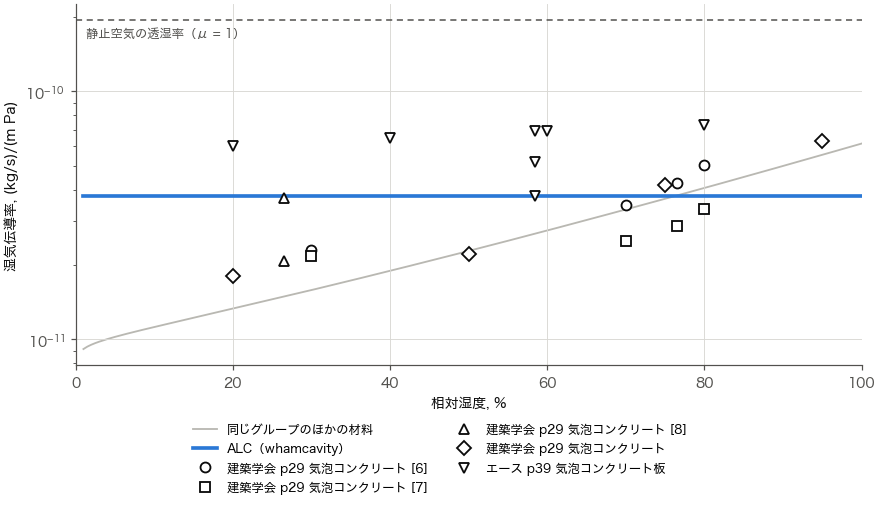
図 3-3　ALC：湿気伝導率と相対湿度

**液水拡散係数**：液水が動かない設定。文献では 10⁻⁹〜10⁻⁷ で、ALC は液水がよく動く材料（要注意）。

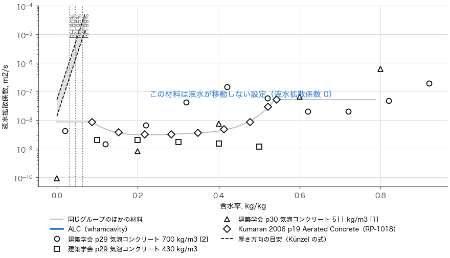
図 3-4　ALC：液水拡散係数と含水率

**直す・確かめること（優先：中）**：高湿の平衡含水率と液水拡散係数を、文献（または MEWS Aerated Concrete の高湿の値）に合わせることを検討する。

### 3.2 MEWS Aerated Concrete（MEWS）

| 熱 | 平衡含水率 | 湿気伝導率 | 液水拡散係数 |
|---|---|---|---|
| 妥当 | **誤りの疑い** | 妥当 | 妥当 |

**根拠**：RR-110 の Aerated Concrete（No.1）。熱・湿気伝導率・液水拡散係数は RR-110 の表とよく合う（`mews_excel_derivation.md`）。

**熱物性**：密度 460、熱伝導率 0.121、比熱 840。文献（455〜492 kg/m³ で 0.138）より 1 割ほど小さいが、RR-110 の測定値と同じで、妥当。

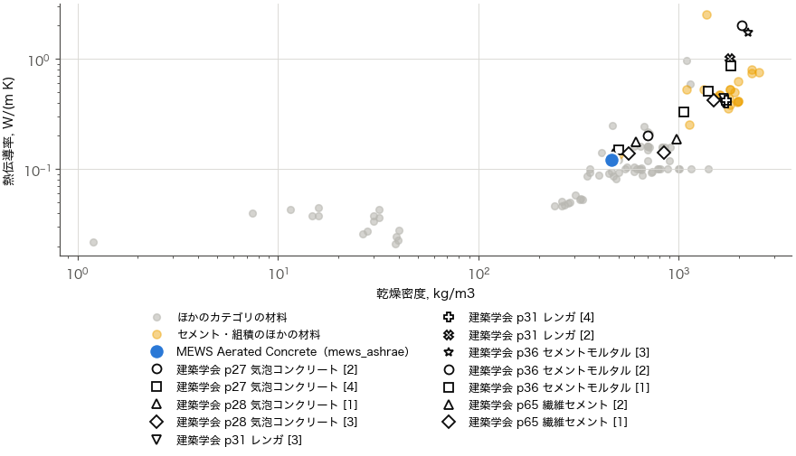
図 3-5　MEWS Aerated Concrete：熱伝導率と乾燥密度

**平衡含水率**：**RH 50% で 3×10⁻⁶ kg/kg とほぼ 0**。RH 80% でも 0.012。文献（RH 55% で 0.024〜0.045）、RR-110 の表（RH 50.6% で 0.011）のどちらとも合わない。RH 95% 以上では RR-110 の放湿・加圧板の値とよく合う（RH 99% で 0.55）。式の当てはめが高湿域に引っ張られた結果で（`mews_excel_derivation.md` 5.5 節）、MEWS OSB と同じ型の誤り（**誤りの疑い**）。ふだんの湿度での含水量（調湿の効果）を、ほぼ 0 と見積もる。

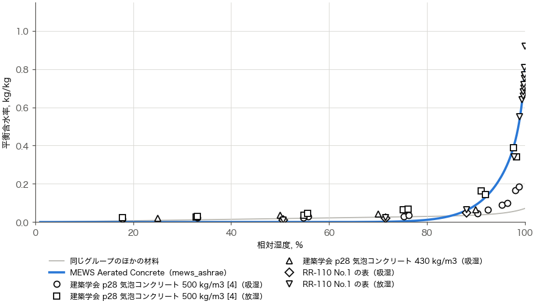
図 3-6　MEWS Aerated Concrete：平衡含水率と相対湿度

**湿気伝導率**：RH 50% で 2.3×10⁻¹¹（μ 8.5）、RH 90% で 5.0×10⁻¹¹（μ 3.9）。文献の点とよく合い、妥当。

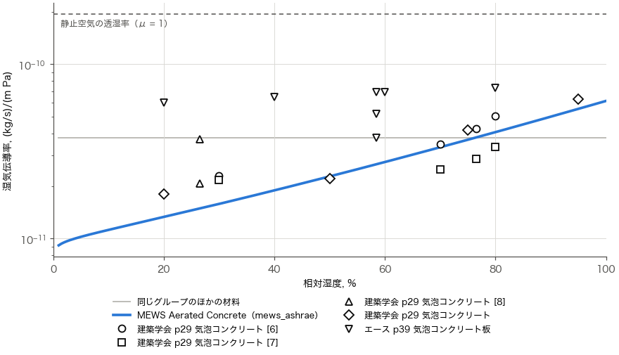
図 3-7　MEWS Aerated Concrete：湿気伝導率と相対湿度

**液水拡散係数**：RH 80〜99% の含水率で 3×10⁻⁹〜5×10⁻⁸。RR-110 の表（Kumaran 2006 の Table 8 と同じ値）と 0.94〜1.2 倍で合う。RR-110 の吸水係数（0.036）からの目安の約 6 倍で、妥当。

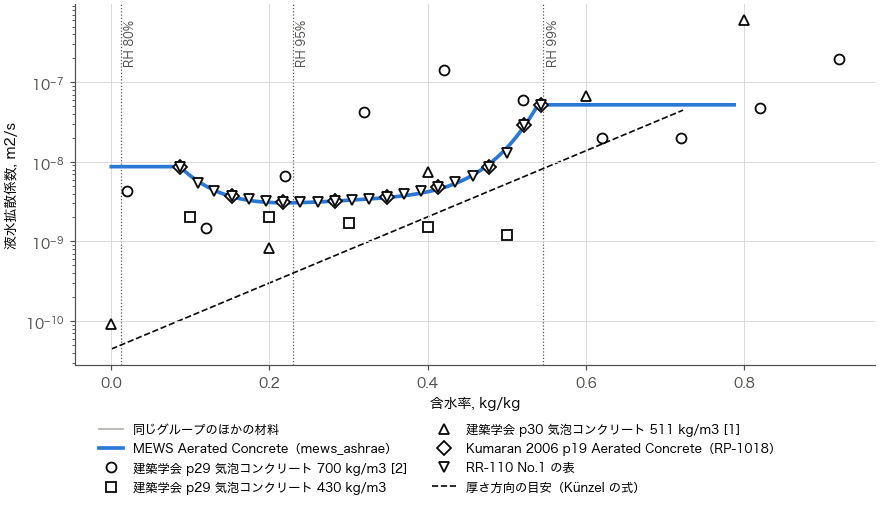
図 3-8　MEWS Aerated Concrete：液水拡散係数と含水率

**直す・確かめること（優先：高）**：平衡含水率の係数を、低湿域（RH 50〜90%）にも合うように当てはめ直す。

## 4. レンガ

**文献の値**（建築学会 p31〜35）：乾燥密度 1100〜2150 kg/m³、比熱 840〜920。熱伝導率は粘土レンガ 0.397〜0.435（1676 kg/m³、NRC）、砂石灰レンガ 0.400〜0.419（1728）、1.0（1800、[2]）。平衡含水率は非常に小さく、RH 50% で 0.0005〜0.003、RH 95% で 0.004〜0.008 kg/kg（試料によって数倍違う）。透湿率は 1×10⁻¹²〜3.2×10⁻¹¹（μ 6〜190）。液水拡散係数は、[2] で 2×10⁻⁹〜10⁻⁷、NRC の [3]（粘土）・[4]（砂石灰）で 10⁻⁸〜10⁻⁵ と大きい。吸水係数は 0.05〜0.5（密度による）、NRC の [3][4] で 0.112・0.121。

**MEWS のレンガ**：RR-110 の 6 製品（Concrete 2、Clay 3、Calcium Silicate 1）。RR-110 表 5.3 の吸水係数は 0.0012〜0.0322 と、建築学会の本のレンガ（0.05〜0.5）より 1〜2 桁小さい。

### 4.1 MEWS Brick I - White Concrete Brick（MEWS）

| 熱 | 平衡含水率 | 湿気伝導率 | 液水拡散係数 |
|---|---|---|---|
| 妥当 | 妥当 | 妥当 | 妥当 |

**根拠**：RR-110 の Brick（No.14、コンクリートレンガ）。熱伝導率と密度は RR-110 表 5.1 の測定値と同じ。

**熱物性**：密度 2300、熱伝導率 0.792、比熱 800。文献のレンガ（0.4〜1.0）の範囲に入り、妥当。

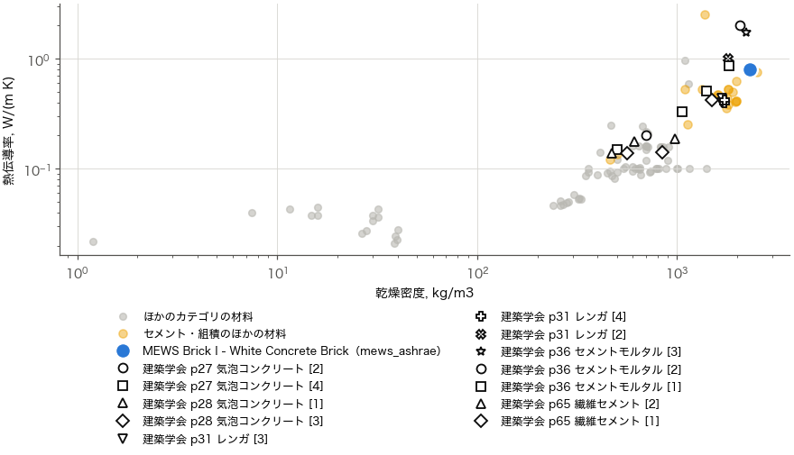
図 4-1　MEWS Brick I - White Concrete Brick：熱伝導率と乾燥密度

**平衡含水率**：RH 50% で 0.021、RH 80% で 0.026。粘土レンガの文献より 1 桁大きいが、コンクリートのレンガなので製品の違いとして説明できる。RR-110 の表と 0.94〜1.0 倍で合い、妥当。

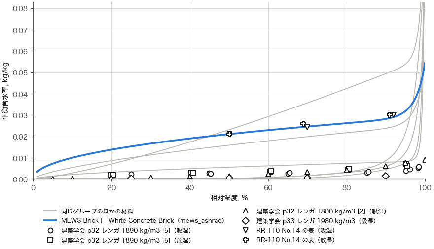
図 4-2　MEWS Brick I - White Concrete Brick：平衡含水率と相対湿度

**湿気伝導率**：RH 50% で 1.8×10⁻¹²（μ 109）、RH 90% で 2.5×10⁻¹²。文献の範囲に入り、妥当。

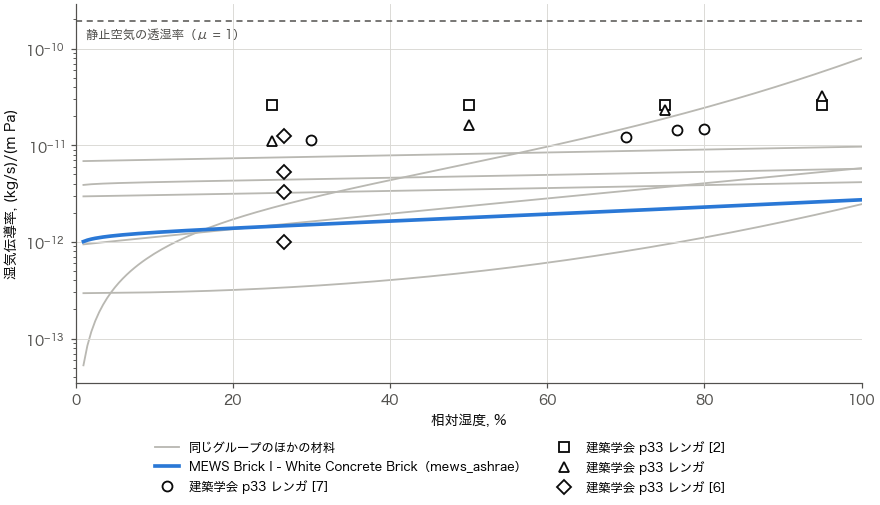
図 4-3　MEWS Brick I - White Concrete Brick：湿気伝導率と相対湿度

**液水拡散係数**：RH 99% の含水率（0.045）で 2.1×10⁻⁹。RR-110 の表と 0.99〜1.0 倍で合い、RR-110 の吸水係数（0.0076）からの目安の約 0.3 倍。妥当。

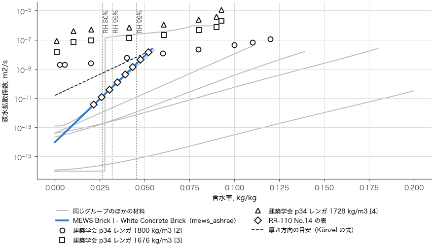
図 4-4　MEWS Brick I - White Concrete Brick：液水拡散係数と含水率

### 4.2 MEWS Brick II - Red Matt Clay Brick（MEWS）

| 熱 | 平衡含水率 | 湿気伝導率 | 液水拡散係数 |
|---|---|---|---|
| 妥当 | 妥当 | 要注意 | 要注意 |

**根拠**：RR-110 の Brick（No.15、粘土レンガ）。熱伝導率と密度は RR-110 表 5.1 の測定値と同じ。

**熱物性**：密度 1900、熱伝導率 0.5、比熱 800。文献のレンガ（0.4〜1.0）の範囲に入り、妥当。

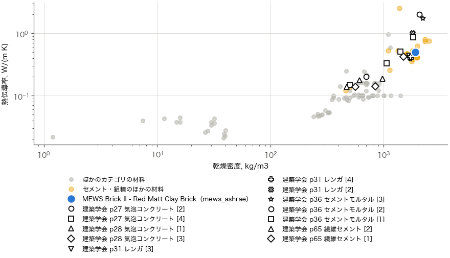
図 4-5　MEWS Brick II - Red Matt Clay Brick：熱伝導率と乾燥密度

**平衡含水率**：RH 50% で 0.0004、RH 80% で 0.0033。文献の粘土レンガ（RH 50% で 0.0005〜0.003）の下の方。RR-110 の吸湿・放湿の値は 0.001 kg/kg 程度で、比は 0.4〜17 倍とばらつくが、値そのものが非常に小さく、加圧板の値は合う（`mews_excel_derivation.md`）。妥当。

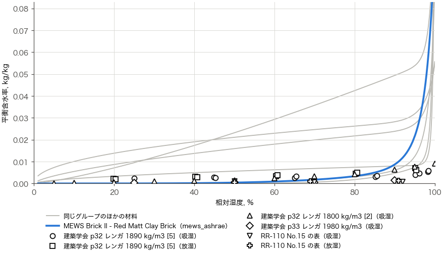
図 4-6　MEWS Brick II - Red Matt Clay Brick：平衡含水率と相対湿度

**湿気伝導率**：RH 50% で 4.8×10⁻¹³（μ 400）、RH 90% で 1.6×10⁻¹²。低湿で文献の最小（1×10⁻¹²）の約半分、RR-110 の表 5.2（1.5〜2.2×10⁻¹²）の約 1/5（`mews_excel_derivation.md` 5.4 節、要注意）。

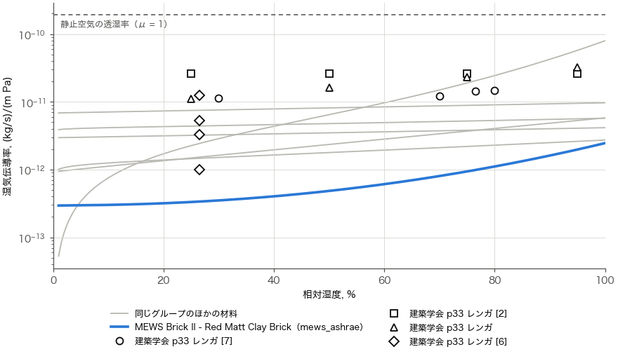
図 4-7　MEWS Brick II - Red Matt Clay Brick：湿気伝導率と相対湿度

**液水拡散係数**：RH 99% の含水率（0.073）で 3.7×10⁻¹⁰。RR-110 の表と 0.95〜1.0 倍で合うが、RR-110 の吸水係数（0.0268）からの目安（1.1×10⁻⁸）の約 1/30（要注意）。

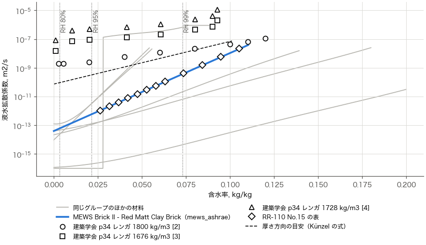
図 4-8　MEWS Brick II - Red Matt Clay Brick：液水拡散係数と含水率

**確かめること（優先：低）**：湿気伝導率の低湿域を RR-110 の表に合わせて当てはめ直すか検討する。液水拡散係数は、RR-110 の表と吸水係数が食い違っている（4 章の冒頭）。

### 4.3 MEWS Brick III - Buff Matt Clay Brick（MEWS）

| 熱 | 平衡含水率 | 湿気伝導率 | 液水拡散係数 |
|---|---|---|---|
| 妥当 | 要注意 | 妥当 | 要注意 |

**根拠**：RR-110 の Brick（No.16、粘土レンガ）。熱伝導率と密度は RR-110 表 5.1 の測定値と同じ。

**熱物性**：密度 1700、熱伝導率 0.434、比熱 800。文献のレンガ（0.4〜1.0）の範囲に入り、妥当。

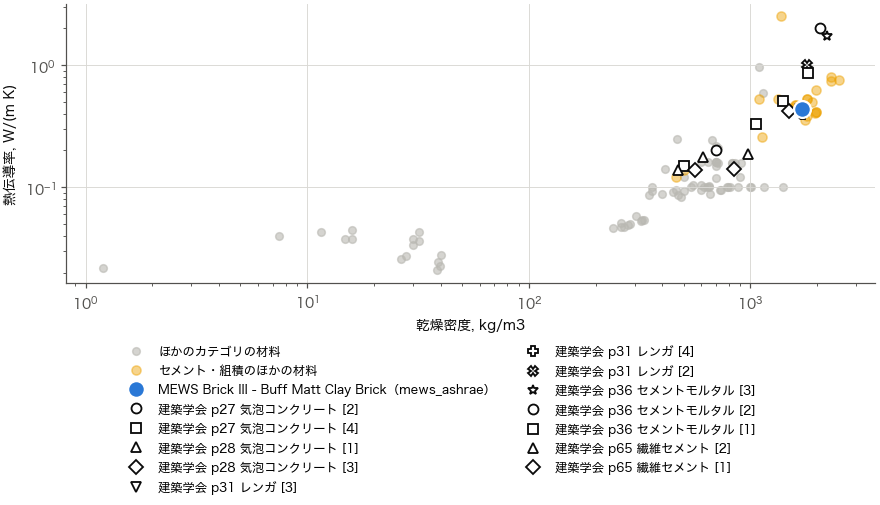
図 4-9　MEWS Brick III - Buff Matt Clay Brick：熱伝導率と乾燥密度

**平衡含水率**：RH 50% で 4×10⁻⁵ とほぼ 0、RH 80% で 0.0018。文献の粘土レンガ（RH 50% で 0.0005〜0.003）の 1/10〜1/70。RR-110 の吸湿・放湿の値（RH 50% で 0.0012〜0.002）より 1〜2 桁小さい（要注意）。値そのものが小さいので、計算への影響は小さい。

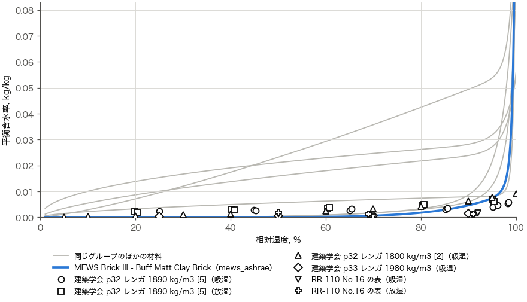
図 4-10　MEWS Brick III - Buff Matt Clay Brick：平衡含水率と相対湿度

**湿気伝導率**：RH 50% で 8.1×10⁻¹²（μ 24）、RH 90% で 9.3×10⁻¹²。文献の範囲に入り、妥当。

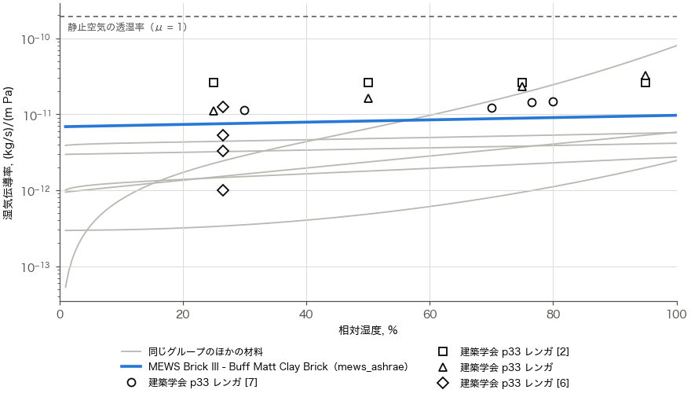
図 4-11　MEWS Brick III - Buff Matt Clay Brick：湿気伝導率と相対湿度

**液水拡散係数**：RH 99% の含水率（0.034）で 3.7×10⁻¹⁶ と実質 0。RR-110 の表（10⁻¹⁵〜10⁻¹¹）とは合うが、RR-110 の吸水係数（0.0012）からの目安（8×10⁻¹³）の約 1/2000（要注意）。

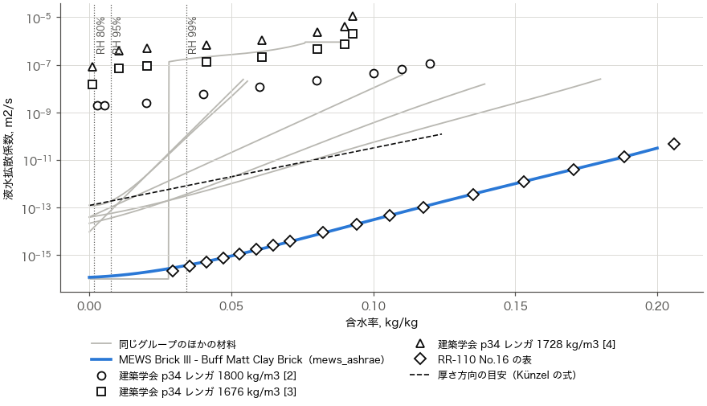
図 4-12　MEWS Brick III - Buff Matt Clay Brick：液水拡散係数と含水率

**確かめること（優先：低）**：液水拡散係数は、RR-110 の表と吸水係数が 3 桁食い違っている（4 章の冒頭）。

### 4.4 MEWS Brick IV - Textured Coated Clay Brick（MEWS）

| 熱 | 平衡含水率 | 湿気伝導率 | 液水拡散係数 |
|---|---|---|---|
| 妥当 | 要注意 | 妥当 | 要注意 |

**根拠**：RR-110 の Brick（No.17、表面を塗装した粘土レンガ）。熱伝導率と密度は RR-110 表 5.1 の測定値と同じ。

**熱物性**：密度 1800、熱伝導率 0.522、比熱 800。文献のレンガ（0.4〜1.0）の範囲に入り、妥当。

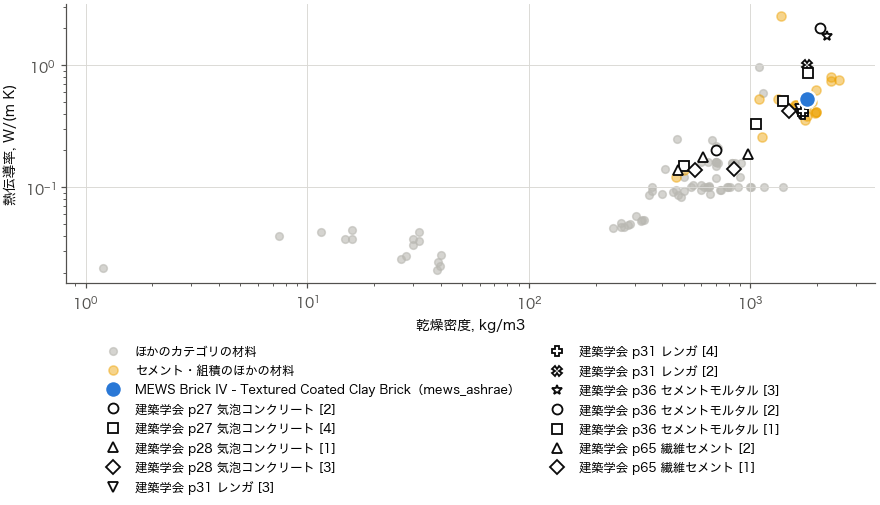
図 4-13　MEWS Brick IV - Textured Coated Clay Brick：熱伝導率と乾燥密度

**平衡含水率**：RH 50% で 0.0056、RH 80% で 0.0074。RR-110 の吸湿・放湿の値（0.0001〜0.0016）の 5〜56 倍で、文献の粘土レンガ（0.0005〜0.003）よりも大きい。式が低湿で平らになっている（要注意）。値そのものが小さいので、計算への影響は小さい。

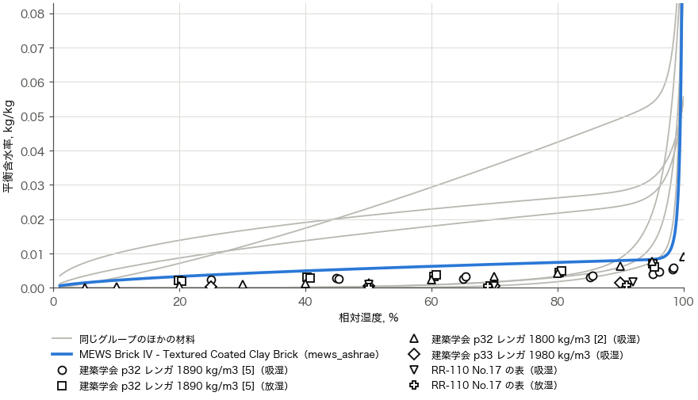
図 4-14　MEWS Brick IV - Textured Coated Clay Brick：平衡含水率と相対湿度

**湿気伝導率**：RH 50% で 3.5×10⁻¹²（μ 56）、RH 90% で 4.0×10⁻¹²。文献の範囲に入り、妥当。

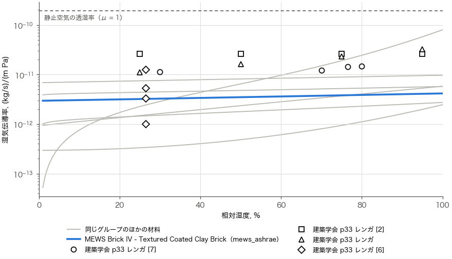
図 4-15　MEWS Brick IV - Textured Coated Clay Brick：湿気伝導率と相対湿度

**液水拡散係数**：RH 99% の含水率（0.022）で 1.3×10⁻¹³。RR-110 の表とは 0.95〜1.1 倍で合うが、RR-110 の吸水係数（0.0322、6 製品で最大）からの目安（6×10⁻¹⁰）の約 1/5000（要注意）。図では、RR-110 の表（ひし形）だけが文献の点（10⁻⁹〜10⁻⁵）から大きく下に離れている。

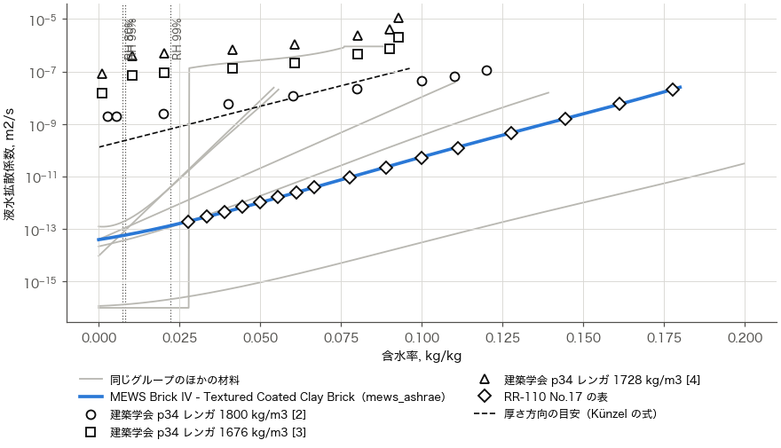
図 4-16　MEWS Brick IV - Textured Coated Clay Brick：液水拡散係数と含水率

**確かめること（優先：低）**：液水拡散係数は、RR-110 の表と吸水係数が 3〜4 桁食い違っている（4 章の冒頭）。

### 4.5 MEWS Brick V - Concrete Brick（MEWS）

| 熱 | 平衡含水率 | 湿気伝導率 | 液水拡散係数 |
|---|---|---|---|
| 妥当 | 妥当 | 妥当 | 妥当 |

**根拠**：RR-110 の Brick（No.18、コンクリートレンガ）。熱伝導率と密度は RR-110 表 5.1 の測定値と同じ。

**熱物性**：密度 2300、熱伝導率 0.737、比熱 800。文献のレンガ（0.4〜1.0）の範囲に入り、妥当。

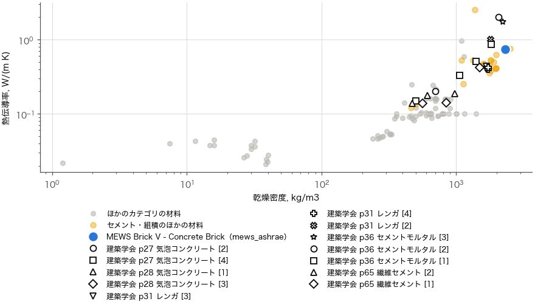
図 4-17　MEWS Brick V - Concrete Brick：熱伝導率と乾燥密度

**平衡含水率**：RH 50% で 0.016、RH 80% で 0.022。コンクリートのレンガとして Brick I に近く、RR-110 の表と 0.93〜1.1 倍で合う。妥当。

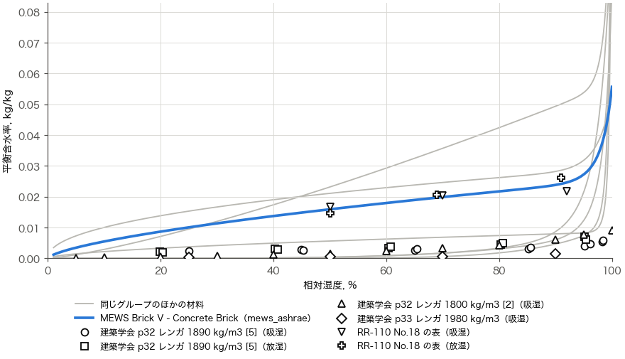
図 4-18　MEWS Brick V - Concrete Brick：平衡含水率と相対湿度

**湿気伝導率**：RH 50% で 2.4×10⁻¹²（μ 83）、RH 90% で 4.8×10⁻¹²。文献の範囲に入り、妥当。

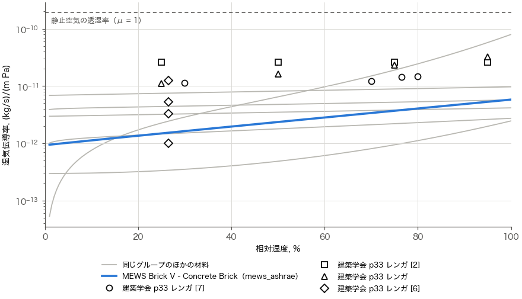
図 4-19　MEWS Brick V - Concrete Brick：湿気伝導率と相対湿度

**液水拡散係数**：RH 99% の含水率（0.043）で 8.0×10⁻¹⁰。RR-110 の表と合い、吸水係数（0.0097）からの目安の約 0.1 倍。妥当（下限に近い）。

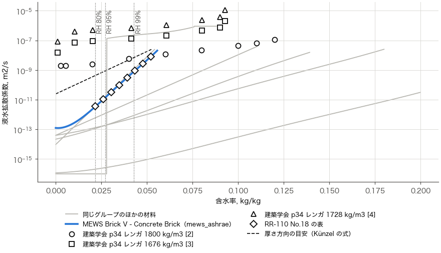
図 4-20　MEWS Brick V - Concrete Brick：液水拡散係数と含水率

### 4.6 MEWS Brick VI - Calcium Silicate Brick（MEWS）

| 熱 | 平衡含水率 | 湿気伝導率 | 液水拡散係数 |
|---|---|---|---|
| 妥当 | 妥当 | 妥当 | 要注意 |

**根拠**：RR-110 の Brick（No.19、珪酸カルシウムレンガ）。熱伝導率と密度は RR-110 表 5.1 の測定値と同じ。

**熱物性**：密度 1970、熱伝導率 0.623、比熱 800。文献のレンガ（0.4〜1.0）の範囲に入り、妥当。

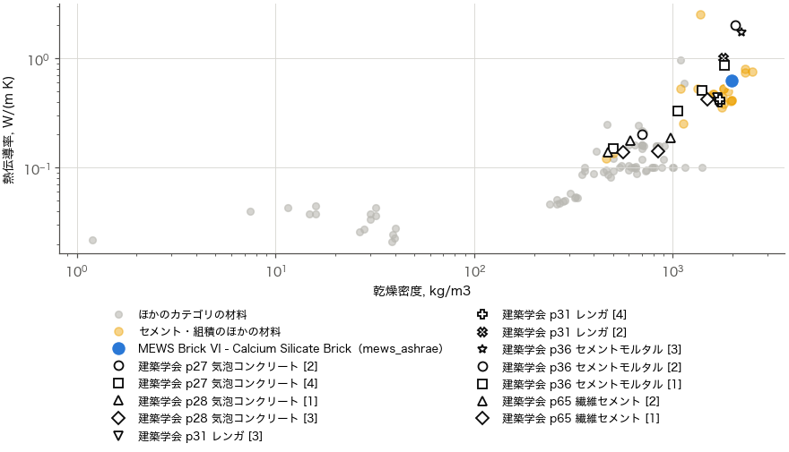
図 4-21　MEWS Brick VI - Calcium Silicate Brick：熱伝導率と乾燥密度

**平衡含水率**：RH 50% で 0.023、RH 80% で 0.042。RR-110 の表と 0.81〜1.1 倍で合い、妥当。

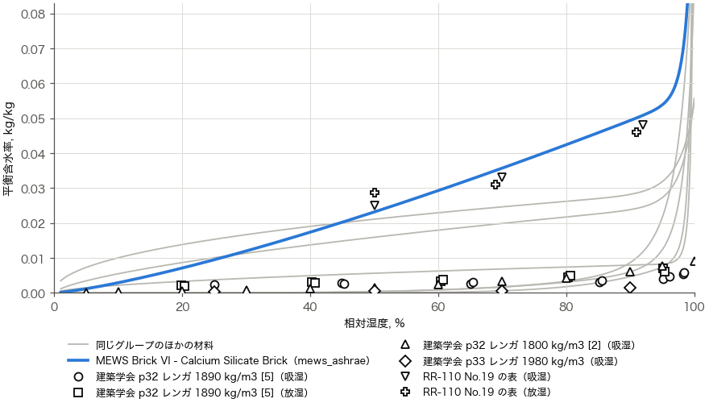
図 4-22　MEWS Brick VI - Calcium Silicate Brick：平衡含水率と相対湿度

**湿気伝導率**：RH 50% で 6.4×10⁻¹²（μ 30）、RH 90% で 4.2×10⁻¹¹（μ 4.6）。湿度とともに大きくなり、RH 90% で文献の上限を少し超えるが、RR-110 の測定値と合う。妥当。

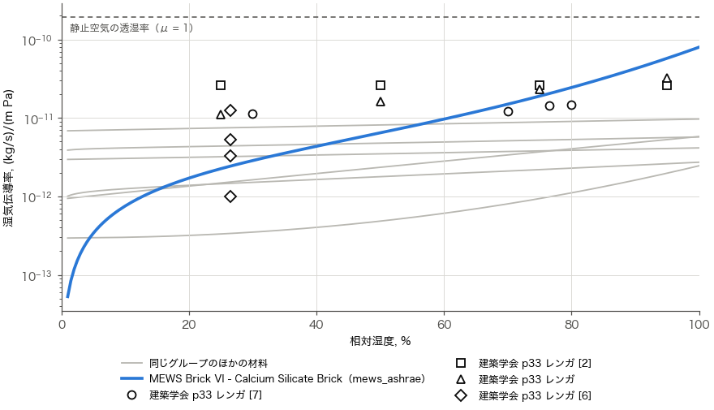
図 4-23　MEWS Brick VI - Calcium Silicate Brick：湿気伝導率と相対湿度

**液水拡散係数**：RH 99% の含水率（0.084）で 7.1×10⁻¹¹。RR-110 の表とは合うが、吸水係数（0.0181）からの目安（2.6×10⁻⁹）の約 1/35（要注意）。

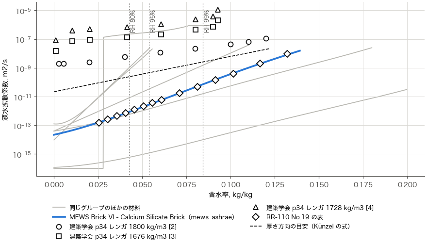
図 4-24　MEWS Brick VI - Calcium Silicate Brick：液水拡散係数と含水率

### 4.7 ASHRAE Clay Brick（ASHRAE）

| 熱 | 平衡含水率 | 湿気伝導率 | 液水拡散係数 |
|---|---|---|---|
| 妥当 | 妥当 | 妥当 | 妥当 |

**根拠**：ASHRAE RP-1018（Kumaran 2006 の Clay Brick、密度 1980）。測った範囲より下の液水拡散係数は 10⁻¹⁶（実質 0）。

**熱物性**：密度 1980（論文と一致）、熱伝導率 0.415、比熱 840。文献の粘土レンガ（0.40〜0.44）とほぼ同じで、妥当。

図 4-25　ASHRAE Clay Brick：熱伝導率と乾燥密度

**平衡含水率**：RH 50% で 0.0004、RH 80% で 0.0031。文献の粘土レンガの下の方（[2a] の 1980 kg/m³ で RH 50% 0.0005、RH 70% 0.0006、RH 90% 0.0014）と同じ大きさで、妥当。

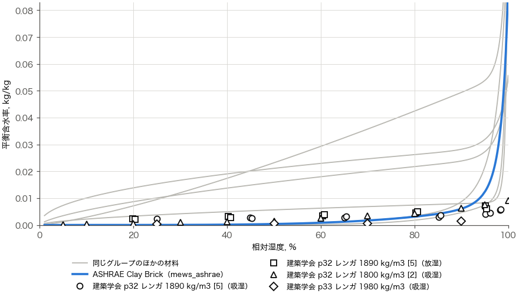
図 4-26　ASHRAE Clay Brick：平衡含水率と相対湿度

**湿気伝導率**：RH 50% で 4.8×10⁻¹²（μ 41）、RH 90% で 5.5×10⁻¹²。文献の範囲に入り、妥当。

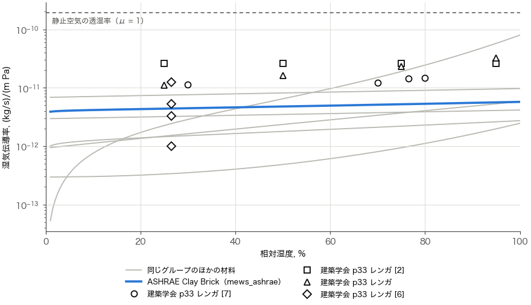
図 4-27　ASHRAE Clay Brick：湿気伝導率と相対湿度

**液水拡散係数**：RH 99% の含水率（0.049）で 2.6×10⁻⁷。NRC の粘土レンガの吸水係数（0.112〜0.121）からの目安の 1.4〜1.6 倍で、文献の NRC の測定値（[3]：10⁻⁸〜10⁻⁶）とも同じ桁。妥当。この カテゴリの ASHRAE の材料では、目安と合う唯一の例。

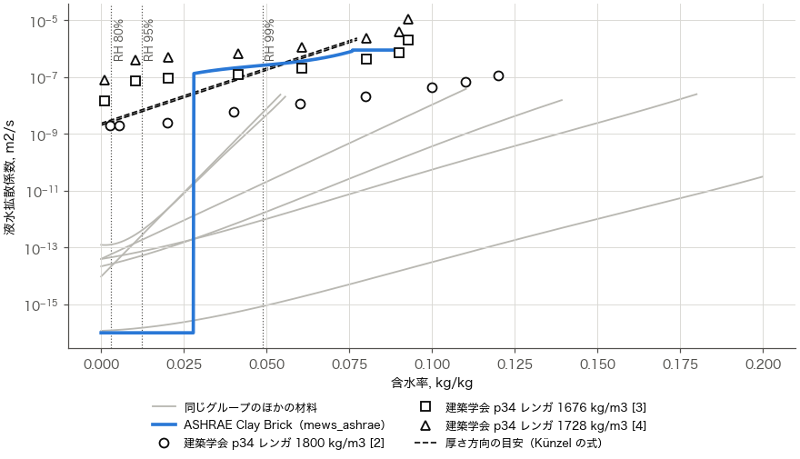
図 4-28　ASHRAE Clay Brick：液水拡散係数と含水率

## 5. モルタル

**文献の値**（建築学会 p36〜40、エース 表 7.2）：乾燥密度 1050〜2200 kg/m³、比熱 840〜980。熱伝導率は 1.71〜1.99（2050〜2210 kg/m³）、式 λ = 0.088 exp(0.00125ρ)（1055〜1822 kg/m³ で 0.33〜0.86）。平衡含水率は RH 45% で 0.011〜0.025、RH 85% で 0.029〜0.056（2000 kg/m³ の 2 試料、1786 kg/m³）。透湿率は 2.7×10⁻¹²〜8×10⁻¹¹（[2]）、6.4〜10×10⁻¹²（[4]）、エースの表で 1.6×10⁻¹²〜1.6×10⁻¹¹（調合 1:1〜1:3）。液水拡散係数は 2×10⁻⁹〜7×10⁻⁸、式 Dw = 2.0×10⁻⁹ exp(0.022 w)（1072 kg/m³）など。吸水係数 0.042〜0.8。

### 5.1 軽量モルタル（旧 Excel）

| 熱 | 平衡含水率 | 湿気伝導率 | 液水拡散係数 |
|---|---|---|---|
| 要注意 | 根拠なし | 妥当 | 要注意 |

**根拠**：Fortran の材料 12 の平衡含水率の式 0.203·r^−0.120·exp(−1.75(1−r^2.015))（RH 0% で計算できない）。熱伝導率 0.522、比熱 1050、密度 1091、湿気伝導率は一定値 2.79×10⁻¹¹。

**熱物性**：密度 1091、熱伝導率 0.522。文献の式（密度 1091 で 0.34）、[1] の 1072 kg/m³ の乾燥時の値（0.346）の約 1.5 倍（要注意）。比熱 1050 は文献（840〜980）より少し大きい。熱伝導率 0.522 は旧 Excel の土壁と同じ値。

図 5-1　軽量モルタル：熱伝導率と乾燥密度

**平衡含水率**：RH 50% で 0.059、RH 80% で 0.111。文献の普通のモルタル（2000 kg/m³、RH 45% で 0.011〜0.025）の 2〜5 倍。軽量モルタルの文献値は手元にないので、比べられない（根拠なし）。

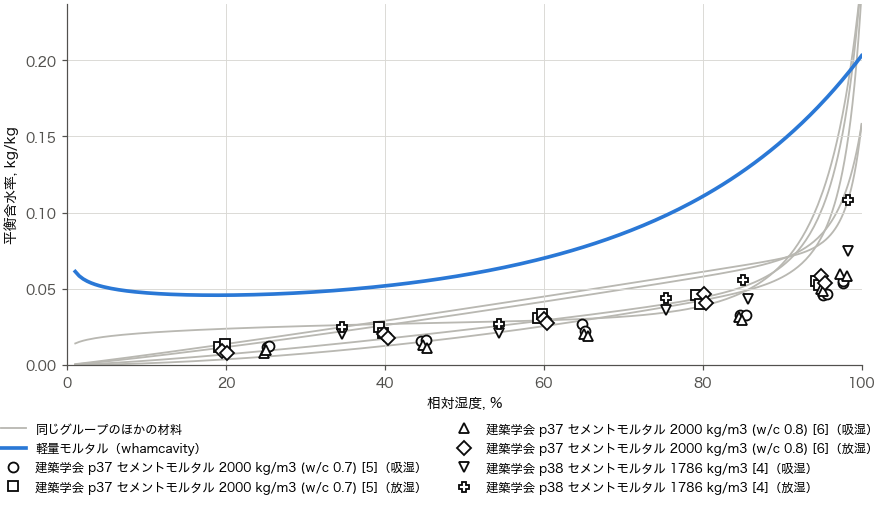
図 5-2　軽量モルタル：平衡含水率と相対湿度

**湿気伝導率**：一定値 2.79×10⁻¹¹（μ 6.9）。文献のモルタル（2.7×10⁻¹²〜8×10⁻¹¹）の範囲に入り、妥当。

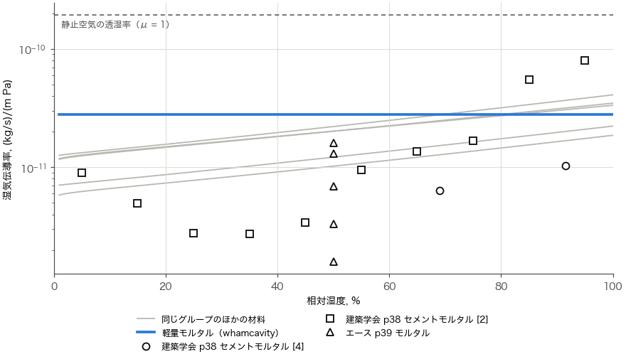
図 5-3　軽量モルタル：湿気伝導率と相対湿度

**液水拡散係数**：液水が動かない設定。文献のモルタルでは 10⁻⁹〜10⁻⁸ で動く（要注意）。

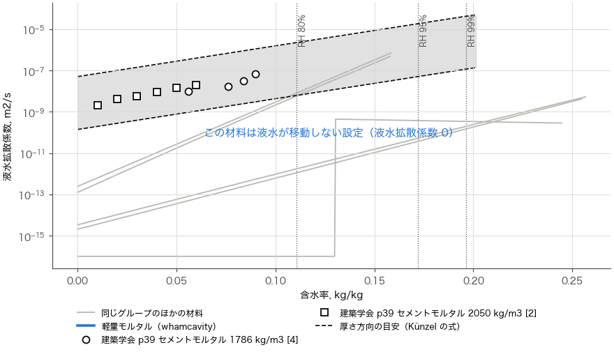
図 5-4　軽量モルタル：液水拡散係数と含水率

**確かめること（優先：低）**：熱伝導率 0.522 の根拠（土壁と同じ値なので写し間違いか）を確かめる。

### 5.2 MEWS Mortar 1-S（MEWS）

| 熱 | 平衡含水率 | 湿気伝導率 | 液水拡散係数 |
|---|---|---|---|
| 要注意 | 妥当 | 妥当 | 妥当 |

**根拠**：RR-110 の Mortar（No.20）。熱伝導率・密度は RR-110 表 6.2 の 2 試験体の平均。

**熱物性**：密度 1800、熱伝導率 0.523、比熱 900。RR-110 の測定値（0.519〜0.527）と合うが、文献の式（密度 1800 で 0.83）の 0.63 倍（要注意）。モルタルの調合（砂とセメントの割合、空気量）の違いと考えられる。

図 5-5　MEWS Mortar 1-S：熱伝導率と乾燥密度

**平衡含水率**：RH 50% で 0.037、RH 80% で 0.061。文献のモルタル（RH 45% で 0.011〜0.025）より大きいが、RR-110 の吸湿・放湿の間を通る（比 0.82〜1.4）。妥当。

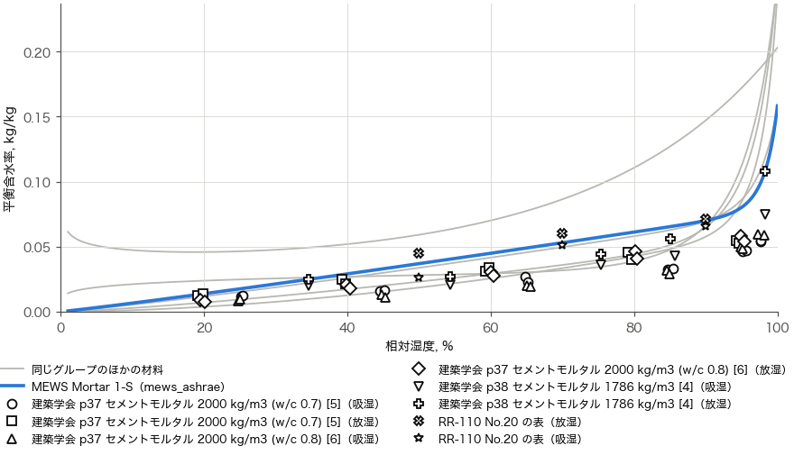
図 5-6　MEWS Mortar 1-S：平衡含水率と相対湿度

**湿気伝導率**：RH 50% で 1.0×10⁻¹¹（μ 19）、RH 90% で 1.6×10⁻¹¹。文献の範囲に入り、妥当。

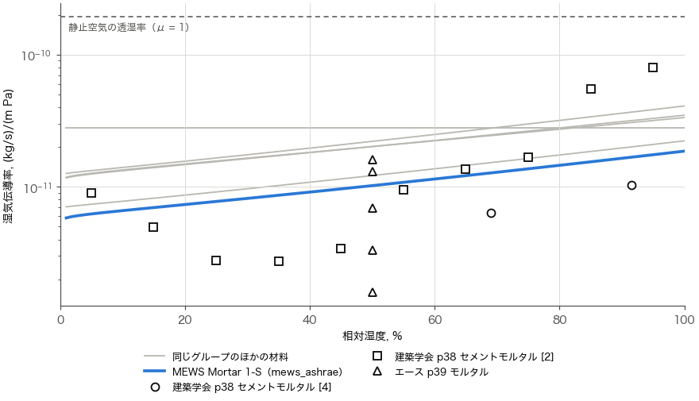
図 5-7　MEWS Mortar 1-S：湿気伝導率と相対湿度

**液水拡散係数**：RH 99% の含水率（0.123）で 2.5×10⁻⁸。RR-110 の表の 1.5〜1.6 倍、吸水係数（0.063）からの目安の約 0.4 倍。妥当。

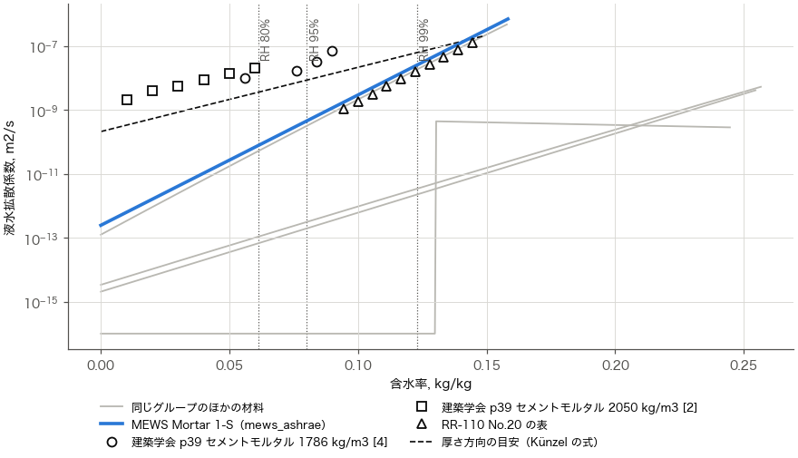
図 5-8　MEWS Mortar 1-S：液水拡散係数と含水率

### 5.3 MEWS Mortar 1-N（MEWS）

| 熱 | 平衡含水率 | 湿気伝導率 | 液水拡散係数 |
|---|---|---|---|
| 要注意 | 妥当 | 妥当 | 妥当 |

**根拠**：RR-110 の Mortar（No.21）。熱伝導率・密度は RR-110 表 6.2 の 2 試験体の平均。

**熱物性**：密度 1780、熱伝導率 0.439、比熱 900。RR-110 の測定値（0.395〜0.482）と合うが、文献の式（密度 1780 で 0.81）の 0.54 倍（要注意）。モルタルの調合（砂とセメントの割合、空気量）の違いと考えられる。

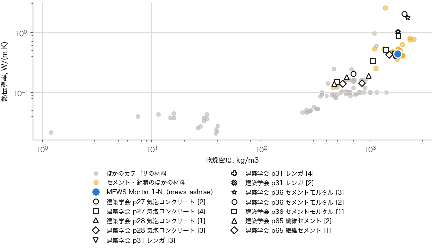
図 5-9　MEWS Mortar 1-N：熱伝導率と乾燥密度

**平衡含水率**：RH 50% で 0.034、RH 80% で 0.058。RR-110 の吸湿・放湿の間を通る（比 0.72〜1.8）。妥当。

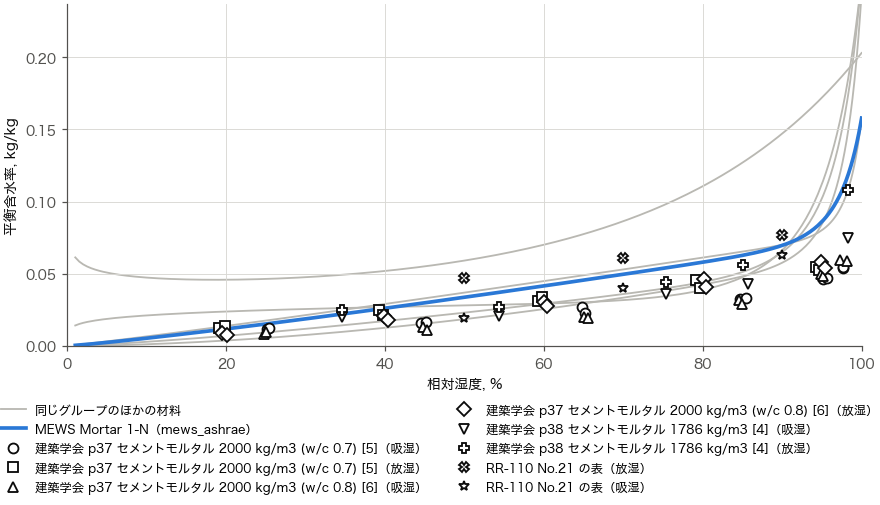
図 5-10　MEWS Mortar 1-N：平衡含水率と相対湿度

**湿気伝導率**：RH 50% で 1.2×10⁻¹¹（μ 16）、RH 90% で 2.0×10⁻¹¹。文献の範囲に入り、妥当。

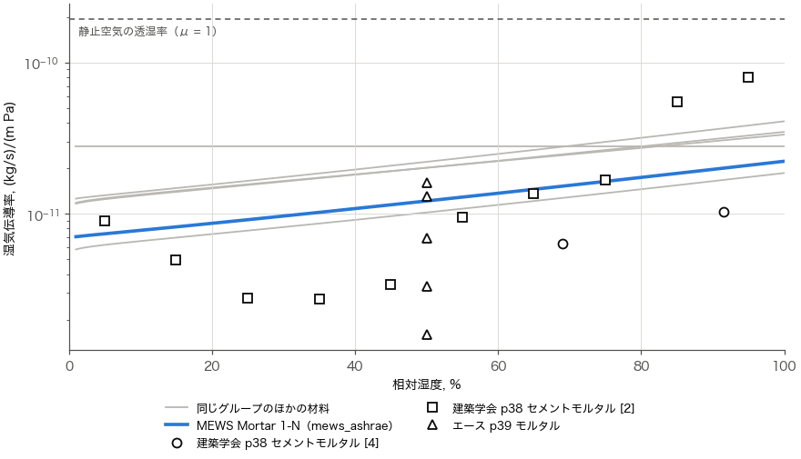
図 5-11　MEWS Mortar 1-N：湿気伝導率と相対湿度

**液水拡散係数**：RH 99% の含水率（0.132）で 4.1×10⁻⁸。RR-110 の表の 1.0〜1.2 倍、吸水係数（0.086）からの目安の約 0.3 倍。妥当。

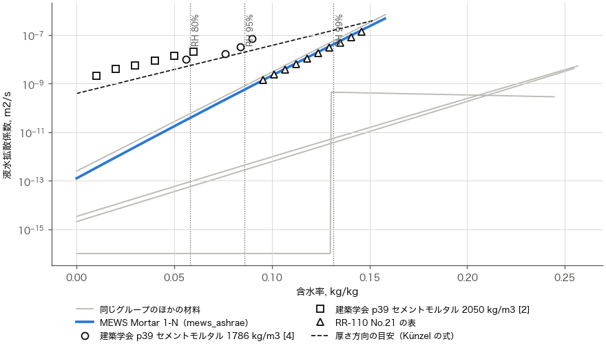
図 5-12　MEWS Mortar 1-N：液水拡散係数と含水率

### 5.4 MEWS Mortar 2-S（MEWS）

| 熱 | 平衡含水率 | 湿気伝導率 | 液水拡散係数 |
|---|---|---|---|
| 要注意 | 要注意 | 妥当 | 妥当 |

**根拠**：RR-110 の Mortar（No.22）。熱伝導率・密度は RR-110 表 6.2 の 2 試験体の平均。

**熱物性**：密度 1530、熱伝導率 0.448、比熱 900。RR-110 の測定値（0.446〜0.450）と合うが、文献の式（密度 1530 で 0.60）の 0.75 倍（要注意）。モルタルの調合（砂とセメントの割合、空気量）の違いと考えられる。

図 5-13　MEWS Mortar 2-S：熱伝導率と乾燥密度

**平衡含水率**：RH 50% で 0.028、RH 80% で 0.039。RR-110 の放湿とは合うが、**RR-110 の RH 50% の吸湿（0.005）の約 5 倍**（比 0.59〜5.6。`mews_excel_derivation.md`）。吸湿と放湿の差が大きい材料で、Excel は放湿側に近い（要注意）。

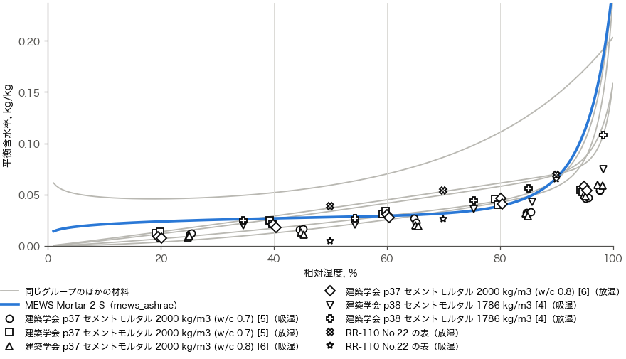
図 5-14　MEWS Mortar 2-S：平衡含水率と相対湿度

**湿気伝導率**：RH 50% で 2.2×10⁻¹¹（μ 8.8）、RH 90% で 3.6×10⁻¹¹。文献の範囲に入り、妥当。

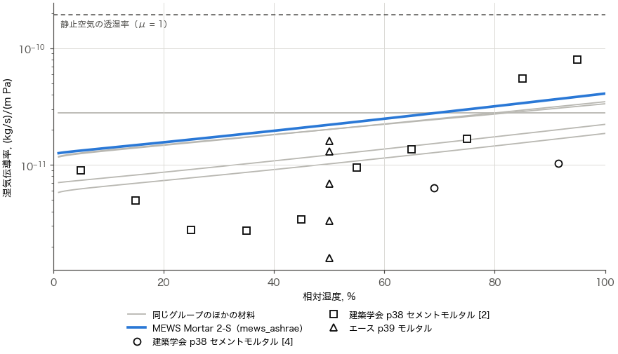
図 5-15　MEWS Mortar 2-S：湿気伝導率と相対湿度

**液水拡散係数**：RH 99% の含水率（0.210）で 3.2×10⁻¹⁰。RR-110 の表の 0.85〜0.92 倍、吸水係数（0.011）からの目安の約 0.26 倍。妥当。

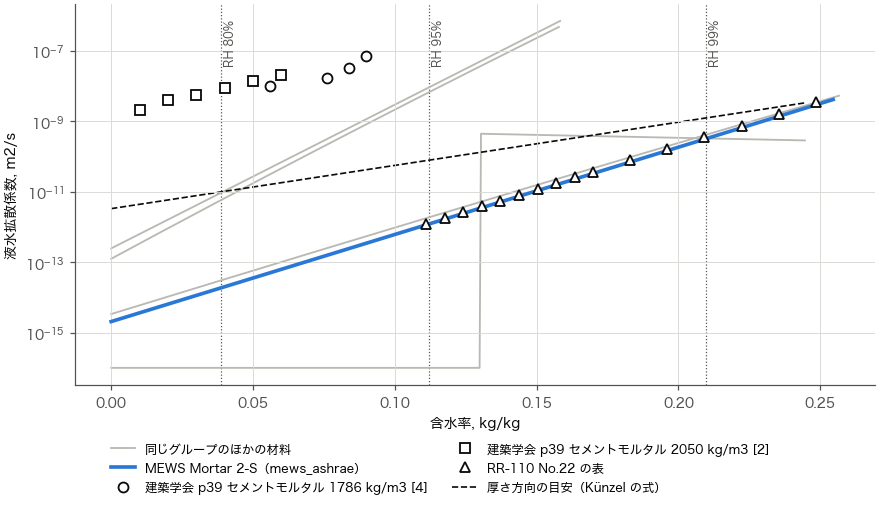
図 5-16　MEWS Mortar 2-S：液水拡散係数と含水率

### 5.5 MEWS Mortar 2-N（MEWS）

| 熱 | 平衡含水率 | 湿気伝導率 | 液水拡散係数 |
|---|---|---|---|
| 要注意 | 要注意 | 妥当 | 妥当 |

**根拠**：RR-110 の Mortar（No.23）。熱伝導率・密度は RR-110 表 6.2 の 2 試験体の平均。

**熱物性**：密度 1590、熱伝導率 0.468、比熱 900。RR-110 の測定値（0.460〜0.476）と合うが、文献の式（密度 1590 で 0.64）の 0.73 倍（要注意）。モルタルの調合（砂とセメントの割合、空気量）の違いと考えられる。

図 5-17　MEWS Mortar 2-N：熱伝導率と乾燥密度

**平衡含水率**：RH 50% で 0.023、RH 80% で 0.044。5.4 節と同じく、RR-110 の RH 50% の吸湿（0.004）の約 6 倍で、放湿側に近い（要注意）。

図 5-18　MEWS Mortar 2-N：平衡含水率と相対湿度

**湿気伝導率**：RH 50% で 2.0×10⁻¹¹（μ 9.6）、RH 90% で 3.1×10⁻¹¹。文献の範囲に入り、妥当。

図 5-19　MEWS Mortar 2-N：湿気伝導率と相対湿度

**液水拡散係数**：RH 99% の含水率（0.202）で 2.6×10⁻¹⁰。RR-110 の表の 1.2〜1.4 倍、吸水係数（0.016）からの目安の約 0.13 倍。妥当（下限に近い）。

図 5-20　MEWS Mortar 2-N：液水拡散係数と含水率

### 5.6 ASHRAE Mortar（ASHRAE）

| 熱 | 平衡含水率 | 湿気伝導率 | 液水拡散係数 |
|---|---|---|---|
| 要注意 | 妥当 | 妥当 | 要注意 |

**根拠**：ASHRAE RP-1018（Kumaran 2006 の Mortar、密度 1600）。測った範囲より下の液水拡散係数は 10⁻¹⁶。

**熱物性**：密度 1600（論文と一致）、熱伝導率 0.47、比熱 840。文献の式（密度 1600 で 0.65）の約 0.7 倍（要注意）。MEWS のモルタルと同じ傾向。

図 5-21　ASHRAE Mortar：熱伝導率と乾燥密度

**平衡含水率**：RH 50% で 0.018、RH 80% で 0.042。文献のモルタル（RH 45% で 0.011〜0.025、RH 85% で 0.029〜0.056）に入り、妥当。

図 5-22　ASHRAE Mortar：平衡含水率と相対湿度

**湿気伝導率**：RH 50% で 2.0×10⁻¹¹（μ 9.6）、RH 90% で 3.0×10⁻¹¹。文献の範囲に入り、妥当。

図 5-23　ASHRAE Mortar：湿気伝導率と相対湿度

**液水拡散係数**：RH 99% の含水率（0.179）で 3.6×10⁻¹⁰。吸水係数がこの材料のものではなく、文献の幅（0.042〜0.8）が広すぎて目安（10⁻⁸〜4×10⁻⁶）も 2 桁以上の幅になる。その下限の約 1/30（要注意）。文献の測定値（10⁻⁹〜10⁻⁸）よりも 1 桁小さい。

図 5-24　ASHRAE Mortar：液水拡散係数と含水率

## 6. スタッコ（外壁の塗り材）

**文献の値**：スタッコそのものの値は建築学会の本にないので、セメントモルタル（5 章）とエースの表の石灰プラスター（1.9〜2.8×10⁻¹²）と比べた。RR-110 の Stucco の表（7 章）は、MEWS のレポートで照合済み。

**液水拡散係数について**：MEWS の Stucco 3 種は、Excel の値が RR-110 の表 7.6 と合わない（0.9〜26 万倍。`mews_excel_derivation.md` 5.2 節）。しかし、同じ RR-110 の吸水係数（表 7.3：0.0050〜0.0123）から Künzel の式で求めた目安とは、1.6〜17 倍と同じ桁で合う。RR-110 の表 7.6 の値（含水量 50〜280 kg/m³ で 10⁻¹⁵〜10⁻⁹）は、同じ報告書の吸水係数から考えられる大きさより 1〜3 桁小さく、表の方に問題がある可能性もある。前の MEWS のレポートの判断（Excel が表と合わない）は、このレポートでは「表と合わないが、吸水係数とは合う」と見直した。

### 6.1 MEWS Regular Lime Stucco（MEWS）

| 熱 | 平衡含水率 | 湿気伝導率 | 液水拡散係数 |
|---|---|---|---|
| 妥当 | 妥当 | 妥当 | 要注意 |

**根拠**：RR-110 の Stucco（No.24）。熱伝導率・密度は RR-110 表 7.1 の 2 試験体の平均。

**熱物性**：密度 1770、熱伝導率 0.352、比熱 840。RR-110 の測定値と合う。同じ密度のモルタルの文献の式（0.8〜1.0）より小さいが、スタッコは別の材料なので、比べる文献がない範囲で妥当とした。

図 6-1　MEWS Regular Lime Stucco：熱伝導率と乾燥密度

**平衡含水率**：RH 50% で 0.042、RH 80% で 0.067。RR-110 の吸湿・放湿の間を通り（比 0.85〜1.1）、妥当。

図 6-2　MEWS Regular Lime Stucco：平衡含水率と相対湿度

**湿気伝導率**：RH 50% で 3.4×10⁻¹²（μ 58）、RH 90% で 6.0×10⁻¹²。エースの表の石灰プラスター（1.9〜2.8×10⁻¹²）より少し大きく、モルタルの範囲の下の方。妥当。

図 6-3　MEWS Regular Lime Stucco：湿気伝導率と相対湿度

**液水拡散係数**：RH 99% の含水率（0.132）で 9.4×10⁻⁹。RR-110 の吸水係数（0.0050）からの目安（5.4×10⁻¹⁰）の約 17 倍で、1 桁よりわずかに大きい（要注意）。RR-110 の表とは合わない（6 章の冒頭）。

図 6-4　MEWS Regular Lime Stucco：液水拡散係数と含水率

**確かめること（優先：低）**：RR-110 の表 7.6 と吸水係数の食い違い（6 章の冒頭）。

### 6.2 MEWS Regular Portland Stucco（MEWS）

| 熱 | 平衡含水率 | 湿気伝導率 | 液水拡散係数 |
|---|---|---|---|
| 妥当 | 妥当 | 妥当 | 妥当 |

**根拠**：RR-110 の Stucco（No.25）。熱伝導率・密度は RR-110 表 7.1 の 2 試験体の平均。

**熱物性**：密度 1960、熱伝導率 0.407、比熱 840。RR-110 の測定値と合う。同じ密度のモルタルの文献の式（0.8〜1.0）より小さいが、スタッコは別の材料なので、比べる文献がない範囲で妥当とした。

図 6-5　MEWS Regular Portland Stucco：熱伝導率と乾燥密度

**平衡含水率**：RH 50% で 0.033、RH 80% で 0.054。RR-110 の吸湿・放湿の間を通り（比 0.78〜1.3）、妥当。

図 6-6　MEWS Regular Portland Stucco：平衡含水率と相対湿度

**湿気伝導率**：RH 50% で 1.8×10⁻¹²（μ 108）、RH 90% で 3.0×10⁻¹²。モルタルの範囲の下の方。妥当。

図 6-7　MEWS Regular Portland Stucco：湿気伝導率と相対湿度

**液水拡散係数**：RH 99% の含水率（0.100）で 4.0×10⁻⁸。RR-110 の吸水係数（0.0123）からの目安（5.2×10⁻⁹）の約 8 倍で、妥当（上限に近い）。RR-110 の表とは合わない。

図 6-8　MEWS Regular Portland Stucco：液水拡散係数と含水率

### 6.3 MEWS Acrylic Stucco（MEWS）

| 熱 | 平衡含水率 | 湿気伝導率 | 液水拡散係数 |
|---|---|---|---|
| 妥当 | 妥当 | 妥当 | 妥当 |

**根拠**：RR-110 の Stucco（No.26）。熱伝導率・密度は RR-110 表 7.1 の 2 試験体の平均。

**熱物性**：密度 1800、熱伝導率 0.381、比熱 840。RR-110 の測定値と合う。同じ密度のモルタルの文献の式（0.8〜1.0）より小さいが、スタッコは別の材料なので、比べる文献がない範囲で妥当とした。

図 6-9　MEWS Acrylic Stucco：熱伝導率と乾燥密度

**平衡含水率**：RH 50% で 0.030、RH 80% で 0.049。RR-110 の吸湿・放湿の間を通り（比 0.7〜1.9）、妥当。

図 6-10　MEWS Acrylic Stucco：平衡含水率と相対湿度

**湿気伝導率**：RH 50% で 3.1×10⁻¹²（μ 63）、RH 90% で 4.0×10⁻¹²。モルタルの範囲の下の方。妥当。

図 6-11　MEWS Acrylic Stucco：湿気伝導率と相対湿度

**液水拡散係数**：RH 99% の含水率（0.139）で 2.3×10⁻⁹。RR-110 の吸水係数（0.0074）からの目安（1.4×10⁻⁹）の約 1.6 倍で、妥当。区間 3 の定数は MEWS Fibreboard I の区間 1 と全桁一致する（`mews_excel_derivation.md` 5.3 節）が、値は目安と合う。

図 6-12　MEWS Acrylic Stucco：液水拡散係数と含水率

### 6.4 ASHRAE Stucco（ASHRAE）

| 熱 | 平衡含水率 | 湿気伝導率 | 液水拡散係数 |
|---|---|---|---|
| 妥当 | 妥当 | 妥当 | 要注意 |

**根拠**：ASHRAE RP-1018（Kumaran 2006 の Stucco、密度 1985）。

**熱物性**：密度 1985（論文と一致）、熱伝導率 0.41、比熱 840。MEWS のスタッコとほぼ同じで、妥当。

図 6-13　ASHRAE Stucco：熱伝導率と乾燥密度

**平衡含水率**：RH 50% で 0.034、RH 80% で 0.052。MEWS のスタッコとほぼ同じで、妥当。RH 100% の 0.121 が、最後の液水拡散係数の区間の上限（0.12）を少し超える（`ashrae_excel_derivation.md`、上限での値で一定として扱う）。

図 6-14　ASHRAE Stucco：平衡含水率と相対湿度

**湿気伝導率**：RH 50% で 1.6×10⁻¹²（μ 119）、RH 90% で 3.3×10⁻¹²。MEWS の Portland Stucco とほぼ同じで、妥当。

図 6-15　ASHRAE Stucco：湿気伝導率と相対湿度

**液水拡散係数**：RH 99% の含水率（0.113）で 4.3×10⁻¹⁰。この材料の吸水係数は手元になく、モルタルの文献の幅（0.042〜0.8）から求めた目安（8×10⁻⁸〜3×10⁻⁵）の下限の約 1/200。MEWS のスタッコの値（2×10⁻⁹〜4×10⁻⁸）より 1〜2 桁小さい（要注意）。

図 6-16　ASHRAE Stucco：液水拡散係数と含水率

## 7. そのほか（土壁、繊維セメント板、セメント板、石灰岩）

**文献の値**（建築学会 p62・p65〜66）：繊維セメントは乾燥密度 820〜2050 kg/m³、比熱 840、熱伝導率 0.184〜0.191（973 kg/m³）、乾燥時の式で 0.14（823〜862 kg/m³）・0.42（1495 kg/m³）。平衡含水率は吸湿で RH 52% 0.054・RH 75% 0.067、放湿で 0.075・0.152。透湿率は 0.46〜6.8×10⁻¹¹、式で 1.1〜2×10⁻¹¹。液水拡散係数は式 Dw = 3.4×10⁻¹¹ exp(0.018 w)。砂-石灰石（sand-lime stone、石灰岩とは別の材料）は乾燥密度 1685〜1807 kg/m³、透湿率の式 δ = 8.19×10⁻¹² + 8.66×10⁻¹⁵ exp(9.86φ)。

### 7.1 土壁（旧 Excel）

| 熱 | 平衡含水率 | 湿気伝導率 | 液水拡散係数 |
|---|---|---|---|
| 根拠なし | 根拠なし | 根拠なし | 要注意 |

**根拠**：Fortran の材料 11 の平衡含水率の式 0.0645·r^0.658·exp(−0.69(1−r^25.06))（Fortran の「tutikabe」）。熱伝導率 0.522、比熱 1050、密度 1334、湿気伝導率は一定値 2.03×10⁻¹¹。手元の文献に土壁の値はない。

**熱物性**：密度 1334、熱伝導率 0.522（軽量モルタルと同じ値）、比熱 1050。比べる文献がない（根拠なし）。図では、セメント・組積の材料の並びに入っている。

図 7-1　土壁：熱伝導率と乾燥密度

**平衡含水率**：RH 50% で 0.021、RH 80% で 0.028、RH 100% で 0.065。比べる文献がない（根拠なし）。

図 7-2　土壁：平衡含水率と相対湿度

**湿気伝導率**：一定値 2.03×10⁻¹¹（μ 9.5）。比べる文献がない（根拠なし）。モルタル・ALC と同じくらいの値。

図 7-3　土壁：湿気伝導率と相対湿度

**液水拡散係数**：液水が動かない設定。土壁は液水がよく動く材料と考えられる（要注意）。

図 7-4　土壁：液水拡散係数と含水率

**確かめること（優先：低）**：土壁の物性値の出典を確かめる（国内の文献で比べる）。

### 7.2 ASHRAE Fibre Cement Board（ASHRAE）

| 熱 | 平衡含水率 | 湿気伝導率 | 液水拡散係数 |
|---|---|---|---|
| **誤りの疑い** | 妥当 | 要注意 | 妥当 |

**根拠**：ASHRAE RP-1018（Kumaran 2006 の Fibre Cement、密度 1380）。測った範囲より下の液水拡散係数は 10⁻¹⁶。

**熱物性**：**熱伝導率 2.5 は、繊維セメントの文献（0.14〜0.42）の 6〜18 倍**で、普通コンクリート（約 1.6）よりも大きい（**誤りの疑い**、`ashrae_excel_derivation.md` でも指摘）。図 1-2 でも、ほかのすべての材料から上に飛び出している。同じ ASHRAE の Cement Board が 0.255 なので、0.25 の写し間違いの可能性がある（推測）。密度 1380 は論文と一致。

図 7-5　ASHRAE Fibre Cement Board：熱伝導率と乾燥密度

**平衡含水率**：RH 50% で 0.052、RH 80% で 0.120。文献の吸湿（RH 52% で 0.054）と放湿（RH 75% で 0.152）の間を通り、妥当。

図 7-6　ASHRAE Fibre Cement Board：平衡含水率と相対湿度

**湿気伝導率**：RH 50% で 1.7×10⁻¹²（μ 115）、RH 90% で 1.5×10⁻¹¹（μ 13）。高湿では文献と合うが、低湿では文献（0/52% で 4.6×10⁻¹²、式で 1.1×10⁻¹¹）の 1/3〜1/6（要注意）。

図 7-7　ASHRAE Fibre Cement Board：湿気伝導率と相対湿度

**液水拡散係数**：RH 99% の含水率（0.314）で 2.4×10⁻⁸。文献の式（同じ含水量で 8×10⁻⁸）の約 0.3 倍で、妥当。

図 7-8　ASHRAE Fibre Cement Board：液水拡散係数と含水率

**直す・確かめること（優先：高）**：熱伝導率 2.5 を確かめる（RP-1018 の最終報告書、または 0.25 の写し間違いか）。壁の外装に使うと、熱抵抗を 1/10 に見積もることになる。

### 7.3 ASHRAE Cement Board（ASHRAE）

| 熱 | 平衡含水率 | 湿気伝導率 | 液水拡散係数 |
|---|---|---|---|
| 妥当 | 要注意 | 妥当 | 要注意 |

**根拠**：ASHRAE RP-1018（Kumaran 2006 の Cement Board、密度 1130）。セメント板の文献値はないので、繊維セメントと比べた。

**熱物性**：密度 1130（論文と一致）、熱伝導率 0.255、比熱 840。繊維セメントの文献（0.14〜0.42、密度による）の範囲に入り、妥当。

図 7-9　ASHRAE Cement Board：熱伝導率と乾燥密度

**平衡含水率**：RH 50% で 0.0095、RH 80% で 0.042。繊維セメントの文献（吸湿で RH 52% 0.054）の約 1/5（要注意）。材料が違う可能性もある。

図 7-10　ASHRAE Cement Board：平衡含水率と相対湿度

**湿気伝導率**：RH 50% で 9.4×10⁻¹²（μ 21）、RH 90% で 1.6×10⁻¹¹。繊維セメントの文献の範囲に入り、妥当。

図 7-11　ASHRAE Cement Board：湿気伝導率と相対湿度

**液水拡散係数**：RH 99% の含水率（0.151）で 9.1×10⁻⁹。繊維セメントの文献の式（同じ含水量で 7×10⁻¹⁰）の約 12 倍で、1 桁よりわずかに大きい（要注意）。

図 7-12　ASHRAE Cement Board：液水拡散係数と含水率

### 7.4 ASHRAE Lime Stone（ASHRAE）

| 熱 | 平衡含水率 | 湿気伝導率 | 液水拡散係数 |
|---|---|---|---|
| 根拠なし | 根拠なし | 根拠なし | 根拠なし |

**根拠**：ASHRAE RP-1018（Kumaran 2006 の Limestone、密度 2500）。手元の文献には石灰岩の値がない（建築学会の本の砂-石灰石は、砂と石灰を固めた別の材料）。

**熱物性**：密度 2500（論文と一致）、熱伝導率 0.75、比熱 840。比べる文献がない（根拠なし）。同じ密度のコンクリートレンガ（MEWS Brick I・V、0.74〜0.79）と同じくらい。

図 7-13　ASHRAE Lime Stone：熱伝導率と乾燥密度

**平衡含水率**：RH 50% で 2×10⁻⁵、RH 80% で 0.0006、RH 100% で 0.013。非常に吸湿しにくい材料として、形はもっともらしいが、比べる文献がない（根拠なし）。

図 7-14　ASHRAE Lime Stone：平衡含水率と相対湿度

**湿気伝導率**：RH 50% で 5.3×10⁻¹⁴（μ 3700）、RH 90% で 7.0×10⁻¹³（μ 280）。このカテゴリで最も湿気を通しにくい。比べる文献がない（根拠なし）。砂-石灰石の式（8×10⁻¹²〜1.1×10⁻¹¹）とは 2 桁違うが、材料が違う。

図 7-15　ASHRAE Lime Stone：湿気伝導率と相対湿度

**液水拡散係数**：RH 99% の含水率（0.006）で 7×10⁻¹¹。比べる文献がない（根拠なし）。

図 7-16　ASHRAE Lime Stone：液水拡散係数と含水率
