# 材料物性レビュー ⑤ 繊維系断熱材

作成: 2026-10-21（Claude Code による調査）
対象: 旧 Excel（`whamcavity`）のグラスウール1・2、セルロースファイバー、新しい Excel（`mews_ashrae`）の ASHRAE Low-density Glassfibre Batt Insulation（11.5 kg/m³ と、名前に密度を足した 32 kg/m³）・Cellulose Insulation、合わせて 6 材料
比べた文献: 建築学会『建築材料の熱・空気・湿気物性値』p67〜70（グラスウール断熱材）・p75〜77（セルロース系断熱材）、新しい Excel の出典 Kumaran 2006。文献の目録は `sources.md`、書き写した数値は `ref_data/fibrous_insulation.csv`
図: `make_figures_fibrous_insulation.py`

---

## 1. まとめ

判定の基準と図の見方は 2 章（共通のことは `01_wood_boards.md` 2 章）。

| 材料 | 熱 | 平衡含水率 | 湿気伝導率 | 液水拡散係数 | 主な点 | 節 |
|---|---|---|---|---|---|---|
| グラスウール1（旧） | 妥当 | 要注意 | 妥当 | 妥当 | RH 50% の含水率が文献の約 1/60。RH 98% 超の直線で RH 100% は 1.0 kg/kg | 3.1 |
| グラスウール2（旧） | 妥当 | 要注意 | 妥当 | 妥当 | 平衡含水率はグラスウール1 と同じ式 | 3.2 |
| ASHRAE Low-density Glassfibre Batt Insulation | 妥当 | 要注意 | 妥当 | 根拠なし | RH 100% の含水率 87 kg/kg（空隙をちょうど水で満たす量）。液水拡散係数は 10⁻⁸ の丸い値 | 3.3 |
| ASHRAE Low-density Glassfibre Batt Insulation (32 kg/m3) | 要注意 | **誤りの疑い** | 妥当 | 根拠なし | No.62 の密度だけを 32 に変えた材料。RH 100% の含水率が空隙の 2.8 倍 | 3.4 |
| セルロースファイバー（旧） | **誤りの疑い** | **誤りの疑い** | **誤りの疑い** | 要注意 | 熱伝導率が文献の約半分、平衡含水率がグラスウールの式、湿気伝導率が文献の 1/3000 | 4.1 |
| ASHRAE Cellulose Insulation | 妥当 | 要注意 | 妥当 | 要注意 | RH 100% の含水率 122 kg/kg（空隙の 3.7 倍）。液水拡散係数 10⁻⁶ は文献の約 100 倍 | 4.2 |

**主な結論**
- **旧 Excel のセルロースファイバーは、熱・平衡含水率・湿気伝導率がそろっておかしい**。平衡含水率の式はグラスウールと同じ式（Fortran の AHGANS の 13 番、6 材料共通）で、セルロースの吸湿性（RH 50% で 0.07〜0.10 kg/kg）を表していない。湿気伝導率 5×10⁻¹⁴ は文献（1.1〜1.5×10⁻¹⁰）の約 1/3000 で、防湿シート並み（μ 3900）。熱伝導率 0.021 も文献（0.038〜0.042）の約半分。Fortran の材料データファイル（`mcoff1.prn`）とも同じ値なので、Fortran の時点からの値。
- **グラスウール**：熱伝導率・湿気伝導率は文献とよく合う（μ ≒ 1.1〜1.5）。平衡含水率は、旧 Excel・ASHRAE とも文献（Hansen のカタログ、18 kg/m³）より 3〜60 倍小さい。グラスウールの吸湿量はもともと非常に小さく（体積あたりではごくわずか）、計算への影響は小さい。
- **RH 100% 近くの含水率**：前に指標で見つけたとおり、ASHRAE Cellulose（122 kg/kg、空隙の 3.7 倍）と Glassfibre 32 kg/m³（87 kg/kg、空隙の 2.8 倍）はありえない。RH 99% を超えたところだけの話だが、結露の計算では含水量の上限を大きく見積もる。
- **液水拡散係数**：ASHRAE の 2 材料は、測った範囲より上が 10⁻⁸（Glassfibre）・10⁻⁶（Cellulose）と、どちらも 10 のべき乗ちょうど（Excel の a が ln(10⁻⁸)、ln(10⁻⁶)）。測定値を当てはめた値ではなく、置いた値と見られる。セルロースの文献（Marchand・Kumaran 1994）は 10⁻⁹〜1.3×10⁻⁸ で、Excel はその約 100 倍。

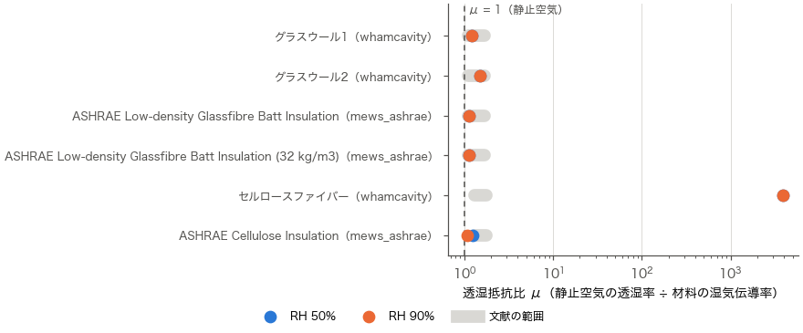
図 1-1　繊維系断熱材 6 材料の透湿抵抗比 μ。青は RH 50%、橙は RH 90%。灰色の帯は、文献のグラスウール（μ 1.1〜1.7）・セルロース（μ 1.3〜1.8）の範囲。旧 Excel のセルロースファイバーだけが μ 3900 と、帯から 3 桁外れている。

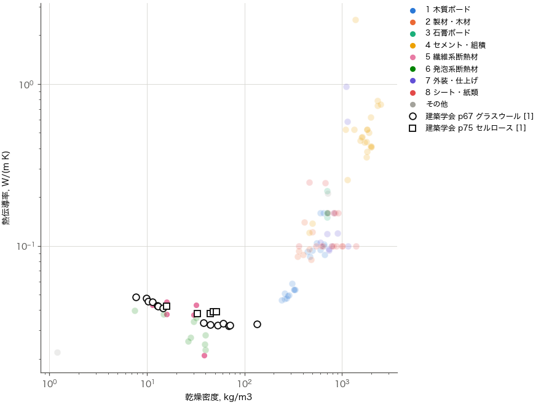
図 1-2　全 100 材料の熱伝導率と乾燥密度。緑が繊維系断熱材、黒い白抜きの印が文献の値（グラスウールは密度とともに熱伝導率が下がり、40 kg/m³ 以上でほぼ一定）。密度 38.6 で 0.021 と低い点が、旧 Excel のセルロースファイバー。

---

## 2. 見方

判定の 4 段階、指標（μ、ψ）、図の線・印の意味は `01_wood_boards.md` 2 章と同じ。この章では、このカテゴリに特有のことだけを書く。

- **熱伝導率は密度で大きく変わる**：グラスウールは、密度 8〜15 kg/m³ で 0.041〜0.048、40 kg/m³ 以上で 0.032〜0.033（建築学会 p67、NRC の測定）。同じ密度の文献値と比べた。
- **平衡含水率の文献**：グラスウールは Hansen のカタログ（18 kg/m³、建築学会 p69 [6]。本の出典の欄には「concrete sample」とあるが、グラスウールの節なので誤記と見られる）しかない。セルロースは新聞紙を原料とする製品（[2]）と、スロバキアのデータ（[3]）。
- **液水拡散係数**：グラスウールの文献値は手元にない。セルロースの文献（[4]、Marchand・Kumaran 1994）は含水量 kg/m³ で与えられ、試料の密度が書かれていないので、ASHRAE Cellulose と同じ 30 kg/m³ で割って kg/kg に直した。この カテゴリの材料は吸水係数が手元にないので、Künzel の式の目安は描いていない。ASHRAE の 2 材料の液水拡散係数の図は、RH 100% の含水率がありえないほど大きいため、横軸を絞った（Glassfibre は 1 kg/kg、Cellulose は 8 kg/kg まで）。
- 原典のページの画像は、非公開リポジトリ `docs/reference/papers/review_images/`（建築学会 p67〜70・p75〜77）。書き写した数値は、画像と見比べて確かめた。

---

## 3. グラスウール

**文献の値**（建築学会 p67〜70）：乾燥密度 8〜180 kg/m³、比熱 840。熱伝導率（24 ℃）は密度 7.7 で 0.048、11.4 で 0.045、14.7 で 0.041、38〜135 で 0.032〜0.033。平衡含水率（18 kg/m³）は RH 43% で吸湿 0.012・放湿 0.014、RH 85% で 0.017・0.022、RH 98% で 0.026。透湿率は密度 17〜120 で 1.15〜1.65×10⁻¹⁰（μ 1.2〜1.7）、[2] で 1.58×10⁻¹⁰、温度の式（20 ℃）で 1.77×10⁻¹⁰。

### 3.1 グラスウール1（旧 Excel）

| 熱 | 平衡含水率 | 湿気伝導率 | 液水拡散係数 |
|---|---|---|---|
| 妥当 | 要注意 | 妥当 | 妥当 |

**根拠**：Fortran の材料 3。熱伝導率 0.045、比熱 840、密度 16、湿気伝導率は一定値 1.58×10⁻¹⁰（建築学会 p69 [2] の値と同じ）。

**熱物性**：密度 16、熱伝導率 0.045。文献（密度 14.7 で 0.041、11.4 で 0.045）とほぼ同じで、妥当。比熱 840 も文献と同じ。

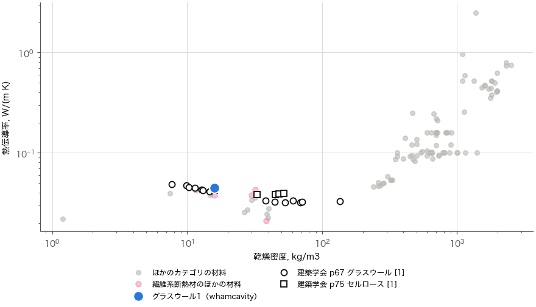
図 3-1　グラスウール1：熱伝導率と乾燥密度

**平衡含水率**：Fortran の AHGANS の 13 番の式 0.16·r^7.6448·exp(−1.3016(1−r^101.667))（グラスウール系 6 材料に共通）と、RH 98% を超えたら直線 47.79595·r − 46.79595（RH 100% で 1.0 kg/kg、Fortran のコメントに「飽和含水率 = 100wt%」。手順 5-3 で使われるように直した）。RH 50% で 0.0002、RH 80% で 0.008、RH 95% で 0.030。文献（RH 43% で 0.012〜0.014）の約 1/60（RH 50% 付近）で、低湿でほぼ 0。RH 95% では文献（0.019〜0.029）に近い。グラスウールの吸湿量はもともと小さく、容積含水率では RH 95% でも 0.0005 程度なので、計算への影響は小さい（要注意）。RH 100% の 1.0 kg/kg は容積含水率 0.016 で、空隙（約 0.99）よりずっと小さく、ありえない値ではない。

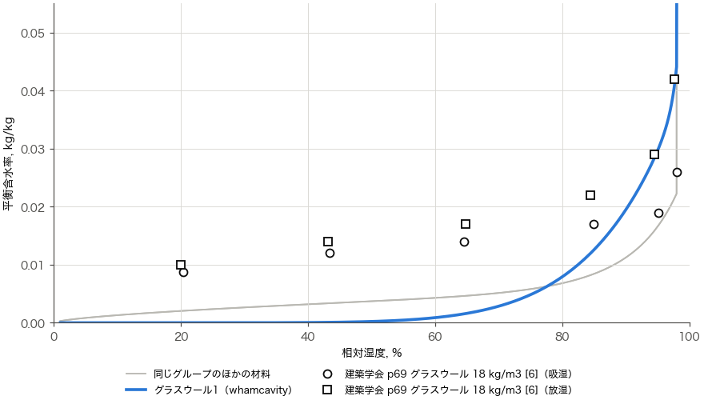
図 3-2　グラスウール1：平衡含水率と相対湿度

**湿気伝導率**：一定値 1.58×10⁻¹⁰（μ 1.2）。文献の [2]（1.58×10⁻¹⁰）と全桁一致し、カップ法の測定値（1.15〜1.65×10⁻¹⁰）の範囲にも入る。妥当。

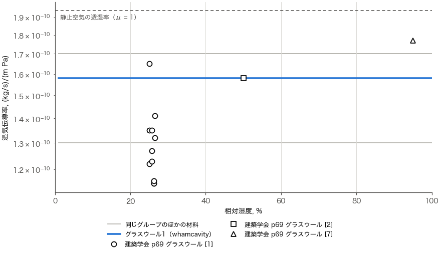
図 3-3　グラスウール1：湿気伝導率と相対湿度

**液水拡散係数**：液水が動かない設定。グラスウールは毛細管力がほとんど働かない材料なので、液水が動かない扱いは妥当（文献値はない）。

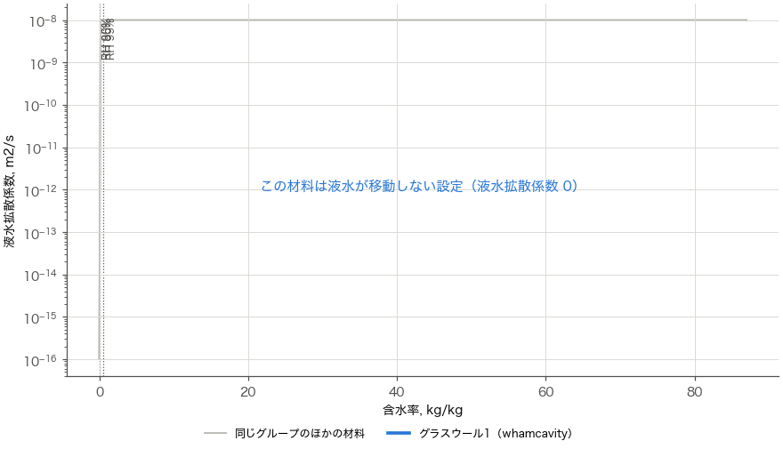
図 3-4　グラスウール1：液水拡散係数と含水率

### 3.2 グラスウール2（旧 Excel）

| 熱 | 平衡含水率 | 湿気伝導率 | 液水拡散係数 |
|---|---|---|---|
| 妥当 | 要注意 | 妥当 | 妥当 |

**根拠**：Fortran の材料 17。熱伝導率 0.0379、比熱 838、密度 16、湿気伝導率は一定値 1.30×10⁻¹⁰。平衡含水率の式はグラスウール1 と同じ。

**熱物性**：密度 16、熱伝導率 0.0379。文献の密度 16 付近（0.041）より 1 割ほど小さいが、高性能グラスウール（細い繊維）なら 0.035〜0.038 程度になるので、製品の違いとして妥当。

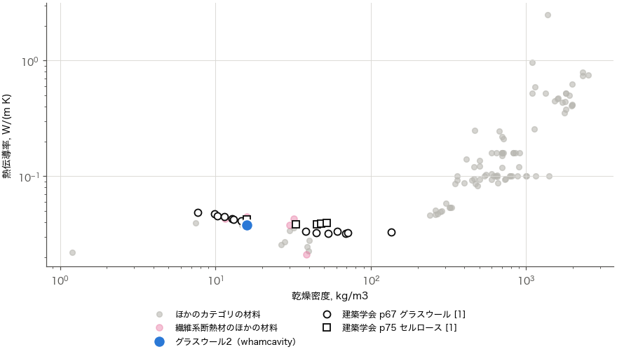
図 3-5　グラスウール2：熱伝導率と乾燥密度

**平衡含水率**：Fortran の AHGANS の 13 番の式 0.16·r^7.6448·exp(−1.3016(1−r^101.667))（グラスウール系 6 材料に共通）と、RH 98% を超えたら直線 47.79595·r − 46.79595（RH 100% で 1.0 kg/kg、Fortran のコメントに「飽和含水率 = 100wt%」。手順 5-3 で使われるように直した）。RH 50% で 0.0002、RH 80% で 0.008、RH 95% で 0.030。文献（RH 43% で 0.012〜0.014）の約 1/60（RH 50% 付近）で、低湿でほぼ 0。RH 95% では文献（0.019〜0.029）に近い。グラスウールの吸湿量はもともと小さく、容積含水率では RH 95% でも 0.0005 程度なので、計算への影響は小さい（要注意）。RH 100% の 1.0 kg/kg は容積含水率 0.016 で、空隙（約 0.99）よりずっと小さく、ありえない値ではない。

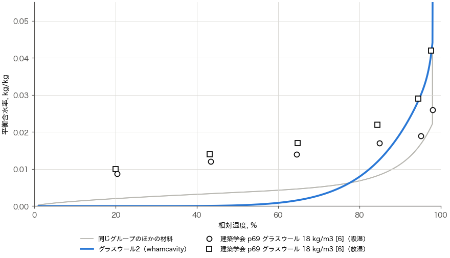
図 3-6　グラスウール2：平衡含水率と相対湿度

**湿気伝導率**：一定値 1.30×10⁻¹⁰（μ 1.5）。文献の範囲（1.15〜1.65×10⁻¹⁰）に入り、妥当。

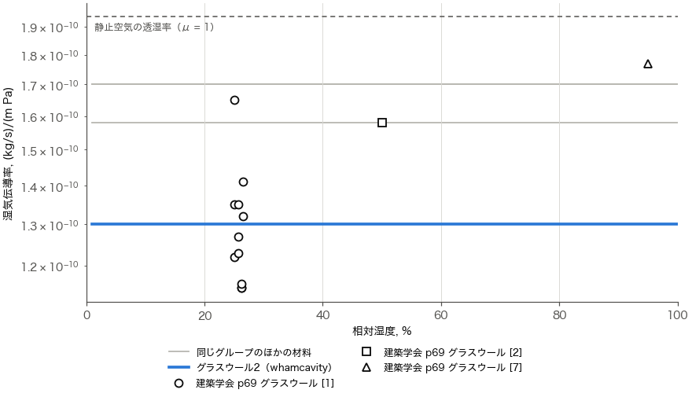
図 3-7　グラスウール2：湿気伝導率と相対湿度

**液水拡散係数**：液水が動かない設定。グラスウール1 と同じく妥当。

図 3-8　グラスウール2：液水拡散係数と含水率

### 3.3 ASHRAE Low-density Glassfibre Batt Insulation（ASHRAE）

| 熱 | 平衡含水率 | 湿気伝導率 | 液水拡散係数 |
|---|---|---|---|
| 妥当 | 要注意 | 妥当 | 根拠なし |

**根拠**：ASHRAE RP-1018（Kumaran 2006 の Low Density Glass Fibre Batt、密度 11.5 ± 1.5）。平衡含水率は Parameter = 2（RH 98% を超えたら直線、RH 100% で f = 87 kg/kg）。

**熱物性**：密度 11.5（論文と一致）、熱伝導率 0.043、比熱 840。文献（密度 11.4 で 0.045）とほぼ同じで、妥当。

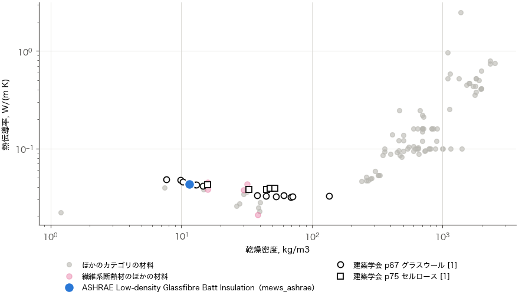
図 3-9　ASHRAE Low-density Glassfibre Batt Insulation：熱伝導率と乾燥密度

**平衡含水率**：RH 50% で 0.0037、RH 80% で 0.0068、RH 95% で 0.017。文献（18 kg/m³、RH 43% で 0.012）の 1/3〜1/4 だが、旧 Excel のグラスウールよりは文献に近い。**RH 100% の f = 87 kg/kg** は 1000 ÷ 11.5 で、容積含水率 1.0（空隙をちょうど水で満たす量）。ありえない値ではないが、RH 98% から 100% の間に含水率が 0.022 から 87 まで直線で増え、RH 99% で 43 kg/kg になる（要注意）。

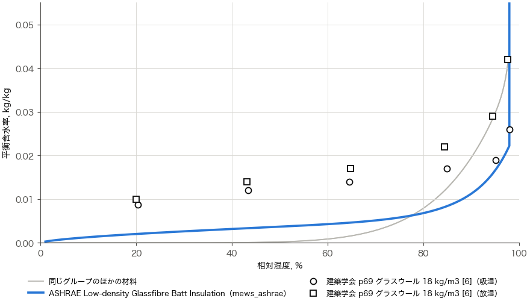
図 3-10　ASHRAE Low-density Glassfibre Batt Insulation：平衡含水率と相対湿度

**湿気伝導率**：一定値 1.7×10⁻¹⁰（μ 1.1）。文献の範囲（1.15〜1.65×10⁻¹⁰）のやや上で、静止空気（1.94×10⁻¹⁰）に近い。妥当。

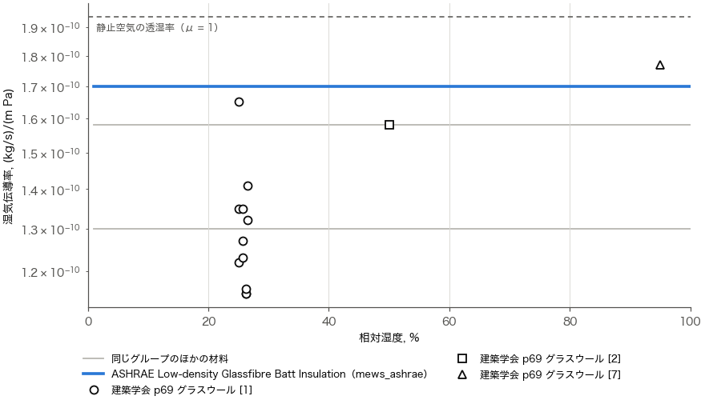
図 3-11　ASHRAE Low-density Glassfibre Batt Insulation：湿気伝導率と相対湿度

**液水拡散係数**：含水率 0.023 以下は 10⁻¹⁶（実質 0）、それより上は 10⁻⁸（Excel の a = −18.42 = ln(10⁻⁸)）。10 のべき乗ちょうどで、測定値を当てはめた値ではなく置いた値と見られる。比べる文献がない（根拠なし）。

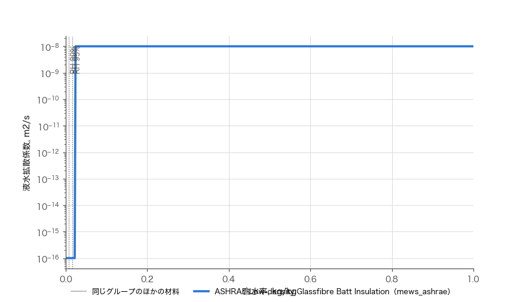
図 3-12　ASHRAE Low-density Glassfibre Batt Insulation：液水拡散係数と含水率

**確かめること（優先：低）**：RH 98〜100% の直線と液水拡散係数 10⁻⁸ の根拠を、RP-1018 の最終報告書で確かめたい。

### 3.4 ASHRAE Low-density Glassfibre Batt Insulation (32 kg/m3)（ASHRAE（No.80））

| 熱 | 平衡含水率 | 湿気伝導率 | 液水拡散係数 |
|---|---|---|---|
| 要注意 | **誤りの疑い** | 妥当 | 根拠なし |

**根拠**：Excel の No.80。Kumaran 2006 の材料一覧になく、No.62（3.3 節）の行を写して密度だけを 32 に変えたものと見られる（`ashrae_excel_derivation.md`。日本のグラスウール 32K 用か）。ローダーで名前に「(32 kg/m3)」を足して区別している。

**熱物性**：密度 32 に対して熱伝導率 0.043 は、No.62（11.5 kg/m³）と同じ値のまま。文献では密度 38 で 0.033 で、日本のグラスウール 32K も 0.035〜0.036 程度。密度に合わせて小さくなっていない（要注意）。

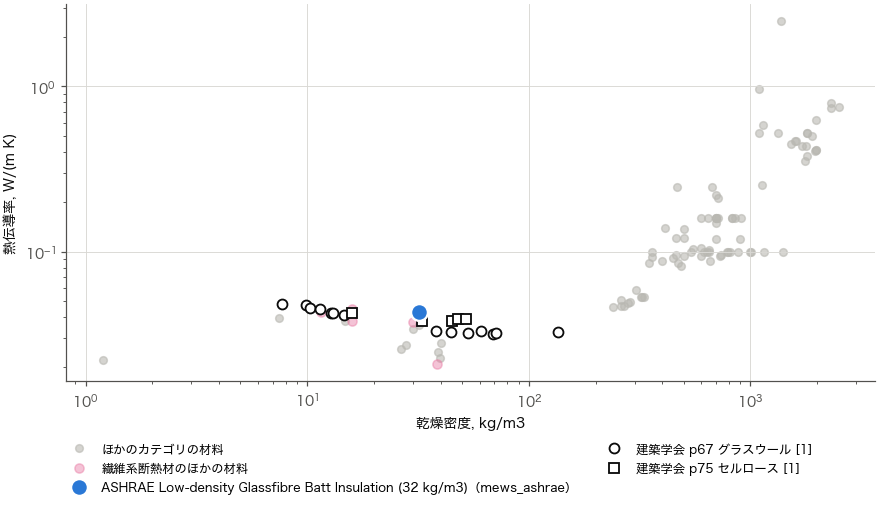
図 3-13　ASHRAE Low-density Glassfibre Batt Insulation (32 kg/m3)：熱伝導率と乾燥密度

**平衡含水率**：値は No.62 と同じ。**RH 100% の f = 87 kg/kg は、密度 11.5 のときの「空隙を水で満たす量」（1000 ÷ 11.5）のまま**で、密度 32 では容積含水率 2.8 と、空隙の 2.8 倍の水を含むことになる（**誤りの疑い**）。密度 32 なら f は 1000 ÷ 32 ≒ 31 以下のはず。

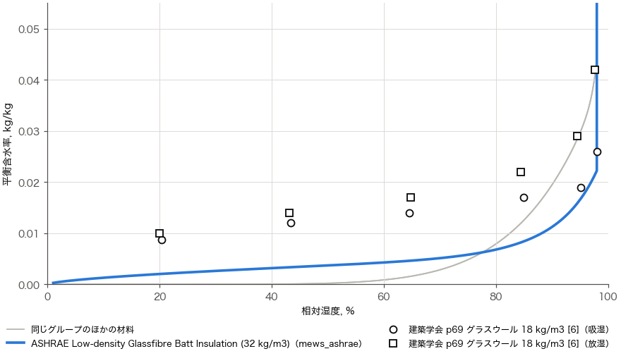
図 3-14　ASHRAE Low-density Glassfibre Batt Insulation (32 kg/m3)：平衡含水率と相対湿度

**湿気伝導率**：No.62 と同じ一定値 1.7×10⁻¹⁰（μ 1.1）。文献の範囲で、妥当（グラスウールの透湿率は密度であまり変わらない）。

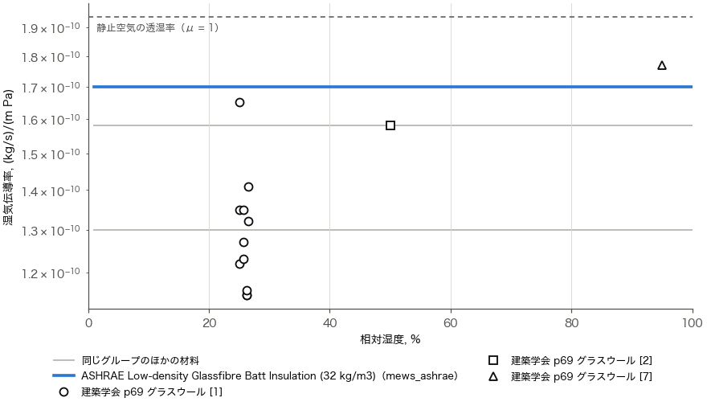
図 3-15　ASHRAE Low-density Glassfibre Batt Insulation (32 kg/m3)：湿気伝導率と相対湿度

**液水拡散係数**：No.62 と同じ（10⁻⁸ の置いた値）。根拠なし。

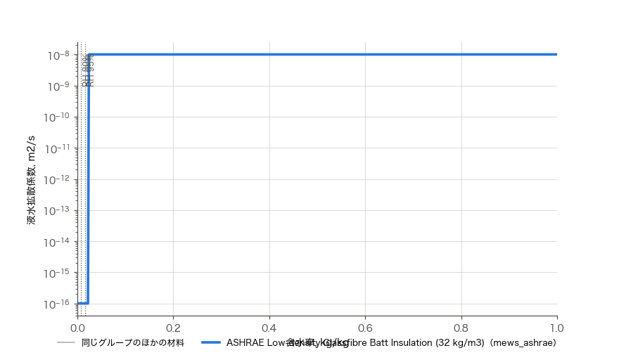
図 3-16　ASHRAE Low-density Glassfibre Batt Insulation (32 kg/m3)：液水拡散係数と含水率

**直す・確かめること（優先：中）**：使うなら、熱伝導率を密度 32 の値（0.035 前後）に、平衡含水率の f を 31 以下に直す。

## 4. セルロースファイバー

**文献の値**（建築学会 p75〜77）：乾燥密度 15〜55 kg/m³、比熱 1880。熱伝導率（24 ℃）は密度 16 で 0.042、33〜52 で 0.038〜0.039。平衡含水率は RH 52% で 0.090（新聞紙原料 [2]）、RH 44% で吸湿 0.070・放湿 0.098（[3]）、RH 86% で 0.17〜0.23。透湿率は 1.1〜1.5×10⁻¹⁰（μ 1.3〜1.8）。液水拡散係数（Marchand・Kumaran 1994）は含水量 2〜189 kg/m³ で 10⁻⁹〜1.3×10⁻⁸。

### 4.1 セルロースファイバー（旧 Excel）

| 熱 | 平衡含水率 | 湿気伝導率 | 液水拡散係数 |
|---|---|---|---|
| **誤りの疑い** | **誤りの疑い** | **誤りの疑い** | 要注意 |

**根拠**：Fortran の材料 13。熱伝導率 0.021、比熱 878、密度 38.6、湿気伝導率は一定値 5×10⁻¹⁴。平衡含水率は**グラスウールと同じ式**（Fortran の AHGANS の 13 番を、材料 3・13〜17 の 6 材料で共通に使っている）。Fortran の材料データファイル（`mcoff1.prn`）とも同じ値。

**熱物性**：**熱伝導率 0.021 は、文献（密度 33〜52 で 0.038〜0.039）の約半分**で、繊維系断熱材としては低すぎる（ウレタンなど発泡系の値に近い）。比熱 878 もグラスウールの値（840）に近く、文献のセルロース（1880）の約半分（**誤りの疑い**）。

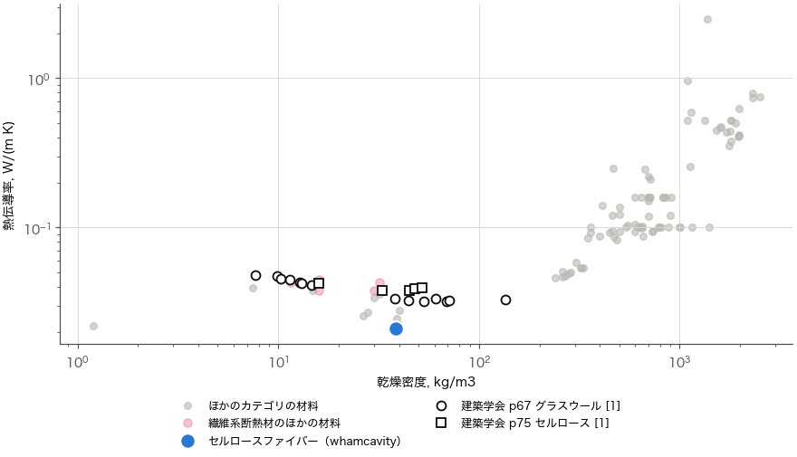
図 4-1　セルロースファイバー：熱伝導率と乾燥密度

**平衡含水率**：**グラスウールの式なので、RH 50% で 0.0002、RH 80% で 0.008**。文献のセルロース（RH 52% で 0.09、RH 86% で 0.17〜0.23）の 1/20〜1/400 で、セルロースが木材と同じくらい吸湿する性質を表していない（**誤りの疑い**）。室内の調湿の効果や、壁の中の水分のたまり方を大きく見誤る。

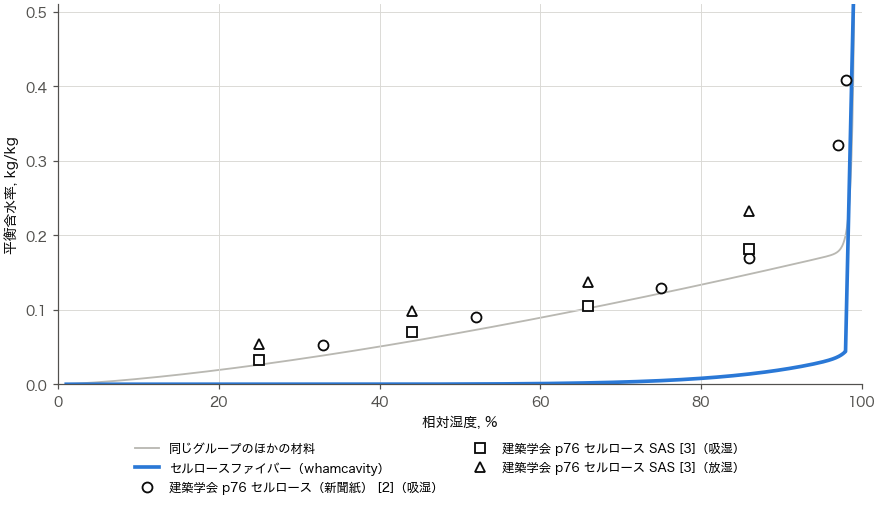
図 4-2　セルロースファイバー：平衡含水率と相対湿度

**湿気伝導率**：**一定値 5×10⁻¹⁴（μ 3900）は、文献（1.1〜1.5×10⁻¹⁰）の約 1/3000**で、防湿シート並みに湿気を通さない値（**誤りの疑い**）。吹き込みのセルロースは、グラスウールと同じく湿気をよく通す（μ 1〜2）。

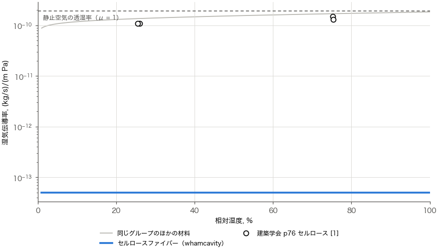
図 4-3　セルロースファイバー：湿気伝導率と相対湿度

**液水拡散係数**：液水が動かない設定。文献では 10⁻⁹〜10⁻⁸ で動く（要注意）。

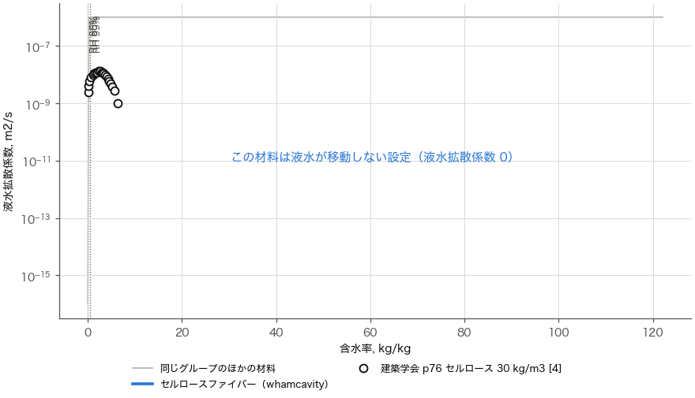
図 4-4　セルロースファイバー：液水拡散係数と含水率

**直す・確かめること（優先：高）**：熱伝導率・比熱・平衡含水率・湿気伝導率を、文献のセルロース（または ASHRAE Cellulose）の値に直す。今の値では、セルロースではなく別の材料（防湿性の高い発泡断熱材のような性質）として計算される。

### 4.2 ASHRAE Cellulose Insulation（ASHRAE）

| 熱 | 平衡含水率 | 湿気伝導率 | 液水拡散係数 |
|---|---|---|---|
| 妥当 | 要注意 | 妥当 | 要注意 |

**根拠**：ASHRAE RP-1018（Kumaran 2006 の Cellulose Fibre Insulation、新聞紙を原料とする吹き込み品、密度 30 ± 4）。平衡含水率の係数は a = 122.1、d = 197.85。

**熱物性**：密度 30（論文と一致）、熱伝導率 0.0376、比熱 1880。文献（密度 33 で 0.038、比熱 1880）と合い、妥当。

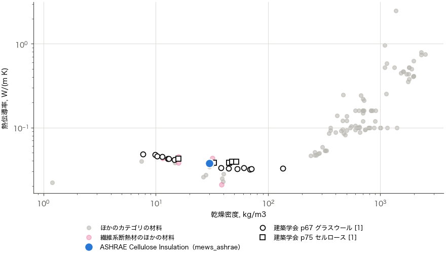
図 4-5　ASHRAE Cellulose Insulation：熱伝導率と乾燥密度

**平衡含水率**：RH 50% で 0.069、RH 80% で 0.134、RH 95% で 0.17。文献（RH 44〜52% で 0.07〜0.10、RH 86% で 0.17〜0.23）の吸湿側とよく合う。ただし、**RH 100% で 122 kg/kg**（容積含水率 3.7、空隙の約 3.7 倍）とありえない値になる（`ashrae_excel_derivation.md`）。RH 99% で 0.44、RH 99.5% で約 2 と、RH 99% を超えると急に増える。結露の計算では含水量の上限を大きく見積もる（要注意）。

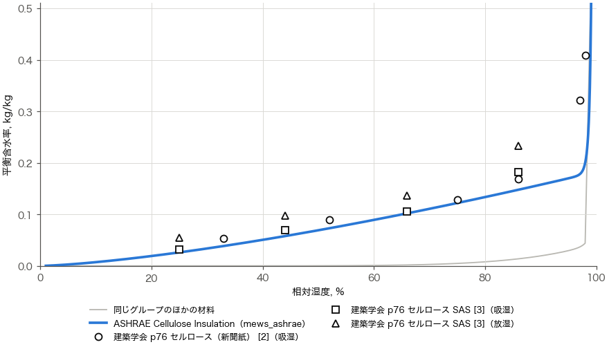
図 4-6　ASHRAE Cellulose Insulation：平衡含水率と相対湿度

**湿気伝導率**：RH 50% で 1.55×10⁻¹⁰（μ 1.3）、RH 90% で 1.79×10⁻¹⁰。文献（1.1〜1.5×10⁻¹⁰）とよく合い、妥当。

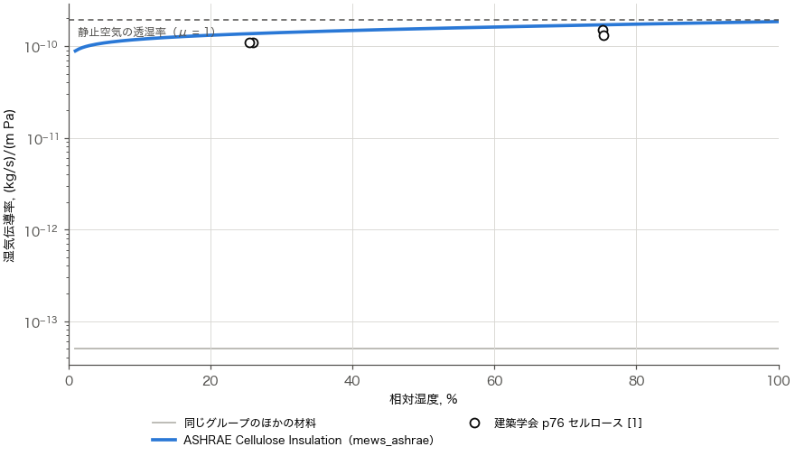
図 4-7　ASHRAE Cellulose Insulation：湿気伝導率と相対湿度

**液水拡散係数**：含水率 0.2 以下は 10⁻¹⁶（実質 0）、それより上は 10⁻⁶（Excel の a = −13.82 = ln(10⁻⁶)）。10 のべき乗ちょうどで、置いた値と見られる。文献（含水率 0.07〜6 で 10⁻⁹〜1.3×10⁻⁸）の約 100 倍（要注意）。

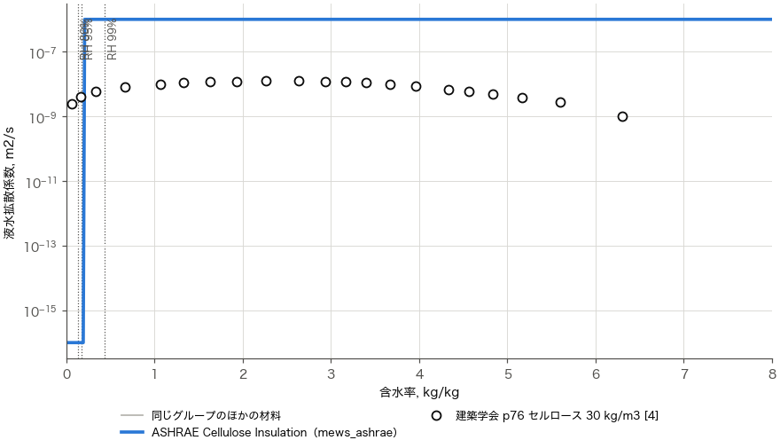
図 4-8　ASHRAE Cellulose Insulation：液水拡散係数と含水率

**直す・確かめること（優先：中）**：平衡含水率の RH 100% の値（a = 122.1）を、空隙を超えない値（密度 30 なら 33 kg/kg 以下）に直す。液水拡散係数は文献（Marchand・Kumaran 1994）の値を使うことを検討する。
