# 材料物性レビュー ⑥ 発泡系断熱材

作成: 2026-10-21（Claude Code による調査）
対象: 旧 Excel（`whamcavity`）の発泡プラスチック1〜3、新しい Excel（`mews_ashrae`）の MEWS Spray Polyurethane Foam、ASHRAE の Expanded Polystyrene（EPS）・Extruded Polystyrene（XPS）・Spray Polyurethane Foam・Polyisocyanurate・Low-density Polyurethane Foam、合わせて 9 材料
比べた文献: 建築学会『建築材料の熱・空気・湿気物性値』p73〜74（ビーズ法ポリスチレン）・p78〜80（押出法ポリスチレン）・p81〜82（ポリウレタン）・p83〜84（ポリイソシアヌレート）、新しい Excel の出典 RR-110・Kumaran 2006。文献の目録は `sources.md`、書き写した数値は `ref_data/foam_insulation.csv`
図: `make_figures_foam_insulation.py`

---

## 1. まとめ

判定の基準と図の見方は 2 章（共通のことは `01_wood_boards.md` 2 章）。

| 材料 | 熱 | 平衡含水率 | 湿気伝導率 | 液水拡散係数 | 主な点 | 節 |
|---|---|---|---|---|---|---|
| ASHRAE Expanded Polystyrene Insulation | 妥当 | 妥当 | 妥当 | 妥当 | 平衡含水率は文献（Hansen の EPS）とよく合う | 3.1 |
| ASHRAE Extruded Polystyrene Insulation | 妥当 | **誤りの疑い** | 妥当 | 妥当 | 平衡含水率の係数 a〜d が EPS と同じで、XPS の文献（NRC）の 30〜60 倍 | 3.2 |
| 発泡プラスチック1（旧） | 妥当 | 要注意 | 妥当 | 妥当 | 平衡含水率はグラスウールの式。比熱 1260 は文献 1470 より小さい | 3.3 |
| 発泡プラスチック2（旧） | 妥当 | 要注意 | 妥当 | 妥当 | 同上 | 3.4 |
| 発泡プラスチック3（旧） | 妥当 | 要注意 | **誤りの疑い** | 妥当 | 湿気伝導率 1.3×10⁻¹⁰（μ 1.5）はグラスウール2 と同じ値で、発泡プラスチックの 10〜100 倍 | 3.5 |
| MEWS Spray Polyurethane Foam | 妥当 | **根拠なし** | 妥当 | 妥当 | 平衡含水率が 0（測っていない） | 4.1 |
| ASHRAE Spray Polyurethane Foam Insulation | 妥当 | 要注意 | 妥当 | 根拠なし | 平衡含水率が RH 25〜90% でほぼ一定（0.0066）。液水拡散係数は 10⁻¹² の置いた値 | 4.2 |
| ASHRAE Polyisocyanurate Insulation | 妥当 | **誤りの疑い** | 妥当 | 根拠なし | RH 95% で 0.70、RH 100% で 636 kg/kg（空隙の 17 倍） | 4.3 |
| ASHRAE Low-density Polyurethane Foam Insulation | 根拠なし | 根拠なし | 根拠なし | 根拠なし | 密度 7.5 の連続気泡のフォームで、比べられる文献がない | 4.4 |

**主な結論**
- **熱物性**：9 材料とも文献（ポリスチレン 0.022〜0.039、ウレタン・イソシアヌレート 0.018〜0.026、密度・材齢による）の範囲に入る。旧 Excel の比熱（1260、837）は文献の 1470 より小さい。
- **平衡含水率**
  - **ASHRAE XPS の平衡含水率は、ASHRAE EPS と係数 a〜d が同じ**（最後の桁だけ違う）。EPS の文献（Hansen、31 kg/m³）とは合うが、XPS の文献（NRC、RH 50% で 0.0006）の約 60 倍。EPS の係数を XPS に写したと見られる（誤りの疑い）。前に指標で見つけた「XPS の RH 50% の含水率が文献の約 60 倍」の理由。
  - **ASHRAE Polyisocyanurate は RH 95% で 0.70、RH 100% で 636 kg/kg**（容積含水率 17、空隙の 17 倍）とありえない値。RH 90% 以下でも文献（NRC）の 4〜8 倍。
  - 旧 Excel の 3 材料は、グラスウールと同じ式（Fortran の AHGANS の 13 番）。XPS のような独立気泡のフォームなら、吸湿が小さいので大きくは外れない。
- **湿気伝導率**：ほとんどの材料が文献の範囲（μ 16〜200）に入る。**旧 Excel の発泡プラスチック3 は 1.3×10⁻¹⁰（μ 1.5）で、グラスウール2 と同じ値**。比熱 837 もグラスウール2（838）にほぼ同じで、グラスウールの値が写った可能性がある（誤りの疑い）。
- **液水拡散係数**：独立気泡のフォームは液水がほとんど動かないので、旧 Excel・EPS・XPS の「液水が動かない」設定は妥当。ASHRAE のウレタン系 3 材料は、測った範囲より上が 10⁻¹²（Excel の a = ln(10⁻¹²)）の置いた値。

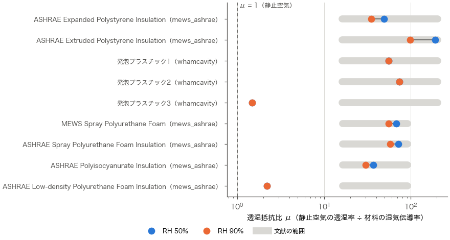
図 1-1　発泡系断熱材 9 材料の透湿抵抗比 μ。青は RH 50%、橙は RH 90%。灰色の帯は、文献のポリスチレン（EPS・XPS）、ウレタン・イソシアヌレートの μ の範囲。発泡プラスチック3 と Low-density PU Foam が、帯から大きく外れて湿気を通しやすい。

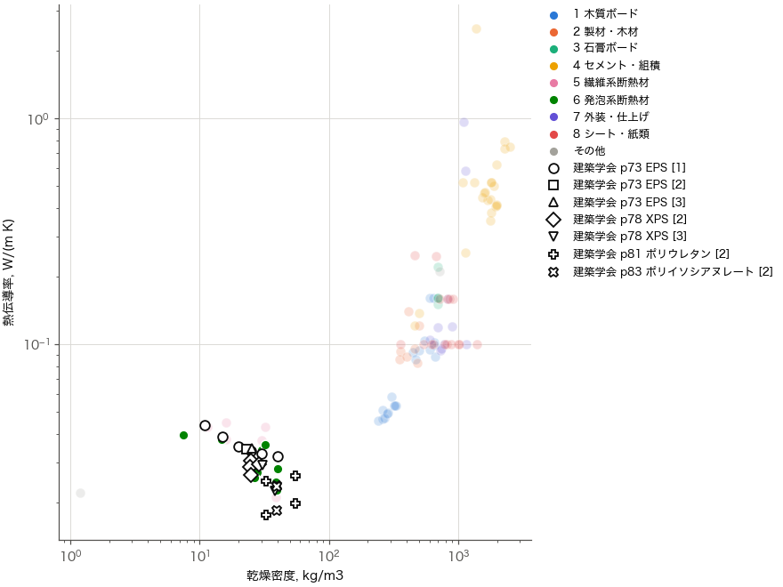
図 1-2　全 100 材料の熱伝導率と乾燥密度。濃い緑が発泡系断熱材、黒い白抜きの印が文献の値（EPS は密度の式、XPS・ウレタン・イソシアヌレートは材齢による違いを含む）。

---

## 2. 見方

判定の 4 段階、指標（μ、ψ）、図の線・印の意味は `01_wood_boards.md` 2 章と同じ。この章では、このカテゴリに特有のことだけを書く。

- **熱伝導率は材齢で変わる**：XPS・ウレタン・イソシアヌレートは、発泡ガスが抜けて空気に置き換わるにつれ、熱伝導率が 2〜3 年で 1〜4 割大きくなる（建築学会 p78〜83、NRC の材齢の表）。文献の点は、材齢 0 日と最後の値を描いた。
- **EPS の熱伝導率**は、密度の式 λ = 0.0213 + 1.2×10⁻⁴ρ + 0.235/ρ（20 ℃、[1]）から密度 11〜40 で計算した点を描いた。
- **透湿率の密度の式**（[1]、平均 RH 86%）は、EPS・XPS について密度 15〜45 で計算した点を描いた。
- **液水拡散係数**：このカテゴリの文献には液水拡散係数がない。独立気泡のフォームは、液水がほとんど動かないので、0 の設定は妥当とした。液水拡散係数が 10 のべき乗ちょうどの値で入っている材料は、置いた値として「根拠なし」とした。RH 100% の含水率がありえないほど大きい材料（ASHRAE の EPS・XPS・Spray PU Foam・Polyisocyanurate）は、液水拡散係数の図の横軸を 1 kg/kg までに絞った。
- 原典のページの画像は、非公開リポジトリ `docs/reference/papers/review_images/`（建築学会 p73〜74・p78〜84）。書き写した数値は、画像と見比べて確かめた。

---

## 3. ポリスチレン系（EPS、XPS、旧 Excel の発泡プラスチック）

**文献の値**（建築学会 p73〜74・p78〜80）：EPS は乾燥密度 11〜40 kg/m³、比熱 1470、熱伝導率 0.034〜0.035（23〜25.5 kg/m³）、密度の式で 0.033〜0.044。平衡含水率（Hansen、31 kg/m³）は RH 43% で 0.041、RH 98% で 0.05〜0.08 と比較的大きい。透湿率 0.72〜1.2×10⁻¹¹（約 11.5 kg/m³）。XPS は乾燥密度 25〜55、比熱 1470、熱伝導率は材齢 0 日で 0.022〜0.026、約 3 年で 0.0285〜0.0305。平衡含水率（NRC）は RH 25〜90% で 0.0006〜0.0017 と非常に小さい。透湿率 0.95〜2.1×10⁻¹²。

### 3.1 ASHRAE Expanded Polystyrene Insulation（ASHRAE）

| 熱 | 平衡含水率 | 湿気伝導率 | 液水拡散係数 |
|---|---|---|---|
| 妥当 | 妥当 | 妥当 | 妥当 |

**根拠**：ASHRAE RP-1018（Kumaran 2006 の EPS、密度 14.8 ± 0.2）。平衡含水率は Parameter = 2（RH 98% を超えたら直線、RH 100% で f = 56 kg/kg）。液水拡散係数は範囲分け数 0（液水が動かない）。

**熱物性**：密度 14.8（論文と一致）、熱伝導率 0.0379、比熱 1470。文献の密度の式（密度 14.8 で 0.039）と合い、妥当。

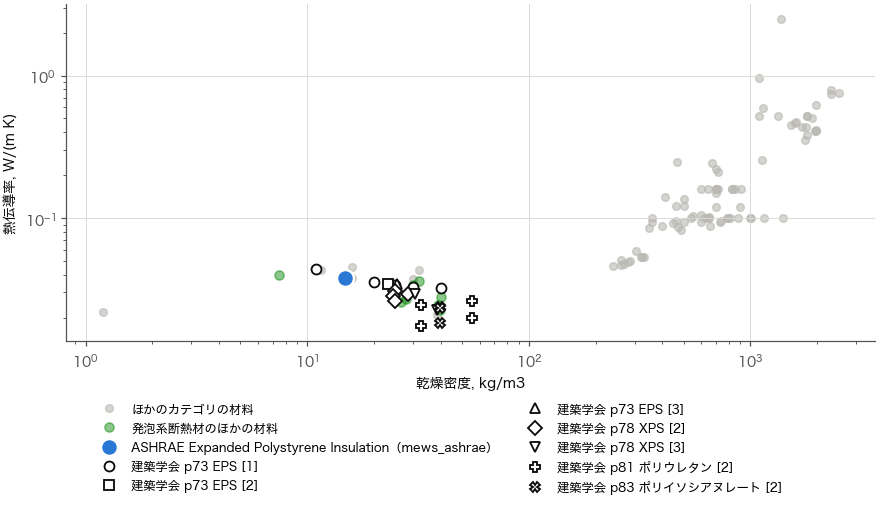
図 3-1　ASHRAE Expanded Polystyrene Insulation：熱伝導率と乾燥密度

**平衡含水率**：RH 50% で 0.038、RH 90% で 0.057。文献（Hansen、31 kg/m³：RH 43% で 0.041、RH 85% で 0.040〜0.056）の吸湿と放湿の間を通り、妥当。RH 100% の f = 56 kg/kg は容積含水率 0.83 で、空隙（約 0.99）を超えない。

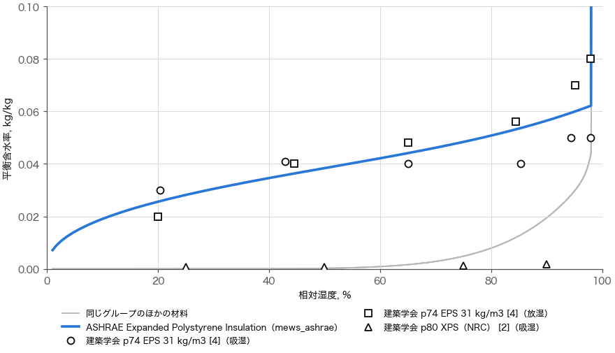
図 3-2　ASHRAE Expanded Polystyrene Insulation：平衡含水率と相対湿度

**湿気伝導率**：RH 50% で 3.9×10⁻¹²（μ 49）、RH 86% で 5.3×10⁻¹²。文献のカップ法（約 11.5 kg/m³ で 0.72〜1.2×10⁻¹¹）の 0.4〜0.6 倍だが、密度の式（14.8 kg/m³ で 5.6×10⁻¹²）とは合う。妥当。

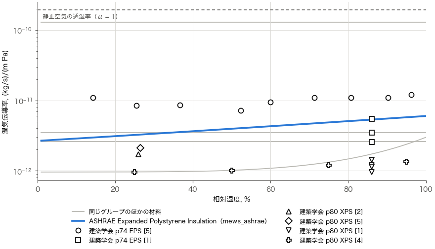
図 3-3　ASHRAE Expanded Polystyrene Insulation：湿気伝導率と相対湿度

**液水拡散係数**：液水が動かない設定。独立気泡のフォームなので妥当。

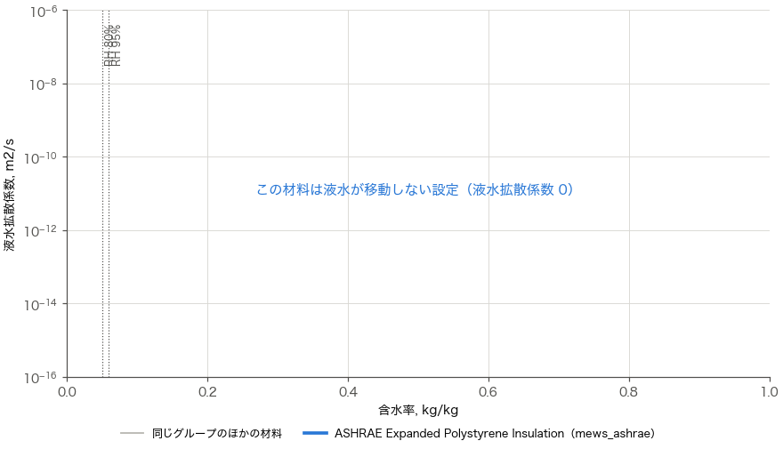
図 3-4　ASHRAE Expanded Polystyrene Insulation：液水拡散係数と含水率

### 3.2 ASHRAE Extruded Polystyrene Insulation（ASHRAE）

| 熱 | 平衡含水率 | 湿気伝導率 | 液水拡散係数 |
|---|---|---|---|
| 妥当 | **誤りの疑い** | 妥当 | 妥当 |

**根拠**：ASHRAE RP-1018（Kumaran 2006 の XPS、密度 28.6、Excel は 28）。**平衡含水率の係数 a〜d（0.063819、0.42613、−0.22771、3.9586）が、ASHRAE EPS（0.063819、0.42612、−0.22771、3.9583）と最後の桁まで同じ**で、f だけが違う（EPS 56、XPS 21）。

**熱物性**：密度 28、熱伝導率 0.0271、比熱 1470。文献の材齢 0 日（0.022〜0.026）と約 3 年（0.0285〜0.0305）の間で、妥当。

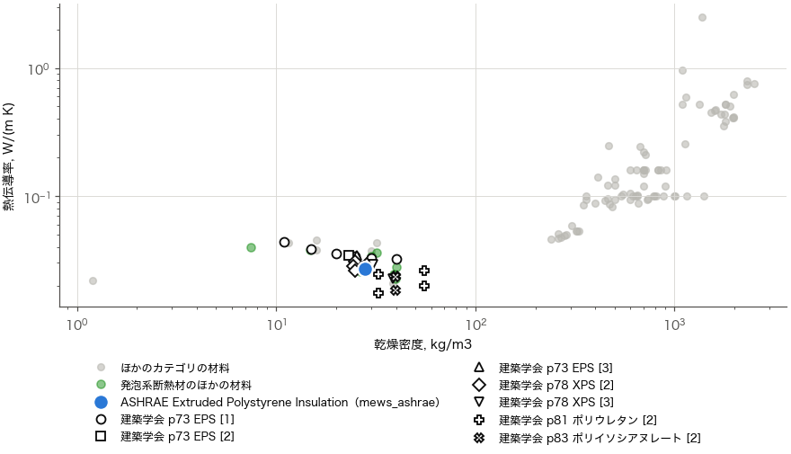
図 3-5　ASHRAE Extruded Polystyrene Insulation：熱伝導率と乾燥密度

**平衡含水率**：**RH 50% で 0.038、RH 90% で 0.057 は、XPS の文献（NRC、RH 50% で 0.0006、RH 90% で 0.0017）の 30〜60 倍**で、EPS の文献の値と同じ。XPS は EPS より吸湿しにくい材料で、EPS の係数を XPS の行に写したと見られる（**誤りの疑い**）。RP-1018 の XPS は、文献の XPS と同じ NRC の測定のはずで、その値（0.0006〜0.0017）が正しい可能性が高い。

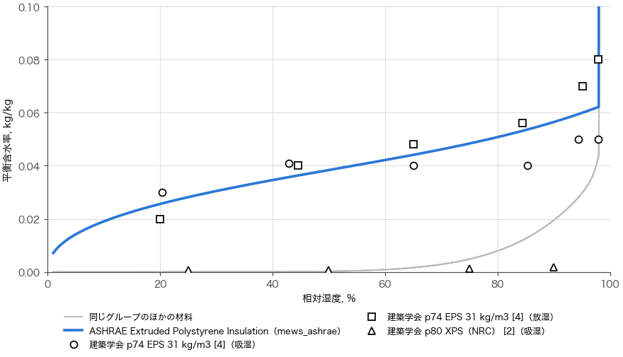
図 3-6　ASHRAE Extruded Polystyrene Insulation：平衡含水率と相対湿度

**湿気伝導率**：RH 50% で 1.0×10⁻¹²（μ 191）、RH 86% で 1.7×10⁻¹²。文献（0.95〜2.1×10⁻¹²、密度の式で 1.3×10⁻¹²）とよく合い、妥当。

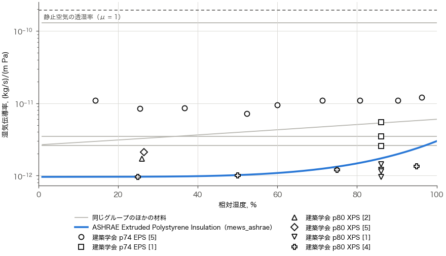
図 3-7　ASHRAE Extruded Polystyrene Insulation：湿気伝導率と相対湿度

**液水拡散係数**：液水が動かない設定。独立気泡のフォームなので妥当。

図 3-8　ASHRAE Extruded Polystyrene Insulation：液水拡散係数と含水率

**直す・確かめること（優先：中）**：平衡含水率を XPS の値（NRC：RH 25〜90% で 0.0006〜0.0017）で当てはめ直す。今の値では、XPS の含水量を 30〜60 倍に見積もる。

### 3.3 発泡プラスチック1（旧 Excel）

| 熱 | 平衡含水率 | 湿気伝導率 | 液水拡散係数 |
|---|---|---|---|
| 妥当 | 要注意 | 妥当 | 妥当 |

**根拠**：Fortran の材料 14。熱伝導率 0.0339、比熱 1260、密度 30、湿気伝導率は一定値 3.48×10⁻¹²。どの種類の発泡プラスチック（EPS、XPS など）かは書かれていない。

**熱物性**：密度 30、熱伝導率 0.0339。密度 30 の EPS の式（0.033）とほぼ同じで、妥当。比熱 1260 は文献の 1470 より小さい。

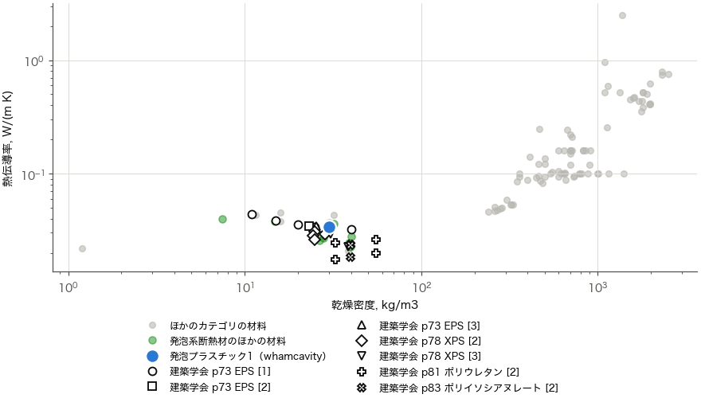
図 3-9　発泡プラスチック1：熱伝導率と乾燥密度

**平衡含水率**：グラスウールと同じ式（Fortran の AHGANS の 13 番を、材料 3・13〜17 で共通に使っている。RH 98% を超えたら直線で RH 100% は 1.0 kg/kg）。RH 50% で 0.0002、RH 90% で 0.020。XPS の文献（RH 50% で 0.0006、RH 90% で 0.0017）と同じく小さいが、RH 90% では 10 倍大きい。EPS の文献（RH 43% で 0.041）とは合わない。製品が分からないので、要注意にとどめる。

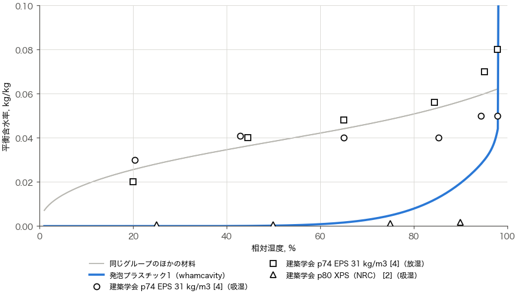
図 3-10　発泡プラスチック1：平衡含水率と相対湿度

**湿気伝導率**：一定値 3.48×10⁻¹²（μ 56）。文献のポリスチレン（0.95×10⁻¹²〜1.2×10⁻¹¹、μ 16〜200）の範囲に入り、妥当。

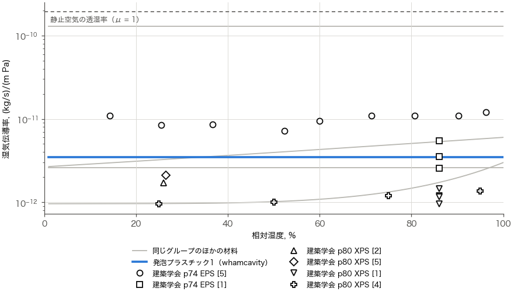
図 3-11　発泡プラスチック1：湿気伝導率と相対湿度

**液水拡散係数**：液水が動かない設定。独立気泡のフォームなので妥当。

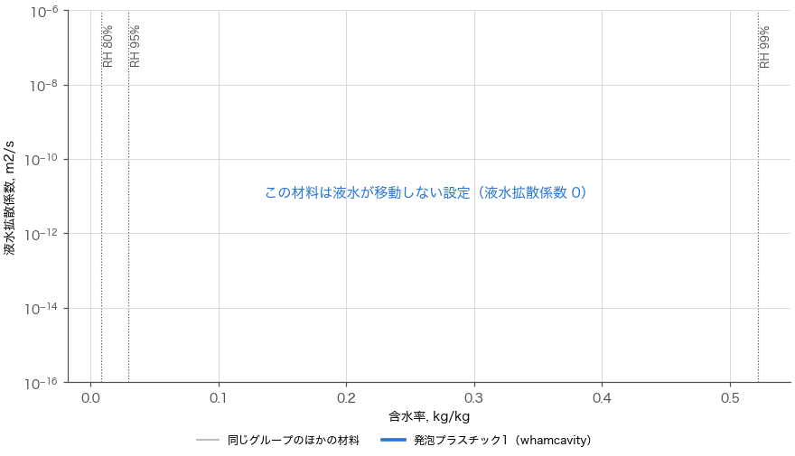
図 3-12　発泡プラスチック1：液水拡散係数と含水率

### 3.4 発泡プラスチック2（旧 Excel）

| 熱 | 平衡含水率 | 湿気伝導率 | 液水拡散係数 |
|---|---|---|---|
| 妥当 | 要注意 | 妥当 | 妥当 |

**根拠**：Fortran の材料 15。熱伝導率 0.028、比熱 1260、密度 40、湿気伝導率は一定値 2.61×10⁻¹²。どの種類の発泡プラスチック（EPS、XPS など）かは書かれていない。

**熱物性**：密度 40、熱伝導率 0.028。XPS の文献（0.022〜0.030）の範囲で、妥当。比熱 1260 は文献の 1470 より小さい。

図 3-13　発泡プラスチック2：熱伝導率と乾燥密度

**平衡含水率**：グラスウールと同じ式（Fortran の AHGANS の 13 番を、材料 3・13〜17 で共通に使っている。RH 98% を超えたら直線で RH 100% は 1.0 kg/kg）。RH 50% で 0.0002、RH 90% で 0.020。XPS の文献（RH 50% で 0.0006、RH 90% で 0.0017）と同じく小さいが、RH 90% では 10 倍大きい。EPS の文献（RH 43% で 0.041）とは合わない。製品が分からないので、要注意にとどめる。

図 3-14　発泡プラスチック2：平衡含水率と相対湿度

**湿気伝導率**：一定値 2.61×10⁻¹²（μ 74）。文献のポリスチレン（0.95×10⁻¹²〜1.2×10⁻¹¹、μ 16〜200）の範囲に入り、妥当。

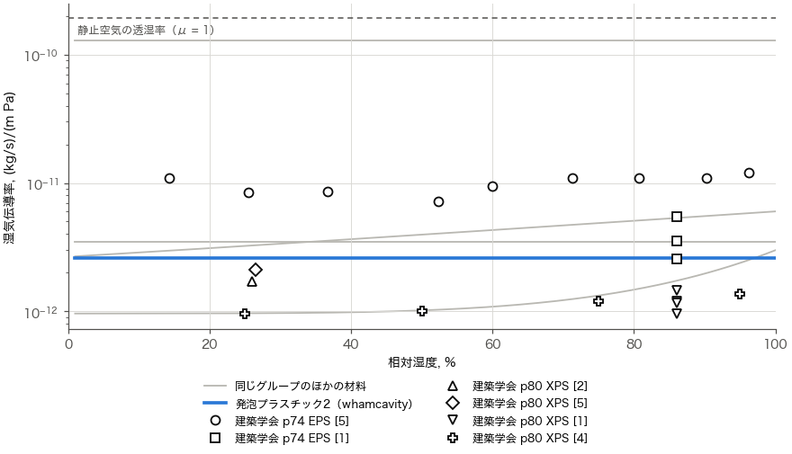
図 3-15　発泡プラスチック2：湿気伝導率と相対湿度

**液水拡散係数**：液水が動かない設定。独立気泡のフォームなので妥当。

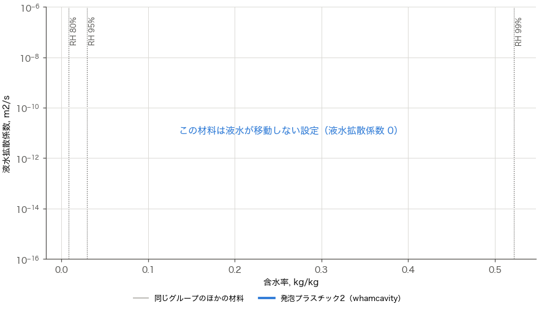
図 3-16　発泡プラスチック2：液水拡散係数と含水率

### 3.5 発泡プラスチック3（旧 Excel）

| 熱 | 平衡含水率 | 湿気伝導率 | 液水拡散係数 |
|---|---|---|---|
| 妥当 | 要注意 | **誤りの疑い** | 妥当 |

**根拠**：Fortran の材料 16。熱伝導率 0.036、比熱 837、密度 32、湿気伝導率は一定値 1.30×10⁻¹⁰。どの種類の発泡プラスチック（EPS、XPS など）かは書かれていない。比熱 837 と湿気伝導率 1.30×10⁻¹⁰ は、旧 Excel のグラスウール2（838、1.30×10⁻¹⁰）とほぼ同じ。

**熱物性**：密度 32、熱伝導率 0.036。密度 32 の EPS の式（0.033）に近く、妥当。比熱 837 は文献の 1470 より小さい。

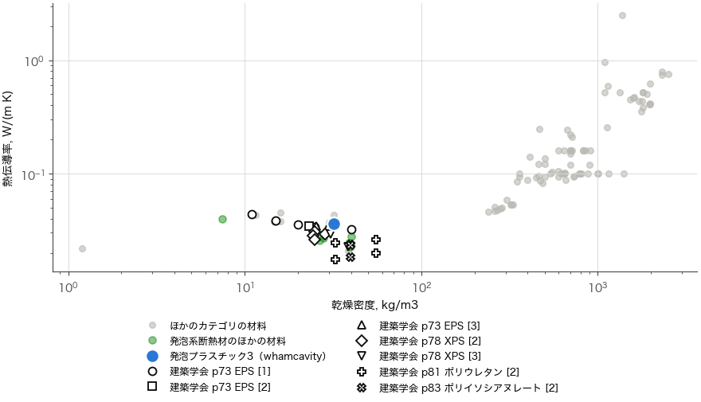
図 3-17　発泡プラスチック3：熱伝導率と乾燥密度

**平衡含水率**：グラスウールと同じ式（Fortran の AHGANS の 13 番を、材料 3・13〜17 で共通に使っている。RH 98% を超えたら直線で RH 100% は 1.0 kg/kg）。RH 50% で 0.0002、RH 90% で 0.020。XPS の文献（RH 50% で 0.0006、RH 90% で 0.0017）と同じく小さいが、RH 90% では 10 倍大きい。EPS の文献（RH 43% で 0.041）とは合わない。製品が分からないので、要注意にとどめる。

図 3-18　発泡プラスチック3：平衡含水率と相対湿度

**湿気伝導率**：**一定値 1.30×10⁻¹⁰（μ 1.5）は、文献の発泡プラスチック（0.95×10⁻¹²〜1.2×10⁻¹¹）の 10〜100 倍**で、グラスウール並みに湿気を通す。グラスウール2 と同じ値で、写し間違いの可能性がある（**誤りの疑い**）。

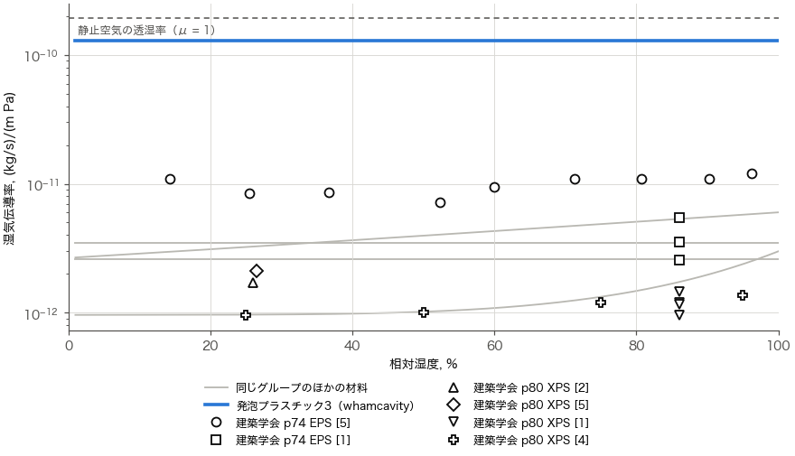
図 3-19　発泡プラスチック3：湿気伝導率と相対湿度

**液水拡散係数**：液水が動かない設定。独立気泡のフォームなので妥当。

図 3-20　発泡プラスチック3：液水拡散係数と含水率

**直す・確かめること（優先：中）**：湿気伝導率と比熱の根拠を確かめる。グラスウール2 の値が写ったのなら、発泡プラスチックの値（μ 50〜200 程度）に直す。

## 4. ウレタン系（ポリウレタン、ポリイソシアヌレート）

**文献の値**（建築学会 p81〜84）：乾燥密度 20〜55 kg/m³、比熱 1470。熱伝導率は、ポリウレタンが材齢 0 日で 0.0175〜0.0198、約 2.5 年で 0.0247〜0.0261、ポリイソシアヌレートが 0.0183 から約 3 年で 0.0234〜0.0236。透湿率は、ポリウレタンが 2.1〜11.8×10⁻¹²（湿度とともに大きくなる）、ポリイソシアヌレートが 2.2〜8.3×10⁻¹²。平衡含水率は、ポリイソシアヌレート（NRC）が RH 25〜90% で 0.002〜0.007。ポリウレタンの平衡含水率は文献にない。

### 4.1 MEWS Spray Polyurethane Foam（MEWS）

| 熱 | 平衡含水率 | 湿気伝導率 | 液水拡散係数 |
|---|---|---|---|
| 妥当 | **根拠なし** | 妥当 | 妥当 |

**根拠**：RR-110 12 章の Spray Polyurethane Foam（密度 39.7）。熱伝導率と湿気伝導率は RR-110 の値。**平衡含水率の係数はすべて 0**（測っていない）。液水拡散係数は範囲分け数 0（Excel の a は「測っていない」の印 ln(99999)）。

**熱物性**：密度 39.7、熱伝導率 0.0227、比熱 1470。文献のポリウレタン（材齢 0 日で 0.0175〜0.0198、約 2.5 年で 0.025〜0.026）の間で、妥当。

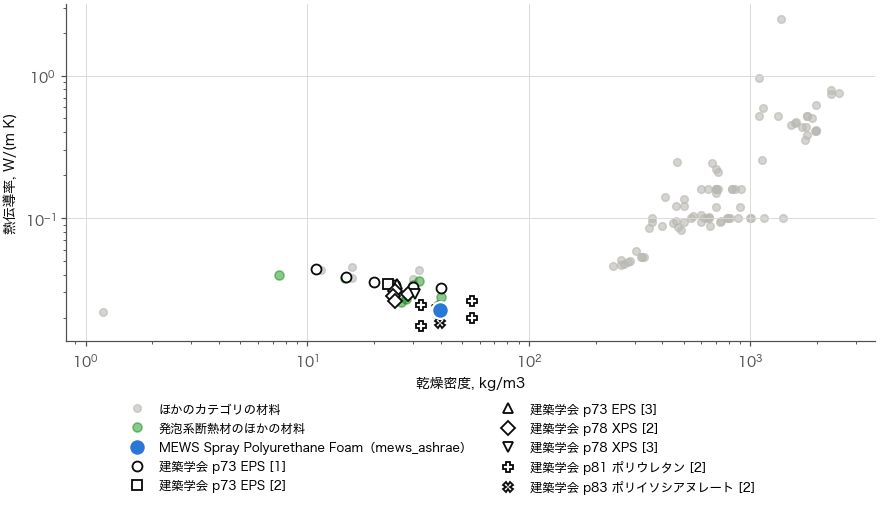
図 4-1　MEWS Spray Polyurethane Foam：熱伝導率と乾燥密度

**平衡含水率**：**どの湿度でも 0**。RR-110 に測定値がない（根拠なし）。独立気泡のウレタンは吸湿が小さいが 0 ではない（ポリイソシアヌレートの文献で RH 50% 0.003）。

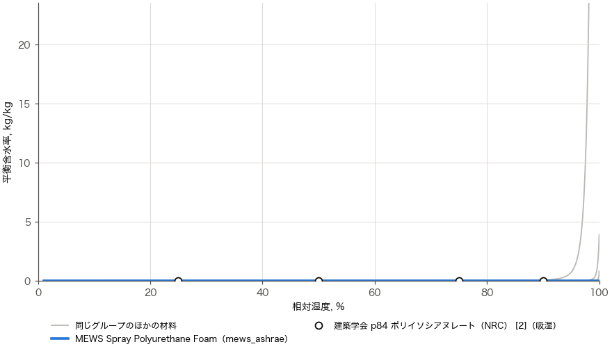
図 4-2　MEWS Spray Polyurethane Foam：平衡含水率と相対湿度

**湿気伝導率**：RH 50% で 2.9×10⁻¹²（μ 68）、RH 86% で 3.4×10⁻¹²。文献（2.1〜11.8×10⁻¹²）の範囲に入り、妥当。

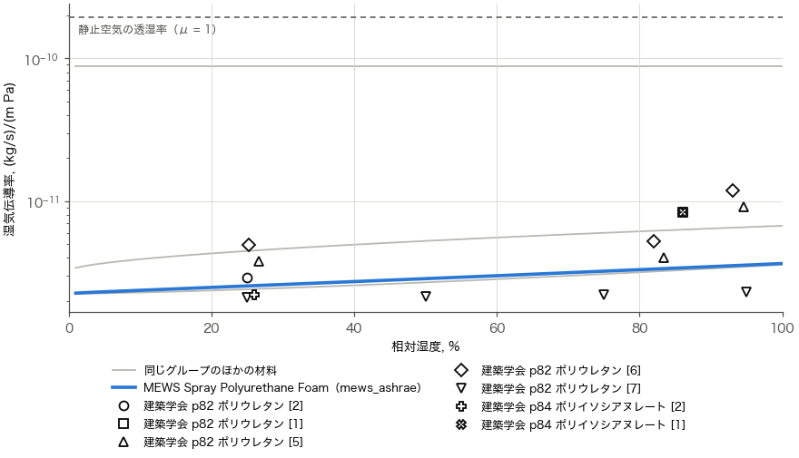
図 4-3　MEWS Spray Polyurethane Foam：湿気伝導率と相対湿度

**液水拡散係数**：液水が動かない設定。独立気泡のフォームなので妥当。

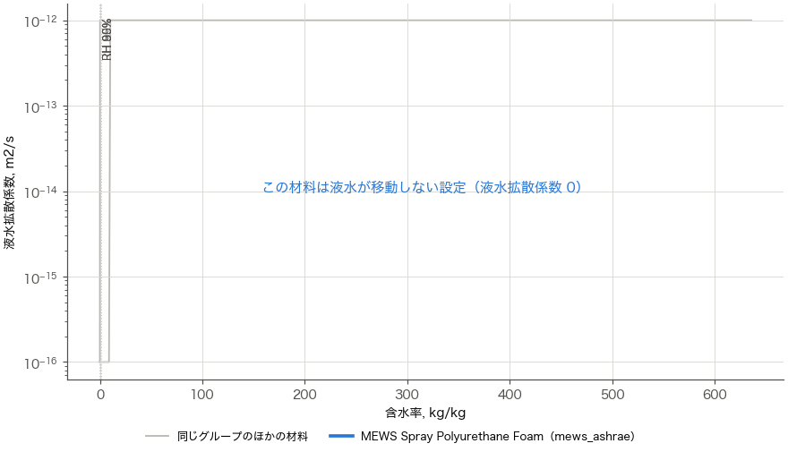
図 4-4　MEWS Spray Polyurethane Foam：液水拡散係数と含水率

**確かめること（優先：低）**：平衡含水率が入っていない。使うなら、ASHRAE Spray Polyurethane Foam やポリイソシアヌレートの文献の値を参考に入れる。

### 4.2 ASHRAE Spray Polyurethane Foam Insulation（ASHRAE）

| 熱 | 平衡含水率 | 湿気伝導率 | 液水拡散係数 |
|---|---|---|---|
| 妥当 | 要注意 | 妥当 | 根拠なし |

**根拠**：ASHRAE RP-1018（Kumaran 2006 の Sprayed Polyurethane Foam、密度 39 ± 2）。平衡含水率の係数 a = 3.8792、b = 0.007873（ほぼ 0）、c = −6.3666、d = 63.592。液水拡散係数の区間 1 と 2 のすき間（0.071〜0.077）は前の区間を延ばして埋め、最後の区間の上限 2.9 を超えたら一定にしている（`material_loaders.py`）。

**熱物性**：密度 39（論文と一致）、熱伝導率 0.0246、比熱 1470。文献のポリウレタン（約 2.5 年で 0.025〜0.026）と合い、妥当。

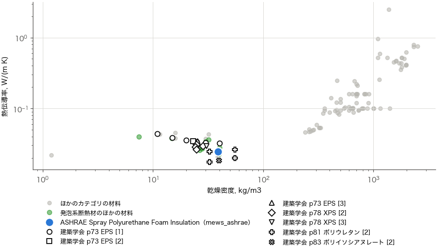
図 4-5　ASHRAE Spray Polyurethane Foam Insulation：熱伝導率と乾燥密度

**平衡含水率**：RH 25% から 90% まで 0.0066〜0.0067 とほぼ一定（b ≒ 0 のため）で、RH 95% から急に増え、RH 100% で 3.88 kg/kg（容積含水率 0.15）。湿度によって変わらない形は、吸湿の測定値に当てはめた形としては不自然。ポリイソシアヌレートの文献（RH 25% で 0.002、RH 90% で 0.007）とは RH 90% で合う（要注意）。

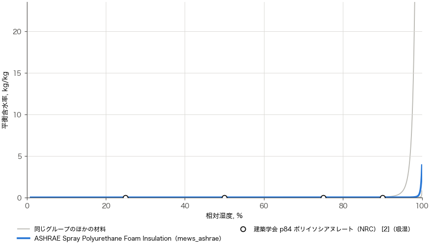
図 4-6　ASHRAE Spray Polyurethane Foam Insulation：平衡含水率と相対湿度

**湿気伝導率**：RH 50% で 2.7×10⁻¹²（μ 72）、RH 86% で 3.3×10⁻¹²。文献（2.1〜11.8×10⁻¹²）の範囲に入り、妥当。

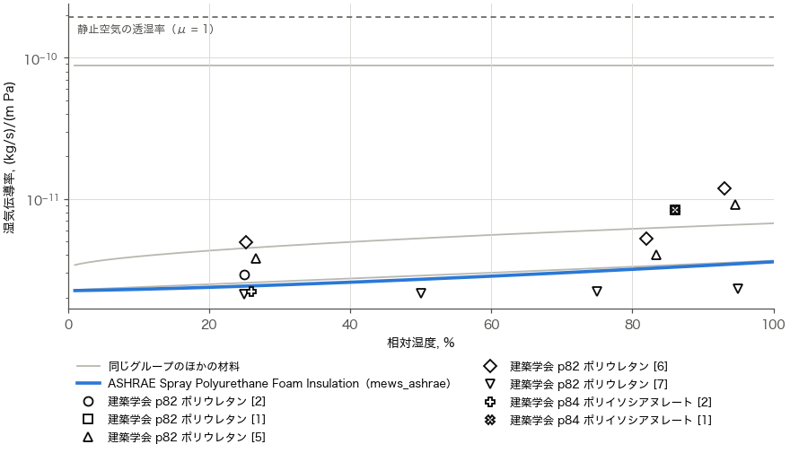
図 4-7　ASHRAE Spray Polyurethane Foam Insulation：湿気伝導率と相対湿度

**液水拡散係数**：含水率 0.077 以下は 10⁻¹⁶（実質 0）、それより上は 10⁻¹²（Excel の a = −27.631 = ln(10⁻¹²)）。10 のべき乗ちょうどの置いた値と見られる（根拠なし）。値が小さいので、計算への影響は小さい。

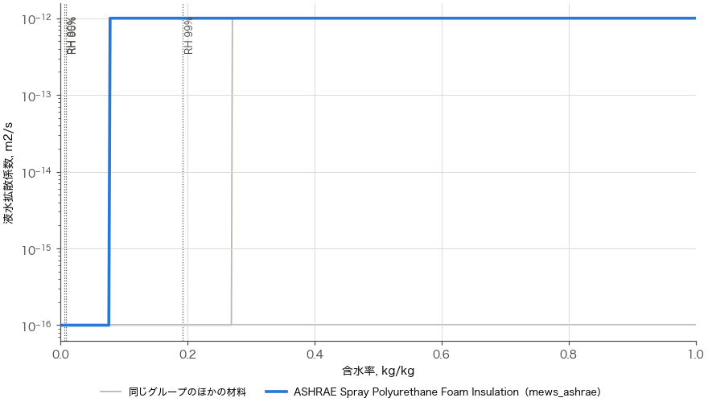
図 4-8　ASHRAE Spray Polyurethane Foam Insulation：液水拡散係数と含水率

### 4.3 ASHRAE Polyisocyanurate Insulation（ASHRAE）

| 熱 | 平衡含水率 | 湿気伝導率 | 液水拡散係数 |
|---|---|---|---|
| 妥当 | **誤りの疑い** | 妥当 | 根拠なし |

**根拠**：ASHRAE RP-1018（Kumaran 2006 の Polyisocyanurate Board、表面材を取り除いた試験体、密度 26.5）。平衡含水率の係数 a = 635.94。液水拡散係数の区間 1 と 2 のすき間（8.1〜9.3）は前の区間を延ばして埋め、最後の区間の上限 38 を超えたら一定にしている。

**熱物性**：密度 26.5（論文と一致）、熱伝導率 0.0257、比熱 1470。文献（材齢 0 日で 0.0183、約 3 年で 0.0234〜0.0236）より 1 割ほど大きいが、近い。妥当。

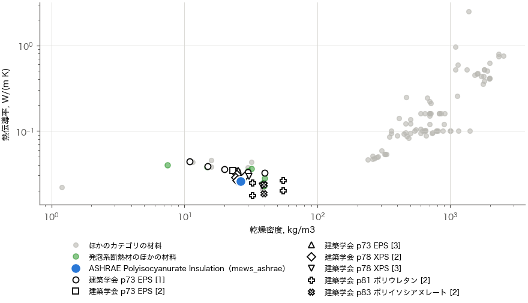
図 4-9　ASHRAE Polyisocyanurate Insulation：熱伝導率と乾燥密度

**平衡含水率**：RH 50% で 0.011、RH 90% で 0.055 は、文献（NRC、RH 50% で 0.003、RH 90% で 0.007）の 4〜8 倍。さらに **RH 95% で 0.70、RH 99% で 93、RH 100% で 636 kg/kg**（容積含水率 17、空隙の 17 倍）とありえない値になる（**誤りの疑い**、`ashrae_excel_derivation.md`）。a = 635.94 は、測定値ではなく、高湿の点に無理に合わせた当てはめの結果と見られる。

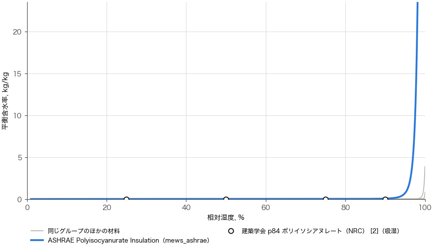
図 4-10　ASHRAE Polyisocyanurate Insulation：平衡含水率と相対湿度

**湿気伝導率**：RH 50% で 5.3×10⁻¹²（μ 37）、RH 86% で 6.3×10⁻¹²。文献（2.2〜8.3×10⁻¹²）の範囲に入り、妥当。

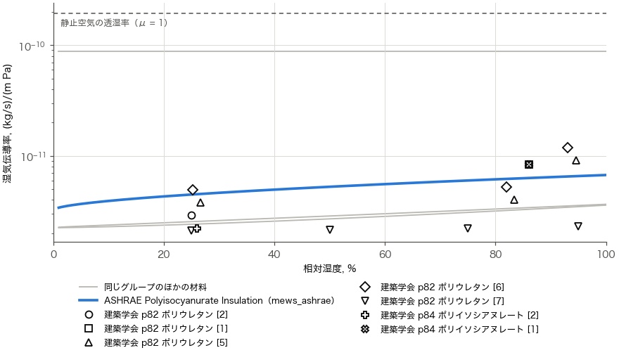
図 4-11　ASHRAE Polyisocyanurate Insulation：湿気伝導率と相対湿度

**液水拡散係数**：含水率 9.3 以下は 10⁻¹⁶、それより上は 10⁻¹²（置いた値）。根拠なし。

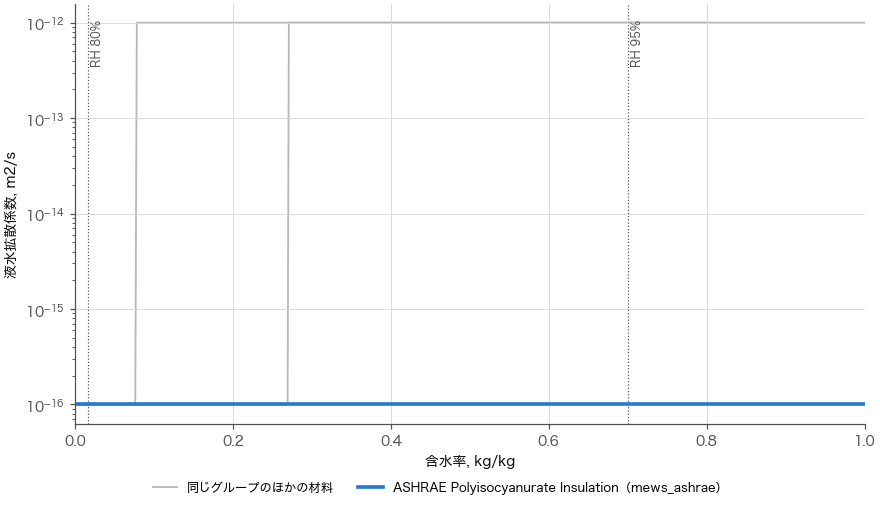
図 4-12　ASHRAE Polyisocyanurate Insulation：液水拡散係数と含水率

**直す・確かめること（優先：高）**：平衡含水率を文献（NRC：RH 25〜90% で 0.002〜0.007）で当てはめ直し、RH 100% の値を空隙を超えない値（密度 26.5 なら 37 kg/kg 以下）にする。今の式では、RH 95% を超えると壁の中に大量の水がたまる計算になる。

### 4.4 ASHRAE Low-density Polyurethane Foam Insulation（ASHRAE）

| 熱 | 平衡含水率 | 湿気伝導率 | 液水拡散係数 |
|---|---|---|---|
| 根拠なし | 根拠なし | 根拠なし | 根拠なし |

**根拠**：ASHRAE RP-1018（Kumaran 2006 の Low-Density Sprayed Polyurethane Foam、密度 6.5〜8.5、Excel は 7.5）。湿気伝導率は一定値 8.8×10⁻¹¹。手元の文献のポリウレタンは密度 20〜55 の独立気泡のもので、この低密度の連続気泡のフォームとは比べられない。

**熱物性**：密度 7.5、熱伝導率 0.0396、比熱 1470。比べる文献がない（根拠なし）。連続気泡のフォームは空気の熱伝導に近く、グラスウール（0.04 前後）と同じくらいなのはもっともらしい。

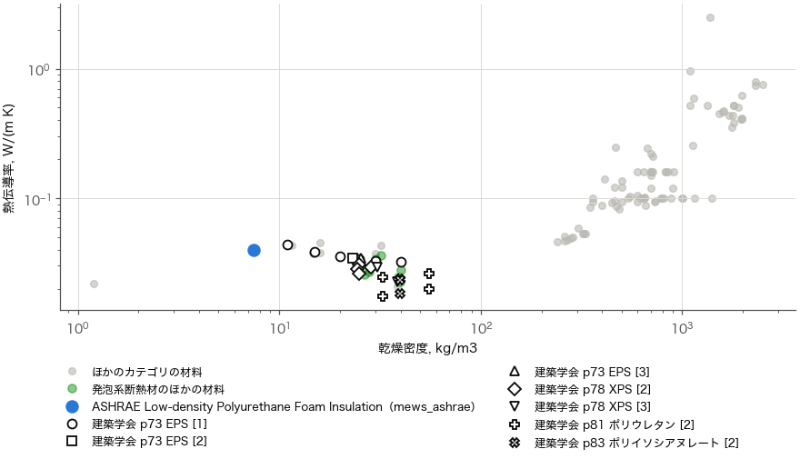
図 4-13　ASHRAE Low-density Polyurethane Foam Insulation：熱伝導率と乾燥密度

**平衡含水率**：RH 50% で 0.0025、RH 90% で 0.018、RH 100% で 0.80（容積含水率 0.006）。比べる文献がない（根拠なし）。

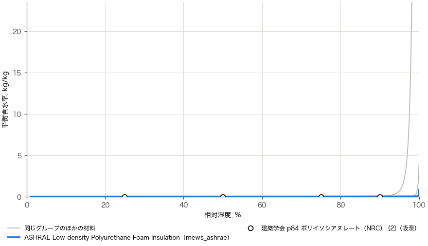
図 4-14　ASHRAE Low-density Polyurethane Foam Insulation：平衡含水率と相対湿度

**湿気伝導率**：一定値 8.8×10⁻¹¹（μ 2.2）。連続気泡なので、独立気泡のウレタン（μ 16〜90）より湿気をずっと通しやすいのはもっともらしいが、比べる文献がない（根拠なし）。

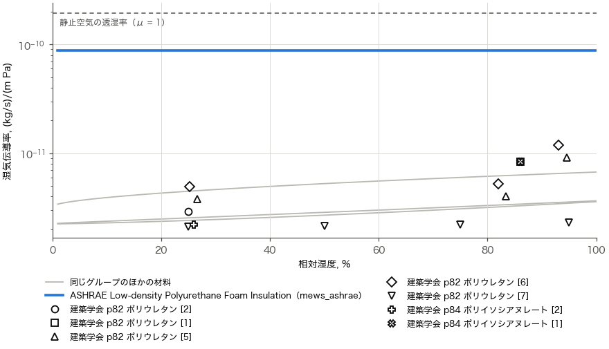
図 4-15　ASHRAE Low-density Polyurethane Foam Insulation：湿気伝導率と相対湿度

**液水拡散係数**：含水率 0.27 までは 10⁻¹⁶、それより上は 10⁻¹²（置いた値）。RH 100% の含水率 0.80 までの範囲で使われる。根拠なし。

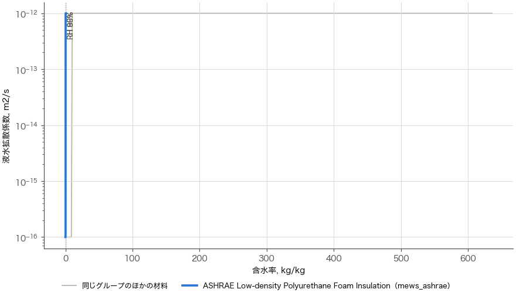
図 4-16　ASHRAE Low-density Polyurethane Foam Insulation：液水拡散係数と含水率
