# 材料物性レビュー ⑦ 外装・仕上げ

作成: 2026-10-21（Claude Code による調査）
対象: 旧 Excel（`whamcavity`）のサイディング、新しい Excel（`mews_ashrae`）の MEWS Siding I〜V・MEWS EIFS Base Coat + Finish Coat、ASHRAE の Composite Wood Siding・EIFS Base Coat and Finish Coat・Vinyl Wallpaper、合わせて 10 材料
比べた文献: 新しい Excel の出典 RR-110（9 章 Siding、10 章 EIFS）・Kumaran 2006（表 9：どの材料で何を測ったか）、建築学会『建築材料の熱・空気・湿気物性値』p61（繊維混入ポリマーセメント）・p88（壁紙）・p89（壁用塗料）。文献の目録は `sources.md`、書き写した数値は `ref_data/exterior_finishes.csv`（RR-110 の表は `mews_check/rr110_tables.py`）
図: `make_figures_exterior_finishes.py`

---

## 1. まとめ

判定の基準と図の見方は 2 章（共通のことは `01_wood_boards.md` 2 章）。

| 材料 | 熱 | 平衡含水率 | 湿気伝導率 | 液水拡散係数 | 主な点 | 節 |
|---|---|---|---|---|---|---|
| サイディング（旧） | **誤りの疑い** | 要注意 | **誤りの疑い** | 要注意 | 湿気伝導率 4.17×10⁻¹⁰ は静止空気より大きい（μ 0.46）。熱伝導率 0.963 はサイディングの約 10 倍 | 3.1 |
| MEWS Siding I - OSB | 妥当 | 要注意 | 要注意 | 要注意 | 平衡含水率が RH 91% で表の 2.6 倍。湿気伝導率は表の 0.37〜0.99 倍。液水が動かない | 3.2 |
| MEWS Siding II - Plywood | 妥当 | 要注意 | 妥当 | 要注意 | 液水拡散係数は表（小口から吸水）と一致し、厚さ方向の目安の約 240 倍 | 3.3 |
| MEWS Siding III - Fibreboard | 妥当 | 要注意 | 妥当 | 要注意 | 液水が動かない（RR-110 で解析できなかった製品） | 3.4 |
| MEWS Siding IV - Fibreboard | 妥当 | 要注意 | 妥当 | 要注意 | 液水拡散係数は表と一致し、厚さ方向の目安の約 56 倍 | 3.5 |
| MEWS Siding V - Fibreboard | 妥当 | 要注意 | 妥当 | 要注意 | 同上（約 49 倍） | 3.6 |
| ASHRAE Composite Wood Siding | 妥当 | 妥当 | 妥当 | 要注意 | 湿気伝導率が MEWS Siding V と同じ（同じ製品の可能性） | 3.7 |
| MEWS EIFS Base Coat + Finish Coat | **根拠なし** | 妥当 | 妥当 | 妥当 | 水分物性は RR-110 表 10.1 と一致。熱物性は出典に値がなく、比熱 1880 は木材の値 | 4.1 |
| ASHRAE EIFS Base Coat and Finish Coat | **根拠なし** | 根拠なし | 妥当 | 根拠なし | RP-1018 で測ったのは透湿・透気だけ。熱伝導率 0.588 は MEWS EIFS（0.1）の約 6 倍 | 4.2 |
| ASHRAE Vinyl Wallpaper | 根拠なし | 根拠なし | 妥当 | 根拠なし | RP-1018 で測ったのは透湿・透気・吸水だけ。平衡含水率は文献の壁紙と近い | 5.1 |

**主な結論**
- **旧 Excel のサイディングは、湿気伝導率 4.17×10⁻¹⁰ が静止空気（1.94×10⁻¹⁰）より大きく、μ 0.46 とありえない**（前に指標で見つけた点）。平衡含水率は Fortran のコメントのとおり MEWS Siding IV（RR-110 の製品 4）と同じ式だが、密度 1095・熱伝導率 0.963・比熱 879 は Siding IV（900、0.12、1880）とも、RR-110 のサイディング 5 製品（密度 590〜910、熱伝導率 0.09〜0.13）とも合わない。4.17×10⁻¹⁰ は、RR-110 の製品 4・5 の**パーミアンス**（kg/(m²·s·Pa)、製品 4 の RH 90〜100% で 4.0〜4.8×10⁻¹⁰、製品 5 で 3.7〜5.5×10⁻¹⁰）と同じ大きさで、厚さをかけずに透湿率として入れた可能性がある（厚さ 12 mm をかければ 5×10⁻¹²、μ 約 40）。
- **MEWS Siding I〜V**：熱物性は RR-110 表 9.1 と一致（約 0.1 W/(m·K)）。**平衡含水率は 5 製品とも、RH 50% で表の 0.35〜0.67 倍、RH 91% で 1.3〜2.6 倍**。Excel の曲線は RH 100% で真空飽和の含水率（表の 1 行目）を通るように当てはめてあり、吸引圧 3×10⁵ Pa（RH 約 99.8%）の点（表 0.37〜0.65）より 1.5〜2.2 倍大きい。高湿で含水量を多めに見積もる。湿気伝導率は Siding I だけ表の 0.37〜0.99 倍（`mews_excel_derivation.md` の既知の点）。
- **サイディングの液水拡散係数は、小口から吸水させた値**（RR-110 表 9.6、「along the edges」）。Excel は表と一致するが（0.8〜1.16 倍）、塗装面からの吸水係数（表 9.2、0.00038〜0.00062）による厚さ方向の目安より 50〜240 倍大きい。サイディングは塗装面が雨を受けるので、厚さ方向の値はずっと小さいはず。製品 1・3（Siding I・III）は RR-110 で解析できず、Excel は液水が動かない設定。
- **ASHRAE Composite Wood Siding は、湿気伝導率が MEWS Siding V と全桁近く同じ**（RH 50% で 4.67×10⁻¹² と 4.68×10⁻¹²）。密度（740 と 730）・熱伝導率（0.0955 と 0.094）も近く、どちらも塗装した高密度の木繊維板なので、同じ製品を測った可能性がある。平衡含水率は RR-110 の製品 5 の表とよく合い、MEWS Siding V の Excel の曲線よりも表に近い。
- **EIFS**：MEWS の水分物性は、RR-110 表 10.1（測定値ではなく、スポットの確認とメーカーの資料から決めた値）と一致する。建築学会 p61 の繊維混入ポリマーセメント（ベースコートと同じ種類）とも同じ桁。**熱物性は、RR-110 にも RP-1018 にも値がない**（RP-1018 の表 9 で熱伝導率は「No」）。MEWS の 0.1・1880 と ASHRAE の 0.588・840 は 6 倍違うが、厚さ約 4.5 mm（Kumaran 2006）の層なので、熱抵抗の違いは 0.04 m²·K/W 程度で影響は小さい。
- **ASHRAE Vinyl Wallpaper**：RP-1018 で測ったのは透湿・透気・吸水係数だけ（表 9）。湿気伝導率（μ 2000〜4500、μd 0.4〜0.9 m）は、建築学会 p88 のビニル壁紙（μd 0.025〜2.1 m）の範囲に入る。平衡含水率は測っていない値だが、文献のビニル壁紙と近い。熱物性・液水拡散係数は根拠なし（厚さ 0.2 mm なので影響は小さい）。

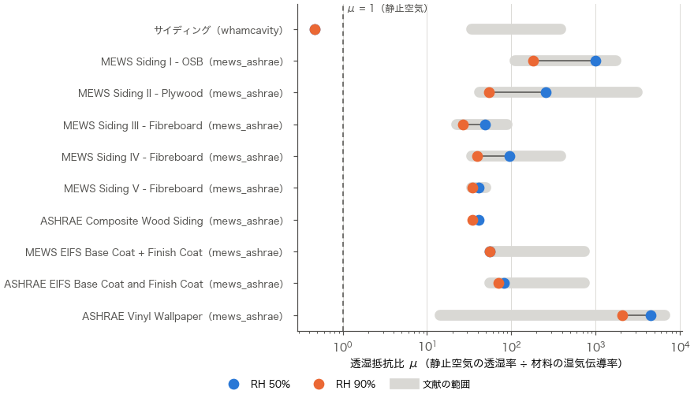
図 1-1　外装・仕上げ 10 材料の透湿抵抗比 μ。青は RH 50%、橙は RH 90%。灰色の帯は、各材料の出典の表（RR-110）または建築学会の本の値から求めた μ の範囲（旧 Excel のサイディングは RR-110 の製品 4、EIFS は RR-110 表 10.1 と繊維混入ポリマーセメント・塗料、壁紙は建築学会 p88 の 6 種類）。旧 Excel のサイディングだけが μ = 1 より左にある。

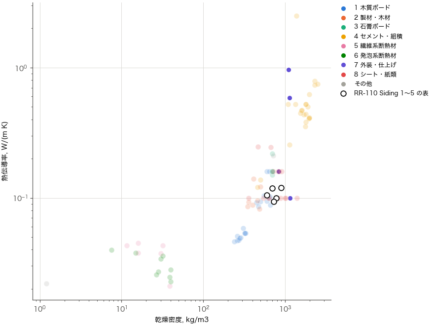
図 1-2　全 100 材料の熱伝導率と乾燥密度。紫が外装・仕上げ、黒い白抜きの印が RR-110 のサイディング 5 製品（表 9.1）。

---

## 2. 見方

判定の 4 段階、指標（μ、ψ）、図の線・印の意味は `01_wood_boards.md` 2 章と同じ。この章では、このカテゴリに特有のことだけを書く。

- **RR-110 の表の重ね方**：平衡含水率は表 9.4（吸湿・放湿の RH 50・70・91%）、湿気伝導率は表 9.5 のパーミアンスに表 9.1 の厚さ（2 試験体の平均）をかけた値、液水拡散係数は表 9.6 の含水量 kg/m³ を表 9.1 の試料の密度で割った値。表 9.4 の吸引圧の 2 行（0 Pa＝真空飽和、3×10⁵ Pa）は図に描かず、本文で比べた。旧 Excel のサイディングには、平衡含水率が同じ式の RR-110 の製品 4（Siding IV）の表を重ねた。
- **サイディングの液水拡散係数の目安**：Künzel の式の吸水係数は、RR-110 表 9.2 の**塗装面を水につけて測った値**（製品 1〜5 で 0.00038、0.00047、0.00058、0.00060、0.00062 kg/(m²·s^½)）。旧 Excel のサイディングは製品 4 の値、ASHRAE Composite Wood Siding は 5 製品の範囲を使った。木質ボード（①）の素地の値（0.002〜0.005）より 1 桁小さく、塗装が吸水を抑えている。wf は Excel の RH 99.8% の含水率を使ったが、MEWS のサイディングは 3 章のとおりこの値が表より 1.5〜2.2 倍大きいので、目安は実際より小さめに出ている可能性がある（wf が大きいほど目安は小さい）。
- **RP-1018 の表 9**（Kumaran 2006 p21〜22）：材料ごとに、熱伝導率・透湿・平衡含水率・吸引圧・液水拡散係数・透気・吸水係数を測ったかどうかの一覧。EIFS は透湿と透気だけ「Yes」（ほかは「No」：反応が遅すぎて測れなかった）、Vinyl Wallpaper は透湿・透気・吸水係数だけ（ほかは計画になし）、Composite Wood Siding は吸引圧以外すべて「Yes」。**測っていない物性に Excel の値が入っている場合は「根拠なし」とした**。
- **壁紙の湿気伝導率**：建築学会 p88 の湿気拡散厚 μd（m）を、厚さ d から δ = δ_air × d ÷ μd で透湿率に直し、RH の範囲の中央（33〜52% → 42.5%、52〜98% → 75%）に描いた。壁紙の密度は、質量（kg/m²）÷ 厚さで求めた（ビニル 470〜660 kg/m³）。
- 原典のページの画像は、非公開リポジトリ `docs/reference/papers/review_images/`（建築学会 p61・p88・p89、RR-110 p65 表 9.2、Kumaran 2006 p21〜22 表 9）。書き写した数値は、画像と見比べて確かめた。

---

## 3. サイディング

**文献の値**（RR-110 9 章）：5 製品とも、木質の素地（製品 1 OSB、2 合板、3〜5 繊維板）の片面を塗装したサイディング。厚さ 10.5〜15 mm、密度 590〜910 kg/m³、熱伝導率（24 ℃）0.094〜0.133（「どの製品もおよそ 0.1」）、比熱は IEA Annex 24 の 1880。平衡含水率（表 9.4）は、RH 50% で 0.043〜0.059、RH 91% で 0.12〜0.18、真空飽和で 0.64〜1.15 kg/kg。透湿（表 9.5、パーミアンス）は製品で 1〜2 桁違い、製品 1・2 は低湿で小さい（塗装の影響）。液水拡散係数（表 9.6）は小口から吸水させた値で、製品 2・4・5 だけ（「ほかの 2 製品は解析できる結果が出なかった」）。塗装面からの吸水係数（表 9.2）は 0.00038〜0.00062。

**MEWS Siding I〜V の平衡含水率**（5 製品に共通）：

| 製品（Excel） | RH 50% 吸湿 表 → Excel | RH 91% 吸湿〜放湿 表 → Excel | 3×10⁵ Pa（RH 約 99.8%）表 → Excel | 真空飽和 表 → Excel の RH 100% |
|---|---|---|---|---|
| 1（Siding I） | 0.048 → 0.027 | 0.157〜0.178 → 0.412 | 0.654 → 0.975 | 1.151 → 0.998 |
| 2（Siding II） | 0.051 → 0.018 | 0.163〜0.173 → 0.350 | 0.629 → 0.952 | 1.004 → 0.990 |
| 3（Siding III） | 0.048 → 0.018 | 0.131〜0.160 → 0.247 | 0.381 → 0.783 | 0.828 → 0.823 |
| 4（Siding IV） | 0.051 → 0.034 | 0.120〜0.154 → 0.208 | 0.365 → 0.607 | 0.643 → 0.635 |
| 5（Siding V） | 0.046 → 0.026 | 0.131〜0.134 → 0.194 | 0.376 → 0.820 | 0.898 → 0.880 |

Excel の曲線は、RH 100% で真空飽和の含水率を通り、RH 70% 付近で表と近い（0.8〜1.1 倍）。その分、RH 50% では小さく（0.35〜0.67 倍）、RH 91% と 3×10⁵ Pa では大きい（1.3〜2.6 倍、1.5〜2.2 倍）。真空飽和は、空隙をすべて水で満たした値で、ふつうの湿度の範囲では届かない。**RH 100% で真空飽和に合わせると、高湿の含水量を多めに見積もる**。5 製品とも要注意とした。

### 3.1 サイディング（旧 Excel）

| 熱 | 平衡含水率 | 湿気伝導率 | 液水拡散係数 |
|---|---|---|---|
| **誤りの疑い** | 要注意 | **誤りの疑い** | 要注意 |

**根拠**：旧 Excel と Fortran（`mcoff`）で同じ値。平衡含水率は、Fortran のコメント「ASHRAE Siding No.38」（新しい Excel の No.38 = MEWS Siding IV）のとおり、MEWS Siding IV と同じ式（0.635 · r^2.5972 · exp(−1.1225 (1 − r^15.878))）。密度・比熱・熱伝導率・湿気伝導率の出どころは書かれていない。

**熱物性**：密度 1095、比熱 879、**熱伝導率 0.963**。平衡含水率の出どころの Siding IV（900、1880、0.12）とも、RR-110 の 5 製品（0.094〜0.133）とも合わず、熱伝導率は約 8 倍。比熱 879 は木質ではなくセメント系の値に近い。窯業系（セメント系）のサイディングの値を入れた可能性もあるが、平衡含水率は木繊維板の製品の式で、材料として合っていない。熱伝導率 0.963 は、レンガ（0.4〜0.8）より大きく、セメント系の板としても大きすぎる（**誤りの疑い**）。

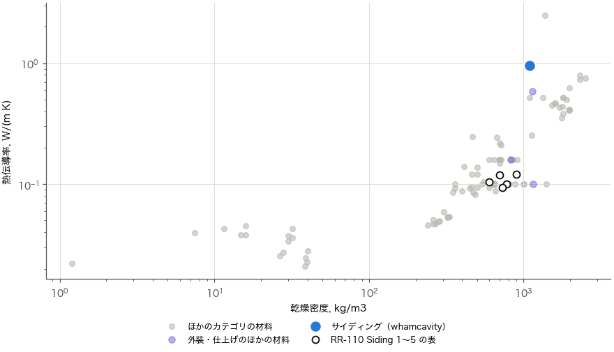
図 3-1　サイディング：熱伝導率と乾燥密度

**平衡含水率**：MEWS Siding IV と同じ式（3 章の表の製品 4 の行）。RH 50% で 0.034（表 0.051）、RH 91% で 0.208（表 0.120〜0.154）。ただし密度が 1095 なので、同じ含水率でも容積あたりの水は Siding IV の 1.2 倍になる（ψ(100%) 0.70）。要注意。

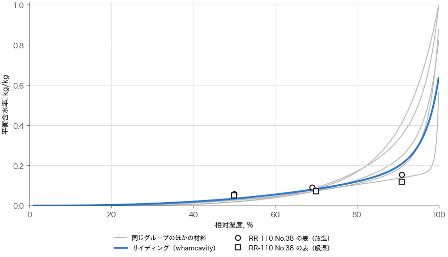
図 3-2　サイディング：平衡含水率と相対湿度

**湿気伝導率**：**一定値 4.17×10⁻¹⁰**で、静止空気の透湿率（1.94×10⁻¹⁰）より大きい（**μ 0.46、ありえない**）。RR-110 の製品 4 の表（μ 33〜390）とは 2〜3 桁違う。4.17×10⁻¹⁰ は、製品 4・5 のパーミアンス（kg/(m²·s·Pa)、製品 4 の RH 90〜100% で 4.0〜4.8×10⁻¹⁰、製品 5 で 3.7〜5.5×10⁻¹⁰）と同じ大きさで、パーミアンスに厚さ（約 12 mm）をかけずに入れた可能性がある（**誤りの疑い**）。

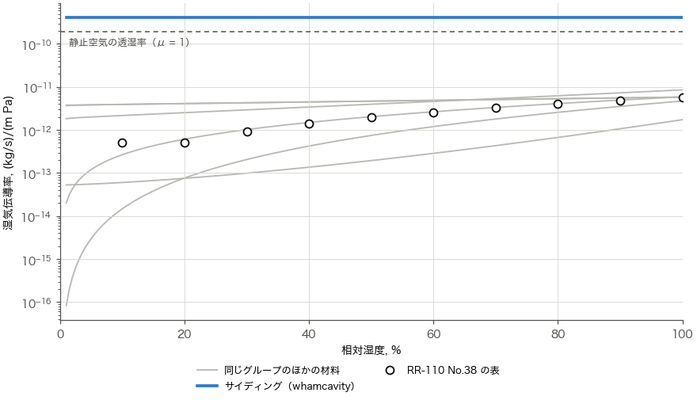
図 3-3　サイディング：湿気伝導率と相対湿度

**液水拡散係数**：液水が動かない設定。RR-110 の製品 4 の表（小口から、10⁻¹⁰〜3×10⁻⁹）も、塗装面からの目安（RH 99% で 1.2×10⁻¹²）も、液水が動くことを示す（要注意）。

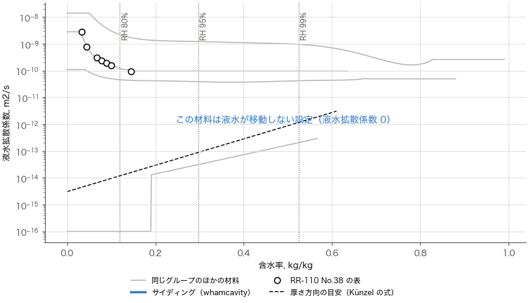
図 3-4　サイディング：液水拡散係数と含水率

**直す・確かめること（優先：高）**：湿気伝導率が静止空気より大きく、サイディングが湿気を通さない層として働かない。何のサイディングを想定したのかを確かめ、木質のサイディングなら MEWS Siding IV の値（熱伝導率 0.12、密度 900、比熱 1880、湿気伝導率 2〜5×10⁻¹²）に直す。窯業系なら、平衡含水率も含めて別の文献の値に替える。

### 3.2 MEWS Siding I - OSB（MEWS）

| 熱 | 平衡含水率 | 湿気伝導率 | 液水拡散係数 |
|---|---|---|---|
| 妥当 | 要注意 | 要注意 | 要注意 |

**根拠**：RR-110 9 章の製品 1（OSB の素地、厚さ 12.9 mm）。熱伝導率は表 9.1 の 2 試験体の平均（0.133 と 0.104 → 0.119）。液水拡散係数は範囲分け数 0（RR-110 で解析できなかった製品）。

**熱物性**：密度 700、熱伝導率 0.119、比熱 1880。表 9.1（705・688、0.133・0.104）と一致し、妥当。

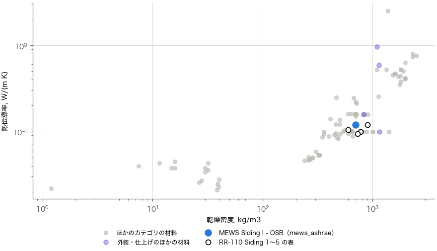
図 3-5　MEWS Siding I - OSB：熱伝導率と乾燥密度

**平衡含水率**：3 章の表のとおり、RH 91% で表の 2.3〜2.6 倍（5 製品でいちばん大きい）、3×10⁵ Pa で 1.5 倍。RH 100% の 0.998 は、真空飽和（1.151）よりは小さい。要注意。

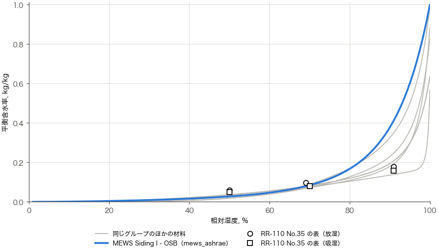
図 3-6　MEWS Siding I - OSB：平衡含水率と相対湿度

**湿気伝導率**：RH 50% で 1.95×10⁻¹³（μ 995）、RH 90% で 1.07×10⁻¹²（μ 181）。表（パーミアンス × 厚さ）の **0.37〜0.99 倍**で、全体に小さい（`mews_excel_derivation.md` の既知の点）。5 製品でいちばん湿気を通しにくい製品で、表の値でも μ 100〜1700。要注意。

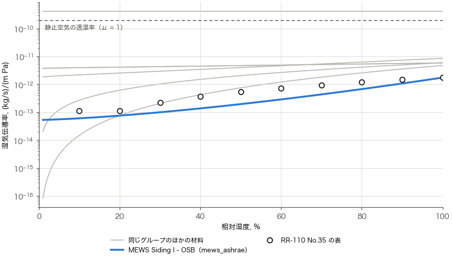
図 3-7　MEWS Siding I - OSB：湿気伝導率と相対湿度

**液水拡散係数**：液水が動かない設定。RR-110 で解析できなかった製品で、測定値がない。塗装面からの目安（RH 99% で 6.7×10⁻¹³）は小さいが 0 ではない（要注意）。

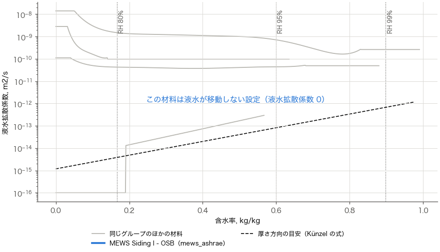
図 3-8　MEWS Siding I - OSB：液水拡散係数と含水率

**直す・確かめること（優先：中）**：平衡含水率を、真空飽和ではなく表 9.4 の吸湿・放湿と 3×10⁵ Pa の点に合わせて当てはめ直す（Siding II〜V も同じ）。湿気伝導率を表 9.5 × 厚さ に合わせ直す。

### 3.3 MEWS Siding II - Plywood（MEWS）

| 熱 | 平衡含水率 | 湿気伝導率 | 液水拡散係数 |
|---|---|---|---|
| 妥当 | 要注意 | 妥当 | 要注意 |

**根拠**：RR-110 9 章の製品 2（合板の素地、厚さ 14.8 mm）。液水拡散係数は範囲分け数 3 で、表 9.6 に当てはめてある。

**熱物性**：密度 600、熱伝導率 0.105、比熱 1880。表 9.1（608・586、0.104・0.105）と一致し、妥当。

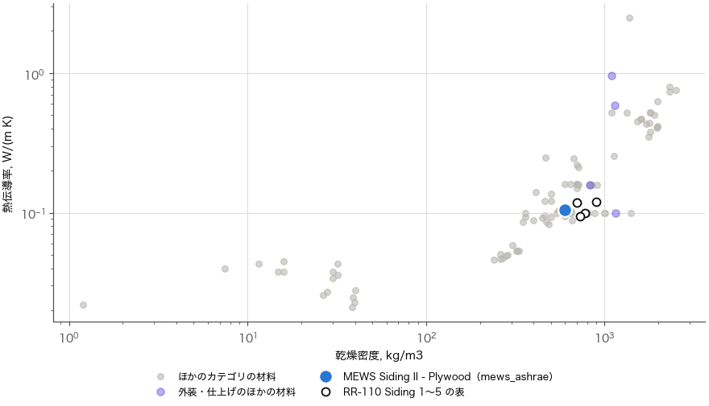
図 3-9　MEWS Siding II - Plywood：熱伝導率と乾燥密度

**平衡含水率**：RH 50% で表の 0.35 倍、RH 91% で 2.0〜2.2 倍、3×10⁵ Pa で 1.5 倍（3 章の表）。要注意。

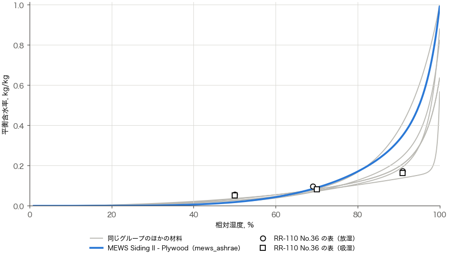
図 3-10　MEWS Siding II - Plywood：平衡含水率と相対湿度

**湿気伝導率**：RH 50% で 7.5×10⁻¹³（μ 259）、RH 90% で 3.5×10⁻¹²（μ 55）。表の 1.02〜1.22 倍（RH 10% だけ 0.24 倍）で、妥当。

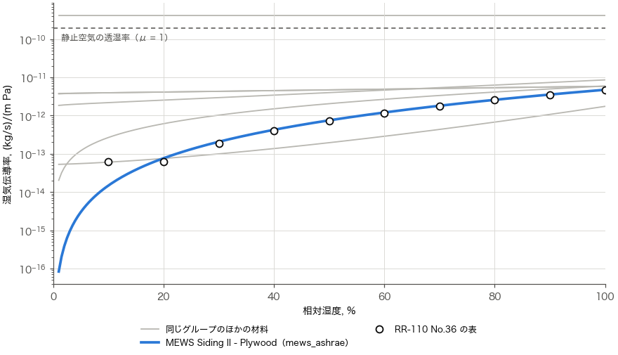
図 3-11　MEWS Siding II - Plywood：湿気伝導率と相対湿度

**液水拡散係数**：含水率 0.05 以下で 1.4×10⁻⁸、RH 95%（0.50）で 1.0×10⁻⁹、RH 99%（0.84）で 2.6×10⁻¹⁰。表 9.6（小口から吸水）の 0.85〜1.16 倍で、表とは合う。しかし塗装面からの目安（RH 99% で 1.1×10⁻¹²）の **約 240 倍**。壁の中で水が動くのは厚さ方向なので、雨水や結露水が実際より速く広がる計算になる（要注意）。

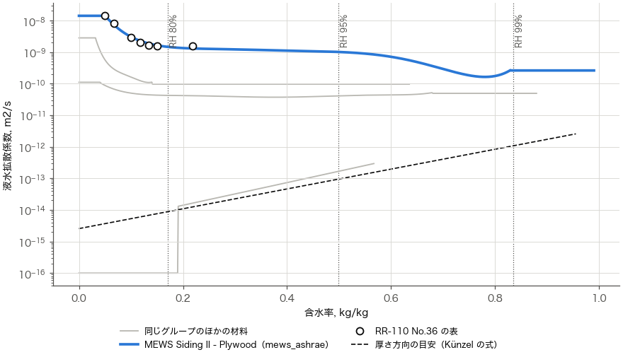
図 3-12　MEWS Siding II - Plywood：液水拡散係数と含水率

**確かめること（優先：中）**：液水拡散係数を、厚さ方向の値（塗装面の吸水係数から見積もる）にするかを決める。木質ボード（①）の MEWS の材料と同じ「小口からの値」の問題。

### 3.4 MEWS Siding III - Fibreboard（MEWS）

| 熱 | 平衡含水率 | 湿気伝導率 | 液水拡散係数 |
|---|---|---|---|
| 妥当 | 要注意 | 妥当 | 要注意 |

**根拠**：RR-110 9 章の製品 3（繊維板の素地、厚さ 12.2 mm）。液水拡散係数は範囲分け数 0（RR-110 で解析できなかった製品）。

**熱物性**：密度 780、熱伝導率 0.1、比熱 1880。表 9.1（779・780、0.0968・0.103）と一致し、妥当。

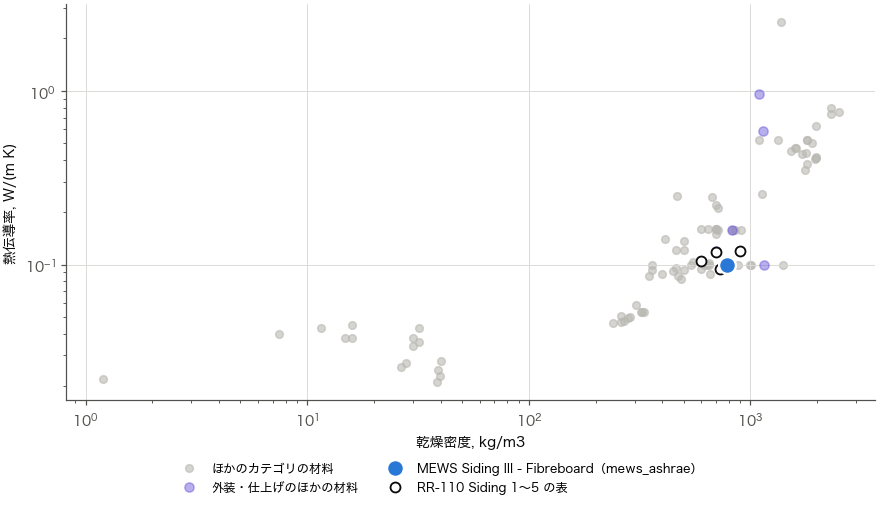
図 3-13　MEWS Siding III - Fibreboard：熱伝導率と乾燥密度

**平衡含水率**：RH 50% で表の 0.38 倍、RH 91% で 1.5〜1.9 倍、3×10⁵ Pa で 2.1 倍（3 章の表）。要注意。

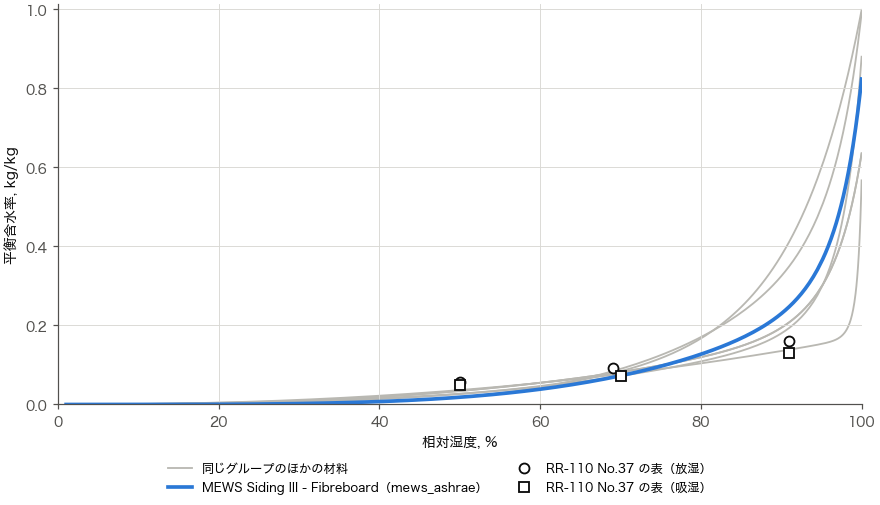
図 3-14　MEWS Siding III - Fibreboard：平衡含水率と相対湿度

**湿気伝導率**：RH 50% で 3.9×10⁻¹²（μ 49）、RH 90% で 7.3×10⁻¹²（μ 27）。表と一致（0.99〜1.00 倍）し、妥当。

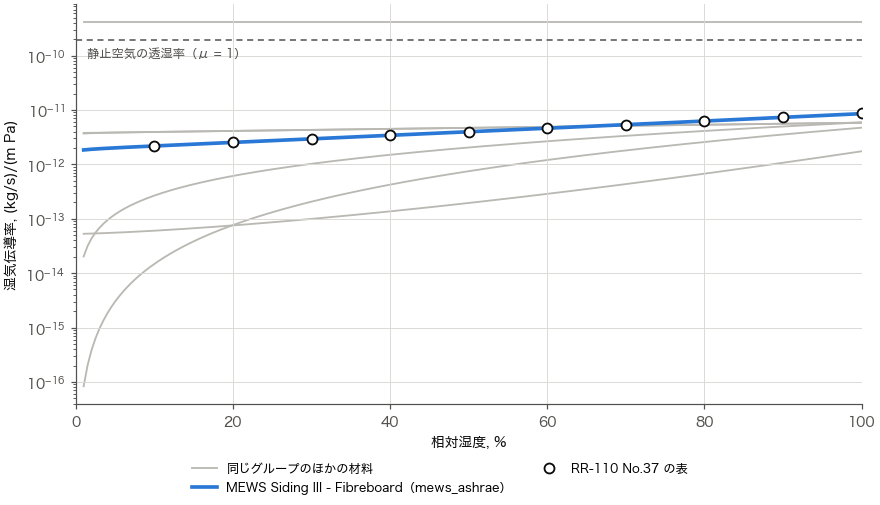
図 3-15　MEWS Siding III - Fibreboard：湿気伝導率と相対湿度

**液水拡散係数**：液水が動かない設定。RR-110 で解析できなかった製品。塗装面からの目安は RH 99% で 1.2×10⁻¹²（要注意）。

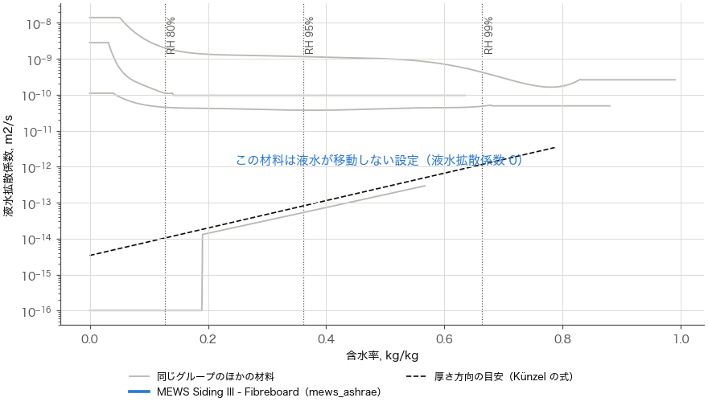
図 3-16　MEWS Siding III - Fibreboard：液水拡散係数と含水率

### 3.5 MEWS Siding IV - Fibreboard（MEWS）

| 熱 | 平衡含水率 | 湿気伝導率 | 液水拡散係数 |
|---|---|---|---|
| 妥当 | 要注意 | 妥当 | 要注意 |

**根拠**：RR-110 9 章の製品 4（繊維板の素地、厚さ 12.0 mm）。液水拡散係数は範囲分け数 3 で、表 9.6 に当てはめてある。旧 Excel のサイディングの平衡含水率は、この材料と同じ式。

**熱物性**：密度 900、熱伝導率 0.12、比熱 1880。表 9.1（889・911、0.119・0.121）と一致し、妥当。

図 3-17　MEWS Siding IV - Fibreboard：熱伝導率と乾燥密度

**平衡含水率**：RH 50% で表の 0.67 倍、RH 91% で 1.4〜1.7 倍、3×10⁵ Pa で 1.7 倍（3 章の表）。5 製品の中ではずれが小さいが、要注意。

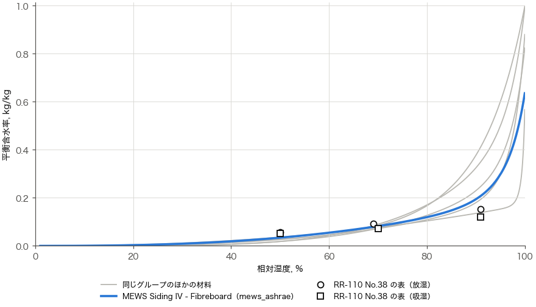
図 3-18　MEWS Siding IV - Fibreboard：平衡含水率と相対湿度

**湿気伝導率**：RH 50% で 2.0×10⁻¹²（μ 95）、RH 90% で 5.0×10⁻¹²（μ 39）。表の 1.01〜1.22 倍（RH 10% だけ 0.53 倍）で、妥当。

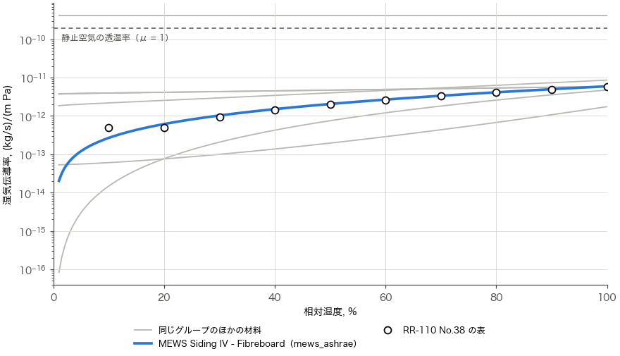
図 3-19　MEWS Siding IV - Fibreboard：湿気伝導率と相対湿度

**液水拡散係数**：含水率 0.05 で 5.7×10⁻¹⁰、0.14 より上は一定値 9.6×10⁻¹¹（表の最後の値）。表 9.6 の 0.80〜1.07 倍で、表とは合う。塗装面からの目安（RH 99% で 1.7×10⁻¹²）の **約 56 倍**（要注意）。

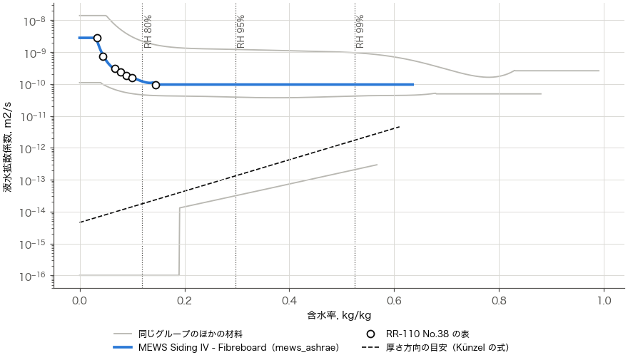
図 3-20　MEWS Siding IV - Fibreboard：液水拡散係数と含水率

### 3.6 MEWS Siding V - Fibreboard（MEWS）

| 熱 | 平衡含水率 | 湿気伝導率 | 液水拡散係数 |
|---|---|---|---|
| 妥当 | 要注意 | 妥当 | 要注意 |

**根拠**：RR-110 9 章の製品 5（繊維板の素地、厚さ 10.5 mm）。液水拡散係数は範囲分け数 3 で、表 9.6 に当てはめてある。区間 1 の値（a = −22.93、1.1×10⁻¹⁰）は、MEWS Gypsum（No.41）の液水拡散係数と全桁一致する（`mews_excel_derivation.md` 5.3 節、③ 石膏ボードのレビュー）。

**熱物性**：密度 730、熱伝導率 0.094、比熱 1880。表 9.1（739・717、0.0937・0.0944）と一致し、妥当。

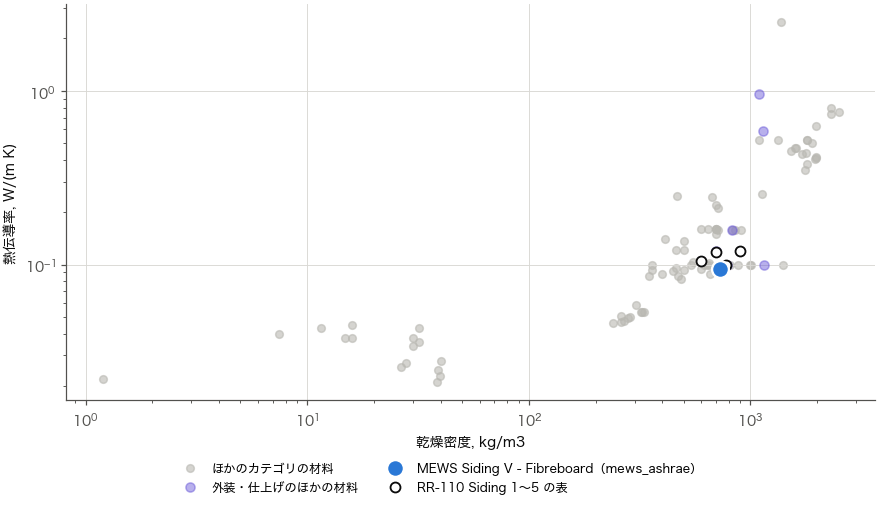
図 3-21　MEWS Siding V - Fibreboard：熱伝導率と乾燥密度

**平衡含水率**：RH 50% で表の 0.57 倍、RH 91% で 1.4〜1.5 倍、3×10⁵ Pa で 2.2 倍（3 章の表）。要注意。

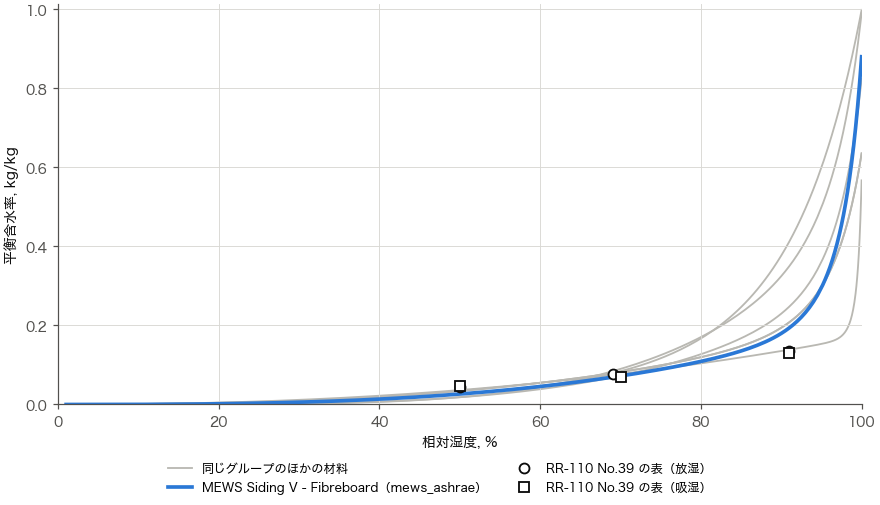
図 3-22　MEWS Siding V - Fibreboard：平衡含水率と相対湿度

**湿気伝導率**：RH 50% で 4.7×10⁻¹²（μ 41）、RH 90% で 5.6×10⁻¹²（μ 35）。表と一致（1.01 倍）し、妥当。

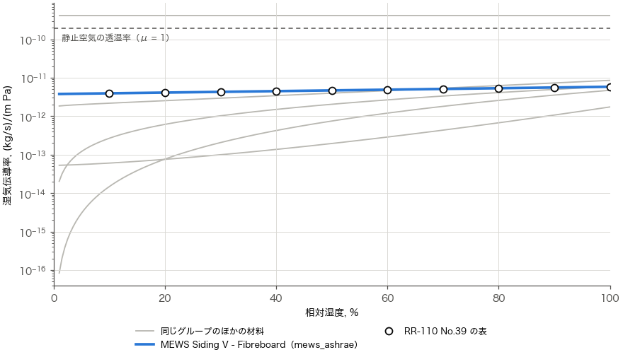
図 3-23　MEWS Siding V - Fibreboard：湿気伝導率と相対湿度

**液水拡散係数**：含水率 0.04 以下で 1.1×10⁻¹⁰、それより上で 4〜5×10⁻¹¹。表 9.6 の 0.95〜1.07 倍で、表とは合う。塗装面からの目安（RH 99% で 9.5×10⁻¹³）の **約 49 倍**（要注意）。

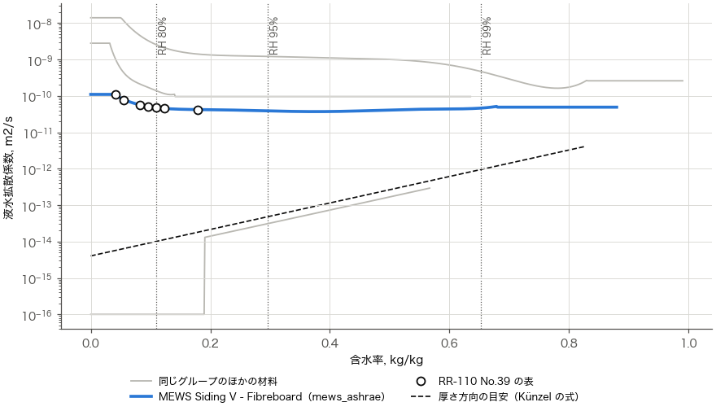
図 3-24　MEWS Siding V - Fibreboard：液水拡散係数と含水率

### 3.7 ASHRAE Composite Wood Siding（ASHRAE）

| 熱 | 平衡含水率 | 湿気伝導率 | 液水拡散係数 |
|---|---|---|---|
| 妥当 | 妥当 | 妥当 | 要注意 |

**根拠**：ASHRAE RP-1018（Kumaran 2006 の 15 番、密度 740 ± 30、厚さ 7/16 インチ（約 11 mm）の高密度の木繊維板で、片面を薄く塗装したもの）。表 9 では吸引圧以外すべて測っている。**湿気伝導率の係数が MEWS Siding V（RR-110 の製品 5）とほぼ同じ**。

**熱物性**：密度 740、熱伝導率 0.0955、比熱 1880。RR-110 の 5 製品（0.094〜0.133）と合い、とくに製品 5（密度 728、0.094）に近い。妥当。

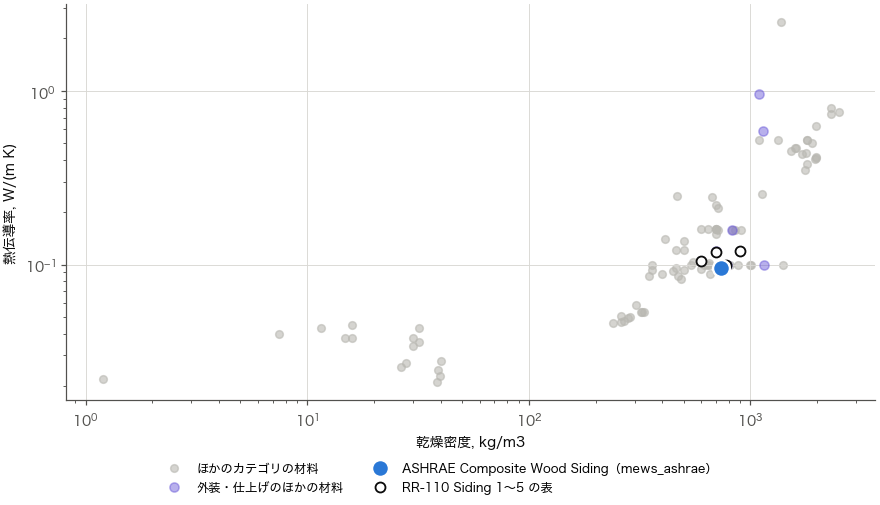
図 3-25　ASHRAE Composite Wood Siding：熱伝導率と乾燥密度

**平衡含水率**：RH 50% で 0.036、RH 70% で 0.077、RH 91% で 0.139、RH 100% で 0.567。RR-110 の製品 5 の表（RH 50% で 0.043〜0.046、RH 70% で 0.069〜0.076、RH 91% で 0.131〜0.134）とよく合い、MEWS Siding V の Excel の曲線よりも表に近い。妥当。RH 100% の値は吸引圧を測っていないので、当てはめの外挿。

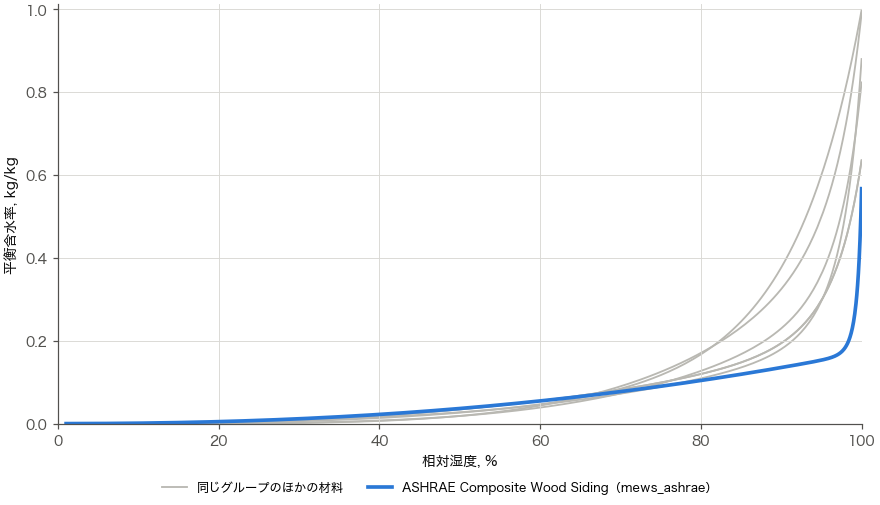
図 3-26　ASHRAE Composite Wood Siding：平衡含水率と相対湿度

**湿気伝導率**：RH 50% で 4.67×10⁻¹²（μ 41）、RH 90% で 5.57×10⁻¹²（μ 35）。**MEWS Siding V（4.68×10⁻¹²、5.57×10⁻¹²）とほぼ同じ**で、RR-110 の製品 5 の表と一致する。密度・熱伝導率・素地（塗装した木繊維板）も近いので、同じ研究所（NRC）が同じ製品を測った可能性が高い。妥当。

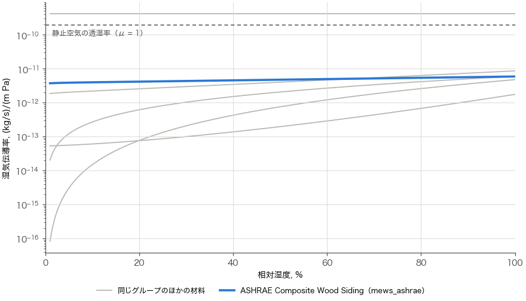
図 3-27　ASHRAE Composite Wood Siding：湿気伝導率と相対湿度

**液水拡散係数**：含水率 0.19（RH 約 98%）まで 10⁻¹⁶（実質 0）、それより上で 1.4×10⁻¹⁴〜3×10⁻¹³。RH 99%（0.25）で 2.1×10⁻¹⁴ は、塗装面からの目安（5 製品の吸水係数で 2.4〜6.3×10⁻¹³）の 0.03〜0.09 倍で、やや小さい（要注意）。MEWS Siding V（小口からの値、4×10⁻¹¹）よりは 3 桁小さく、RP-1018 は厚さ方向に近い条件で測った可能性がある。

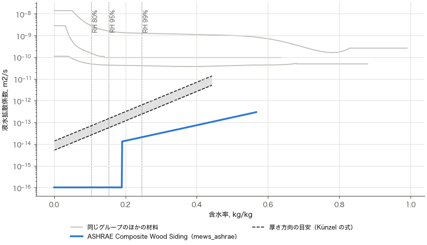
図 3-28　ASHRAE Composite Wood Siding：液水拡散係数と含水率

**確かめること（優先：低）**：MEWS Siding V と同じ製品かどうか（RP-1018 の最終報告書で確かめられる）。同じなら、平衡含水率はこの材料の式のほうが表に近く、液水拡散係数は方向の違う 2 つの値になる。

## 4. EIFS（ベースコート ＋ 仕上げ塗り）

**文献の値**：RR-110 10 章の EIFS は、ポリマーセメントのベースコートと「Latex Acrylic」の仕上げ塗り。厚い板が手に入らず、反応も遅いので、**物性を直接は測っていない**。大型試験の後の壁（仕上げ ＋ ベースコート ＋ EPS）から、吸水・透湿・飽和のスポットの確認とメーカーの資料をもとに、hygIRC の入力値として決めた（表 10.1）。平衡含水率は RH 10% で 0.011、RH 50% で 0.019、RH 90% で 0.043、RH 100% で 0.090。透湿率は一定 3.5×10⁻¹²。液水拡散係数は RH 90% 以下 10⁻¹⁶、RH 95% 以上で 6.9×10⁻¹²〜1.6×10⁻¹¹。熱物性の値はない。RP-1018（Kumaran 2006）の EIFS も同じ構成で、厚さ約 4.5 mm、密度 約 1140。表 9 で測ったのは透湿と透気だけ。

**似た材料**（建築学会 p61、繊維混入ポリマーセメント、KU-Leuven）：密度 2000、平衡含水率 RH 33% で 0.014、RH 86% で 0.043、RH 97% で 0.098、透湿率 0.88〜2.7×10⁻¹²。p89 のストラクチャードペイント（厚さ 1.5 mm、気泡コンクリートの上）は μd 1.10 m（透湿率 2.6×10⁻¹³）。

### 4.1 MEWS EIFS Base Coat + Finish Coat（MEWS）

| 熱 | 平衡含水率 | 湿気伝導率 | 液水拡散係数 |
|---|---|---|---|
| **根拠なし** | 妥当 | 妥当 | 妥当 |

**根拠**：RR-110 10 章 表 10.1。湿気伝導率は一定値、液水拡散係数は範囲分け数 2（区間 1 は 10⁻¹⁶、区間 2 は RH 95% 以上の 6 点に合わせた 6 次式）。

**熱物性**：密度 1150、熱伝導率 0.1、比熱 1880。**RR-110 に熱物性の値がない**。比熱 1880 は、RR-110 で木質の材料（OSB・合板・繊維板・サイディング）に使われている IEA Annex 24 の値で、ポリマーセメントの値ではない。熱伝導率 0.1 も、密度 1150 のセメント系としては小さく、サイディングの値（約 0.1）が写った可能性がある（根拠なし）。厚さ約 4.5 mm の層なので、熱の計算への影響は小さい。

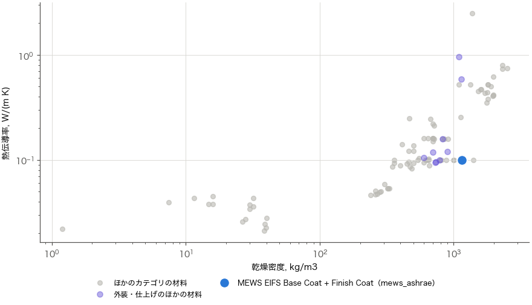
図 4-1　MEWS EIFS Base Coat + Finish Coat：熱伝導率と乾燥密度

**平衡含水率**：RH 10% で 0.010、RH 50% で 0.020、RH 90% で 0.044、RH 100% で 0.087。表 10.1 の 0.90〜1.06 倍で一致し、繊維混入ポリマーセメントの文献とも同じ大きさ。妥当（ただし表 10.1 そのものが、測定値ではなく決めた値）。

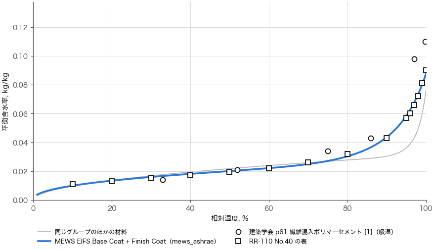
図 4-2　MEWS EIFS Base Coat + Finish Coat：平衡含水率と相対湿度

**湿気伝導率**：一定値 3.5×10⁻¹²（μ 55）。表 10.1 と一致。繊維混入ポリマーセメント（0.88〜2.7×10⁻¹²）より少し大きいが同じ桁で、妥当。

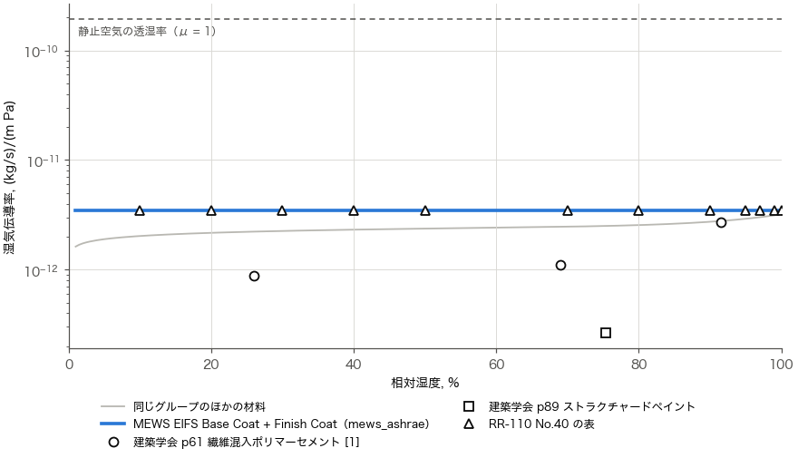
図 4-3　MEWS EIFS Base Coat + Finish Coat：湿気伝導率と相対湿度

**液水拡散係数**：含水率 0.043（RH 90%）まで 10⁻¹⁶、RH 95% で 6.7×10⁻¹²、RH 99% で 1.5×10⁻¹¹。表 10.1 の 0.77〜1.0 倍で一致し、妥当。吸水係数の値がないので、厚さ方向の目安は描いていない。

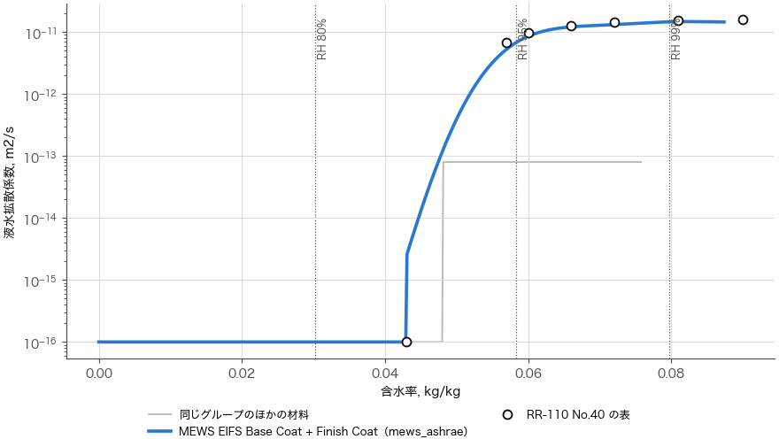
図 4-4　MEWS EIFS Base Coat + Finish Coat：液水拡散係数と含水率

**確かめること（優先：低）**：熱伝導率と比熱の出どころ。ポリマーセメントの値（文献があれば）に替えるか、このままにするか決める。

### 4.2 ASHRAE EIFS Base Coat and Finish Coat（ASHRAE）

| 熱 | 平衡含水率 | 湿気伝導率 | 液水拡散係数 |
|---|---|---|---|
| **根拠なし** | 根拠なし | 妥当 | 根拠なし |

**根拠**：ASHRAE RP-1018（Kumaran 2006 の 37 番、厚さ約 4.5 mm、密度 約 1140）。**表 9 では、熱伝導率・平衡含水率・吸引圧・液水拡散係数・吸水係数が「No」（測れなかった）**。測ったのは透湿と透気だけ。液水拡散係数の区間 2 は一定値 8×10⁻¹⁴ で、ASHRAE Western Red Cedar の区間 3 と全桁一致する（`ashrae_excel_derivation.md`）。

**熱物性**：密度 1140、**熱伝導率 0.588**、比熱 840。RP-1018 では測っていない（根拠なし）。MEWS EIFS（0.1、1880）の約 6 倍で、同じ構成の材料なのに値が大きく違う。0.588 はセメントモルタル（0.47 前後）に近く、ベースコートのセメントとしてはありうるが、出どころがわからない。厚さ約 4.5 mm なので、熱抵抗は 0.008 m²·K/W（MEWS の値なら 0.045）で、壁全体への影響は小さい。

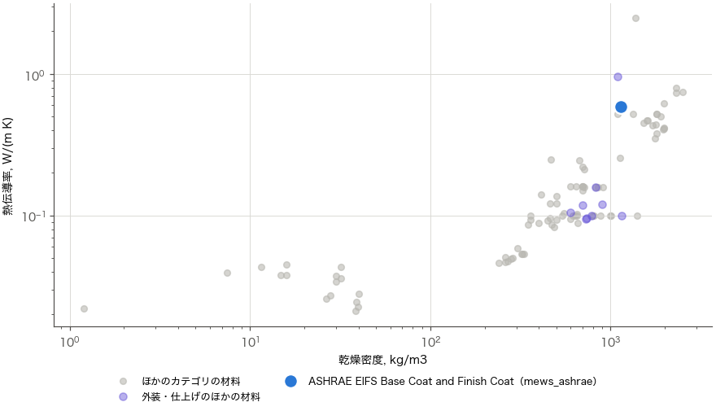
図 4-5　ASHRAE EIFS Base Coat and Finish Coat：熱伝導率と乾燥密度

**平衡含水率**：RH 50% で 0.022、RH 80% で 0.028、RH 95% で 0.036、RH 100% で 0.076。RP-1018 では測っていない（根拠なし）。RH 70% までは RR-110 表 10.1 と同じ大きさだが、RH 80% より上は表の 0.6〜0.9 倍。

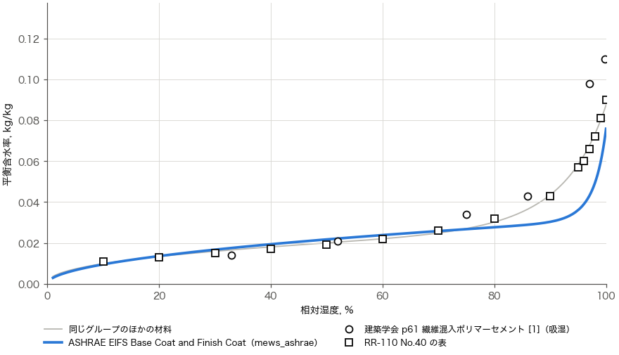
図 4-6　ASHRAE EIFS Base Coat and Finish Coat：平衡含水率と相対湿度

**湿気伝導率**：RH 50% で 2.4×10⁻¹²（μ 82）、RH 90% で 2.7×10⁻¹²（μ 71）。RP-1018 で測った値。RR-110 表 10.1（3.5×10⁻¹²）、繊維混入ポリマーセメント（0.88〜2.7×10⁻¹²）と同じ桁で、妥当。

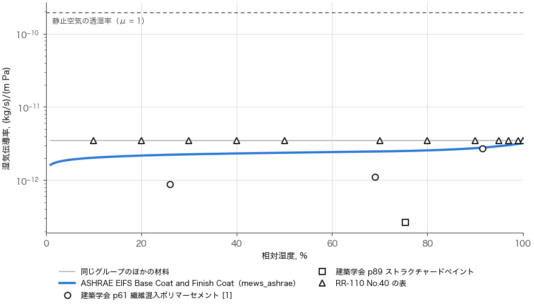
図 4-7　ASHRAE EIFS Base Coat and Finish Coat：湿気伝導率と相対湿度

**液水拡散係数**：含水率 0.048（RH 約 97%）まで 10⁻¹⁶、それより上は一定値 8×10⁻¹⁴。RP-1018 で測っていない値で、10 のべき乗に近い丸めた値（根拠なし）。RR-110 表 10.1（RH 95% 以上で 10⁻¹¹ 台）より 2 桁小さい。

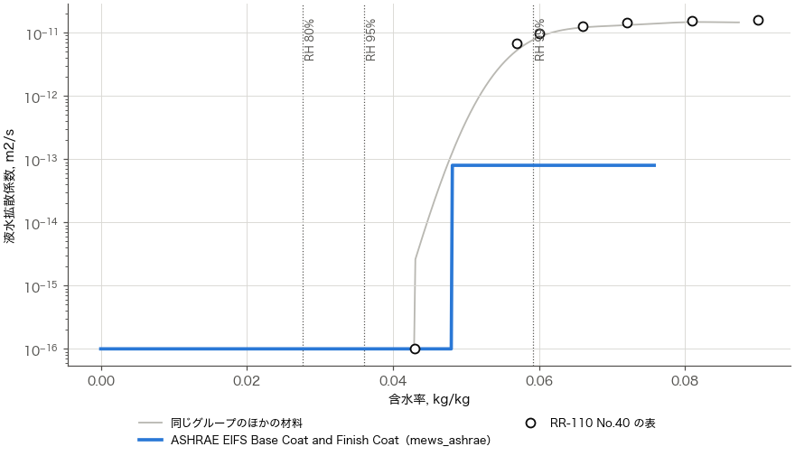
図 4-8　ASHRAE EIFS Base Coat and Finish Coat：液水拡散係数と含水率

**確かめること（優先：低）**：熱伝導率・比熱・平衡含水率・液水拡散係数は測っていない値。MEWS EIFS（RR-110 表 10.1）にそろえるか決める。

## 5. 壁紙

**文献の値**（建築学会 p88、IEA Annex 14 のカタログから）：6 種類の壁紙（繊維 2、ビニル 2、紙 2）。質量 0.15〜0.33 kg/m²、厚さ 0.28〜0.70 mm。平衡含水率（吸湿）は RH 52% で 0.023〜0.055、RH 86% で 0.048〜0.112、RH 97% で 0.13〜0.40（放湿はその 1.3〜6 倍）。湿気拡散厚 μd は、RH 33〜52% で 0.025〜2.14 m、RH 52〜98% で 0.006〜0.18 m で、湿度が高いと小さくなる。ビニル壁紙は、壁紙2（0.325 mm）が μd 2.14・0.18 m、壁紙4（0.45 mm）が 0.09・0.025 m。熱物性と液水拡散係数の値はない。

### 5.1 ASHRAE Vinyl Wallpaper（ASHRAE）

| 熱 | 平衡含水率 | 湿気伝導率 | 液水拡散係数 |
|---|---|---|---|
| 根拠なし | 根拠なし | 妥当 | 根拠なし |

**根拠**：ASHRAE RP-1018（Kumaran 2006 の 35 番、質量 約 170 g/m²、厚さ 0.205 mm）。密度 829 は 170 ÷ 0.205 で、論文と一致する（`ashrae_excel_derivation.md`）。**表 9 で測ったのは透湿・透気・吸水係数だけ**（熱伝導率・平衡含水率・液水拡散係数は計画になし）。平衡含水率の RH 100% の値 a = 1.0996 は、ASHRAE の #15 Felt・10/30/60 min Paper と同じ値。

**熱物性**：密度 829、熱伝導率 0.159、比熱 1250。RP-1018 では測っていない（根拠なし）。文献の壁紙の密度（ビニル 470〜660、繊維・紙 480〜690）より少し大きい。厚さ 0.2 mm の層なので、熱の計算への影響はほとんどない。

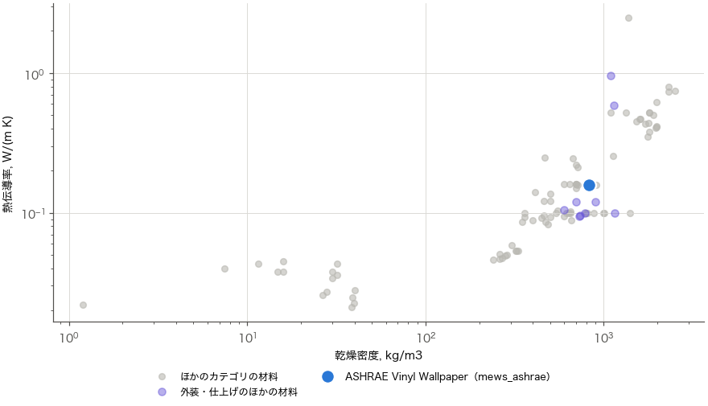
図 5-1　ASHRAE Vinyl Wallpaper：熱伝導率と乾燥密度

**平衡含水率**：RH 33% で 0.023、RH 52% で 0.044、RH 86% で 0.091、RH 97% で 0.144、RH 100% で 1.10（ψ 0.91）。RP-1018 では測っていない（根拠なし）が、文献のビニル壁紙（RH 52% で 0.023〜0.083、RH 86% で 0.048〜0.107、RH 97% で 0.13〜0.52）の範囲に入る。RH 100% の 1.10 は、#15 Felt や紙類と同じ値で、この材料の値ではない。

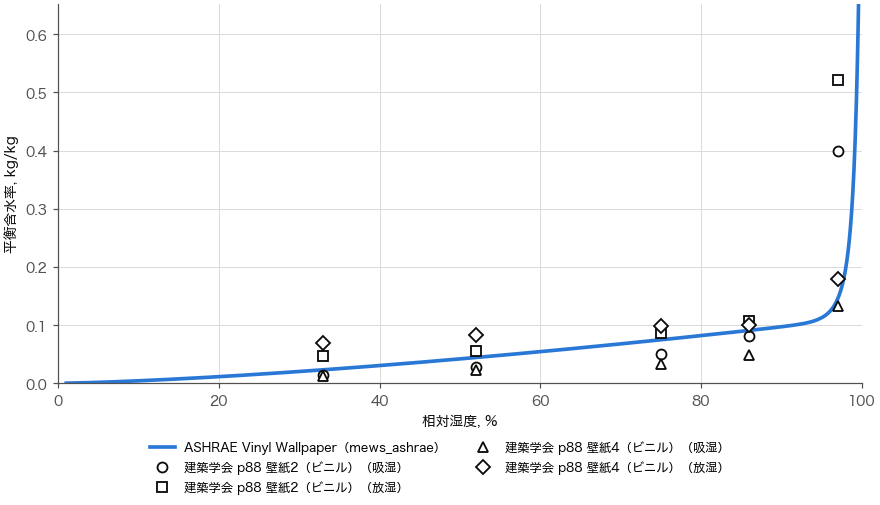
図 5-2　ASHRAE Vinyl Wallpaper：平衡含水率と相対湿度

**湿気伝導率**：RH 50% で 4.3×10⁻¹⁴（μ 4500、厚さ 0.205 mm で μd 0.92 m）、RH 90% で 9.4×10⁻¹⁴（μ 2050、μd 0.42 m）。RP-1018 で測った値。文献のビニル壁紙2（μd 2.14・0.18 m）と壁紙4（0.09・0.025 m）の間にあり、湿度が高いと通しやすくなる向きも同じ。妥当。

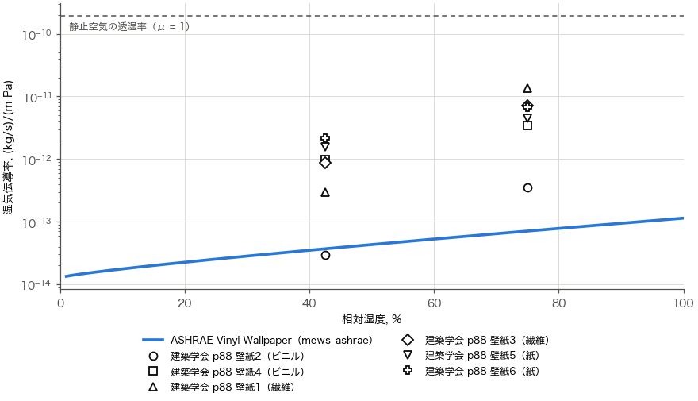
図 5-3　ASHRAE Vinyl Wallpaper：湿気伝導率と相対湿度

**液水拡散係数**：含水率 0.18（RH 約 98%）まで 10⁻¹⁶、それより上で 10⁻¹⁵〜10⁻¹⁴ 台。RP-1018 で測っていない（根拠なし）。値が非常に小さく、厚さも薄いので、計算への影響はほとんどない。

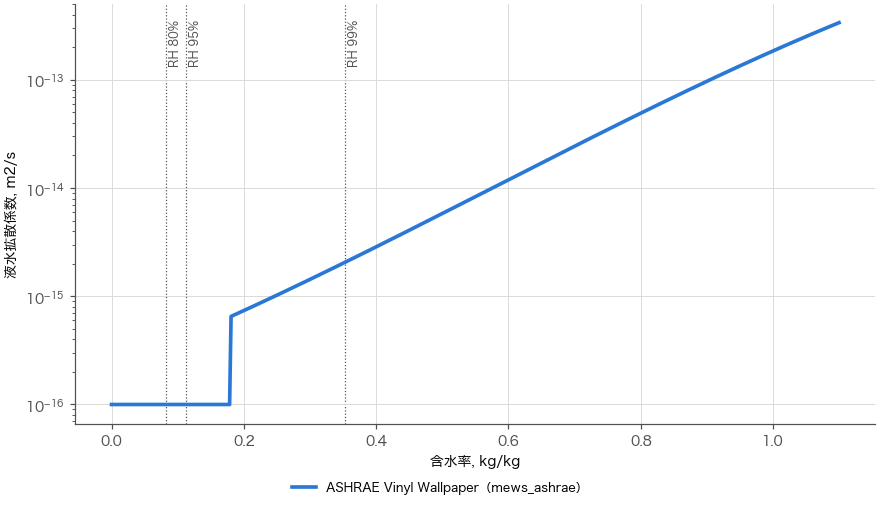
図 5-4　ASHRAE Vinyl Wallpaper：液水拡散係数と含水率

**確かめること（優先：低）**：平衡含水率の RH 100% の値 1.10 は紙類と同じで、RH 98% を超えると急に増える。壁紙の内側で結露する計算をするときは、この部分の影響を確かめる。
