# 材料物性レビュー ⑧ シート・紙類

作成: 2026-10-21（Claude Code による調査）
対象: 新しい Excel（`mews_ashrae`）の MEWS Building Membrane（IA、II、III、IVA、V A、V C、VI、VII、VIII、IX）、ASHRAE の #15 Felt・10 / 30 / 60 min Paper・Spun Bonded Polyolefin Membrane・Bonded Polyolefin Membrane (Crinkled)、合わせて 16 材料
比べた文献: 新しい Excel の出典 RR-110（4 章 Water Resistive Barriers）・Kumaran 2006（材料の説明と表 9）、建築学会『建築材料の熱・空気・湿気物性値』p76（新聞紙の平衡含水率）・p91（シート・防湿材）・p112（タイベック）、『最新建築環境工学』p21（表 7-2）。文献の目録は `sources.md`、書き写した数値は `ref_data/sheets.csv`（RR-110 の表は `mews_check/rr110_tables.py`）
図: `make_figures_sheets.py`

---

## 1. まとめ

判定の基準と図の見方は 2 章（共通のことは `01_wood_boards.md` 2 章）。

| 材料 | 熱 | 平衡含水率 | 湿気伝導率 | 液水拡散係数 | 主な点 | 節 |
|---|---|---|---|---|---|---|
| MEWS Building Membrane IA | 根拠なし | 根拠なし | 妥当 | 根拠なし | 湿気伝導率だけ出典の値。ほかは 0 または全製品で同じ値 | 3.1 |
| MEWS Building Membrane II | 根拠なし | 根拠なし | 妥当 | 根拠なし | 同上 | 3.2 |
| MEWS Building Membrane III | 根拠なし | 根拠なし | 妥当 | 根拠なし | 同上 | 3.3 |
| MEWS Building Membrane IVA | 根拠なし | 根拠なし | 妥当 | 根拠なし | 同上 | 3.4 |
| MEWS Building Membrane V A | 根拠なし | 根拠なし | 妥当 | 根拠なし | 同上（低湿で表の 0.79 倍） | 3.5 |
| MEWS Building Membrane V C | 根拠なし | 根拠なし | 妥当 | 根拠なし | 同上 | 3.6 |
| MEWS Building Membrane VI | 根拠なし | 根拠なし | 妥当 | 根拠なし | 同上（RH 10% だけ表の 0.08 倍）。湿度で透湿が 900 倍変わる膜 | 3.7 |
| MEWS Building Membrane VII | 根拠なし | 根拠なし | 妥当 | 根拠なし | 同上 | 3.8 |
| MEWS Building Membrane VIII | 根拠なし | 根拠なし | 妥当 | 根拠なし | 同上 | 3.9 |
| MEWS Building Membrane IX | 根拠なし | 根拠なし | 妥当 | 根拠なし | 同上 | 3.10 |
| ASHRAE #15 Felt | 根拠なし | 根拠なし | 妥当 | 妥当 | 平衡含水率は 4 材料でほぼ同じ曲線（測っていない） | 4.1 |
| ASHRAE 10 min Paper | 根拠なし | 根拠なし | 妥当 | 妥当 | 同上 | 4.2 |
| ASHRAE 30 min Paper | 根拠なし | 根拠なし | 妥当 | 妥当 | 同上 | 4.3 |
| ASHRAE 60 min Paper | 根拠なし | 根拠なし | 妥当 | 妥当 | 同上 | 4.4 |
| ASHRAE Spun Bonded Polyolefin Membrane | 根拠なし | 根拠なし | 妥当 | 要注意 | 液水拡散係数は RH 98% より上で 10⁻⁹ 台 | 5.1 |
| ASHRAE Bonded Polyolefin Membrane (Crinkled ) | 根拠なし | 根拠なし | 妥当 | 要注意 | 同上（10⁻¹⁰ 台） | 5.2 |

**主な結論**
- **出典で測ったのは透湿（と透気・吸水係数）だけ**。RR-110 4 章は「これらの製品は、透気・透湿・吸水係数だけを測った」、RP-1018 の表 9 も 6 種類のシートは同じ。16 材料とも、**湿気伝導率は出典の値と合い、妥当**（MEWS は表 4.2 のパーミアンス × 表 4.1 の厚さ、`mews_excel_derivation.md`）。文献のシート（タイベック μd 約 0.01〜0.05 m、アスファルトフェルト・クラフト紙・硫酸紙 μd 0.04〜0.4 m、ビチューメン紙 0.7〜8 m、ポリエチレンの防湿フィルム 27〜64 m）と比べると、16 材料は μd 0.04〜3 m で、**透湿防水シート・紙・フェルトの範囲。防湿フィルムのような材料はない**。
- **熱物性はどの材料も測っていない**。MEWS の 10 材料は全部が熱伝導率 0.1・比熱 1250、ASHRAE の紙・フェルトは 0.159・1256〜1260（Vinyl Wallpaper と同じ）、ポリオレフィンは 0.245〜0.248・1250。シートは厚さ 0.04〜0.72 mm なので、熱の計算への影響はほとんどない。
- **MEWS の 10 材料は、平衡含水率と液水拡散係数が 0**（RR-110 に値がない）。紙・フェルト系の製品なら実際は吸湿する（ASHRAE の紙で RH 50% 0.045）。厚さが薄いので、蓄える水の量としては小さい（0.2 mm、密度 1000 で RH 50% なら 0.01 kg/m² 程度）。
- **ASHRAE の紙・フェルト 4 材料の平衡含水率は、ほぼ同じ曲線**（差は 0.001 以下、RH 100% の値 a = 1.0996 は Vinyl Wallpaper とも同じ）。測っていない値で、新聞紙（建築学会 p76）の約半分。
- **ASHRAE の液水拡散係数**（RP-1018 では測っていない）は、RR-110 4 章の吸水係数（紙系 0.0005〜0.001、高分子系 0.0003 未満）から Künzel の式で求めた目安とよく合う（紙・フェルト 0.06〜1.0 倍、ポリオレフィン 0.9〜1.2 倍）。測った吸水係数から見積もった値の可能性がある。ポリオレフィンの値（RH 98% より上で 10⁻⁹ 台）は、高分子系の吸水係数の**上限**を使った目安と合うもので、実際はもっと小さいかもしれない（要注意）。

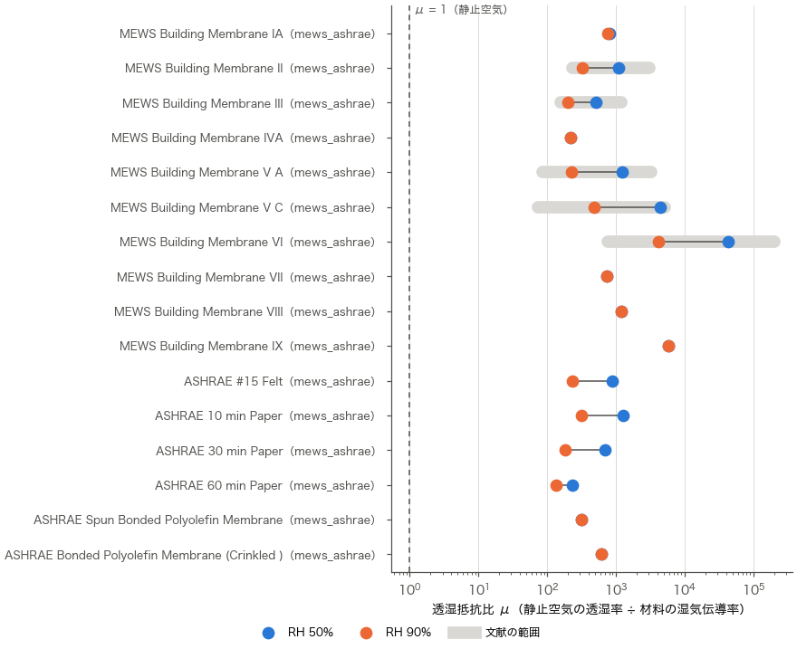
図 1-1　シート・紙類 16 材料の透湿抵抗比 μ。青は RH 50%、橙は RH 90%。灰色の帯は、RR-110 表 4.2 のパーミアンス × 表 4.1 の厚さから求めた μ の範囲（RH によらず一定の製品は帯にならない）。ASHRAE の 6 材料は、出典の表を手元に持っていないので帯がない。

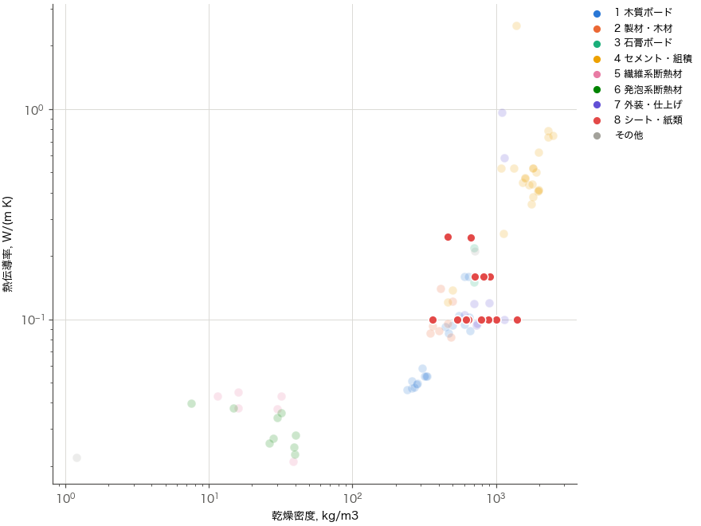
図 1-2　全 100 材料の熱伝導率と乾燥密度。濃い色の点がシート・紙類。MEWS の 10 材料は熱伝導率がすべて 0.1 で、横一列に並ぶ。シート・紙類の熱伝導率を比べられる文献は手元にない。

---

## 2. 見方

判定の 4 段階、指標（μ、ψ）、図の線・印の意味は `01_wood_boards.md` 2 章と同じ。この章では、このカテゴリに特有のことだけを書く。

- **MEWS のメンブレンの図は湿気伝導率だけ**：平衡含水率と液水拡散係数が 0 なので、図を描いても線が出ない。熱物性は 10 材料とも同じ値なので、まとめの図 1-2 で見る。
- **シートの透湿は、ふつう「パーミアンス」や「湿気拡散厚 μd」で表す**：μd = μ × 厚さ（m）。μd が大きいほど湿気を通しにくい。図は、ほかのカテゴリと同じく透湿率（湿気伝導率、= 静止空気の透湿率 × 厚さ ÷ μd）で描いた。文献の値は、厚さがわかるものだけ透湿率に直した。
- **MEWS のメンブレンの表の列**：RR-110 表 4.2 は、列と製品の対応が表から読み取れない（列の見出しが崩れている）。`mews_excel_derivation.md` の照合で、Excel の値に一番近い列を選んである。図の黒い星（RR-110 の表）は、その列 × 厚さ。
- **文献のシート**：湿気伝導率の図には、紙・フェルト系（最新 p21 のアスファルトフェルト・クラフト紙・硫酸紙、建築学会 p91 のビチューメン紙）と高分子系（建築学会 p112 のタイベック、p91・最新 p21 のポリエチレン）を全部重ねた。最新 p21 の表は測定の湿度が書かれていないので、RH 50% の位置に置いた。MEWS のメンブレンは製品の種類が書かれていないので、どの文献と比べるべきかは決められない（質量と厚さからの推定は各節に書いた）。
- **液水拡散係数の目安**：Künzel の式の吸水係数は、RR-110 4 章の「紙系（10・30・60 min Paper）は 0.0005〜0.001、高分子系はすべて 0.0003 未満」を使った。#15 Felt は紙系の値を借りた。高分子系は上限なので、目安も上限になる。
- 原典のページの画像は、非公開リポジトリ `docs/reference/papers/review_images/`（建築学会 p76・p91・p112、最新 p21、RR-110 p31〜32 表 4.1・4.2）。書き写した数値は、画像と見比べて確かめた。

---

## 3. MEWS Building Membrane（10 製品）

**文献の値**（RR-110 4 章）：外装の下に張る防水・透湿のシート（Water Resistive Barriers）。紙系（10・30・60 分紙、#15 フェルト）と高分子系（スパンボンドのポリオレフィン、ポリアセテート、穴あきポリエチレン）があるが、**表の I〜IX がどの製品かは書かれていない**。測ったのは透気（表 4.1）・透湿（表 4.2〜4.4、パーミアンス）・吸水係数（本文だけ）。厚さ 0.04〜0.65 mm、質量 55〜570 g/m²。Excel の密度は「質量 ÷ 厚さ」で、10 製品とも一致する。比熱 1250・熱伝導率 0.1 は報告書に値がない。

**MEWS の 10 材料に共通の判定**
- **熱物性（根拠なし）**：10 材料とも熱伝導率 0.1、比熱 1250。報告書に値がなく、出どころがわからない。厚さ 0.04〜0.65 mm なので、熱抵抗は 0.0004〜0.0065 m²·K/W で、壁の計算への影響はほとんどない。
- **平衡含水率（根拠なし）**：係数がすべて 0（どの湿度でも含水率 0）。報告書に値がない。紙系の製品なら、実際は ASHRAE の紙（RH 50% で 0.045）くらい吸湿するが、厚さが薄いので蓄える水の量は小さい。
- **液水拡散係数（根拠なし）**：範囲分け数 0（Excel の a は「測っていない」の印 ln(99999)）。液水が動かない設定。紙系の吸水係数 0.0005〜0.001 は、液水が少しは動くことを示すが、薄い膜なので影響は小さい。

### 3.1 MEWS Building Membrane IA（MEWS）

| 熱 | 平衡含水率 | 湿気伝導率 | 液水拡散係数 |
|---|---|---|---|
| 根拠なし | 根拠なし | 妥当 | 根拠なし |

**根拠**：厚さ 0.23 mm、質量 83 g/m²（密度 360）、透気 2.1 L/(75 Pa·m²·s)。パーミアンスは RH によらず一定 1.06×10⁻⁹（表 4.2）。軽くて空気を通すので、高分子の不織布の可能性がある。

**熱物性**：熱伝導率 0.1、比熱 1250（3 章の共通の判定）。

**平衡含水率**：どの湿度でも 0（3 章の共通の判定）。

**湿気伝導率**：2.4×10⁻¹³〜2.5×10⁻¹³（μ 760〜800、μd 0.18 m）。表の一定値 × 厚さ の 0.94〜1.05 倍で、妥当。

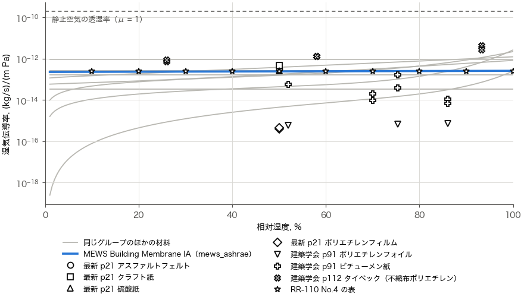
図 3-1　MEWS Building Membrane IA：湿気伝導率と相対湿度

**液水拡散係数**：液水が動かない設定（3 章の共通の判定）。

### 3.2 MEWS Building Membrane II（MEWS）

| 熱 | 平衡含水率 | 湿気伝導率 | 液水拡散係数 |
|---|---|---|---|
| 根拠なし | 根拠なし | 妥当 | 根拠なし |

**根拠**：厚さ 0.20 mm、質量 199 g/m²（密度 1000）。質量と厚さが ASHRAE の 30 min Paper（200 g/m²、0.22 mm）に近く、紙系の可能性がある。表 4.2 の列 A（RH 10% 3.2×10⁻¹⁰ → RH 100% 4.2×10⁻⁹）。

**熱物性**：熱伝導率 0.1、比熱 1250（3 章の共通の判定）。

**平衡含水率**：どの湿度でも 0（3 章の共通の判定）。

**湿気伝導率**：RH 50% で 1.75×10⁻¹³（μ 1110、μd 0.22 m）、RH 90% で 5.9×10⁻¹³（μ 330、μd 0.066 m）。表の 0.97〜1.08 倍で、妥当。湿度が高いと通しやすくなる向きは、ASHRAE の紙・文献のクラフト紙と同じ。

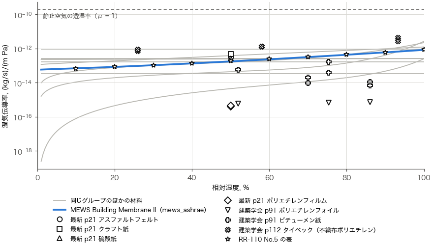
図 3-2　MEWS Building Membrane II：湿気伝導率と相対湿度

**液水拡散係数**：液水が動かない設定（3 章の共通の判定）。

### 3.3 MEWS Building Membrane III（MEWS）

| 熱 | 平衡含水率 | 湿気伝導率 | 液水拡散係数 |
|---|---|---|---|
| 根拠なし | 根拠なし | 妥当 | 根拠なし |

**根拠**：厚さ 0.20 mm、質量 202 g/m²（密度 1010）。II と同じく紙系の可能性がある。表 4.2 の列 B（RH 10% 8.2×10⁻¹⁰ → RH 100% 6.2×10⁻⁹）。

**熱物性**：熱伝導率 0.1、比熱 1250（3 章の共通の判定）。

**平衡含水率**：どの湿度でも 0（3 章の共通の判定）。

**湿気伝導率**：RH 50% で 3.8×10⁻¹³（μ 510、μd 0.10 m）、RH 90% で 9.7×10⁻¹³（μ 200、μd 0.040 m）。表の 0.92〜1.02 倍で、妥当。

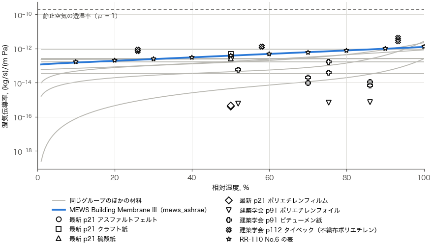
図 3-3　MEWS Building Membrane III：湿気伝導率と相対湿度

**液水拡散係数**：液水が動かない設定（3 章の共通の判定）。

### 3.4 MEWS Building Membrane IVA（MEWS）

| 熱 | 平衡含水率 | 湿気伝導率 | 液水拡散係数 |
|---|---|---|---|
| 根拠なし | 根拠なし | 妥当 | 根拠なし |

**根拠**：厚さ 0.31 mm、質量 199 g/m²（密度 640）、透気 0.51。パーミアンスは一定 2.87×10⁻⁹（表 4.2）。

**熱物性**：熱伝導率 0.1、比熱 1250（3 章の共通の判定）。

**平衡含水率**：どの湿度でも 0（3 章の共通の判定）。

**湿気伝導率**：一定 8.9×10⁻¹³（μ 218、μd 0.068 m）。表の一定値 × 厚さ と一致し、妥当。

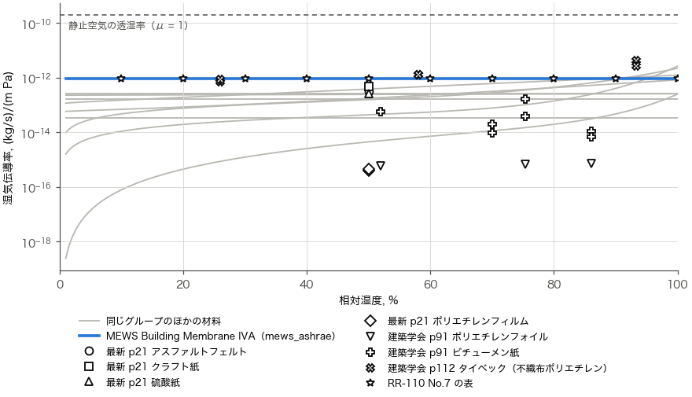
図 3-4　MEWS Building Membrane IVA：湿気伝導率と相対湿度

**液水拡散係数**：液水が動かない設定（3 章の共通の判定）。

### 3.5 MEWS Building Membrane V A（MEWS）

| 熱 | 平衡含水率 | 湿気伝導率 | 液水拡散係数 |
|---|---|---|---|
| 根拠なし | 根拠なし | 妥当 | 根拠なし |

**根拠**：厚さ 0.64 mm、質量 521 g/m²（密度 810）。質量と厚さが ASHRAE の #15 Felt（515 g/m²、0.72 mm）に近く、フェルトの可能性がある。表 4.2 の列 D（RH 10% 9.3×10⁻¹¹ → RH 100% 3.5×10⁻⁹）。

**熱物性**：熱伝導率 0.1、比熱 1250（3 章の共通の判定）。

**平衡含水率**：どの湿度でも 0（3 章の共通の判定）。

**湿気伝導率**：RH 50% で 1.56×10⁻¹³（μ 1240、μd 0.79 m）、RH 90% で 8.6×10⁻¹³（μ 226、μd 0.15 m）。表の 0.79〜1.14 倍（低湿でずれが大きい）で、妥当。ASHRAE #15 Felt（μ 894・230）、文献のアスファルトフェルト（μ 約 620）と同じ大きさ。

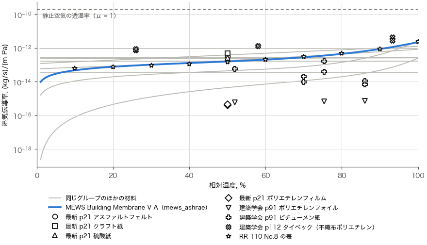
図 3-5　MEWS Building Membrane V A：湿気伝導率と相対湿度

**液水拡散係数**：液水が動かない設定（3 章の共通の判定）。

### 3.6 MEWS Building Membrane V C（MEWS）

| 熱 | 平衡含水率 | 湿気伝導率 | 液水拡散係数 |
|---|---|---|---|
| 根拠なし | 根拠なし | 妥当 | 根拠なし |

**根拠**：厚さ 0.65 mm、質量 570 g/m²（密度 880）。V A と同じくフェルトの可能性がある。表 4.2 の列 F（RH 50〜100% の 6 点、RH 50% 5.9×10⁻¹¹ → RH 100% 4.0×10⁻⁹）。

**熱物性**：熱伝導率 0.1、比熱 1250（3 章の共通の判定）。

**平衡含水率**：どの湿度でも 0（3 章の共通の判定）。

**湿気伝導率**：RH 50% で 4.3×10⁻¹⁴（μ 4490、μd 2.9 m）、RH 90% で 4.0×10⁻¹³（μ 482、μd 0.31 m）。表の 0.88〜1.13 倍で、妥当。RH 50% より下は表に値がなく、当てはめの外挿。

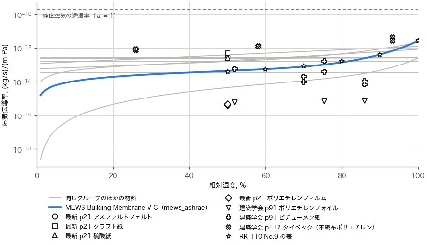
図 3-6　MEWS Building Membrane V C：湿気伝導率と相対湿度

**液水拡散係数**：液水が動かない設定（3 章の共通の判定）。

### 3.7 MEWS Building Membrane VI（MEWS）

| 熱 | 平衡含水率 | 湿気伝導率 | 液水拡散係数 |
|---|---|---|---|
| 根拠なし | 根拠なし | 妥当 | 根拠なし |

**根拠**：厚さ 0.04 mm、質量 55 g/m²（密度 1400）、**空気を通さない**。表 4.2 の列 G（RH 0% 7.1×10⁻¹² → RH 100% 6.3×10⁻⁹、RH 90〜100% は 1% ごと）。湿度で透湿が約 900 倍変わる、湿度で性質が変わる高分子の膜と見られる。

**熱物性**：熱伝導率 0.1、比熱 1250（3 章の共通の判定）。

**平衡含水率**：どの湿度でも 0（3 章の共通の判定）。

**湿気伝導率**：RH 50% で 4.5×10⁻¹⁵（μ 43400、μd 1.7 m）、RH 90% で 4.7×10⁻¹⁴（μ 4130、μd 0.17 m）。表の 0.08〜1.13 倍で、RH 10% だけ 0.08 倍と大きくずれる（ほかは中央 0.99）。RH 10% の値はもともと小さく、計算への影響は小さいので妥当とした。16 材料でいちばん湿気を通しにくいが、ポリエチレンの防湿フィルム（μd 27〜64 m）よりは 1〜2 桁通しやすい。

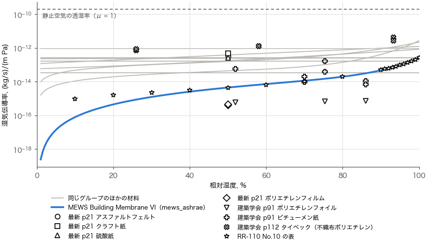
図 3-7　MEWS Building Membrane VI：湿気伝導率と相対湿度

**液水拡散係数**：液水が動かない設定（3 章の共通の判定）。

### 3.8 MEWS Building Membrane VII（MEWS）

| 熱 | 平衡含水率 | 湿気伝導率 | 液水拡散係数 |
|---|---|---|---|
| 根拠なし | 根拠なし | 妥当 | 根拠なし |

**根拠**：厚さ 0.11 mm、質量 68 g/m²（密度 620）、透気 0.0033（ほぼ通さない）。パーミアンスは一定 2.37×10⁻⁹。質量と厚さが ASHRAE の Crinkled Polyolefin（67 g/m²、約 0.1 mm）に近い。

**熱物性**：熱伝導率 0.1、比熱 1250（3 章の共通の判定）。

**平衡含水率**：どの湿度でも 0（3 章の共通の判定）。

**湿気伝導率**：一定 2.6×10⁻¹³（μ 745、μd 0.082 m）。表の一定値 × 厚さ と一致し、妥当。ASHRAE の Crinkled Polyolefin（μ 625）と近い。

図 3-8　MEWS Building Membrane VII：湿気伝導率と相対湿度

**液水拡散係数**：液水が動かない設定（3 章の共通の判定）。

### 3.9 MEWS Building Membrane VIII（MEWS）

| 熱 | 平衡含水率 | 湿気伝導率 | 液水拡散係数 |
|---|---|---|---|
| 根拠なし | 根拠なし | 妥当 | 根拠なし |

**根拠**：厚さ 0.15 mm、質量 81 g/m²（密度 540）、透気 4.3（10 製品でいちばん空気を通す）。パーミアンスは一定 1.07×10⁻⁹。質量と厚さが ASHRAE の Spun Bonded Polyolefin（65 g/m²、0.14〜0.15 mm）に近いが、μ は 4 倍違う。

**熱物性**：熱伝導率 0.1、比熱 1250（3 章の共通の判定）。

**平衡含水率**：どの湿度でも 0（3 章の共通の判定）。

**湿気伝導率**：一定 1.6×10⁻¹³（μ 1210、μd 0.18 m）。表の一定値 × 厚さ と一致し、妥当。

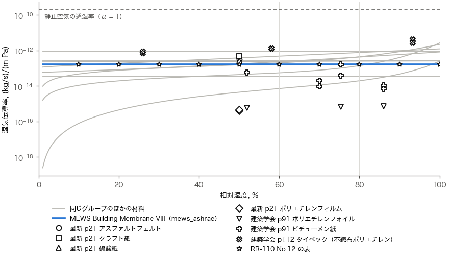
図 3-9　MEWS Building Membrane VIII：湿気伝導率と相対湿度

**液水拡散係数**：液水が動かない設定（3 章の共通の判定）。

### 3.10 MEWS Building Membrane IX（MEWS）

| 熱 | 平衡含水率 | 湿気伝導率 | 液水拡散係数 |
|---|---|---|---|
| 根拠なし | 根拠なし | 妥当 | 根拠なし |

**根拠**：厚さ 0.12 mm、質量 95 g/m²（密度 790）、透気 0.62。パーミアンスは一定 2.77×10⁻¹⁰（10 製品でいちばん小さい一定値）。

**熱物性**：熱伝導率 0.1、比熱 1250（3 章の共通の判定）。

**平衡含水率**：どの湿度でも 0（3 章の共通の判定）。

**湿気伝導率**：一定 3.3×10⁻¹⁴（μ 5870、μd 0.70 m）。表の一定値 × 厚さ と一致し、妥当。

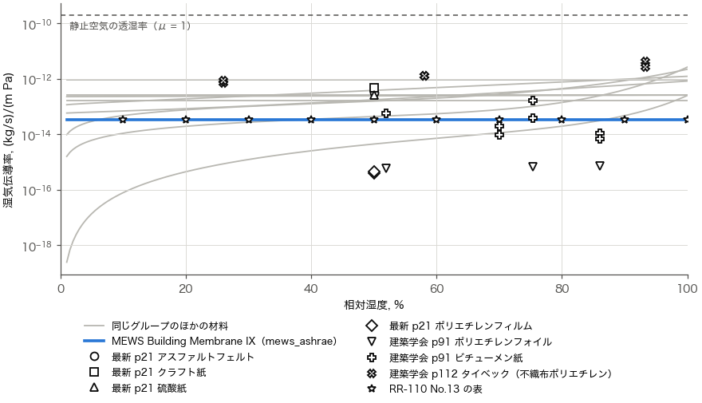
図 3-10　MEWS Building Membrane IX：湿気伝導率と相対湿度

**液水拡散係数**：液水が動かない設定（3 章の共通の判定）。

**MEWS の 10 材料で直す・確かめること（優先：低）**：平衡含水率・熱物性に値がない。紙・フェルト系と見られる製品（II、III、V A、V C）は、ASHRAE の紙・フェルトの平衡含水率を借りるかを決める。0 のままでも、薄い膜なので計算への影響は小さい。

## 4. ASHRAE の紙・フェルト（#15 Felt、10・30・60 min Paper）

**文献の値**：Kumaran 2006 の材料の説明は、#15 Felt が 515 g/m²・0.72 mm、10 min Paper が 170 g/m²・0.20 mm、30 min Paper が 200 g/m²・0.22 mm、60 min Paper が 280 g/m²・0.34 mm（Excel の密度はこの「質量 ÷ 厚さ」と一致）。表 9 で測ったのは透湿・透気・吸水係数だけ。RR-110 4 章では、紙系の吸水係数は 0.0005〜0.001。手元の文献では、アスファルトフェルト（0.7 mm、μ 約 620）、クラフト紙（0.1 mm、μ 約 410）、硫酸紙（0.06 mm、μ 約 740）（最新 p21）、ビチューメン紙（建築学会 p91、μd 0.7〜8.1 m）。紙の平衡含水率は、建築学会 p76 のセルロース断熱材の出典 [2] の新聞紙（RH 52% で 0.09、RH 86% で 0.17）。

**4 材料に共通**
- **熱物性（根拠なし）**：熱伝導率 0.159、比熱 1256〜1260。RP-1018 で測っていない。Vinyl Wallpaper（⑦）と同じ熱伝導率で、出どころがわからない。厚さ 0.2〜0.7 mm なので、影響はほとんどない。
- **平衡含水率（根拠なし）**：4 材料の曲線はほぼ同じ（どの湿度でも差は 0.001 以下）で、RH 100% の値 a = 1.0996 は Vinyl Wallpaper とも同じ。RP-1018 で測っていない値。RH 52% で 0.045、RH 86% で 0.090、RH 97% で 0.144、RH 100% で 1.10。新聞紙の約半分で、アスファルトを含むフェルト・紙なら小さめなのはもっともらしい。
- **液水拡散係数**：含水率 0.18（RH 約 98%）まで 10⁻¹⁶、それより上で 10⁻¹⁵〜10⁻¹² 台。RP-1018 で測っていないが、紙系の吸水係数（0.0005〜0.001）からの目安とよく合う（RH 99% で 0.06〜1.0 倍）。測った吸水係数から見積もった値の可能性がある。目安との比で判定し、妥当とした。

### 4.1 ASHRAE #15 Felt（ASHRAE）

| 熱 | 平衡含水率 | 湿気伝導率 | 液水拡散係数 |
|---|---|---|---|
| 根拠なし | 根拠なし | 妥当 | 妥当 |

**根拠**：Kumaran 2006 の 29 番（515 g/m²、0.72 mm、密度 715）。

**熱物性**：4 章の共通の判定（熱伝導率 0.159、測っていない）。

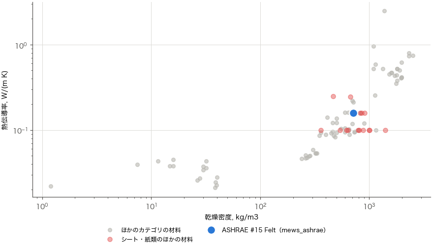
図 4-1　ASHRAE #15 Felt：熱伝導率と乾燥密度

**平衡含水率**：4 章の共通の判定（4 材料でほぼ同じ曲線、測っていない）。

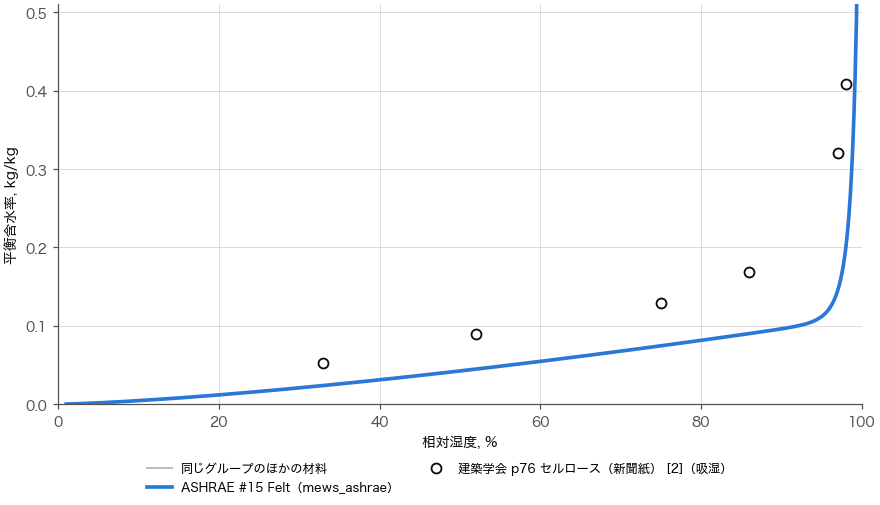
図 4-2　ASHRAE #15 Felt：平衡含水率と相対湿度

**湿気伝導率**：RH 50% で 2.2×10⁻¹³（μ 894、μd 0.64 m）、RH 90% で 8.4×10⁻¹³（μ 230、μd 0.17 m）。文献のアスファルトフェルト（μ 約 620）と同じ大きさで、ビチューメン紙（μd 0.7〜8.1 m）より通しやすい。妥当。

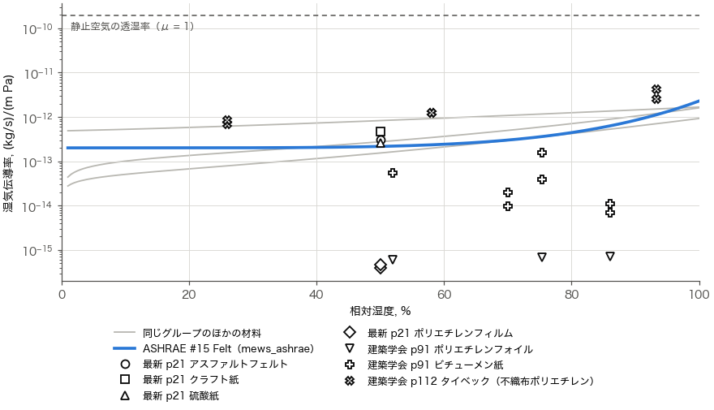
図 4-3　ASHRAE #15 Felt：湿気伝導率と相対湿度

**液水拡散係数**：RH 99%（0.356）で 1.2×10⁻¹⁴。紙系の吸水係数からの目安（5.4×10⁻¹⁴〜2.2×10⁻¹³）の 0.06〜0.22 倍（フェルトの吸水係数はないので紙系の値を借りた）。妥当。

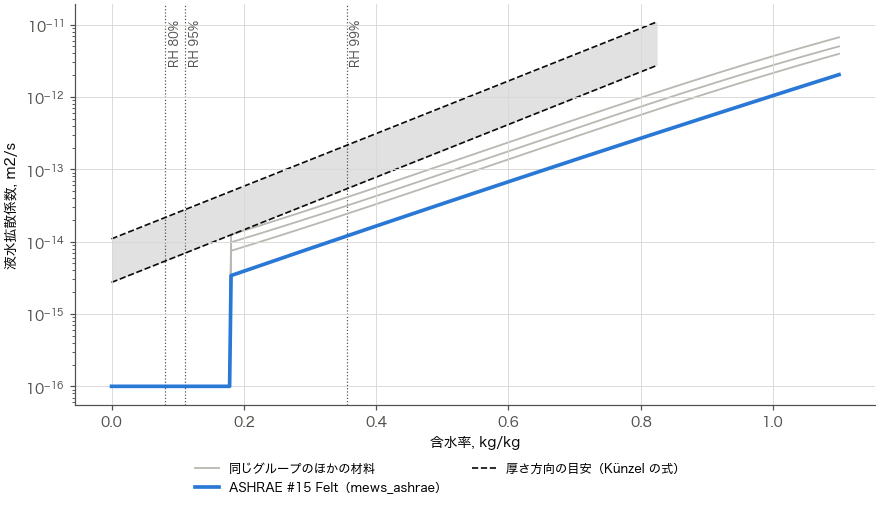
図 4-4　ASHRAE #15 Felt：液水拡散係数と含水率

### 4.2 ASHRAE 10 min Paper（ASHRAE）

| 熱 | 平衡含水率 | 湿気伝導率 | 液水拡散係数 |
|---|---|---|---|
| 根拠なし | 根拠なし | 妥当 | 妥当 |

**根拠**：Kumaran 2006 の 30 番（170 g/m²、0.20 mm、密度 850）。

**熱物性**：4 章の共通の判定（熱伝導率 0.159、測っていない）。

図 4-5　ASHRAE 10 min Paper：熱伝導率と乾燥密度

**平衡含水率**：4 章の共通の判定（4 材料でほぼ同じ曲線、測っていない）。

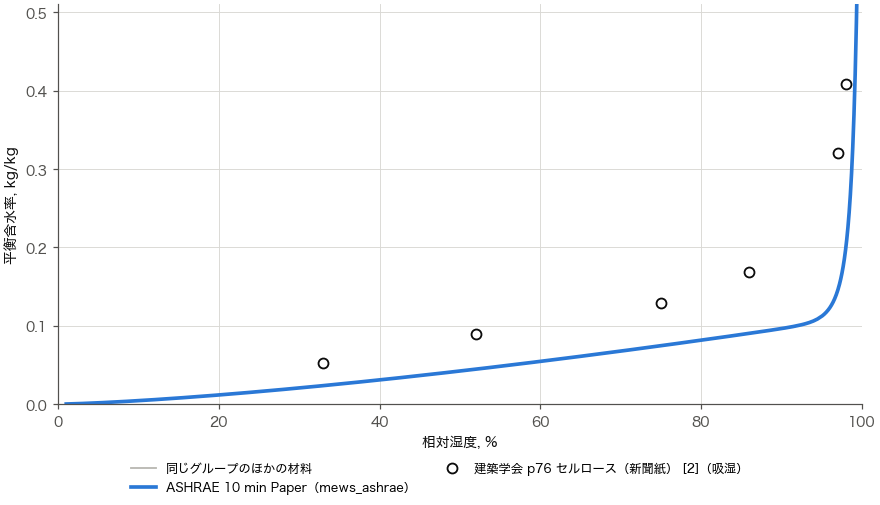
図 4-6　ASHRAE 10 min Paper：平衡含水率と相対湿度

**湿気伝導率**：RH 50% で 1.5×10⁻¹³（μ 1260、μd 0.25 m）、RH 90% で 6.2×10⁻¹³（μ 314、μd 0.063 m）。文献のクラフト紙（μ 約 410）・硫酸紙（約 740）と同じ大きさ。妥当。

図 4-7　ASHRAE 10 min Paper：湿気伝導率と相対湿度

**液水拡散係数**：RH 99%（0.355）で 3.1×10⁻¹⁴。目安（3.8×10⁻¹⁴〜1.5×10⁻¹³）の 0.21〜0.82 倍。妥当。

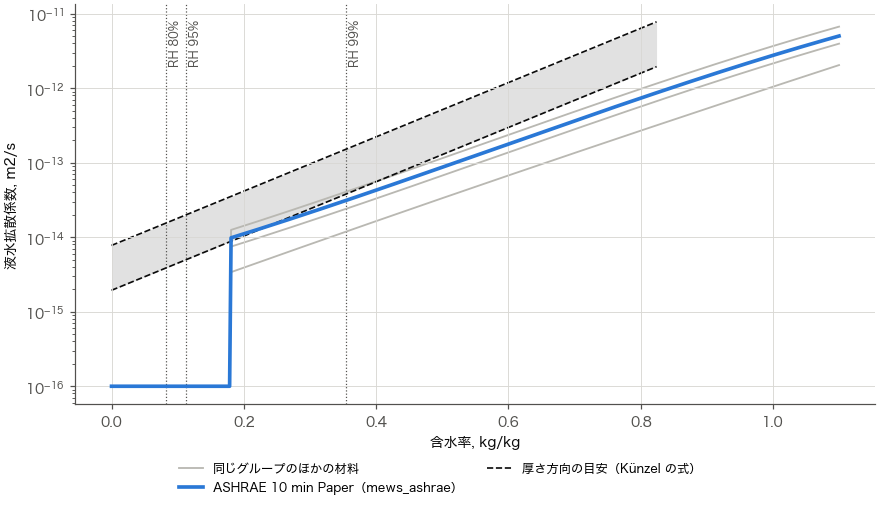
図 4-8　ASHRAE 10 min Paper：液水拡散係数と含水率

### 4.3 ASHRAE 30 min Paper（ASHRAE）

| 熱 | 平衡含水率 | 湿気伝導率 | 液水拡散係数 |
|---|---|---|---|
| 根拠なし | 根拠なし | 妥当 | 妥当 |

**根拠**：Kumaran 2006 の 31 番（200 g/m²、0.22 mm、密度 909）。

**熱物性**：4 章の共通の判定（熱伝導率 0.159、測っていない）。

図 4-9　ASHRAE 30 min Paper：熱伝導率と乾燥密度

**平衡含水率**：4 章の共通の判定（4 材料でほぼ同じ曲線、測っていない）。

図 4-10　ASHRAE 30 min Paper：平衡含水率と相対湿度

**湿気伝導率**：RH 50% で 2.8×10⁻¹³（μ 702、μd 0.15 m）、RH 90% で 1.0×10⁻¹²（μ 186、μd 0.041 m）。文献の紙と同じ大きさで、妥当。MEWS Building Membrane II・III（μ 510〜1110 → 200〜330）とも近い。

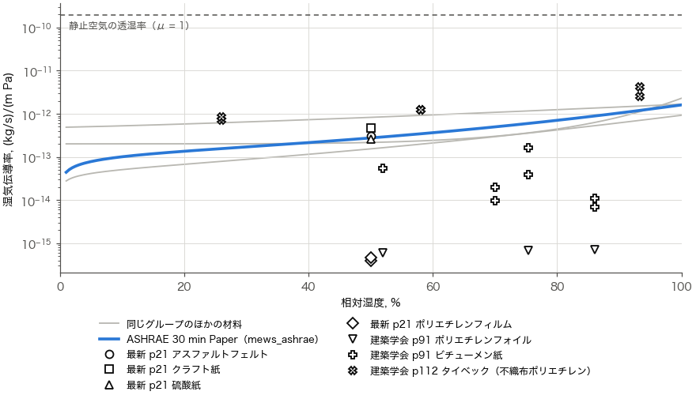
図 4-11　ASHRAE 30 min Paper：湿気伝導率と相対湿度

**液水拡散係数**：RH 99%（0.354）で 2.4×10⁻¹⁴。目安（3.3×10⁻¹⁴〜1.3×10⁻¹³）の 0.18〜0.73 倍。妥当。

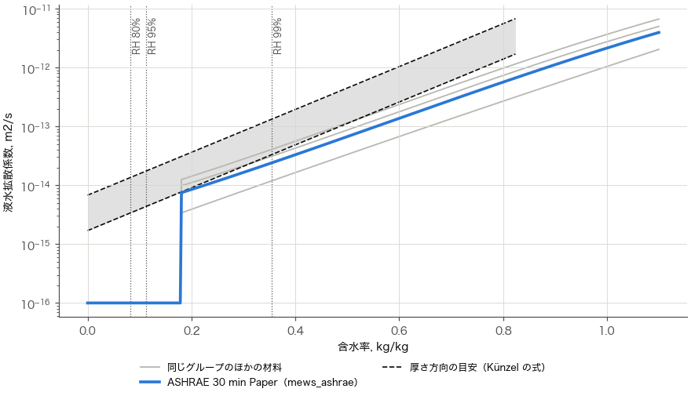
図 4-12　ASHRAE 30 min Paper：液水拡散係数と含水率

### 4.4 ASHRAE 60 min Paper（ASHRAE）

| 熱 | 平衡含水率 | 湿気伝導率 | 液水拡散係数 |
|---|---|---|---|
| 根拠なし | 根拠なし | 妥当 | 妥当 |

**根拠**：Kumaran 2006 の 32 番（280 g/m²、0.34 mm、密度 823）。

**熱物性**：4 章の共通の判定（熱伝導率 0.159、測っていない）。

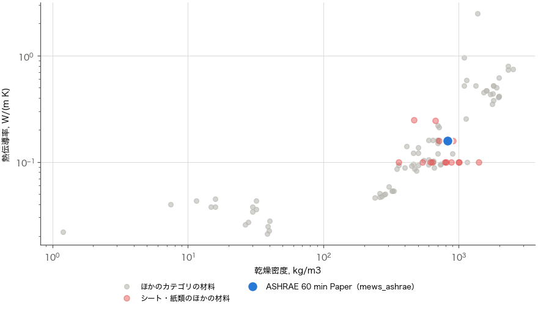
図 4-13　ASHRAE 60 min Paper：熱伝導率と乾燥密度

**平衡含水率**：4 章の共通の判定（4 材料でほぼ同じ曲線、測っていない）。

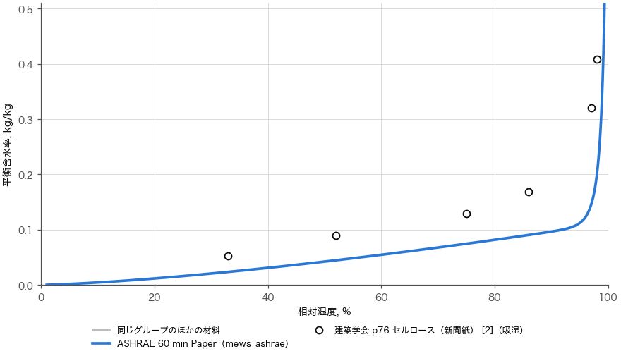
図 4-14　ASHRAE 60 min Paper：平衡含水率と相対湿度

**湿気伝導率**：RH 50% で 8.3×10⁻¹³（μ 234、μd 0.080 m）、RH 90% で 1.4×10⁻¹²（μ 135、μd 0.046 m）。紙・フェルトの 4 材料でいちばん湿気を通しやすいが、文献のクラフト紙（μ 約 410）と同じ大きさ。妥当。

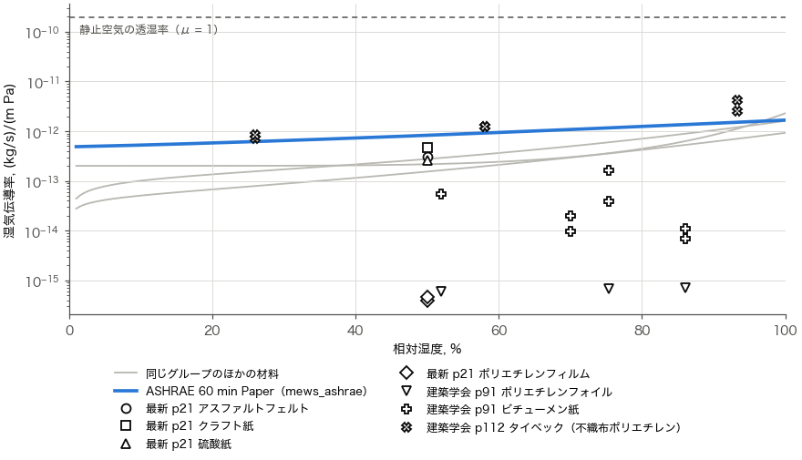
図 4-15　ASHRAE 60 min Paper：湿気伝導率と相対湿度

**液水拡散係数**：RH 99%（0.354）で 4.1×10⁻¹⁴。目安（4.0×10⁻¹⁴〜1.6×10⁻¹³）の 0.25〜1.0 倍。妥当。

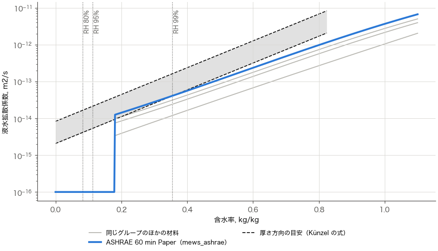
図 4-16　ASHRAE 60 min Paper：液水拡散係数と含水率

**4 材料で確かめること（優先：低）**：平衡含水率が 4 材料（と Vinyl Wallpaper）でほぼ同じなのは、測っていない物性に共通の値を入れたためと見られる。RP-1018 の最終報告書に値があれば、それと比べる。

## 5. ASHRAE のポリオレフィン（スパンボンド、Crinkled）

**文献の値**：Kumaran 2006 の材料の説明は、Spun Bonded Polyolefin が 65 g/m²・0.14〜0.15 mm、Crinkled（表面にしわをつけたもの）が 67 g/m²・約 0.1 mm。表 9 で測ったのは透湿・透気・吸水係数だけ。RR-110 4 章では、高分子系の吸水係数はすべて 0.0003 未満。建築学会 p112 のタイベック（不織布ポリエチレン、厚さ 0.2 mm、25 ℃）の透湿率は、平均 RH 26% で 7.0〜8.3×10⁻¹³、58% で 1.25×10⁻¹²、93% で 2.6〜4.2×10⁻¹²（μ 46〜280）。

**2 材料に共通**
- **熱物性（根拠なし）**：熱伝導率 0.245〜0.248、比熱 1250。RP-1018 で測っていない。厚さ 0.1〜0.15 mm で、影響はほとんどない。
- **平衡含水率（根拠なし）**：RH 50% で 0.005、RH 95% で 0.019〜0.021、RH 100% で 0.027〜0.030。RP-1018 で測っていない。ポリオレフィンはほとんど吸湿しないので、小さい値はもっともらしい。
- **液水拡散係数（要注意）**：含水率 0.023〜0.026（RH 約 98%）まで 10⁻¹⁶、それより上で 10⁻¹⁰〜10⁻⁹ 台。RP-1018 で測っていない。高分子系の吸水係数の上限 0.0003 からの目安と合う（RH 99% で 0.9〜1.2 倍）が、上限との一致なので、実際はもっと小さい可能性がある。ポリオレフィンの透湿防水シートは液水を通さないための材料で、RH 98% を超えると急に液水が動く設定は、材料の性質に合わない。ただし含水率の幅が 0.003 と非常に狭いので、動く水の量は小さい。

### 5.1 ASHRAE Spun Bonded Polyolefin Membrane（ASHRAE）

| 熱 | 平衡含水率 | 湿気伝導率 | 液水拡散係数 |
|---|---|---|---|
| 根拠なし | 根拠なし | 妥当 | 要注意 |

**根拠**：Kumaran 2006 の 33 番（65 g/m²、0.14〜0.15 mm、密度 464）。湿気伝導率は一定値（係数 b〜d が 0）。

**熱物性**：5 章の共通の判定（熱伝導率 0.245〜0.248、測っていない）。

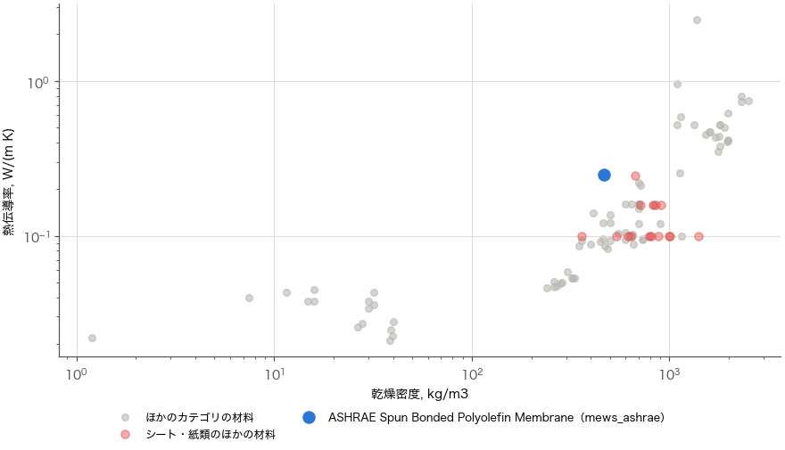
図 5-1　ASHRAE Spun Bonded Polyolefin Membrane：熱伝導率と乾燥密度

**平衡含水率**：5 章の共通の判定（RH 100% で 0.03 以下、測っていない）。

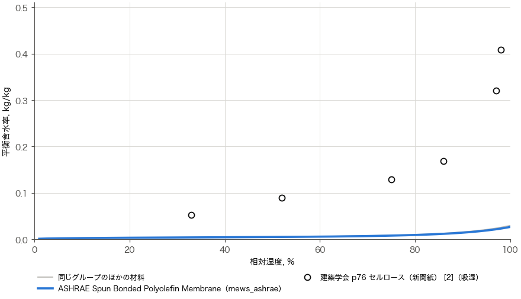
図 5-2　ASHRAE Spun Bonded Polyolefin Membrane：平衡含水率と相対湿度

**湿気伝導率**：一定 6.1×10⁻¹³（μ 318、μd 0.046 m）。文献のタイベックの低湿の値（7.0〜8.3×10⁻¹³）と合う。タイベックは湿度が高いと 4〜7 倍通しやすくなるが、Excel は一定。妥当。

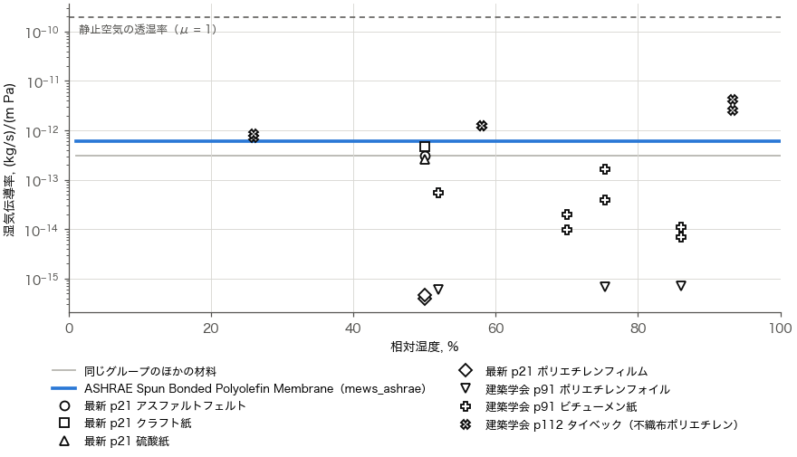
図 5-3　ASHRAE Spun Bonded Polyolefin Membrane：湿気伝導率と相対湿度

**液水拡散係数**：RH 99%（0.025）で 1.9×10⁻⁹。目安（吸水係数の上限 0.0003 で 1.6×10⁻⁹）の 1.2 倍（5 章の共通の判定、要注意）。

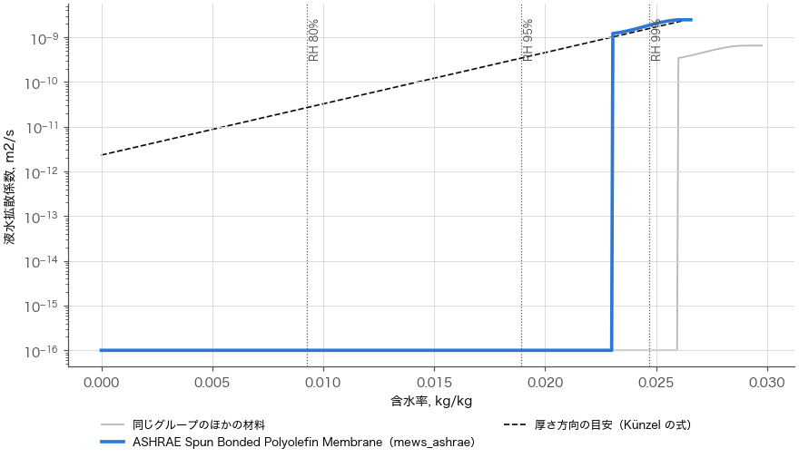
図 5-4　ASHRAE Spun Bonded Polyolefin Membrane：液水拡散係数と含水率

### 5.2 ASHRAE Bonded Polyolefin Membrane (Crinkled )（ASHRAE）

| 熱 | 平衡含水率 | 湿気伝導率 | 液水拡散係数 |
|---|---|---|---|
| 根拠なし | 根拠なし | 妥当 | 要注意 |

**根拠**：Kumaran 2006 の 34 番（67 g/m²、約 0.1 mm、密度 670）。湿気伝導率は一定値。材料名の最後に空白が入っている（Excel のとおり）。

**熱物性**：5 章の共通の判定（熱伝導率 0.245〜0.248、測っていない）。

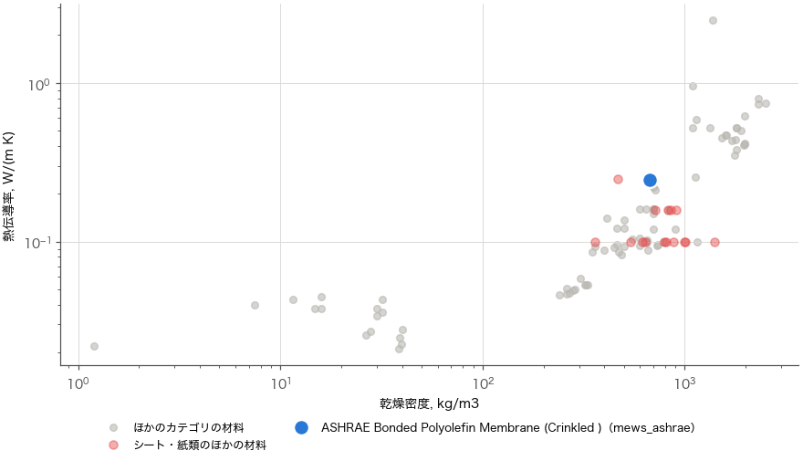
図 5-5　ASHRAE Bonded Polyolefin Membrane (Crinkled )：熱伝導率と乾燥密度

**平衡含水率**：5 章の共通の判定（RH 100% で 0.03 以下、測っていない）。

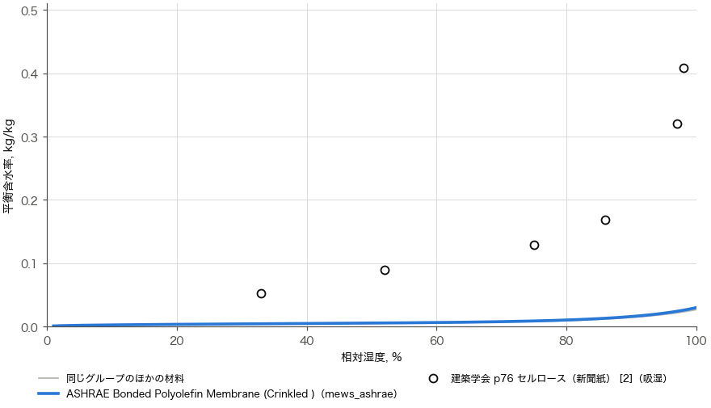
図 5-6　ASHRAE Bonded Polyolefin Membrane (Crinkled )：平衡含水率と相対湿度

**湿気伝導率**：一定 3.1×10⁻¹³（μ 625、μd 0.063 m）。文献のタイベックより少し湿気を通しにくいが、同じ大きさ。MEWS Building Membrane VII（μ 745）と近い。妥当。

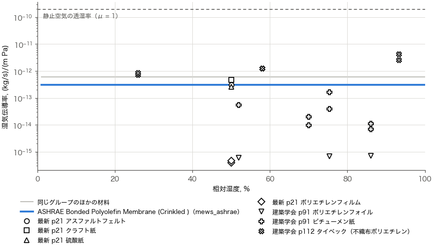
図 5-7　ASHRAE Bonded Polyolefin Membrane (Crinkled )：湿気伝導率と相対湿度

**液水拡散係数**：RH 99%（0.028）で 5.2×10⁻¹⁰。目安（5.9×10⁻¹⁰）の 0.9 倍（5 章の共通の判定、要注意）。

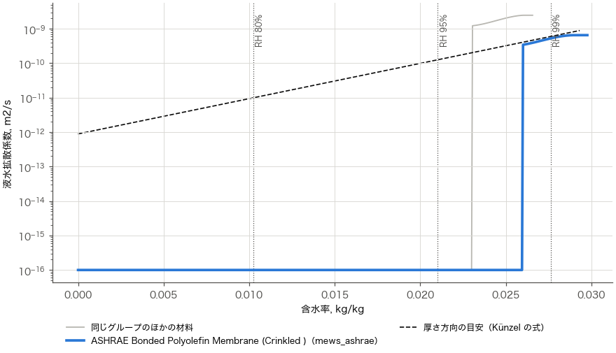
図 5-8　ASHRAE Bonded Polyolefin Membrane (Crinkled )：液水拡散係数と含水率

**2 材料で確かめること（優先：低）**：液水拡散係数を、液水を通さない設定（0）にするか決める。透湿防水シートは液水を止めるのが役目で、今の値では RH 98% を超えると液水が動く。
